# Colophon 基本設計書

日本語 | [English](basic-design.md)

| 項目 | 内容 |
|---|---|
| 対象 | Colophon 1.0.0（DB スキーマ v3／エクスポート形式 v1） |
| 文書の位置づけ | アプリが「何を」「どのように振る舞うか」を定める。実装上のクラス・メソッド・SQL は [詳細設計書](detail-design.ja.md) で扱う |
| 作成日 | 2026-10-14 |

## 改訂履歴

| 版 | 日付 | 内容 |
|---|---|---|
| 1.0 | 2026-10-14 | 初版 |
| 1.1 | 2026-10-14 | 配色テーマ（6種類）と明るさの設定、ステータスのアイコンを追加 |
| 1.2 | 2026-10-14 | テキストのエクスポートに書影を含めるオプションを追加 |
| 1.3 | 2026-10-14 | ISBN 取得の取得元から Google Books を外し、Open Library・米国議会図書館・フランス国立図書館・ドイツ国立図書館を追加（ISBN の国番号で問い合わせ順を決める） |
| 1.4 | 2026-10-14 | ノートのお気に入りを追加（編集画面・検索結果で切り替え、検索で絞り込み、テキストのエクスポートに★） |
| 1.5 | 2026-10-15 | 書籍のビューアモード（見る専用）を追加（登録済みの書籍は保存後にビューアへ戻る）。日付を年付きで表示 |
| 1.6 | 2026-10-15 | 設定画面に「すべてのデータを削除」を追加。各 OS の配布形式とアンインストール時のデータの扱いを追記 |
| 1.7 | 2026-10-15 | アプリアイコンを追加（非機能要件の「見分けやすさ」） |

## 目次

1. [システム概要](#1-システム概要)
2. [機能一覧](#2-機能一覧)
3. [ユースケース](#3-ユースケース)
4. [システム構成](#4-システム構成)
5. [画面設計](#5-画面設計)
6. [データ設計](#6-データ設計)
7. [状態遷移](#7-状態遷移)
8. [主要処理の流れ](#8-主要処理の流れ)
9. [外部インタフェース](#9-外部インタフェース)
10. [非機能要件](#10-非機能要件)
11. [制約・既知の制限](#11-制約既知の制限)
12. [将来拡張（未実装）](#12-将来拡張未実装)

> 図は [Mermaid](https://mermaid.js.org/) で記述している。GitHub ではそのまま図として表示される。VS Code のプレビューで見る場合は拡張機能「Markdown Preview Mermaid Support」を入れる。

---

## 1. システム概要

### 1.1 目的

本好きの個人が、自分の蔵書と読書の記録を1か所で管理できるようにする。書籍の基本情報に加え、読書の進み具合、何度読んだか、読みながら得た感想や学び・抜粋を残し、あとから検索して見返せることを目的とする。

### 1.2 対象利用者

- 紙・電子を問わず本を読む個人（専門知識は不要）
- 複数の言語圏の利用者（7言語の表示に対応）

### 1.3 動作環境

| 区分 | 内容 |
|---|---|
| 対応OS（現行） | Windows 10/11、macOS、Linux（いずれも64bit） |
| 対応OS（将来） | iPhone / iPad、Android スマートフォン / タブレット |
| ネットワーク | 原則不要。ISBN からの書籍情報取得のときだけ使う |
| データの保存先 | 端末内（SQLite データベース1ファイル） |

### 1.4 用語

| 用語 | 意味 |
|---|---|
| 書影 | 本の表紙の画像 |
| ノート | 書籍ごとに付ける自由記述のメモ。分類とページを任意で付けられる |
| 読了日 | その本を読み終えた日。再読に備えて1冊に複数記録できる |
| 進捗 | 読書中の本をどこまで読んだかの割合（0〜100%） |
| 削除済みの印 | 削除したデータの行を残し、削除日時を記録したもの。将来の同期で「削除」を他の端末へ伝えるために使う |

---

## 2. 機能一覧

| ID | 機能 | 概要 |
|---|---|---|
| F-01 | 言語選択 | 初回起動時に表示言語を選ぶ。設定画面でいつでも変更できる |
| F-02 | 書籍の登録・編集・削除 | 書籍名（必須）・著者・翻訳者・監修・出版社・ISBN・版数を管理する |
| F-03 | ISBN からの取得 | ISBN を基に外部サービスから書誌情報を取得し、反映する項目を選ぶ |
| F-04 | 書影の設定 | 端末内の画像を手動で設定する。大きな画像は自動で縮小する（設定で無効化可） |
| F-05 | 読書ステータス | 未設定（初期値）・未読・読書中・読了。読書中は進捗%を任意で入力 |
| F-06 | 読了日の記録 | 1冊に複数の読了日を記録する。読了にしたとき今日の日付の追加を提案する |
| F-07 | ノート | 任意の数のノートを追加・並べ替え・削除する。ノートごとにお気に入りの印（★）を付けられる |
| F-08 | タグ | 1冊に複数のタグを付ける。タグの名前変更・削除を一括で行う |
| F-09 | 一覧表示 | 書籍名の一覧と書影の一覧を切り替える。登録日順・書籍名順で並べ替える |
| F-10 | 検索 | 書籍情報とノート本文を検索し、各種条件で絞り込む |
| F-11 | エクスポート | テキスト（書影を含めることも可）・JSON＋画像（ZIP）・SQLite の3形式で書き出す |
| F-12 | インポート | ZIP・SQLite から「すべて置き換え」または「追加」で復元する |
| F-13 | 設定 | 表示言語・配色テーマ・明るさ・書影の自動縮小・すべてのデータの削除・アプリ情報 |
| F-14 | ビューアモード | 登録済みの書籍を見る専用で表示する。入力済みの項目だけを出し、編集用の操作は出さない。編集モードと切り替えられる |

---

## 3. ユースケース

利用者がアプリで行えることの全体像を示す（Mermaid にユースケース図の専用記法がないため、フローチャートで表す）。

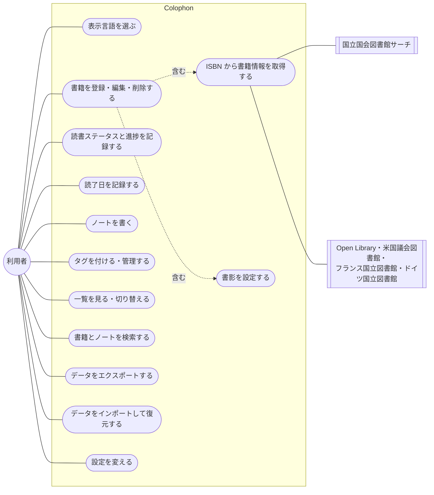

---

## 4. システム構成

### 4.1 全体構成

アプリは端末内で完結し、外部との通信は ISBN 取得のときの書誌情報サービス（5か所）だけである。

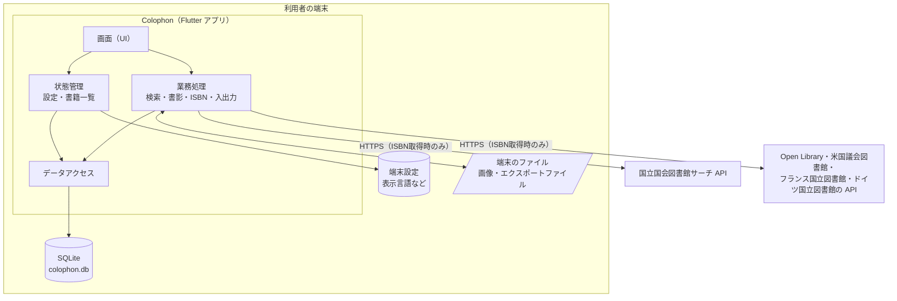

### 4.2 層の役割

| 層 | 役割 | 主なフォルダ |
|---|---|---|
| 画面（UI） | 入力の受付と表示。業務ルールは持たない | `lib/ui/` |
| 状態管理 | 画面が共有する状態（設定・書籍一覧）を保持し、変更を画面へ通知する | `lib/state/` |
| 業務処理 | 検索・書影の縮小・ISBN の検証と取得・エクスポート／インポート | `lib/services/` |
| データアクセス | SQLite の読み書きとスキーマの移行 | `lib/data/` |
| モデル | 書籍・ノートなどのデータの型 | `lib/models/` |

### 4.3 採用技術

| 用途 | 技術 |
|---|---|
| アプリ基盤 | Flutter（Dart）。1つのコードで各OS版を作る |
| データベース | SQLite（`sqlite3` パッケージ） |
| 多言語 | Flutter 標準の多言語機能（ARB ファイル） |
| 端末設定の保存 | `shared_preferences` |
| ファイル選択・保存 | `file_picker` |
| 画像処理 | `image`（縮小・形式変換） |
| ZIP | `archive` |

---

## 5. 画面設計

### 5.1 画面一覧

| ID | 画面 | 種別 | 目的 |
|---|---|---|---|
| SC-01 | 言語選択 | 画面 | 初回起動時に表示言語を選ぶ |
| SC-02 | 書籍一覧 | 画面（ホーム） | 登録した書籍を一覧で見る。各機能への入口 |
| SC-03 | 書籍の表示・登録・編集 | 画面 | 書籍の全情報（書影・ステータス・読了日・タグ・ノート）を見る（ビューアモード）・編集する（編集モード） |
| SC-04 | ISBN 取得結果 | ダイアログ | 取得した書誌情報から反映する項目を選ぶ |
| SC-05 | 検索 | 画面 | 書籍とノートを検索・絞り込みする |
| SC-06 | タグ管理 | 画面 | タグの名前変更・削除 |
| SC-07 | 設定 | 画面 | 表示言語・配色テーマ・明るさ・書影の自動縮小・アプリ情報 |
| SC-08 | エクスポート | ダイアログ | 書き出す形式を選ぶ |
| SC-09 | インポート | ダイアログ | 復元の方法（置き換え／追加）を選ぶ |

### 5.2 画面遷移図

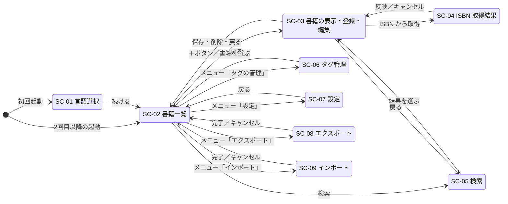

### 5.3 各画面の概要

#### SC-01 言語選択

| 項目・操作 | 内容 |
|---|---|
| 言語の一覧 | English / 日本語 / 简体中文 / Français / Español / Deutsch / 한국어。各言語自身の表記で表示する |
| 初期選択 | 端末の言語が対応言語ならそれ、なければ English |
| 言語を選ぶ | 画面の表示がその場で選んだ言語に切り替わる（確定はしない） |
| 続ける | 選んだ言語を保存し、書籍一覧へ進む |

#### SC-02 書籍一覧

| 項目・操作 | 内容 |
|---|---|
| 書籍名の一覧 | 縮小書影・書籍名・著者・タグ・ステータスを1行ずつ表示 |
| 書影の一覧 | 書影を格子状に並べる。書影がない本は書籍名入りの仮表紙を表示 |
| ステータス表示 | アイコン＋文字で表示（色だけに頼らない）。読書中で進捗が入力されているときだけ「読書中 40%」のように%を添える |
| 読了回数 | 2回以上読了した本に「2回読了」などを表示 |
| 表示切替 | 書籍名の一覧 ⇔ 書影の一覧（選択は端末に保存） |
| 並び替え | 登録日の新しい順／書籍名順（選択は端末に保存） |
| メニュー | タグの管理・エクスポート・インポート・設定 |
| ＋ボタン | 書籍の新規登録（SC-03） |

#### SC-03 書籍の表示・登録・編集

登録済みの書籍はビューアモード（見る専用）で開き、上部の「表示／編集」の切り替えで編集モードにする。新規登録は編集モードだけで、切り替えは出さない。

**ビューアモード**

| 項目 | 表示 |
|---|---|
| 書影 | 登録されていれば左に表示 |
| 書籍名・書誌項目 | 書籍名と、入力済みの項目（著者・翻訳者・監修・出版社・ISBN・版数）だけを「項目名 値」で表示。未入力の項目は項目名ごと出さない |
| ステータス | アイコン＋文字（読書中で進捗が入力されていれば%も） |
| 読了日・タグ | あるときだけ見出しごと表示 |
| ノート | あるときだけ表示。各ノートは、分類とページ（入力されていれば）の小さな見出し＋本文。お気に入りのノートには★を出すが、押しても切り替わらない |
| 登録日・更新日 | 最下部に小さく表示 |
| 出さないもの | 入力欄、保存・削除ボタン、ノートの並べ替え・削除、☆ボタン |

文字は選択してコピーできる。日付は年を含めて表示する（例: 2025年3月1日）。

**編集モード**

| 区分 | 項目・操作 | 内容 |
|---|---|---|
| 書影 | 画像を選択／画像を削除 | 端末の画像を選ぶ。条件により自動縮小（[8.3](#83-書影の登録)） |
| 書誌情報 | 書籍名 | 必須。未入力では保存できない |
| | 著者・翻訳者・監修・出版社・版数 | 任意の自由入力 |
| | ISBN | 任意。正しくない番号のときは警告を出すが、保存は止めない |
| | ISBN から取得 | 正しい ISBN のときだけ実行できる（[8.2](#82-isbn-からの書籍情報取得)） |
| 読書 | ステータス | 未設定・未読・読書中・読了 |
| | 読んだ割合（%） | ステータスが読書中のときだけ表示。0〜100 の整数、任意 |
| | 読了日 | 追加・変更・削除。読了に変えたとき今日の日付の追加を提案 |
| タグ | タグ入力 | 既存タグを候補として表示。Enter で追加 |
| ノート | 分類・ページ・本文 | 分類は任意（感想・学び・メモ・抜粋・その他）。ページは1以上の整数、任意 |
| | お気に入り（☆／★） | 押すたびに登録・解除。保存ボタンで確定 |
| | 追加・上下移動・削除 | 本文があるノートの削除は確認する |
| 操作 | 保存（Ctrl+S／⌘S） | 入力チェックの後に保存する。登録済みの書籍はビューアモードに戻り、新規登録は一覧へ戻る |
| | 書籍を削除 | 確認のうえ削除（編集時のみ） |
| | 戻る・ウィンドウを閉じる | 未保存の変更があれば破棄の確認を出す |

#### SC-04 ISBN 取得結果

取得できた項目（書籍名・著者・翻訳者・監修・出版社・版数）をチェックボックス付きで表示する。初期状態では、編集中の書籍で**まだ空欄の項目だけ**にチェックを付ける。入力済みの項目には現在の値を併記する。取得元の名前（出典）と、「翻訳者・監修の判別が不完全な場合がある」旨を表示する。

#### SC-05 検索

| 項目 | 内容 |
|---|---|
| キーワード | 空白区切りで複数語（すべてを含むものに一致）。入力の0.2秒後に自動で検索 |
| 検索対象 | 書籍名・著者・翻訳者・監修・出版社・ISBN・ノート本文（初期値はすべて） |
| ステータス | 選んだステータスのいずれか |
| ノートの分類 | 選んだ分類（「分類なし」を含む）のノートに絞る |
| お気に入り | お気に入りのノートだけに絞る（分類と両方選ぶと両方を満たすもの） |
| タグ | 選んだタグを**すべて**持つ書籍 |
| 読了日の期間 | 開始日〜終了日（両端を含む。片方だけでも可） |
| 結果 | 書籍ごとに表示し、一致したノートを本文の抜粋付きで並べる。選ぶと SC-03 へ。ノートの☆を押すと、その場でお気に入りを切り替えて保存する |

#### SC-06 タグ管理

タグの一覧を付いている冊数とともに表示する。名前の変更（ほかのタグと同じ名前は不可）と削除（全書籍から外れる）ができる。

#### SC-07 設定

| 項目 | 内容 |
|---|---|
| 表示言語 | 7言語から選ぶ。即時に反映 |
| 配色テーマ | 6種類から見本を見て選ぶ。即時に反映（[5.4](#54-配色テーマ)） |
| 明るさ | OSに合わせる（初期値）／明るい／暗い |
| 書影の自動縮小 | オン（初期値）／オフ |
| すべてのデータを削除 | 書籍・ノート・タグ・読了日・設定をすべて削除し、言語選択画面から始まる最初の状態に戻す。①案内（「先にエクスポート」も選べる）②「元に戻せないことを理解しました」にチェックしないと押せない最終確認、の二段階で確認する |
| このアプリについて | バージョン、書籍情報の取得元、オープンソースライセンス |

#### SC-08 エクスポート／SC-09 インポート

[8.4](#84-エクスポート) と [8.5](#85-インポート) を参照。

### 5.4 配色テーマ

| テーマ | 特徴 |
|---|---|
| レザー（初期値） | 革装の本を思わせる茶系 |
| フォレスト | 深い緑系 |
| オーシャン | 紺・青系 |
| ローズ | 落ち着いた赤紫系 |
| モノクロ | 白・黒・グレーだけ（書影は登録した画像のまま表示） |
| ユニバーサル | 色覚の違いにかかわらず見分けやすい配色。カラーユニバーサルデザイン推奨配色セットの青・空色・オレンジを使い、赤と緑の区別に頼らない |

- どのテーマにも明るい版と暗い版があり、「明るさ」の設定で切り替える。
- ステータスは全テーマで「アイコン＋文字」でも区別できる（未設定＝空の丸、未読＝本、読書中＝しおり、読了＝チェック）。
- 全テーマ・明暗で、文字と背景のコントラスト比は WCAG 2.x の AA（4.5:1）以上とする。
- モノクロとユニバーサルは、P型・D型・T型の色覚でもステータスの色どうしが見分けられる（色差 ΔE 20 以上）ことを自動テストで確認する。

---

## 6. データ設計

### 6.1 概念モデル（クラス図）

利用者から見たデータのまとまりと関係を示す。

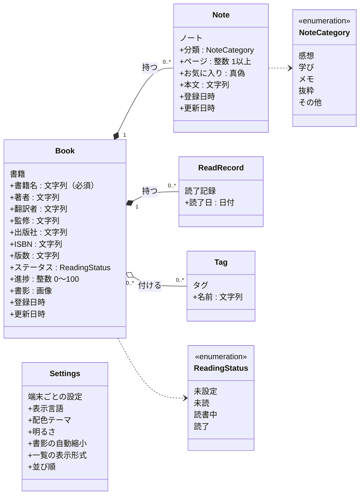

- ノート・読了記録は書籍に属し、書籍を削除すると一緒に削除される（コンポジション）。
- タグは複数の書籍で共有する。どの書籍にも付いていないタグは自動で消える。
- 設定は書籍データとは別に端末ごとに保存し、エクスポート・インポートの対象にしない。

### 6.2 ER 図

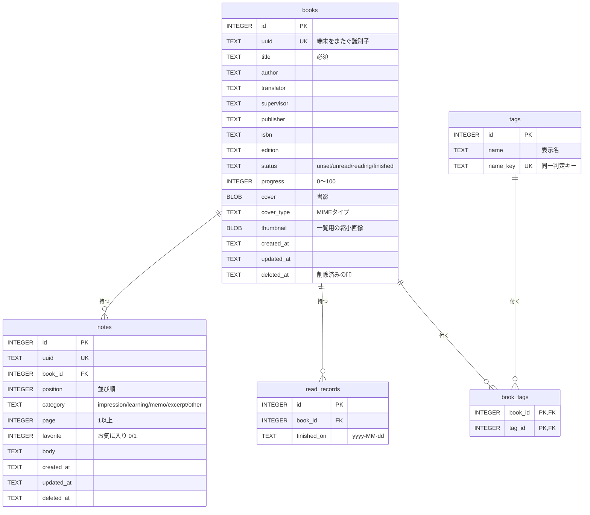

### 6.3 書籍の項目定義

| 項目 | 必須 | 形式・制約 | 補足 |
|---|---|---|---|
| 書籍名 | ○ | 文字列（前後の空白を除いて1文字以上） | |
| 著者・翻訳者・監修・出版社 | | 文字列 | 複数人は「、」区切りを推奨（自由入力） |
| ISBN | | 文字列 | 10桁・13桁、ハイフン・全角数字可。チェックディジット不正は警告のみ |
| 版数 | | 文字列 | 「第2版3刷」などの自由入力 |
| ステータス | ○ | 未設定・未読・読書中・読了 | 初期値は未設定 |
| 進捗 | | 整数 0〜100 | ステータスを変えても値は保持。表示は読書中のときだけ |
| 書影 | | JPEG / PNG / GIF / WebP / BMP | その他の形式は変換して保存（[8.3](#83-書影の登録)） |
| 読了日 | | 日付（複数） | 同じ日付は1件にまとめる |
| タグ | | 文字列（複数） | 大文字小文字・全角半角の違いは同じタグとみなす |
| 登録日時・更新日時 | ○ | 日時（UTC） | 自動で記録 |

### 6.4 ノートの項目定義

| 項目 | 必須 | 形式・制約 |
|---|---|---|
| 分類 | | 感想・学び・メモ・抜粋・その他、または未選択 |
| ページ | | 1以上の整数 |
| お気に入り | ○ | あり／なし（初期値はなし） |
| 本文 | | 複数行の文字列 |
| 並び順 | ○ | 画面での並びの順 |

本文・分類・ページがすべて空のノートは保存しない。

### 6.5 コード値

画面の言語に依存しないよう、データベースとエクスポートファイルには次のコードを保存する。

| 区分 | コード | 表示（日本語） |
|---|---|---|
| ステータス | `unset` / `unread` / `reading` / `finished` | 未設定／未読／読書中／読了 |
| ノートの分類 | `impression` / `learning` / `memo` / `excerpt` / `other` / なし | 感想／学び／メモ／抜粋／その他／分類なし |

### 6.6 削除の扱い

書籍・ノートを削除しても行は残し、削除日時（`deleted_at`）を記録する。書影とノート本文は消去する。画面・検索・エクスポートには現れない。将来の端末間同期で、削除を他の端末へ伝えるための仕組みである（[12.1](#121-端末間の同期)）。

---

## 7. 状態遷移

### 7.1 読書ステータス

ステータスはどの値からどの値へも直接変更できる。代表的な流れと、変更時の振る舞いを示す。

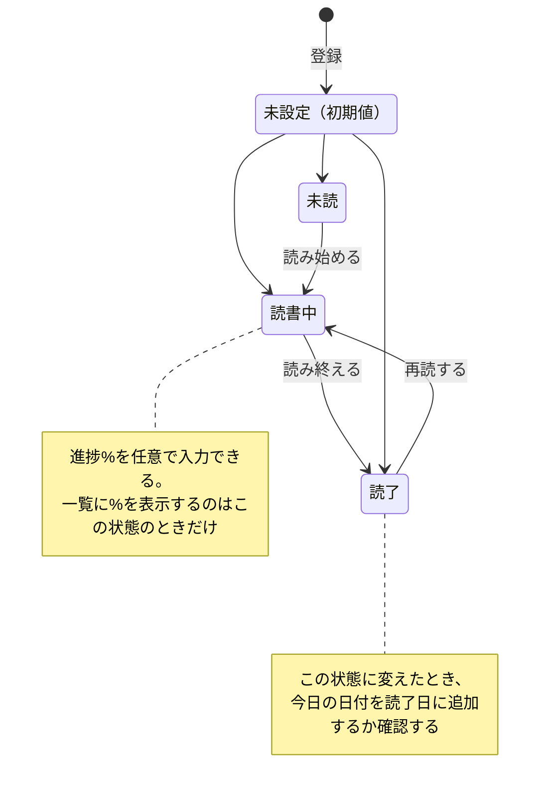

### 7.2 書籍画面のモードと保存状態

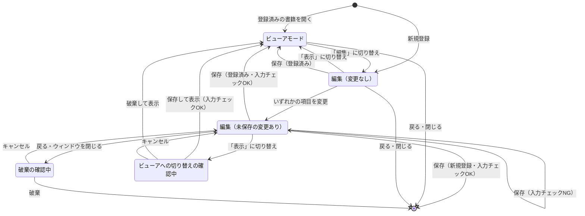

ビューアモードには常に保存済みの内容を表示するため、未保存の変更があるまま「表示」に切り替えるときは、保存するか破棄するかを先に選んでもらう。
---

## 8. 主要処理の流れ

### 8.1 書籍の保存

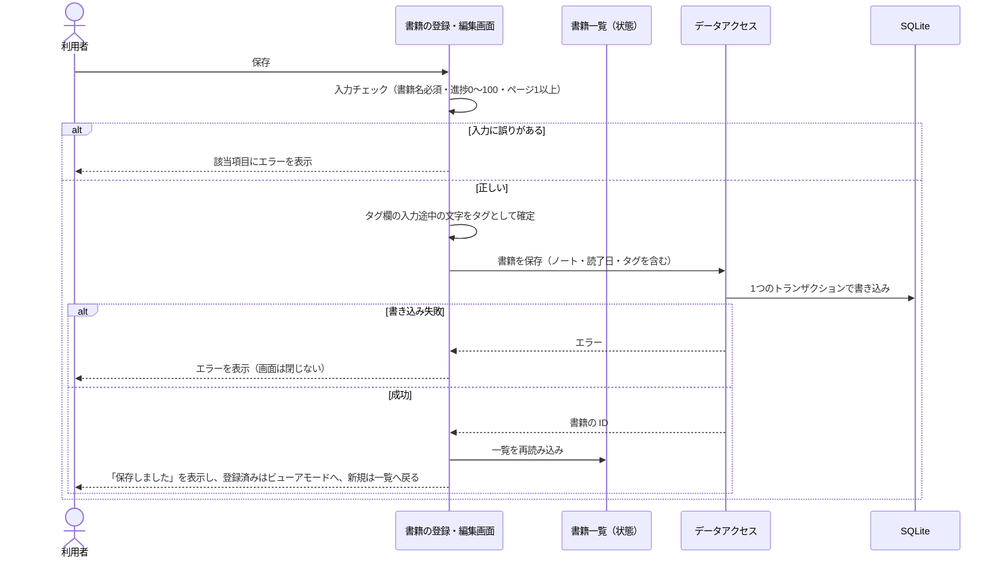

### 8.2 ISBN からの書籍情報取得

ISBN の国・言語の番号（978-4 なら日本など）から問い合わせる順番を決め、見つかるまで順に問い合わせる（順番は [9.2](#92-取得元と問い合わせの順番)）。

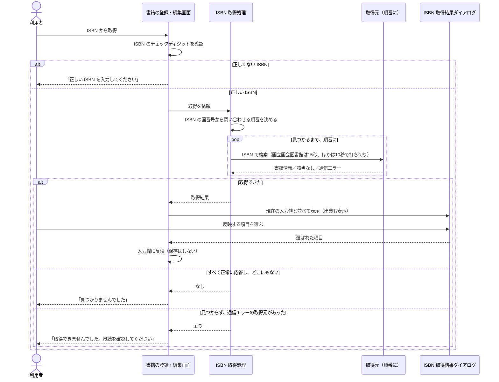

通信エラーの取得元に本があった可能性があるため、その場合は「見つからない」と言い切らない。
### 8.3 書影の登録

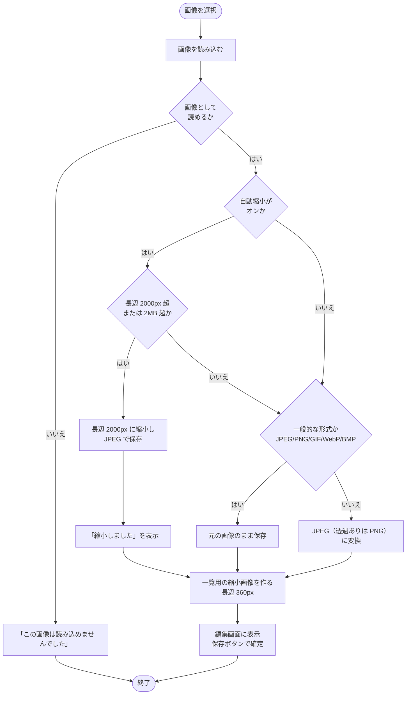

画像処理は時間がかかるため、画面の操作を止めないよう別の処理（Isolate）で行う。

### 8.4 エクスポート

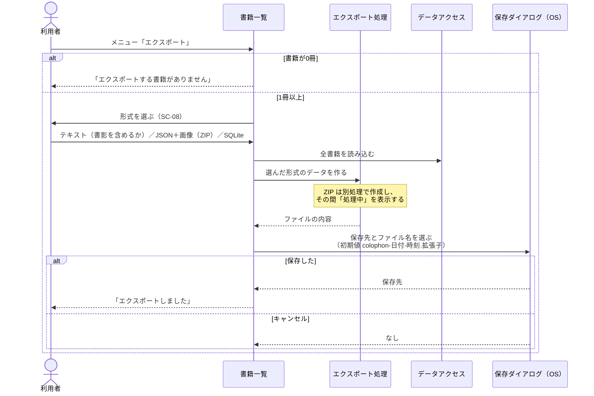

| 形式 | 内容 | インポート |
|---|---|---|
| テキスト | 人が読むための整形テキスト。項目名は表示言語、入力内容はそのまま。書籍に通し番号を付ける。「書影も含める」を選ぶと、テキストと書影の画像フォルダを ZIP にまとめる（チェックの状態は次回も引き継ぐ） | 不可 |
| JSON＋画像（ZIP） | `books.json` と `covers/` フォルダ（[9.3](#93-エクスポートファイル)） | 可 |
| SQLite | データベース全体のコピー | 可 |

### 8.5 インポート

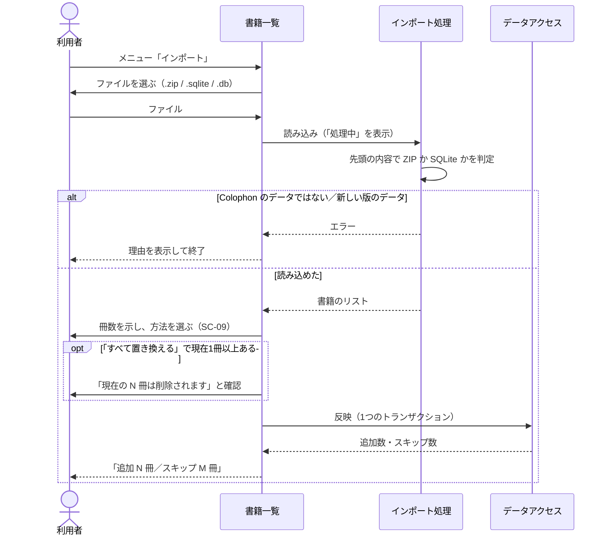

反映時の判定は次のとおり。全体を1つのトランザクションで行い、途中で失敗した場合は何も変更しない。

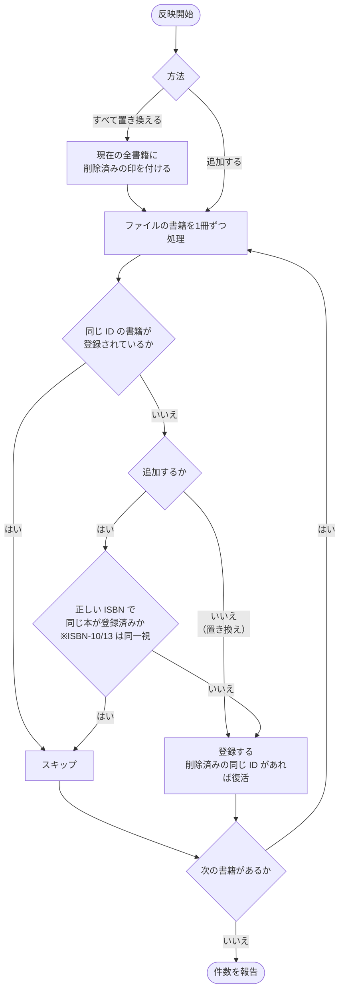

- 置き換えのときは同じ ISBN でもスキップしない（同じ本を複数冊持つ利用者がいるため）。
- 正しくない ISBN（例: 「不明」）は同一判定に使わない。

### 8.6 検索

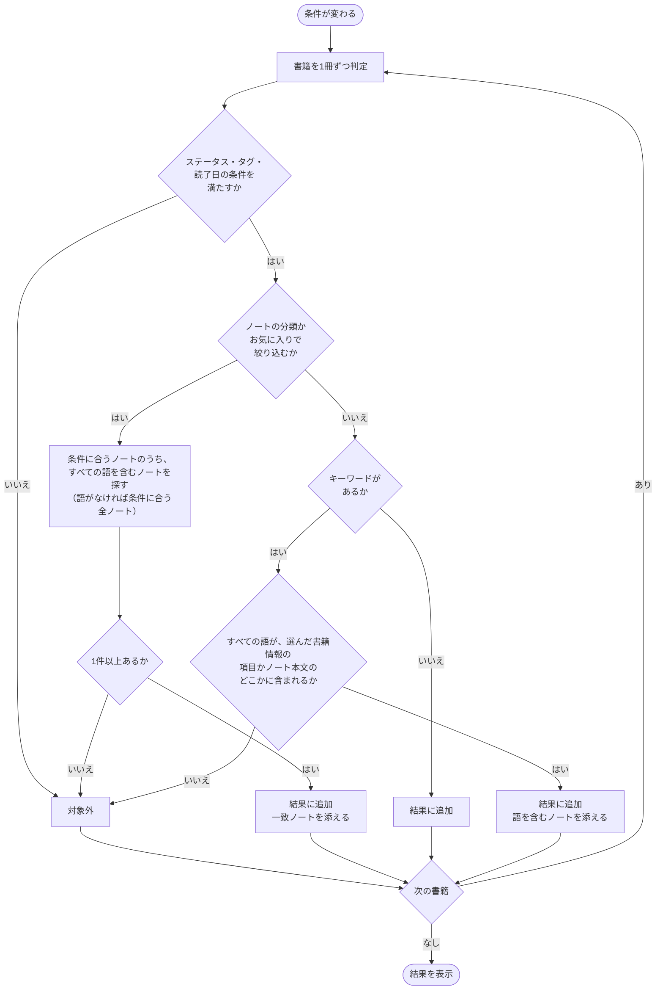

- 比較では大文字・小文字、全角・半角の違いを無視する。
- ISBN はハイフンの有無にかかわらず一致する。

---

## 9. 外部インタフェース

### 9.1 国立国会図書館サーチ（OpenSearch）

| 項目 | 内容 |
|---|---|
| 用途 | ISBN からの書誌情報取得（日本・韓国・中国などの本で最初に問い合わせる） |
| 要求 | `GET https://ndlsearch.ndl.go.jp/api/opensearch?isbn={ISBN}` |
| 応答 | RSS（XML）。最初の `item` を使う |
| 使う項目 | 書籍名（`dc:title`＋巻次 `dcndl:volume`）、責任表示（著者・翻訳者・監修を役割語で振り分け）、出版社（`dc:publisher`）、版（`dcndl:edition`） |
| 認証 | 不要 |

### 9.2 取得元と問い合わせの順番

| ISBN の先頭 | 問い合わせる順番 |
|---|---|
| 978-4（日本） | 国立国会図書館サーチ → Open Library |
| 978-2・979-10（フランス語圏） | フランス国立図書館 → Open Library |
| 978-3（ドイツ語圏） | ドイツ国立図書館 → Open Library |
| 978-0・978-1（英語圏） | Open Library → 米国議会図書館 |
| それ以外（韓国・中国など） | 国立国会図書館サーチ → Open Library → 米国議会図書館 |

| 取得元 | 要求 | 使う項目 | 利用条件 |
|---|---|---|---|
| Open Library | `GET https://openlibrary.org/api/books?bibkeys=ISBN:{ISBN}&format=json&jscmd=data`（JSON） | 書籍名（＋副題）、著者、出版社 | データに新たな権利を主張しない。1秒1件まで。User-Agent でアプリ名と連絡先を名乗る |
| 米国議会図書館 | `GET https://lx2.loc.gov/sru/lcdb?…&query=bath.isbn={ISBN}&recordSchema=dc`（SRU） | 書籍名、著者、出版社 | 登録不要。利用規約の明文はない |
| フランス国立図書館 | `GET https://catalogue.bnf.fr/api/SRU?…&query=bib.isbn all "{ISBN}"&recordSchema=dublincore`（SRU） | 書籍名、著者・翻訳者、出版社 | Licence Ouverte（商用可）。出典を表示する |
| ドイツ国立図書館 | `GET https://services.dnb.de/sru/dnb?…&query=num={ISBN}&recordSchema=oai_dc`（SRU） | 書籍名、著者・翻訳者、出版社 | 登録不要・無料（データは CC0） |

- 順番は、2026-10 に6言語150冊で測った取得率に基づく。各国の本はその国の国立図書館の収録が厚く、組み合わせると 149/150 冊を取得できた。
- 以前使っていた Google Books は、API キーなしの問い合わせが共有の1日上限に達して使えず、表示上の条件（ロゴ・リンクの掲示）も満たせないため使わない。
- どの取得元でも書影は取得しない。取得結果には出典（取得元の名前）を表示する。
### 9.3 エクスポートファイル

| 形式 | 拡張子 | 構造 |
|---|---|---|
| テキスト | `.txt` | 書籍ごとに区切り線・通し番号と書籍名・入力済みの項目・ノートを並べた UTF-8 テキスト。お気に入りのノートの見出しには「★」を付ける（例 `- ★ [学び] p.30`） |
| テキスト＋書影 | `.zip` | `colophon.txt`（上記のテキスト。書影のある書籍には「書影: covers/…」の行が付く）と `covers/{番号}_{書籍名}.{拡張子}` |
| JSON＋画像 | `.zip` | `books.json`（形式名 `colophon`・形式バージョン・書籍の配列）と `covers/{uuid}.{拡張子}` |
| SQLite | `.sqlite` | アプリのデータベースと同じ構造の SQLite ファイル |

`books.json` の項目は [README.ja.md の「エクスポート形式」](../../README.ja.md#エクスポート形式json画像) を参照。

---

## 10. 非機能要件

| 区分 | 要件 | 実現方法 |
|---|---|---|
| 移植性 | Windows / macOS / Linux で同じ機能を提供し、将来スマホにも展開できる | Flutter で1つのコードから各OS版を作る。画面は幅に応じて配置を変える |
| 多言語 | 7言語に対応し、言語を後から増やせる | 文言を言語ごとのファイルに分離。データには言語に依存しないコードを保存 |
| オフライン | ISBN 取得以外はネットワークなしで動く | データは端末内の SQLite に保存 |
| データ保全 | 保存・インポートの途中で失敗してもデータが壊れない | トランザクションで一括反映。失敗時は元に戻す |
| データ保全 | アプリの更新でデータ構造が変わっても既存データを使い続けられる | スキーマのバージョン管理と自動移行。新しい版で作られたデータは開かずに案内する |
| データの持ち出し | 利用者がいつでも自分のデータを取り出せる | 3形式のエクスポート。JSON は公開された簡単な構造 |
| 応答性 | 重い処理で画面が固まらない | 画像処理・ZIP 作成は別処理（Isolate）。処理中は表示を出す |
| プライバシー | 利用者のデータを外部に送らない | 通信は ISBN 取得時の ISBN の送信だけ |
| 誤操作防止 | 取り返しのつかない操作の前に確認する | 削除・全置き換え・未保存の破棄で確認ダイアログ。すべてのデータの削除は二段階で確認 |
| 配布・削除 | 各 OS の一般的な形式で配布し、利用者がデータを確実に消せる | Windows はインストーラー（アンインストール時にデータを消すか確認）、macOS は .dmg、Linux は Flatpak（データも消せる）と .deb。アンインストーラーでデータを消せない形式のため、アプリ内に「すべてのデータを削除」を用意する（[BUILDING.ja.md](../../BUILDING.ja.md)） |
| 見分けやすさ | アイコンだけで「本の管理とノートのアプリ」と分かり、3つの OS のどれでも浮かない | 並んだ3冊の本の背（深緑・紺・えんじに金の帯）と、上に飛び出したオレンジの付箋を、淡い水色の角丸四角の台座に載せる。台座の形と余白は macOS の標準に合わせ、Windows と Linux の小さいサイズは余白を詰める。40px 以下では帯と棚を省く |
| アクセシビリティ | 色覚の違いや好みにかかわらず読みやすい | 6種類の配色テーマと明るさの設定。全テーマでコントラスト比 4.5:1 以上。ステータスはアイコン＋文字でも区別。ユニバーサルテーマは色覚シミュレーションで検証（[5.4](#54-配色テーマ)） |

---

## 11. 制約・既知の制限

| 内容 | 影響 |
|---|---|
| 書籍名順の並びは文字コード順 | 日本語は読み（五十音）順にならない。アクセント付きの文字は英字の後ろに並ぶ |
| HEIC 形式の画像は読み込めない | iPhone で撮った写真は JPEG などに変換してから設定する |
| 翻訳者・監修の判別は取得元の表記に依存 | 取得後に利用者が確認・修正する |
| 同じデータベースを複数のアプリで同時に開く想定はない | 書き込みが重なると最大3秒待ち、それでも競合すれば保存エラーになる |
| 各OS版はそのOS上でしかビルドできない | [BUILDING.ja.md](../../BUILDING.ja.md) 参照 |

---

## 12. 将来拡張（未実装）

> この章の内容は**まだ実装していない**。方針と、現時点で済ませている準備を記す。

### 12.1 端末間の同期

| 項目 | 方針 |
|---|---|
| 方式 | Google Drive の API を直接使い、利用者の Google Drive 内のアプリ専用領域にデータを置く |
| 有効化 | 初期状態では無効。利用者が同期を使いたくなったときに Google にログインして有効にする |
| 突き合わせ | 書籍・ノートを ID（uuid）で突き合わせ、更新日時の新しいほうを採用する |
| 済ませた準備 | 削除済みの印（[6.6](#66-削除の扱い)）、ノートの ID、タグ変更時に書籍の更新日時を更新（DB スキーマ v2） |

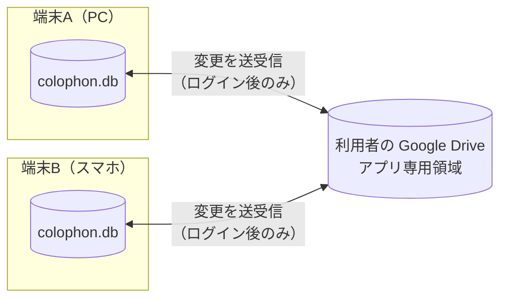

### 12.2 スマートフォン・タブレット版

- iPhone / iPad / Android に対応する（画面は幅に応じた配置を既に採用）。
- カメラでバーコード（ISBN）を読み取って登録できるようにする。
