# Colophon Basic Design

[日本語](basic-design.ja.md) | English

| Item | Details |
|---|---|
| Scope | Colophon 1.0.0 (DB schema v3 / export format v1) |
| Purpose of this document | Defines *what* the app does and *how it behaves*. Implementation-level classes, methods, and SQL are covered in the [Detailed Design](detail-design.md) |
| Created | 2026-10-14 |

## Revision history

| Version | Date | Changes |
|---|---|---|
| 1.0 | 2026-10-14 | First edition |
| 1.1 | 2026-10-14 | Added color themes (6), the brightness setting, and status icons |
| 1.2 | 2026-10-14 | Added the option to include covers in text export |
| 1.3 | 2026-10-14 | Removed Google Books from ISBN lookup and added Open Library, the Library of Congress, the Bibliothèque nationale de France, and the German National Library (the query order depends on the ISBN's country prefix) |
| 1.4 | 2026-10-14 | Added favorite notes (toggle on the edit screen and in search results, filter in search, ★ in text export) |
| 1.5 | 2026-10-15 | Added a viewer mode (read-only) for books (registered books return to it after saving). Dates now include the year |
| 1.6 | 2026-10-15 | Added "Delete all data" to Settings. Documented the package format for each OS and what happens to data on uninstall |
| 1.7 | 2026-10-15 | Added the app icon ("Recognizability" in the non-functional requirements) |

## Contents

1. [System overview](#1-system-overview)
2. [Functions](#2-functions)
3. [Use cases](#3-use-cases)
4. [System architecture](#4-system-architecture)
5. [Screen design](#5-screen-design)
6. [Data design](#6-data-design)
7. [State transitions](#7-state-transitions)
8. [Main processes](#8-main-processes)
9. [External interfaces](#9-external-interfaces)
10. [Non-functional requirements](#10-non-functional-requirements)
11. [Constraints and known limitations](#11-constraints-and-known-limitations)
12. [Future extensions (not implemented)](#12-future-extensions-not-implemented)

> Diagrams are written in [Mermaid](https://mermaid.js.org/). GitHub renders them as diagrams. To view them in the VS Code preview, install the "Markdown Preview Mermaid Support" extension.

---

## 1. System overview

### 1.1 Purpose

To let book lovers manage their personal library and reading records in one place. Besides basic book information, users can record their reading progress, how many times they have read a book, and the impressions, lessons, and excerpts they gather while reading — and search and revisit them later.

### 1.2 Target users

- Individuals who read books, printed or digital (no technical knowledge required)
- Users in several language regions (the UI is available in 7 languages)

### 1.3 Operating environment

| Category | Details |
|---|---|
| Supported OS (current) | Windows 10/11, macOS, Linux (all 64-bit) |
| Supported OS (future) | iPhone / iPad, Android phones / tablets |
| Network | Generally not required. Used only when fetching book details from an ISBN |
| Data storage | On the device (a single SQLite database file) |

### 1.4 Glossary

| Term | Meaning |
|---|---|
| Cover | An image of a book's front cover |
| Note | Free-form text attached to a book. A category and a page number can optionally be added |
| Finish date | The date the user finished reading a book. A book can have several, for re-reads |
| Progress | How far into a book the user is while reading it (0–100%) |
| Deletion marker | Instead of removing a deleted record's row, the row is kept with the deletion time recorded. Used by future sync to propagate deletions to other devices |

---

## 2. Functions

| ID | Function | Summary |
|---|---|---|
| F-01 | Language selection | Choose the display language at first launch. Can be changed anytime in Settings |
| F-02 | Add / edit / delete books | Manage title (required), author, translator, supervisor, publisher, ISBN, and edition |
| F-03 | ISBN lookup | Fetch bibliographic data from external services by ISBN and choose which fields to apply |
| F-04 | Cover image | Set an image from the device manually. Large images are reduced automatically (can be turned off) |
| F-05 | Reading status | Not set (default), Unread, Reading, Finished. Progress (%) can optionally be entered while Reading |
| F-06 | Finish dates | Record multiple finish dates per book. Offers to add today's date when the status becomes Finished |
| F-07 | Notes | Add, reorder, and delete any number of notes. Each note can be marked as a favorite (★) |
| F-08 | Tags | Attach multiple tags to a book. Rename or delete tags across all books |
| F-09 | Library views | Switch between a title list and a cover grid. Sort by recently added or by title |
| F-10 | Search | Search book details and note text, with various filters |
| F-11 | Export | Export as text (optionally with covers), JSON + images (ZIP), or SQLite |
| F-12 | Import | Restore from ZIP or SQLite by either replacing everything or adding |
| F-13 | Settings | Display language, color theme, brightness, automatic cover reduction, deleting all data, app information |
| F-14 | Viewer mode | Shows a registered book read-only: only filled-in fields, no editing controls. Switchable with edit mode |

---

## 3. Use cases

An overview of what users can do with the app (Mermaid has no dedicated use case diagram syntax, so a flowchart is used).

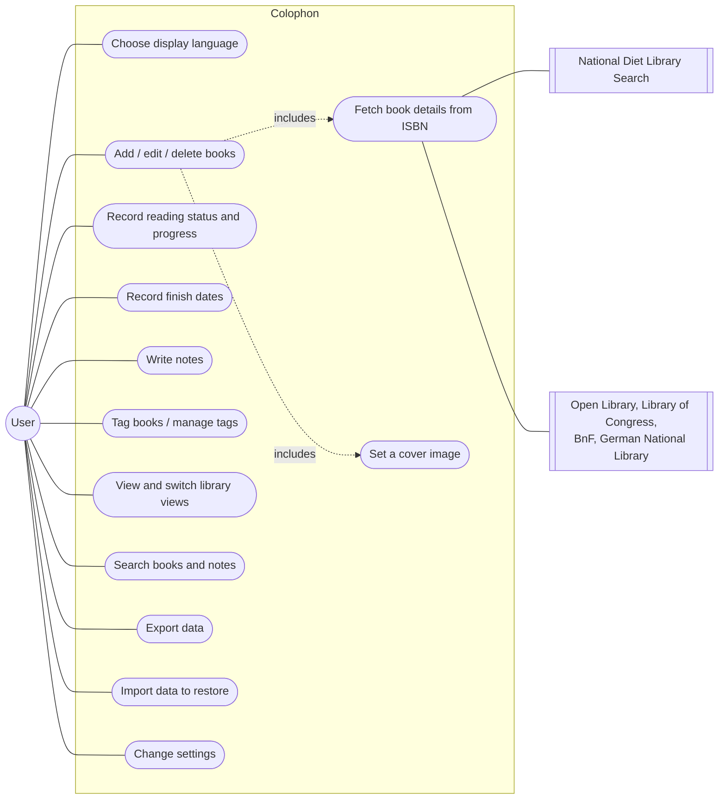

---

## 4. System architecture

### 4.1 Overall structure

The app runs entirely on the device. Its only external communication is with the bibliographic services (5 in total) used for ISBN lookup.

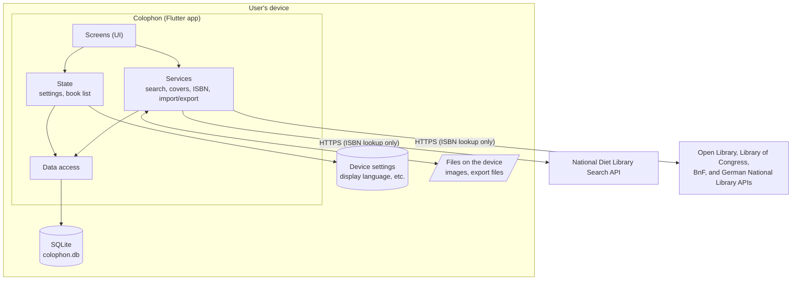

### 4.2 Layers

| Layer | Role | Main folder |
|---|---|---|
| Screens (UI) | Accept input and display results. No business rules | `lib/ui/` |
| State | Hold state shared by screens (settings, book list) and notify screens of changes | `lib/state/` |
| Services | Search, cover reduction, ISBN validation and lookup, export / import | `lib/services/` |
| Data access | Read and write SQLite; migrate the schema | `lib/data/` |
| Models | Data types such as books and notes | `lib/models/` |

### 4.3 Technologies

| Purpose | Technology |
|---|---|
| App framework | Flutter (Dart). One codebase for every OS |
| Database | SQLite (`sqlite3` package) |
| Localization | Flutter's built-in localization (ARB files) |
| Device settings | `shared_preferences` |
| File selection / saving | `file_picker` |
| Image processing | `image` (resizing, format conversion) |
| ZIP | `archive` |

---

## 5. Screen design

### 5.1 Screens

| ID | Screen | Type | Purpose |
|---|---|---|---|
| SC-01 | Language selection | Screen | Choose the display language at first launch |
| SC-02 | Library | Screen (home) | Browse registered books. Entry point to every function |
| SC-03 | View / add / edit book | Screen | View (viewer mode) or edit (edit mode) all information of a book (cover, status, finish dates, tags, notes) |
| SC-04 | ISBN lookup result | Dialog | Choose which fetched fields to apply |
| SC-05 | Search | Screen | Search and filter books and notes |
| SC-06 | Tag manager | Screen | Rename and delete tags |
| SC-07 | Settings | Screen | Display language, color theme, brightness, automatic cover reduction, app information |
| SC-08 | Export | Dialog | Choose the export format |
| SC-09 | Import | Dialog | Choose how to restore (replace / add) |

### 5.2 Screen transitions

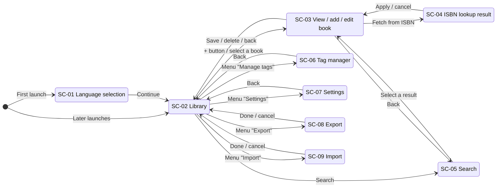

### 5.3 Screen summaries

#### SC-01 Language selection

| Item / action | Details |
|---|---|
| Language list | English / 日本語 / 简体中文 / Français / Español / Deutsch / 한국어, each shown in its own language |
| Initial selection | The device language if supported; otherwise English |
| Select a language | The screen switches to that language immediately (not yet saved) |
| Continue | Saves the selected language and opens the library |

#### SC-02 Library

| Item / action | Details |
|---|---|
| Title list | One row per book: thumbnail, title, author, tags, status |
| Cover grid | Covers in a grid. Books without a cover show a placeholder with the title |
| Status display | Shown as icon + text (not relying on color alone). Adds "%" (e.g. "Reading 40%") only when the status is Reading and progress has been entered |
| Read count | Books finished twice or more show e.g. "Finished ×2" |
| View switch | Title list ⇔ cover grid (saved on the device) |
| Sort | Recently added / title (saved on the device) |
| Menu | Manage tags, Export, Import, Settings |
| + button | Add a new book (SC-03) |

#### SC-03 View / add / edit book

Registered books open in viewer mode (read-only); the "View / Edit" switch at the top changes to edit mode. Adding a new book uses edit mode only, without the switch.

**Viewer mode**

| Item | Display |
|---|---|
| Cover | Shown on the left if registered |
| Title and bibliographic fields | The title and only the filled-in fields (author, translator, supervisor, publisher, ISBN, edition) as "label value". Empty fields are omitted together with their labels |
| Status | Icon + text (with % while Reading if progress was entered) |
| Finish dates, tags | Shown with their headings only when present |
| Notes | Shown only when present. Each note: a small caption of category and page (if entered) + the text. Favorite notes show ★, which does not toggle when pressed |
| Created / updated | Small, at the bottom |
| Not shown | Input fields, Save and Delete buttons, note reorder/delete, ☆ buttons |

Text can be selected and copied. Dates include the year (e.g. Mar 1, 2025).

**Edit mode**

| Group | Item / action | Details |
|---|---|---|
| Cover | Choose image / remove image | Choose an image on the device. Reduced automatically depending on conditions ([8.3](#83-setting-a-cover)) |
| Bibliographic data | Title | Required. Cannot be saved while empty |
| | Author, translator, supervisor, publisher, edition | Optional free text |
| | ISBN | Optional. Shows a warning for an invalid number but does not block saving |
| | Fetch from ISBN | Available only for a valid ISBN ([8.2](#82-fetching-book-details-from-an-isbn)) |
| Reading | Status | Not set, Unread, Reading, Finished |
| | Progress (%) | Shown only while the status is Reading. Integer 0–100, optional |
| | Finish dates | Add, change, delete. Offers to add today's date when the status becomes Finished |
| Tags | Tag input | Suggests existing tags. Enter adds the tag |
| Notes | Category, page, text | Category is optional (Impressions, Learnings, Memo, Excerpt, Other). Page is an integer of 1 or more, optional |
| | Favorite (☆ / ★) | Toggles on each press. Confirmed by Save |
| | Add, move up/down, delete | Deleting a note that has text asks for confirmation |
| Actions | Save (Ctrl+S / ⌘S) | Validates input and saves. Registered books return to viewer mode; new books return to the library |
| | Delete book | Deletes after confirmation (edit mode only) |
| | Back / close window | Asks whether to discard unsaved changes |

#### SC-04 ISBN lookup result

Shows the fetched fields (title, author, translator, supervisor, publisher, edition) with checkboxes. Initially only the fields that are **still empty** in the book being edited are checked. For fields that already have a value, the current value is shown alongside. The source name (attribution) is displayed, along with a note that translators and supervisors may not be detected perfectly.

#### SC-05 Search

| Item | Details |
|---|---|
| Keywords | Several words separated by spaces (matches items containing all of them). Searches automatically 0.2 seconds after typing |
| Search in | Title, author, translator, supervisor, publisher, ISBN, note text (all by default) |
| Status | Any of the selected statuses |
| Note category | Notes of the selected categories (including "No category") |
| Favorites | Only favorite notes (with a category also selected, notes must meet both) |
| Tags | Books that have **all** selected tags |
| Finish date range | From–to (inclusive; either end may be omitted) |
| Results | Grouped by book, listing matching notes with a text excerpt. Selecting one opens SC-03. Pressing a note's ☆ toggles its favorite on the spot and saves immediately |

#### SC-06 Tag manager

Lists tags with the number of books that have them. Tags can be renamed (not to the name of another tag) and deleted (removed from every book).

#### SC-07 Settings

| Item | Details |
|---|---|
| Display language | One of 7 languages. Applied immediately |
| Color theme | Choose one of 6 from previews. Applied immediately ([5.4](#54-color-themes)) |
| Brightness | Match system (default) / light / dark |
| Automatic cover reduction | On (default) / off |
| Delete all data | Erases all books, notes, tags, finish dates, and settings, returning to the initial state that starts with language selection. Confirmed in two steps: (1) an explanation (with an "Export first" option) and (2) a final confirmation that cannot be pressed until "I understand that deleted data cannot be restored" is checked |
| About | Version, book data sources, open source licenses |

#### SC-08 Export / SC-09 Import

See [8.4](#84-export) and [8.5](#85-import).

### 5.4 Color themes

| Theme | Character |
|---|---|
| Leather (default) | Browns reminiscent of leather-bound books |
| Forest | Deep greens |
| Ocean | Navy and blues |
| Rose | Subdued red-purples |
| Monochrome | White, black, and grays only (covers are still shown as registered) |
| Universal | Easy to tell apart for every type of color vision. Uses blue, sky blue, and orange from the Color Universal Design recommended palette and does not rely on telling red from green |

- Every theme has a light and a dark version, switched by the "Brightness" setting.
- In every theme, statuses can also be told apart by icon + text (Not set = empty circle, Unread = book, Reading = bookmark, Finished = check).
- In every theme and brightness, text/background contrast meets WCAG 2.x AA (4.5:1).
- For Monochrome and Universal, automated tests check that status colors remain distinguishable under protan, deutan, and tritan color vision (color difference ΔE of 20 or more).
---

## 6. Data design

### 6.1 Conceptual model (class diagram)

The groups of data as seen by the user, and how they relate.

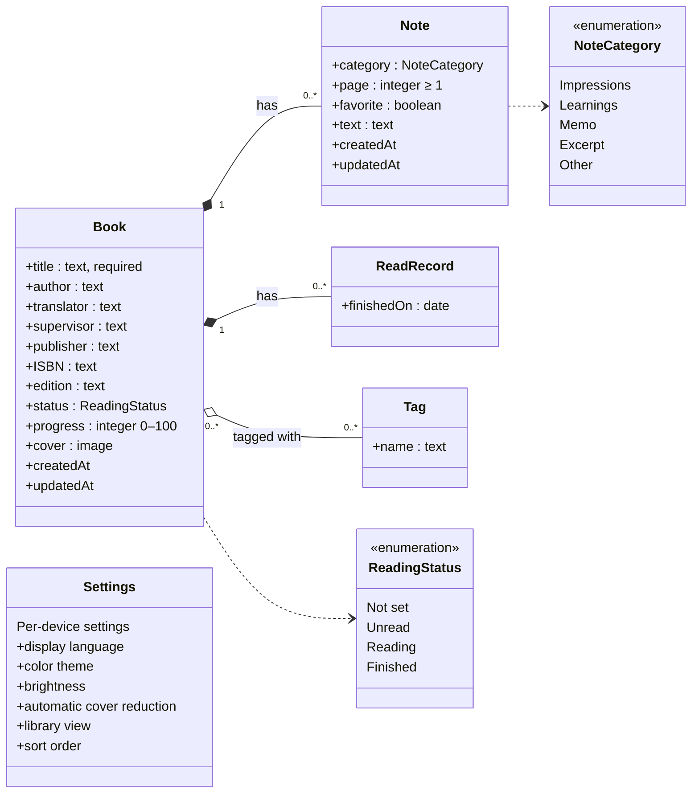

- Notes and finish records belong to a book and are deleted with it (composition).
- Tags are shared among books. A tag attached to no book is removed automatically.
- Settings are stored per device, separately from book data, and are not exported or imported.

### 6.2 ER diagram

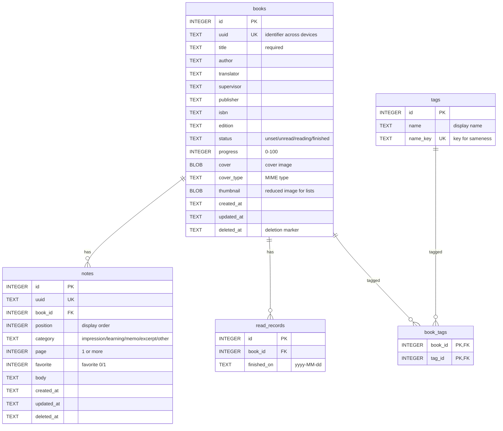

### 6.3 Book fields

| Field | Required | Format / constraints | Notes |
|---|---|---|---|
| Title | ✓ | Text (at least 1 character after trimming spaces) | |
| Author, translator, supervisor, publisher | | Text | Free text; separate multiple people as you like |
| ISBN | | Text | 10 or 13 digits; hyphens and full-width digits allowed. An invalid check digit only triggers a warning |
| Edition | | Text | Free text such as "2nd edition, 3rd printing" |
| Status | ✓ | Not set, Unread, Reading, Finished | Default is Not set |
| Progress | | Integer 0–100 | Kept when the status changes; displayed only while Reading |
| Cover | | JPEG / PNG / GIF / WebP / BMP | Other formats are converted ([8.3](#83-setting-a-cover)) |
| Finish dates | | Dates (multiple) | Duplicate dates are merged |
| Tags | | Text (multiple) | Differences in letter case and full-/half-width are treated as the same tag |
| Created / updated | ✓ | Date and time (UTC) | Recorded automatically |

### 6.4 Note fields

| Field | Required | Format / constraints |
|---|---|---|
| Category | | Impressions, Learnings, Memo, Excerpt, Other, or none |
| Page | | Integer of 1 or more |
| Favorite | ✓ | Yes / no (default: no) |
| Text | | Multi-line text |
| Order | ✓ | Order on the screen |

A note whose text, category, and page are all empty is not saved.

### 6.5 Codes

To stay independent of the display language, the database and export files store these codes:

| Kind | Codes | Display (English) |
|---|---|---|
| Status | `unset` / `unread` / `reading` / `finished` | Not set / Unread / Reading / Finished |
| Note category | `impression` / `learning` / `memo` / `excerpt` / `other` / none | Impressions / Learnings / Memo / Excerpt / Other / No category |

### 6.6 Deletion

Deleting a book or note keeps its row and records the deletion time (`deleted_at`). The cover image and note text are erased. Deleted items do not appear on screens, in search, or in exports. This mechanism lets future sync between devices propagate deletions to other devices ([12.1](#121-sync-between-devices)).

---

## 7. State transitions

### 7.1 Reading status

The status can be changed directly from any value to any other. The diagram shows the typical flow and the behavior on change.

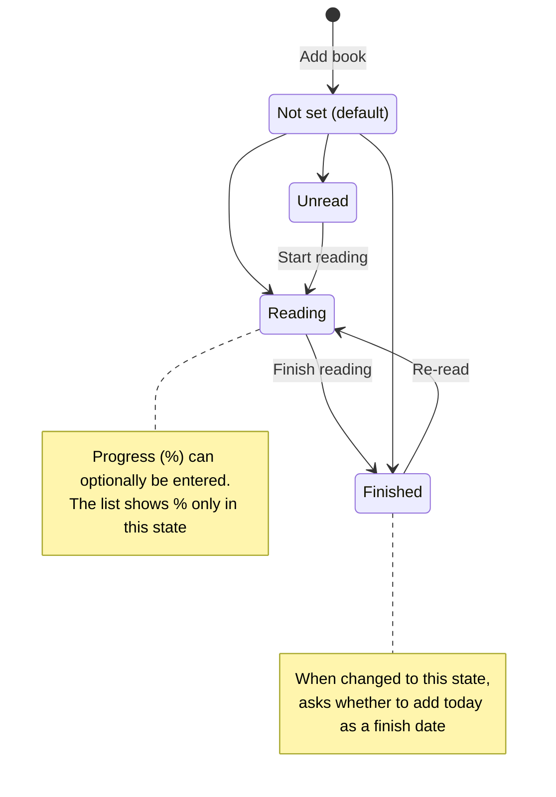

### 7.2 Modes and save state of the book screen

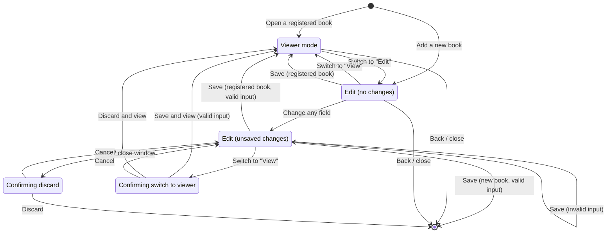

Viewer mode always shows saved content, so switching to "View" with unsaved changes first asks whether to save or discard them.
---

## 8. Main processes

### 8.1 Saving a book

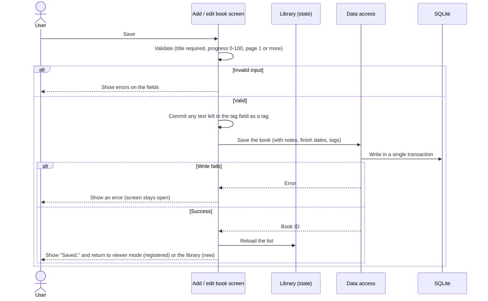

### 8.2 Fetching book details from an ISBN

The query order is decided from the ISBN's country/language prefix (e.g. 978-4 for Japan), and sources are queried in turn until the book is found (order in [9.2](#92-sources-and-query-order)).

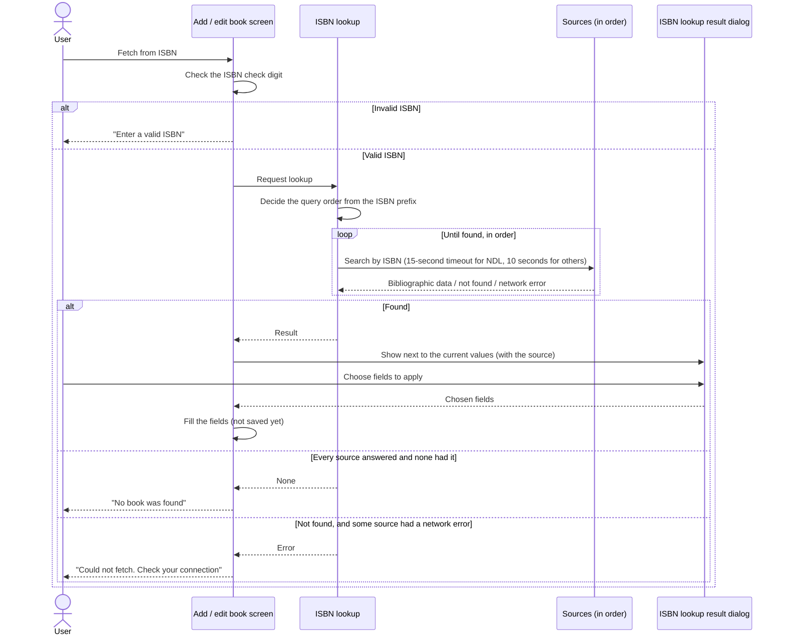

Because a source that failed might have had the book, the app does not claim "not found" in that case.
### 8.3 Setting a cover

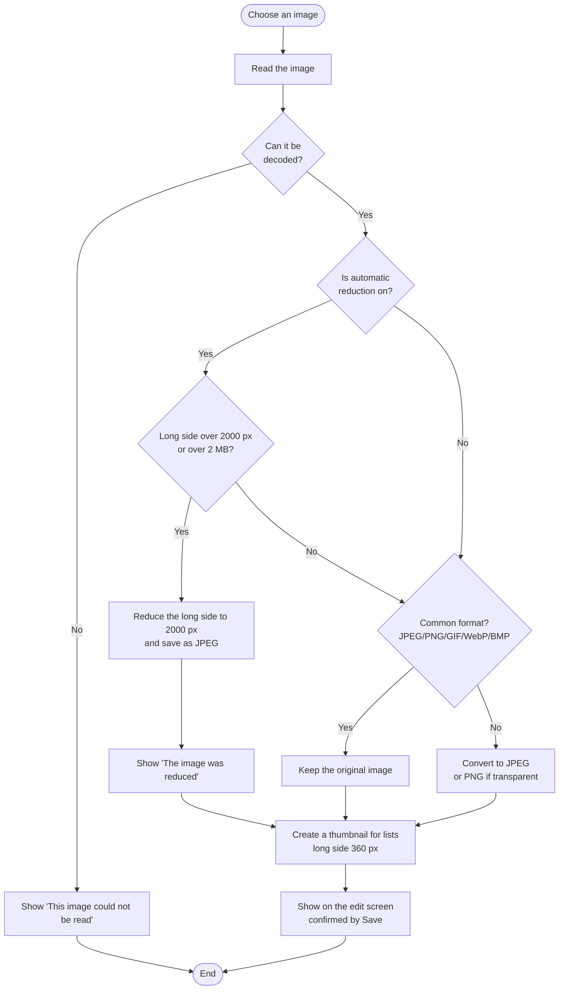

Image processing takes time, so it runs in a separate isolate to keep the UI responsive.

### 8.4 Export

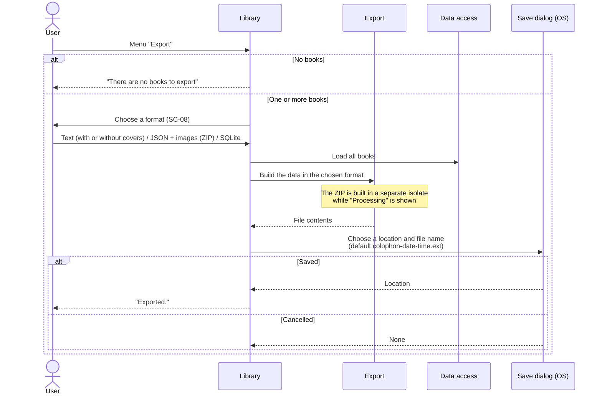

| Format | Contents | Importable |
|---|---|---|
| Text | Formatted text for reading. Labels are in the display language; user content is unchanged. Books are numbered. With "Include covers", the text and a folder of cover images are packed into a ZIP (the checkbox state is kept for next time) | No |
| JSON + images (ZIP) | `books.json` and a `covers/` folder ([9.3](#93-export-files)) | Yes |
| SQLite | A copy of the whole database | Yes |

### 8.5 Import

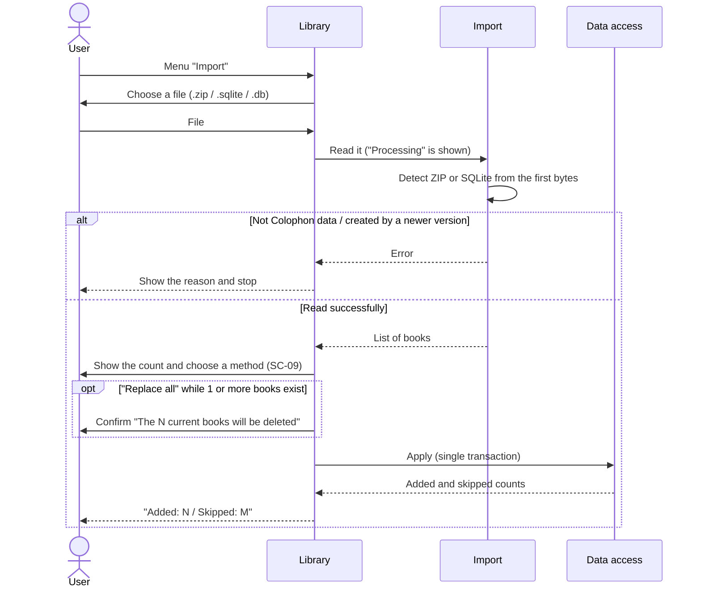

The rules when applying are as follows. Everything runs in one transaction; if anything fails, nothing is changed.

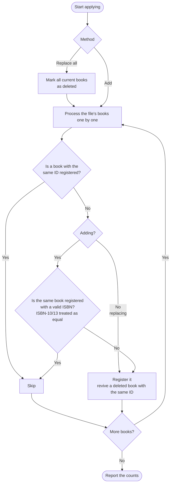

- When replacing, books are not skipped because of a matching ISBN (some users own several copies of the same book).
- Invalid ISBNs (e.g. "unknown") are not used to detect duplicates.

### 8.6 Search

- Comparison ignores letter case and full-/half-width differences.
- ISBNs match with or without hyphens.

---

## 9. External interfaces

### 9.1 National Diet Library Search (OpenSearch)

| Item | Details |
|---|---|
| Use | Fetch bibliographic data by ISBN (queried first for books from Japan, Korea, China, etc.) |
| Request | `GET https://ndlsearch.ndl.go.jp/api/opensearch?isbn={ISBN}` |
| Response | RSS (XML). The first `item` is used |
| Fields used | Title (`dc:title` + volume `dcndl:volume`), statement of responsibility (author, translator, and supervisor separated by role words), publisher (`dc:publisher`), edition (`dcndl:edition`) |
| Authentication | None |

### 9.2 Sources and query order

| ISBN prefix | Query order |
|---|---|
| 978-4 (Japan) | National Diet Library Search → Open Library |
| 978-2, 979-10 (French-speaking) | Bibliothèque nationale de France → Open Library |
| 978-3 (German-speaking) | German National Library → Open Library |
| 978-0, 978-1 (English-speaking) | Open Library → Library of Congress |
| Others (Korea, China, etc.) | National Diet Library Search → Open Library → Library of Congress |

| Source | Request | Fields used | Terms |
|---|---|---|---|
| Open Library | `GET https://openlibrary.org/api/books?bibkeys=ISBN:{ISBN}&format=json&jscmd=data` (JSON) | Title (+ subtitle), authors, publisher | Asserts no new rights over the data. Up to 1 request per second. Identify the app and a contact in the User-Agent |
| Library of Congress | `GET https://lx2.loc.gov/sru/lcdb?…&query=bath.isbn={ISBN}&recordSchema=dc` (SRU) | Title, authors, publisher | No registration. No explicit terms of use found |
| Bibliothèque nationale de France | `GET https://catalogue.bnf.fr/api/SRU?…&query=bib.isbn all "{ISBN}"&recordSchema=dublincore` (SRU) | Title, authors and translators, publisher | Licence Ouverte (commercial use allowed). Show the source |
| German National Library | `GET https://services.dnb.de/sru/dnb?…&query=num={ISBN}&recordSchema=oai_dc` (SRU) | Title, authors and translators, publisher | Free, no registration (data under CC0) |

- The order is based on success rates measured in 2026-10 with 150 books in 6 languages. Each country's books are best covered by its national library; combined, 149 of 150 books were found.
- Google Books, used previously, is no longer used: keyless requests hit a shared daily quota and fail, and its display requirements (logo and links) could not be met.
- No source is used to fetch cover images. Results show their source (attribution).
### 9.3 Export files

| Format | Extension | Structure |
|---|---|---|
| Text | `.txt` | UTF-8 text listing, per book, a separator line, the number and title, the filled-in fields, and notes. Favorite notes are marked with "★" (e.g. `- ★ [Learnings] p.30`) |
| Text + covers | `.zip` | `colophon.txt` (the text above; books with a cover get a "Cover: covers/…" line) and `covers/{number}_{title}.{ext}` |
| JSON + images | `.zip` | `books.json` (format name `colophon`, format version, array of books) and `covers/{uuid}.{ext}` |
| SQLite | `.sqlite` | An SQLite file with the same structure as the app's database |

For the fields in `books.json`, see ["Export format" in README.md](../../README.md#export-format-json--images).

---

## 10. Non-functional requirements

| Category | Requirement | How it is met |
|---|---|---|
| Portability | Same features on Windows / macOS / Linux; can expand to mobile later | Flutter builds every OS from one codebase. Layouts adapt to the window width |
| Localization | 7 languages, with more addable later | UI strings are kept in one file per language. Data stores language-independent codes |
| Offline use | Works without a network except for ISBN lookup | Data is stored in SQLite on the device |
| Data integrity | Data is not corrupted if saving or importing fails midway | Changes are applied in a transaction and rolled back on failure |
| Data integrity | Existing data keeps working when an update changes the data structure | Schema versioning with automatic migration. Data created by a newer version is not opened; the user is told why |
| Data portability | Users can take their data out at any time | Export in 3 formats. The JSON format is simple and documented |
| Responsiveness | Heavy work does not freeze the UI | Image processing and ZIP creation run in separate isolates, with a progress indicator |
| Privacy | User data is not sent to outside services | The only communication is sending an ISBN during lookup |
| Mistake prevention | Ask before irreversible actions | Confirmation dialogs for deletion, replace-all import, and discarding unsaved changes. Deleting all data is confirmed in two steps |
| Distribution and removal | Ship in each OS's usual format and let users reliably delete their data | Windows installer (asks whether to delete data on uninstall), macOS .dmg, Linux Flatpak (can delete data) and .deb. Because some formats cannot delete data on uninstall, the app offers "Delete all data" ([BUILDING.md](../../BUILDING.md)) |
| Recognizability | The icon alone says "an app for managing books and notes", and it does not look out of place on any of the 3 OSes | Three book spines (deep green, navy, and burgundy with gold bands) and an orange sticky tab poking out above them, on a pale blue rounded-square plate. The plate shape and margins follow the macOS standard; Windows and Linux use tighter margins at small sizes. Bands and the shelf are omitted at 40 px and below |
| Accessibility | Readable regardless of color vision or preference | 6 color themes and a brightness setting. Contrast of 4.5:1 or more in every theme. Statuses also distinguished by icon + text. The Universal theme is verified by color-vision simulation ([5.4](#54-color-themes)) |

---

## 11. Constraints and known limitations

| Limitation | Impact |
|---|---|
| Title sort uses character code order | Japanese titles are not in reading (gojūon) order; accented letters sort after unaccented ones |
| HEIC images cannot be read | Convert iPhone photos to JPEG or similar before setting them as covers |
| Translator / supervisor detection depends on the source's wording | Users check and correct the result after fetching |
| Opening the same database from several app instances at once is not expected | Overlapping writes wait up to 3 seconds; a remaining conflict results in a save error |
| Each OS version can only be built on that OS | See [BUILDING.md](../../BUILDING.md) |

---

## 12. Future extensions (not implemented)

> The contents of this chapter are **not implemented yet**. It records the plan and the preparations already made.

### 12.1 Sync between devices

| Item | Plan |
|---|---|
| Method | Use the Google Drive API directly and store data in an app-specific area of the user's Google Drive |
| Enabling | Off by default. Users turn it on by signing in to Google when they want to sync |
| Reconciliation | Match books and notes by ID (uuid) and keep the version with the newer update time |
| Preparations done | Deletion markers ([6.6](#66-deletion)), note IDs, and updating a book's update time when its tags change (DB schema v2) |

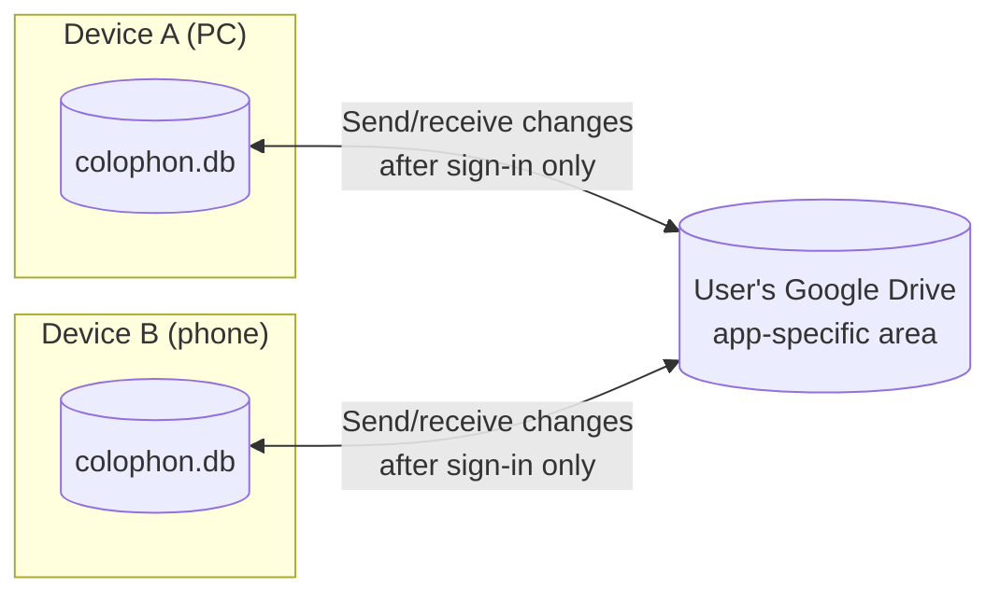

### 12.2 Smartphone and tablet versions

- Support iPhone / iPad / Android (layouts already adapt to the window width).
- Register books by scanning the barcode (ISBN) with the camera.
