# Colophon Basic Design

[日本語](basic-design.ja.md) | English

| Item | Details |
|---|---|
| Scope | Colophon 1.2.0 (DB schema v4 / export format v1 / sync data format v1) |
| Purpose of this document | Defines *what* the app does and *how it behaves*. Implementation-level classes, methods, and SQL are covered in the [Detailed Design](detail-design.md) |
| Created | 2026-10-14 |

## Revision history

| Version | Date | Changes |
|---|---|---|
| 1.0 | 2026-10-14 | First edition |
| 1.1 | 2026-10-14 | Added color themes (6), the brightness setting, and status icons |
| 1.2 | 2026-10-14 | Added the option to include covers in text export |
| 1.3 | 2026-10-14 | Removed Google Books from ISBN lookup and added Open Library, the Library of Congress, the Bibliothèque nationale de France, and the German National Library (the query order depends on the ISBN's country prefix) |
| 1.4 | 2026-10-14 | Added favorite notes (toggle on the edit screen and in search results, filter in search, ★ in text export) |
| 1.5 | 2026-10-15 | Added a viewer mode (read-only) for books (registered books return to it after saving). Dates now include the year |
| 1.6 | 2026-10-15 | Added "Delete all data" to Settings. Documented the package format for each OS and what happens to data on uninstall |
| 1.7 | 2026-10-15 | Added the app icon ("Recognizability" in the non-functional requirements) |
| 1.8 | 2026-10-15 | Added sync between computers through Google Drive (F-15: the sync section in Settings, the Google sign-in, first sync, and sync-on-exit dialogs, the scope of "Delete all data", data stored in the cloud, sync states and processes, and the Google external interfaces). Revised the offline, data integrity, privacy, and other non-functional requirements, and removed sync from the future extensions |
| 1.9 | 2026-10-16 | Updated the target version to 1.1.0 |
| 1.10 | 2026-10-18 | Added sorting the list by status (Not set → Finished / Finished → Not set) (F-09, SC-01) |
| 1.11 | 2026-10-18 | Updated the target version to 1.2.0 |

## Contents

1. [System overview](#1-system-overview)
2. [Functions](#2-functions)
3. [Use cases](#3-use-cases)
4. [System architecture](#4-system-architecture)
5. [Screen design](#5-screen-design)
6. [Data design](#6-data-design)
7. [State transitions](#7-state-transitions)
8. [Main processes](#8-main-processes)
9. [External interfaces](#9-external-interfaces)
10. [Non-functional requirements](#10-non-functional-requirements)
11. [Constraints and known limitations](#11-constraints-and-known-limitations)
12. [Future extensions (not implemented)](#12-future-extensions-not-implemented)

> Diagrams are written in [Mermaid](https://mermaid.js.org/). GitHub renders them as diagrams. To view them in the VS Code preview, install the "Markdown Preview Mermaid Support" extension.

---

## 1. System overview

### 1.1 Purpose

To let book lovers manage their personal library and reading records in one place. Besides basic book information, users can record their reading progress, how many times they have read a book, and the impressions, lessons, and excerpts they gather while reading — and search and revisit them later.

### 1.2 Target users

- Individuals who read books, printed or digital (no technical knowledge required)
- Users in several language regions (the UI is available in 7 languages)

### 1.3 Operating environment

| Category | Details |
|---|---|
| Supported OS (current) | Windows 10/11, macOS, Linux (all 64-bit) |
| Supported OS (future) | iPhone / iPad, Android phones / tablets |
| Network | Generally not required. Used when fetching book details from an ISBN and for sync with Google Drive (only after signing in) |
| Data storage | On the device (a single SQLite database file). When sync is used, the same contents are also stored in the app-specific area of the user's Google Drive ([6.7](#67-data-stored-in-the-cloud)) |

### 1.4 Glossary

| Term | Meaning |
|---|---|
| Cover | An image of a book's front cover |
| Note | Free-form text attached to a book. A category and a page number can optionally be added |
| Finish date | The date the user finished reading a book. A book can have several, for re-reads |
| Progress | How far into a book the user is while reading it (0–100%) |
| Deletion marker | Instead of removing a deleted record's row, the row is kept with the deletion time recorded. Used by sync to propagate deletions to other devices |
| Sync | Keeping books and notes the same on several computers signed in to the same Google account. Google Drive is used as the relay |
| App-specific area | A private area in Google Drive reserved for the app (appDataFolder). It is kept separate from the user's other files |
| Sync data | The contents of books and notes stored in Google Drive for sync. Each cover image is a separate file |
| First sync | A sync on a computer that has never synced. If both the computer and the cloud have data, the user chooses how to combine them |

---

## 2. Functions

| ID | Function | Summary |
|---|---|---|
| F-01 | Language selection | Choose the display language at first launch. Can be changed anytime in Settings |
| F-02 | Add / edit / delete books | Manage title (required), author, translator, supervisor, publisher, ISBN, and edition |
| F-03 | ISBN lookup | Fetch bibliographic data from external services by ISBN and choose which fields to apply |
| F-04 | Cover image | Set an image from the device manually. Large images are reduced automatically (can be turned off) |
| F-05 | Reading status | Not set (default), Unread, Reading, Finished. Progress (%) can optionally be entered while Reading |
| F-06 | Finish dates | Record multiple finish dates per book. Offers to add today's date when the status becomes Finished |
| F-07 | Notes | Add, reorder, and delete any number of notes. Each note can be marked as a favorite (★) |
| F-08 | Tags | Attach multiple tags to a book. Rename or delete tags across all books |
| F-09 | Library views | Switch between a title list and a cover grid. Sort by recently added, by title, or by status (two directions) |
| F-10 | Search | Search book details and note text, with various filters |
| F-11 | Export | Export as text (optionally with covers), JSON + images (ZIP), or SQLite |
| F-12 | Import | Restore from ZIP or SQLite by either replacing everything or adding |
| F-13 | Settings | Display language, color theme, brightness, automatic cover reduction, sync, deleting all data, app information |
| F-14 | Viewer mode | Shows a registered book read-only: only filled-in fields, no editing controls. Switchable with edit mode |
| F-15 | Sync | Sign in with a Google account and keep books, notes, finish dates, tags, and covers the same on several computers through the app-specific area of Google Drive. Syncs automatically at startup, after changes, and before exit, and on demand with "Sync now". Nothing is synced unless the user signs in |

---

## 3. Use cases

An overview of what users can do with the app (Mermaid has no dedicated use case diagram syntax, so a flowchart is used).

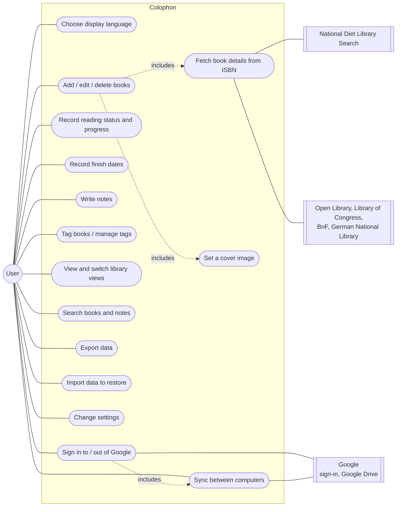

Besides "Sync now", sync (uc15) runs automatically while signed in: at startup, after changes, and before exit ([8.9](#89-automatic-sync)).

---

## 4. System architecture

### 4.1 Overall structure

The app runs entirely on the device. Its only external communication is with the bibliographic services (5 in total) used for ISBN lookup and, when sync is used, with Google (sign-in and Google Drive).

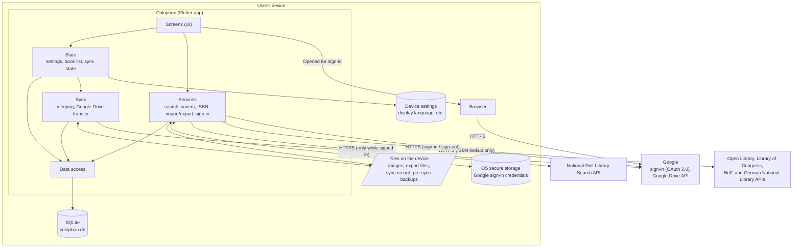

### 4.2 Layers

| Layer | Role | Main folder |
|---|---|---|
| Screens (UI) | Accept input and display results. No business rules | `lib/ui/` |
| State | Hold state shared by screens (settings, book list, sync sign-in state and progress) and notify screens of changes. Decide when to sync automatically | `lib/state/` |
| Services | Search, cover reduction, ISBN validation and lookup, export / import, Google sign-in, recorded time (current time corrected by the server time) | `lib/services/` |
| Sync | Sync data format, merge rules, transfer with Google Drive, sync record, backup before the first sync | `lib/sync/` |
| Data access | Read and write SQLite; migrate the schema. Extract and write sync data | `lib/data/` |
| Models | Data types such as books and notes | `lib/models/` |

### 4.3 Technologies

| Purpose | Technology |
|---|---|
| App framework | Flutter (Dart). One codebase for every OS |
| Database | SQLite (`sqlite3` package) |
| Localization | Flutter's built-in localization (ARB files) |
| Device settings | `shared_preferences` |
| File selection / saving | `file_picker` |
| Image processing | `image` (resizing, format conversion) |
| ZIP | `archive` |
| Google Drive | `googleapis` (Drive API v3) |
| Google sign-in | `googleapis_auth` (authorization code exchange, token refresh) |
| Storing sign-in credentials | `flutter_secure_storage` (OS secure storage) |
| Opening the browser | `url_launcher` |
| Hashing | `crypto` (cover SHA-256, PKCE for sign-in) |

---

## 5. Screen design

### 5.1 Screens

| ID | Screen | Type | Purpose |
|---|---|---|---|
| SC-01 | Language selection | Screen | Choose the display language at first launch |
| SC-02 | Library | Screen (home) | Browse registered books. Entry point to every function |
| SC-03 | View / add / edit book | Screen | View (viewer mode) or edit (edit mode) all information of a book (cover, status, finish dates, tags, notes) |
| SC-04 | ISBN lookup result | Dialog | Choose which fetched fields to apply |
| SC-05 | Search | Screen | Search and filter books and notes |
| SC-06 | Tag manager | Screen | Rename and delete tags |
| SC-07 | Settings | Screen | Display language, color theme, brightness, automatic cover reduction, sync, deleting all data, app information |
| SC-08 | Export | Dialog | Choose the export format |
| SC-09 | Import | Dialog | Choose how to restore (replace / add) |
| SC-10 | Google sign-in | Dialog | Wait for sign-in in the browser. The link can be copied and sign-in cancelled |
| SC-11 | First sync | Dialog | Choose how to combine data when both this computer and the cloud have some |
| SC-12 | Sync on exit | Dialog | Sync changes not yet sent before the app exits |

### 5.2 Screen transitions

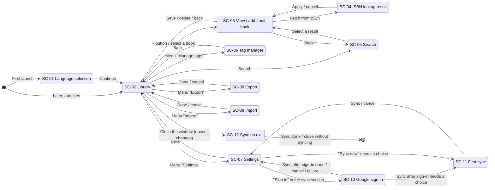

SC-12 appears when the window is closed from any screen (the diagram shows it from SC-02 only). Without unsent changes, the app exits without showing it.

### 5.3 Screen summaries

#### SC-01 Language selection

| Item / action | Details |
|---|---|
| Language list | English / 日本語 / 简体中文 / Français / Español / Deutsch / 한국어, each shown in its own language |
| Initial selection | The device language if supported; otherwise English |
| Select a language | The screen switches to that language immediately (not yet saved) |
| Continue | Saves the selected language and opens the library |

#### SC-02 Library

| Item / action | Details |
|---|---|
| Title list | One row per book: thumbnail, title, author, tags, status |
| Cover grid | Covers in a grid. Books without a cover show a placeholder with the title |
| Status display | Shown as icon + text (not relying on color alone). Adds "%" (e.g. "Reading 40%") only when the status is Reading and progress has been entered |
| Read count | Books finished twice or more show e.g. "Finished ×2" |
| View switch | Title list ⇔ cover grid (saved on the device) |
| Sort | Recently added / title / status (Not set → Finished) / status (Finished → Not set) (saved on the device). By status, reading books are ordered by progress (none entered counts as 0%) and finished books by their last finish date (books without one come last in that group); ties are ordered by title. Not set → Finished uses lower progress and older dates first; Finished → Not set uses higher progress and newer dates first |
| Menu | Manage tags, Export, Import, Settings |
| + button | Add a new book (SC-03) |

#### SC-03 View / add / edit book

Registered books open in viewer mode (read-only); the "View / Edit" switch at the top changes to edit mode. Adding a new book uses edit mode only, without the switch.

**Viewer mode**

| Item | Display |
|---|---|
| Cover | Shown on the left if registered |
| Title and bibliographic fields | The title and only the filled-in fields (author, translator, supervisor, publisher, ISBN, edition) as "label value". Empty fields are omitted together with their labels |
| Status | Icon + text (with % while Reading if progress was entered) |
| Finish dates, tags | Shown with their headings only when present |
| Notes | Shown only when present. Each note: a small caption of category and page (if entered) + the text. Favorite notes show ★, which does not toggle when pressed |
| Created / updated | Small, at the bottom |
| Not shown | Input fields, Save and Delete buttons, note reorder/delete, ☆ buttons |

Text can be selected and copied. Dates include the year (e.g. Mar 1, 2025).

**Edit mode**

| Group | Item / action | Details |
|---|---|---|
| Cover | Choose image / remove image | Choose an image on the device. Reduced automatically depending on conditions ([8.3](#83-setting-a-cover)) |
| Bibliographic data | Title | Required. Cannot be saved while empty |
| | Author, translator, supervisor, publisher, edition | Optional free text |
| | ISBN | Optional. Shows a warning for an invalid number but does not block saving |
| | Fetch from ISBN | Available only for a valid ISBN ([8.2](#82-fetching-book-details-from-an-isbn)) |
| Reading | Status | Not set, Unread, Reading, Finished |
| | Progress (%) | Shown only while the status is Reading. Integer 0–100, optional |
| | Finish dates | Add, change, delete. Offers to add today's date when the status becomes Finished |
| Tags | Tag input | Suggests existing tags. Enter adds the tag |
| Notes | Category, page, text | Category is optional (Impressions, Learnings, Memo, Excerpt, Other). Page is an integer of 1 or more, optional |
| | Favorite (☆ / ★) | Toggles on each press. Confirmed by Save |
| | Add, move up/down, delete | Deleting a note that has text asks for confirmation |
| Actions | Save (Ctrl+S / ⌘S) | Validates input and saves. Registered books return to viewer mode; new books return to the library |
| | Delete book | Deletes after confirmation (edit mode only) |
| | Back / close window | Asks whether to discard unsaved changes |

**Interaction with sync**

| Situation | Behavior |
|---|---|
| The open book changes through sync | If there are no unsaved changes, the screen shows the latest contents (except while a dialog is open). With unsaved changes, the user's input takes priority; saving makes it the newest version |
| The open book is deleted on another computer | Shows "This book was deleted on another computer." and closes the screen. The same happens if this is noticed on Save or "Discard and view"; the book is not saved (saving would revive it on every computer) |
| Notes that arrive through sync while editing | Kept when saving (only notes deleted on this screen are marked as deleted) |

#### SC-04 ISBN lookup result

Shows the fetched fields (title, author, translator, supervisor, publisher, edition) with checkboxes. Initially only the fields that are **still empty** in the book being edited are checked. For fields that already have a value, the current value is shown alongside. The source name (attribution) is displayed, along with a note that translators and supervisors may not be detected perfectly.

#### SC-05 Search

| Item | Details |
|---|---|
| Keywords | Several words separated by spaces (matches items containing all of them). Searches automatically 0.2 seconds after typing |
| Search in | Title, author, translator, supervisor, publisher, ISBN, note text (all by default) |
| Status | Any of the selected statuses |
| Note category | Notes of the selected categories (including "No category") |
| Favorites | Only favorite notes (with a category also selected, notes must meet both) |
| Tags | Books that have **all** selected tags |
| Finish date range | From–to (inclusive; either end may be omitted) |
| Results | Grouped by book, listing matching notes with a text excerpt. Selecting one opens SC-03. Pressing a note's ☆ toggles its favorite on the spot and saves immediately |

#### SC-06 Tag manager

Lists tags with the number of books that have them. Tags can be renamed (not to the name of another tag) and deleted (removed from every book).

#### SC-07 Settings

| Item | Details |
|---|---|
| Display language | One of 7 languages. Applied immediately |
| Color theme | Choose one of 6 from previews. Applied immediately ([5.4](#54-color-themes)) |
| Brightness | Match system (default) / light / dark |
| Automatic cover reduction | On (default) / off |
| Sync | Sign-in state, last sync time, and actions for sync with Google Drive (table below) |
| Delete all data | Erases all books, notes, tags, finish dates, and settings, returning to the initial state that starts with language selection. Confirmed in two steps: (1) an explanation (with an "Export first" option) and (2) a final confirmation that cannot be pressed until "I understand that deleted data cannot be restored" is checked. While signed in, the final confirmation also asks what to delete (this computer only / Google Drive and every computer) ([8.10](#810-deleting-all-data-and-sync)) |
| About | Version, book data sources, open source licenses |

**Sync section**

| State | Display / actions |
|---|---|
| Unavailable | Shows "Sync is not available in this build" with no actions (an app built without the Google client settings) |
| Loading | Right after startup, a progress indicator while the saved sign-in is read |
| Signed out | A description of sync and a "Sign in" button (SC-10) |
| Signed in | "Signed in as (email address)" ("Signed in" if the address is unknown) and a "Sign out" button. Signing out asks for confirmation and deletes nothing from this computer or Google Drive. Disabled while syncing |
| | The last sync time ("Not synced yet" if never; "Syncing…" with a progress indicator while syncing) and a "Sync now" button. When finished, shows "Synced." at the bottom, or the reason for a failure |
| | If the last sync failed, its reason is shown in red ([8.7](#87-sync)). If there is no failure but the first-sync choice is pending, shows "press 'Sync now'"; if the cloud has unreadable records, says that sending was held back |

#### SC-10 Google sign-in

Pressing "Sign in" in the sync section opens Google's sign-in page in the default browser and shows this dialog.

| Item / action | Details |
|---|---|
| Instructions | Asks the user to choose a Google account in the browser and allow Colophon access. Shows a progress indicator |
| Copy link | Copies the sign-in page URL to the clipboard (to paste it when the browser does not open or another browser is preferred) |
| Cancel | Stops signing in. No message is shown |
| Allowed | The browser shows "You are signed in to Colophon. Close this tab and return to the app." The app shows "Signed in.", closes the dialog, and syncs right away (SC-11 if needed) |
| Not allowed / failed | Shows "Sign-in was cancelled." / "Could not sign in. Check your network connection…" and returns to signed out |

#### SC-11 First sync

Shown when this computer has never synced and both this computer and the cloud have books or notes. It shows the book counts on both sides and asks how to combine them ([8.8](#88-first-sync)). It also says that a backup of this computer's data is saved automatically before syncing.

| Option | Details |
|---|---|
| Combine (recommended, default) | Keeps the books from both. Books with the same ISBN become one |
| Replace with Google Drive | Books and notes that exist only on this computer are deleted |
| Replace with this computer | Books and notes that exist only on Google Drive are deleted from every synced computer |

"Sync" runs it. "Cancel" does nothing, and automatic sync does not proceed until a choice is made (the sync section shows a hint).

#### SC-12 Sync on exit

When the window is closed and there are user changes not yet sent, the app shows "Syncing with Google Drive…" / "Colophon will close when syncing finishes." and exits after syncing. Nothing else can be done while it is shown (so that edits made during the sync are not left unsent). "Close without syncing" exits without waiting (the changes stay on this computer and are sent at the next startup). Even if syncing takes long, the app waits at most 10 seconds for a running sync and at most 10 seconds for one sync, and then exits.

#### SC-08 Export / SC-09 Import

See [8.4](#84-export) and [8.5](#85-import).

### 5.4 Color themes

| Theme | Character |
|---|---|
| Leather (default) | Browns reminiscent of leather-bound books |
| Forest | Deep greens |
| Ocean | Navy and blues |
| Rose | Subdued red-purples |
| Monochrome | White, black, and grays only (covers are still shown as registered) |
| Universal | Easy to tell apart for every type of color vision. Uses blue, sky blue, and orange from the Color Universal Design recommended palette and does not rely on telling red from green |

- Every theme has a light and a dark version, switched by the "Brightness" setting.
- In every theme, statuses can also be told apart by icon + text (Not set = empty circle, Unread = book, Reading = bookmark, Finished = check).
- In every theme and brightness, text/background contrast meets WCAG 2.x AA (4.5:1).
- For Monochrome and Universal, automated tests check that status colors remain distinguishable under protan, deutan, and tritan color vision (color difference ΔE of 20 or more).
---

## 6. Data design

### 6.1 Conceptual model (class diagram)

The groups of data as seen by the user, and how they relate.

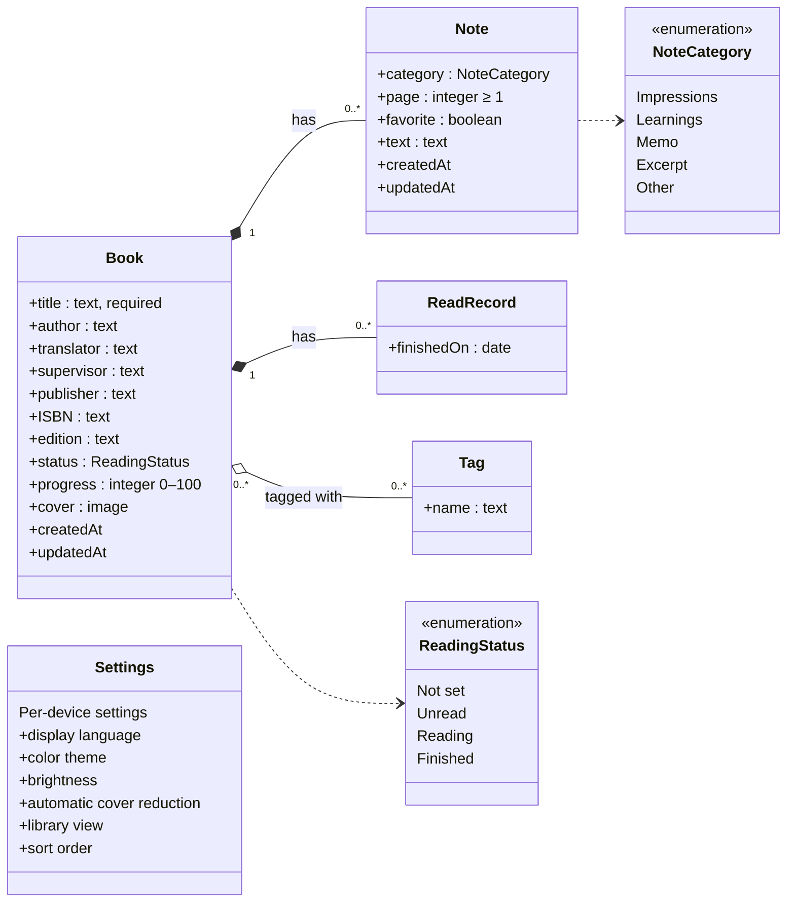

- Notes and finish records belong to a book and are deleted with it (composition).
- Tags are shared among books. A tag attached to no book is removed automatically.
- Settings are stored per device, separately from book data, and are not exported, imported, or synced.

### 6.2 ER diagram

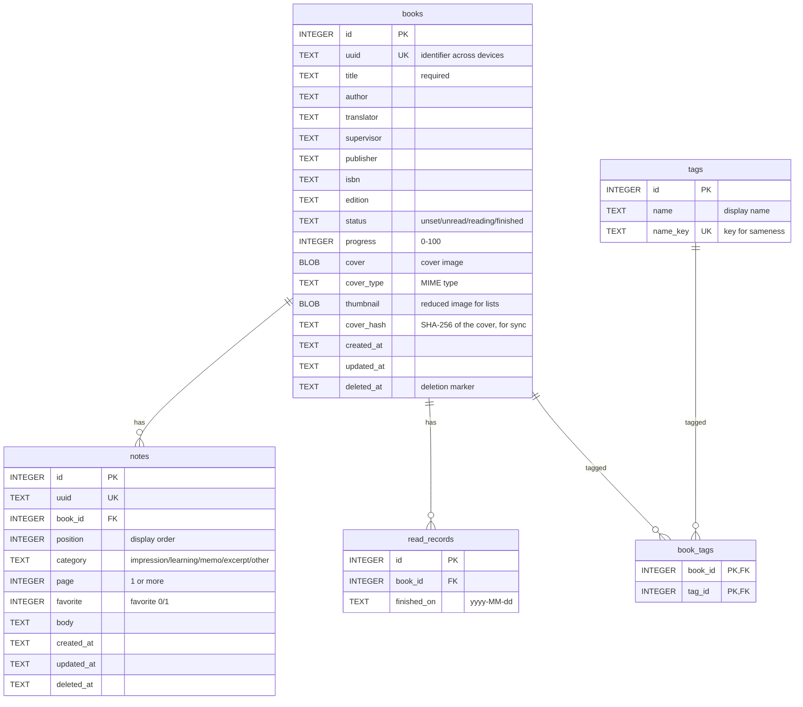

### 6.3 Book fields

| Field | Required | Format / constraints | Notes |
|---|---|---|---|
| Title | ✓ | Text (at least 1 character after trimming spaces) | |
| Author, translator, supervisor, publisher | | Text | Free text; separate multiple people as you like |
| ISBN | | Text | 10 or 13 digits; hyphens and full-width digits allowed. An invalid check digit only triggers a warning |
| Edition | | Text | Free text such as "2nd edition, 3rd printing" |
| Status | ✓ | Not set, Unread, Reading, Finished | Default is Not set |
| Progress | | Integer 0–100 | Kept when the status changes; displayed only while Reading |
| Cover | | JPEG / PNG / GIF / WebP / BMP | Other formats are converted ([8.3](#83-setting-a-cover)) |
| Finish dates | | Dates (multiple) | Duplicate dates are merged |
| Tags | | Text (multiple) | Differences in letter case and full-/half-width are treated as the same tag |
| Created / updated | ✓ | Date and time (UTC) | Recorded automatically |

### 6.4 Note fields

| Field | Required | Format / constraints |
|---|---|---|
| Category | | Impressions, Learnings, Memo, Excerpt, Other, or none |
| Page | | Integer of 1 or more |
| Favorite | ✓ | Yes / no (default: no) |
| Text | | Multi-line text |
| Order | ✓ | Order on the screen |

A note whose text, category, and page are all empty is not saved.

### 6.5 Codes

To stay independent of the display language, the database and export files store these codes:

| Kind | Codes | Display (English) |
|---|---|---|
| Status | `unset` / `unread` / `reading` / `finished` | Not set / Unread / Reading / Finished |
| Note category | `impression` / `learning` / `memo` / `excerpt` / `other` / none | Impressions / Learnings / Memo / Excerpt / Other / No category |

### 6.6 Deletion

Deleting a book or note keeps its row and records the deletion time (`deleted_at`). The cover image and note text are erased. Deleted items do not appear on screens, in search, or in exports. This mechanism lets sync propagate deletions to other devices ([8.7](#87-sync)). Only "Delete all data" in Settings erases everything physically, deletion markers included.

### 6.7 Data stored in the cloud

When sync is used, the following files are stored in the app-specific area (appDataFolder) of the user's Google Drive. Colophon signs in with a permission (`drive.appdata`) that can read and write only this area, so it never touches the user's other files.

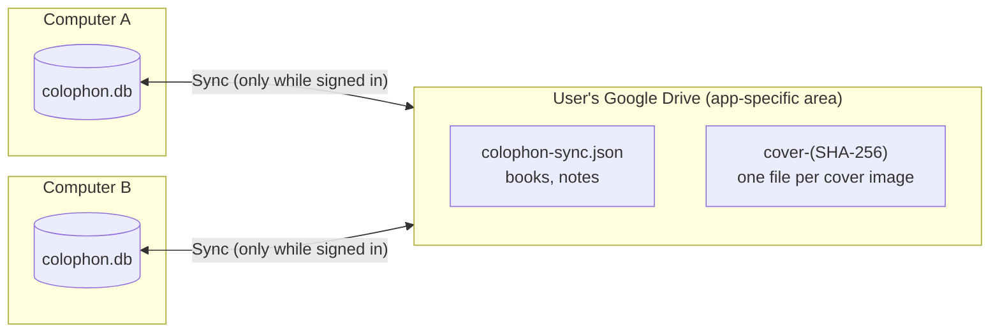

| File | Contents |
|---|---|
| `colophon-sync.json` | The sync data (normally one file; two computers sending their first sync at the same time can briefly create two, which the next sync merges into one). All books (bibliographic fields, status, progress, finish dates, tags, note order, the cover's SHA-256 and MIME type, created and updated times) and all notes (category, page, text, favorite, created and updated times). Deleted books and notes keep only their ID and times |
| `cover-{SHA-256}` | A cover image. Named after the SHA-256 of its contents, so the same image is stored only once and only changed images need to be sent. A cover no longer used by any book is deleted by a sync at least 7 days after that is noticed |

- Not stored: settings (display language, color theme, etc.), thumbnails for lists (created on the receiving computer), the bibliographic fields of deleted books, and the text of deleted notes.
- The data has a format version (sync data format v1). Sync data written by a newer version of the app is neither read nor overwritten by older versions.

Stored on the computer for sync:

| Location | Contents |
|---|---|
| OS secure storage (Windows: an encrypted file; macOS: Keychain; Linux: Secret Service) | Google sign-in credentials (access token, refresh token) and the email address for display |
| `sync-state.json` in the same folder as the library (`colophon.db`) | Whether this computer has ever synced, the last sync time, and the difference from the server time |
| `sync-backups/` in the same folder as the library | Backups taken before the first sync (the same ZIP format as export, so they can be imported; the newest 3 are kept) |

---

## 7. State transitions

### 7.1 Reading status

The status can be changed directly from any value to any other. The diagram shows the typical flow and the behavior on change.

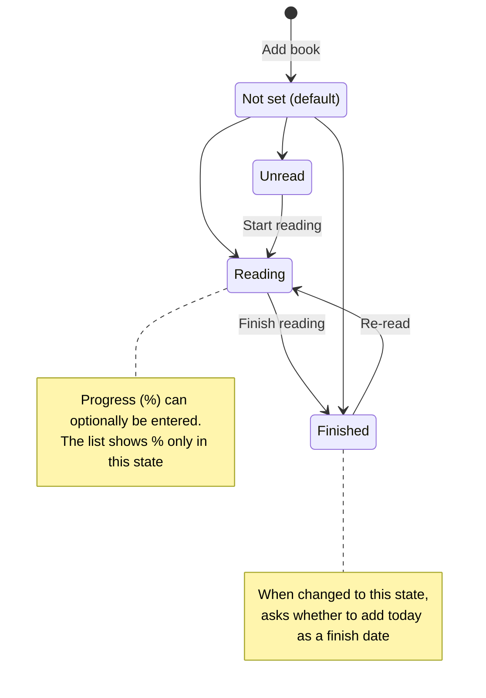

### 7.2 Modes and save state of the book screen

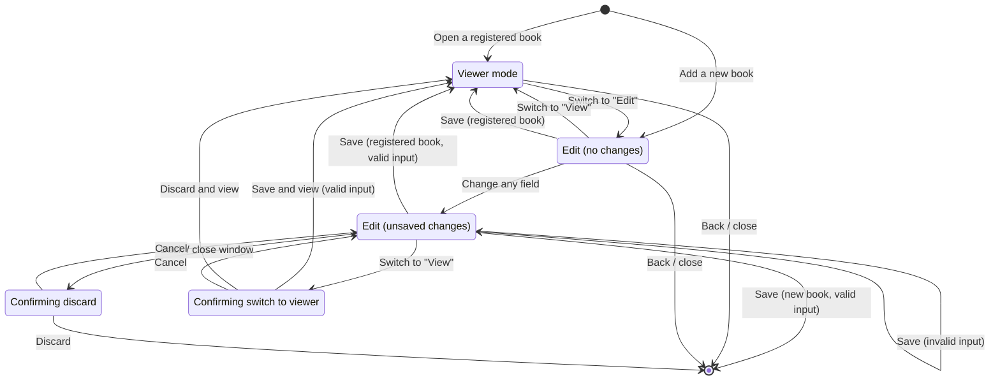

Viewer mode always shows saved content, so switching to "View" with unsaved changes first asks whether to save or discard them.

### 7.3 Sync states

The sync section in Settings ([5.3](#sc-07-settings)) changes its display according to these states.

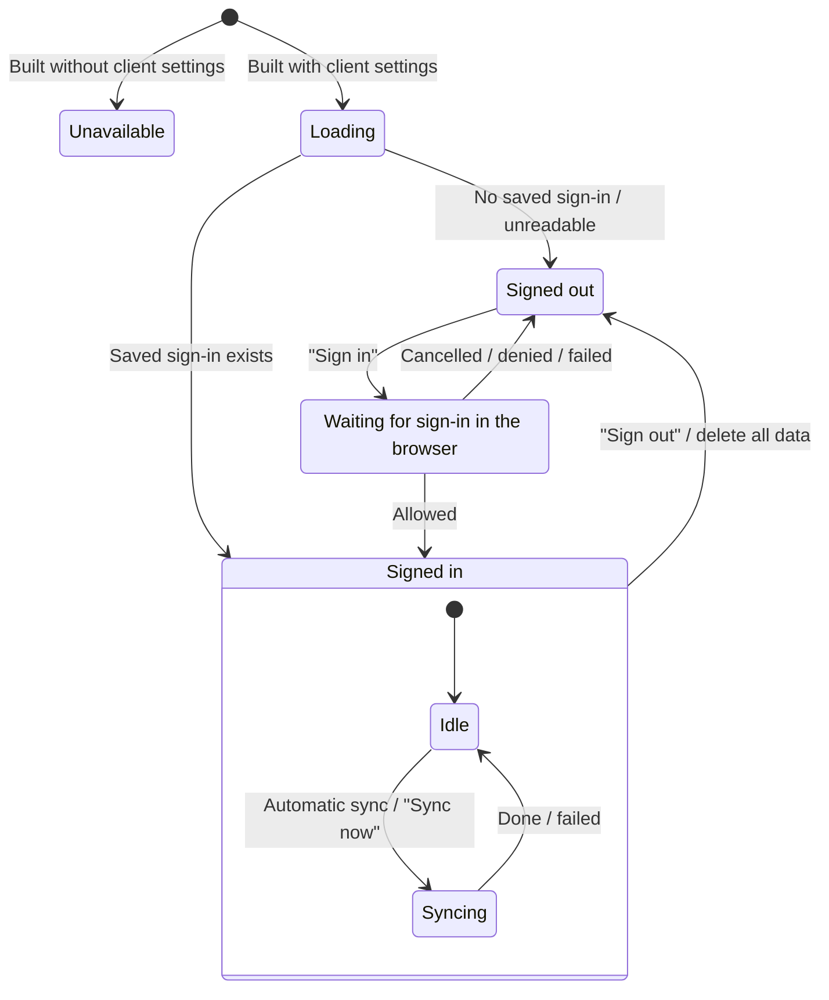

- Signing out also invalidates the token on Google's side and erases the saved sign-in and the sync record (whether this computer has synced, the last sync time). The next sign-in is treated as a first sync (so that data is combined correctly even when another account is used).
- Signing out deletes nothing from this computer or Google Drive.
---

## 8. Main processes

### 8.1 Saving a book

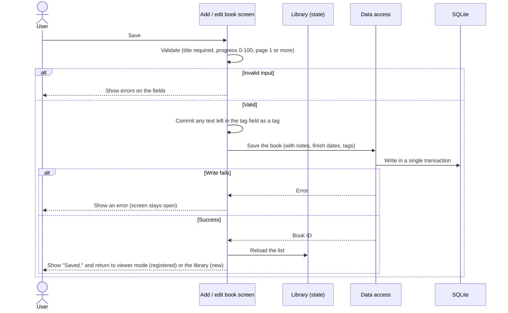

### 8.2 Fetching book details from an ISBN

The query order is decided from the ISBN's country/language prefix (e.g. 978-4 for Japan), and sources are queried in turn until the book is found (order in [9.2](#92-sources-and-query-order)).

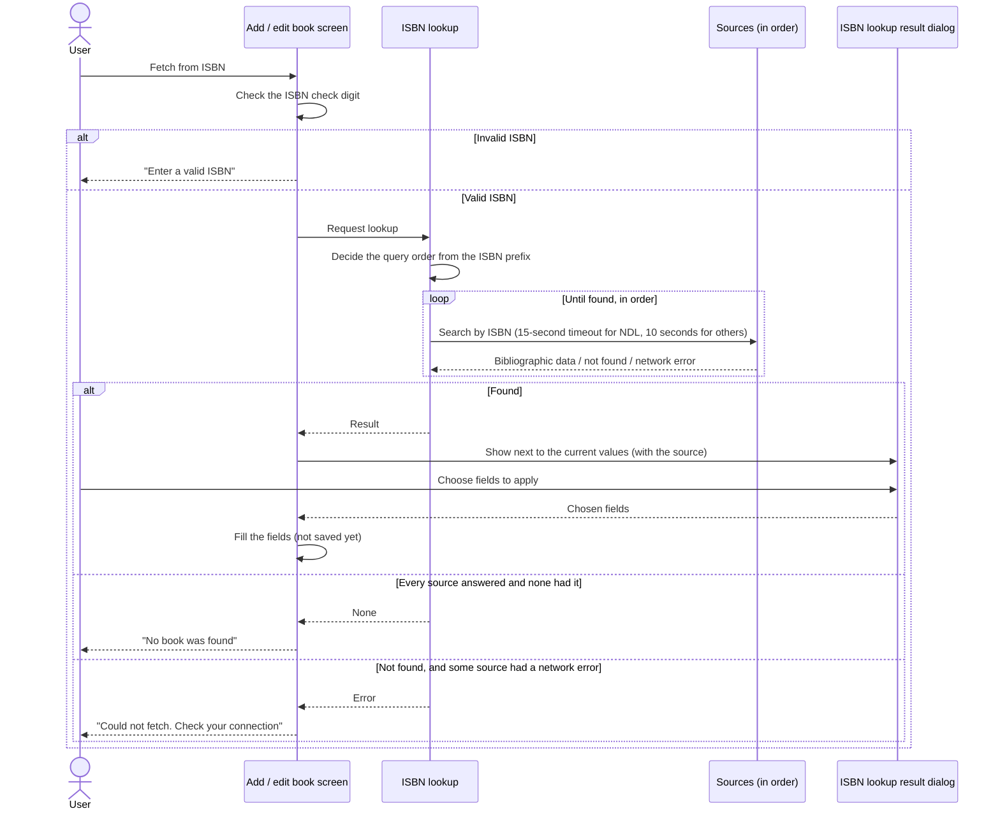

Because a source that failed might have had the book, the app does not claim "not found" in that case.
### 8.3 Setting a cover

Image processing takes time, so it runs in a separate isolate to keep the UI responsive.

### 8.4 Export

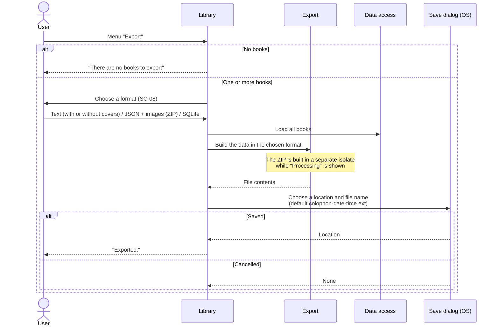

| Format | Contents | Importable |
|---|---|---|
| Text | Formatted text for reading. Labels are in the display language; user content is unchanged. Books are numbered. With "Include covers", the text and a folder of cover images are packed into a ZIP (the checkbox state is kept for next time) | No |
| JSON + images (ZIP) | `books.json` and a `covers/` folder ([9.3](#93-export-files)) | Yes |
| SQLite | A copy of the whole database | Yes |

### 8.5 Import

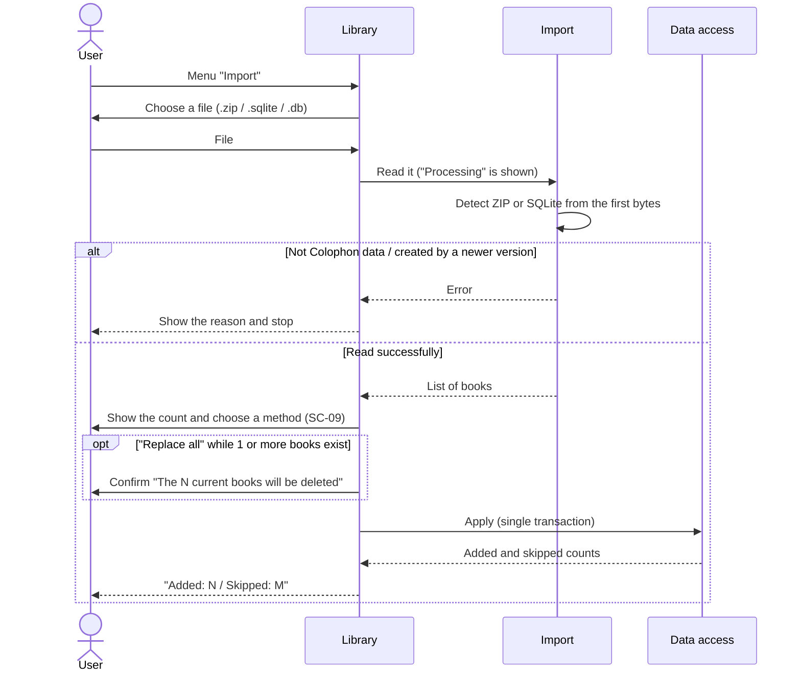

The rules when applying are as follows. Everything runs in one transaction; if anything fails, nothing is changed.

- When replacing, books are not skipped because of a matching ISBN (some users own several copies of the same book).
- Invalid ISBNs (e.g. "unknown") are not used to detect duplicates.
- Imported books and notes get the import time as their update time. If they kept the times from the file, sync would judge the cloud version newer and revert the imported contents.
- Deletion markers set by "Replace all" also reach other computers through sync.

### 8.6 Search

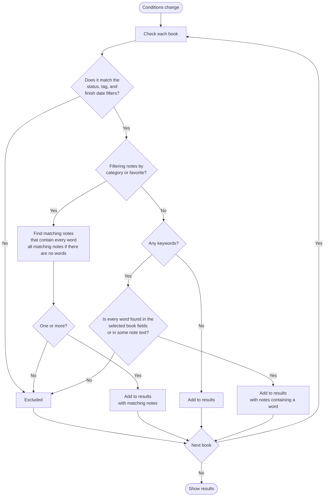

- Comparison ignores letter case and full-/half-width differences.
- ISBNs match with or without hyphens.

### 8.7 Sync

One sync compares and merges the sync data in the cloud with the contents of this computer, sends the merged result to the cloud, and writes it to this computer.

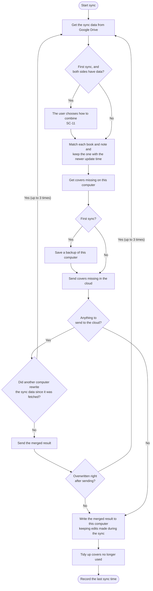

**Merge rules**

| Situation | Result |
|---|---|
| The same book was changed on two computers | The whole book with the newer update time wins (finish dates, tags, and note order count as part of the book) |
| The same note was changed on two computers | For each note, the one with the newer update time wins (decided separately from its book) |
| Same update time | Deletion wins. If neither is a deletion, the cloud side wins (so every computer reaches the same result) |
| Deleted on one, edited on the other | The later action wins. If the deletion is later, all notes of the book are deleted too. If the edit is later, the book is revived and the notes deleted together with it come back (notes deleted individually do not) |
| Different notes added on different computers | Both are kept. Notes missing from the order are appended in order of creation |
| Tags differing only in spelling ("SF" and "sf", etc.) | Treated as the same tag, not as a difference |
| The cloud has unreadable records | Readable records are taken in, but this computer sends nothing (so that overwriting does not erase those records). The user is told so |
| The cloud sync data uses a newer app's format or is damaged | Sync stops and nothing is overwritten |

- Recorded times (created, updated, deleted) are corrected by the difference from Google's server time, so the newer side is judged correctly even if a computer's clock is off.
- If a sync fails or is interrupted, this computer's data stays as it was before writing (writing is done at the end in a single transaction).
- The cloud files are checked before and right after sending; if another computer rewrote them, the sync starts over from fetching (so the other computer's changes are not overwritten). After 3 collisions in a row, the sync fails as "busy".
- Covers are sent before the sync data (so other computers never refer to covers that have not arrived).
- When a sync fails, the reason is shown in the sync section.

| Reason | Message | Automatic retry |
|---|---|---|
| Cannot connect / temporary trouble on Google's side | Could not connect. … | Yes |
| Collided with other computers' syncs repeatedly | Another computer was syncing at the same time. … | Yes |
| A cover that should be in the cloud is not there yet | Some cover images have not arrived yet. … | Yes |
| Unexpected failure | Could not sync. | Yes |
| Sign-in needed again (permission revoked, expired, etc.) | Colophon is no longer allowed to use your Google Drive. … | No |
| Google Drive storage full | Your Google Drive storage is full. | No |
| Sync data written by a newer version of the app | Please update the app. | No |
| The cloud sync data is damaged | The sync data on Google Drive is damaged, so syncing stopped. | No |
| Saving to this computer (DB, backup) failed | Could not save to this computer. … | No |

### 8.8 First sync

Only when this computer has never synced and both the cloud and this computer have (non-deleted) books or notes is the user asked how to combine them (SC-11). If only one side has data, it is merged without asking. Before syncing with the chosen method, this computer's data is saved to `sync-backups/` (before anything is written to Google Drive; if saving fails, nothing is changed).

| Method | Books only on this computer | Books only in the cloud | Books on both with different contents |
|---|---|---|---|
| Combine | Kept and sent. However, a book with the same valid ISBN as a book only in the cloud is combined into one | Taken into this computer | The newer one |
| Replace with Google Drive | Deleted (the sync data is not sent to the cloud) | Taken into this computer | The cloud's contents |
| Replace with this computer | Kept and sent | Marked as deleted and sent (also removed from other computers) | This computer's contents, sent with the update time set to now so that they beat versions left on other computers |

Notes are handled like books. A book combined by ISBN uses the cloud side's ID (to match other computers); its bibliographic fields come from the newer of the two, its finish dates and tags are the union of both, and the notes of both are kept.

### 8.9 Automatic sync

While signed in, the app syncs automatically at these times.

| Trigger | When it syncs |
|---|---|
| Startup (with a saved sign-in) | After 3 seconds |
| User changes (saving or deleting a book, toggling a favorite, renaming or deleting a tag, importing, etc.) | 30 seconds after the last change. Even if changes continue, it syncs 5 minutes after the first change |
| Changes made during a sync | Once more, 2 seconds after that sync finishes |
| Temporary failures ("Yes" in the table in [8.7](#87-sync)) | Retries after 1, 2, 5, 15, and 30 minutes (then every 30 minutes). A success resets the interval |
| Failures that need the user ("No" in the same table) | No automatic retry |
| The first-sync choice is pending | No automatic sync until the user chooses |
| App exit | If there are unsent changes, syncs before exiting (SC-12) |
| Right after signing in / "Sync now" | Immediately |

When a sync changes data on this computer, the library and an open book screen are reloaded ([5.3](#sc-03-view--add--edit-book)).

### 8.10 Deleting all data and sync

When "Delete all data" is run while signed in, the final confirmation asks what to delete. With either choice, sync on this computer is turned off (signed out) before deleting (so that deleted data is not brought back from the cloud).

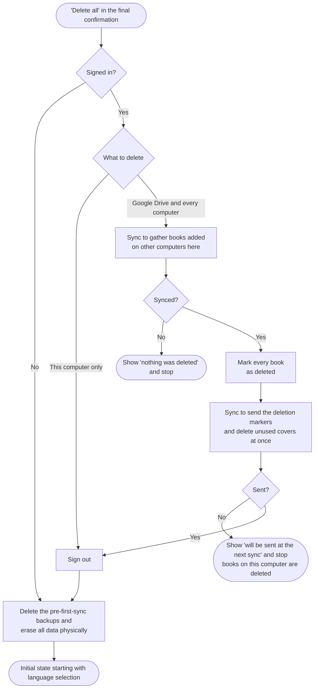

| Scope | Result |
|---|---|
| This computer only (default) | Signs out, then erases this computer's data. Data on Google Drive and other computers is kept |
| Google Drive and every computer | Marks the books and notes in the cloud as deleted; other computers delete them at their next sync. Then erases this computer's data |

- With "every computer", if the first sync cannot be completed (no connection, or unreadable records in the cloud), nothing is deleted. If it counts as a first sync, it uses "Combine".
- The deletion markers get times later than each book's update time, so that books with future update times set on a computer whose clock ran fast are reliably deleted too.

---

## 9. External interfaces

### 9.1 National Diet Library Search (OpenSearch)

| Item | Details |
|---|---|
| Use | Fetch bibliographic data by ISBN (queried first for books from Japan, Korea, China, etc.) |
| Request | `GET https://ndlsearch.ndl.go.jp/api/opensearch?isbn={ISBN}` |
| Response | RSS (XML). The first `item` is used |
| Fields used | Title (`dc:title` + volume `dcndl:volume`), statement of responsibility (author, translator, and supervisor separated by role words), publisher (`dc:publisher`), edition (`dcndl:edition`) |
| Authentication | None |

### 9.2 Sources and query order

| ISBN prefix | Query order |
|---|---|
| 978-4 (Japan) | National Diet Library Search → Open Library |
| 978-2, 979-10 (French-speaking) | Bibliothèque nationale de France → Open Library |
| 978-3 (German-speaking) | German National Library → Open Library |
| 978-0, 978-1 (English-speaking) | Open Library → Library of Congress |
| Others (Korea, China, etc.) | National Diet Library Search → Open Library → Library of Congress |

| Source | Request | Fields used | Terms |
|---|---|---|---|
| Open Library | `GET https://openlibrary.org/api/books?bibkeys=ISBN:{ISBN}&format=json&jscmd=data` (JSON) | Title (+ subtitle), authors, publisher | Asserts no new rights over the data. Up to 1 request per second. Identify the app and a contact in the User-Agent |
| Library of Congress | `GET https://lx2.loc.gov/sru/lcdb?…&query=bath.isbn={ISBN}&recordSchema=dc` (SRU) | Title, authors, publisher | No registration. No explicit terms of use found |
| Bibliothèque nationale de France | `GET https://catalogue.bnf.fr/api/SRU?…&query=bib.isbn all "{ISBN}"&recordSchema=dublincore` (SRU) | Title, authors and translators, publisher | Licence Ouverte (commercial use allowed). Show the source |
| German National Library | `GET https://services.dnb.de/sru/dnb?…&query=num={ISBN}&recordSchema=oai_dc` (SRU) | Title, authors and translators, publisher | Free, no registration (data under CC0) |

- The order is based on success rates measured in 2026-10 with 150 books in 6 languages. Each country's books are best covered by its national library; combined, 149 of 150 books were found.
- Google Books, used previously, is no longer used: keyless requests hit a shared daily quota and fail, and its display requirements (logo and links) could not be met.
- No source is used to fetch cover images. Results show their source (attribution).
### 9.3 Export files

| Format | Extension | Structure |
|---|---|---|
| Text | `.txt` | UTF-8 text listing, per book, a separator line, the number and title, the filled-in fields, and notes. Favorite notes are marked with "★" (e.g. `- ★ [Learnings] p.30`) |
| Text + covers | `.zip` | `colophon.txt` (the text above; books with a cover get a "Cover: covers/…" line) and `covers/{number}_{title}.{ext}` |
| JSON + images | `.zip` | `books.json` (format name `colophon`, format version, array of books) and `covers/{uuid}.{ext}` |
| SQLite | `.sqlite` | An SQLite file with the same structure as the app's database |

For the fields in `books.json`, see ["Export format" in README.md](../../README.md#export-format-json--images).

### 9.4 Google sign-in (OAuth 2.0)

| Item | Details |
|---|---|
| Use | Sign-in for sync (authorization with a Google account) |
| Method | The OAuth 2.0 authorization code flow for installed apps, with PKCE (`S256`) and `state`. The redirect is received on the computer's loopback address (`http://127.0.0.1:{free port}`) |
| Authorization | Opens `https://accounts.google.com/o/oauth2/v2/auth` in the default browser |
| Tokens | The returned authorization code is exchanged for an access token and a refresh token. The access token is refreshed automatically when it expires, and the refreshed token is saved again |
| Permission (scope) | Only `https://www.googleapis.com/auth/drive.appdata` (read and write the app-specific area) |
| Sign-out | Invalidates the token with `POST https://oauth2.googleapis.com/revoke`. The saved sign-in is erased even if this request fails |
| Client | A client ID for a desktop app registered in Google Cloud. Not included in the repository; passed at build time ([BUILDING.md](../../BUILDING.md)). An app built without it cannot sync |

### 9.5 Google Drive API (v3)

| Item | Details |
|---|---|
| Use | Storing and fetching the sync data and covers |
| Area | `appDataFolder` (the app-specific area). Files in the trash are ignored |
| Operations | Listing files (`files.list`), downloading (`files.get`), creating and overwriting (`files.create` / `files.update`), deleting (`files.delete`), updating a cover's extra property (`unusedSince` in `appProperties`), getting the email address for display (`about.get`) |
| Files | `colophon-sync.json` (sync data, JSON), `cover-{SHA-256}` (covers) |
| Detecting rewrites | Compares file IDs and content MD5 (`md5Checksum`) to notice rewrites by other computers |
| Time | Measures the difference from the server time from the `Date` response header and uses it to correct recorded times |
| Authentication | The access token obtained in [9.4](#94-google-sign-in-oauth-20) |

---

## 10. Non-functional requirements

| Category | Requirement | How it is met |
|---|---|---|
| Portability | Same features on Windows / macOS / Linux; can expand to mobile later | Flutter builds every OS from one codebase. Layouts adapt to the window width |
| Localization | 7 languages, with more addable later | UI strings are kept in one file per language. Data stores language-independent codes |
| Offline use | Works without a network except for ISBN lookup and sync. Work can continue while sync is not possible | Data is stored in SQLite on the device. Every sync compares the whole contents, so changes that could not be sent are sent at the next successful sync (temporary failures are retried automatically, and the app also syncs at startup) |
| Data integrity | Data is not corrupted if saving or importing fails midway | Changes are applied in a transaction and rolled back on failure |
| Data integrity | A sync that fails or is interrupted does not corrupt or lose data on any computer | Writing to this computer happens at the end in a single transaction. The cloud is checked for rewrites before and right after sending, so other computers' changes are not overwritten. Covers are sent before the sync data. Nothing is sent while the cloud has unreadable records. A backup is saved before the first sync ([8.7](#87-sync), [8.8](#88-first-sync)) |
| Data integrity | Editing on several computers leads to the same result on every computer | For each book and note, the newer update time wins; on a tie, deletion wins, then the cloud side. Computer clock differences are corrected by the difference from Google's server time ([8.7](#87-sync)) |
| Data integrity | Existing data keeps working when an update changes the data structure | Schema versioning with automatic migration. Data created by a newer version is not opened; the user is told why. The sync data also has a format version; data in a newer format is neither read nor overwritten |
| Data portability | Users can take their data out at any time | Export in 3 formats. The JSON format is simple and documented |
| Responsiveness | Heavy work does not freeze the UI | Image processing and ZIP creation run in separate isolates, with a progress indicator |
| Privacy | User data is not sent anywhere the user has not chosen | The only communication is sending an ISBN during lookup and, when sync is used (after signing in), exchanging data with the user's own Google Drive. Sync uses only the app-specific area with the `drive.appdata` permission and does not read the user's other files. Settings are not sent. Signing out also invalidates the token on Google's side |
| Security | Sign-in credentials do not leak | Credentials are stored in the OS secure storage. Sign-in uses PKCE and `state`, and the redirect from the browser is received only on the computer itself (127.0.0.1). The Google client ID is not included in the repository |
| Mistake prevention | Ask before irreversible actions | Confirmation dialogs for deletion, replace-all import, discarding unsaved changes, and signing out. Deleting all data is confirmed in two steps and, while signed in, asks what to delete. The user chooses how to combine data on the first sync |
| Distribution and removal | Ship in each OS's usual format and let users reliably delete their data | Windows installer (asks whether to delete data on uninstall), macOS .dmg, Linux Flatpak (can delete data) and .deb. Because some formats cannot delete data on uninstall, the app offers "Delete all data" ([BUILDING.md](../../BUILDING.md)) |
| Recognizability | The icon alone says "an app for managing books and notes", and it does not look out of place on any of the 3 OSes | Three book spines (deep green, navy, and burgundy with gold bands) and an orange sticky tab poking out above them, on a pale blue rounded-square plate. The plate shape and margins follow the macOS standard; Windows and Linux use tighter margins at small sizes. Bands and the shelf are omitted at 40 px and below |
| Accessibility | Readable regardless of color vision or preference | 6 color themes and a brightness setting. Contrast of 4.5:1 or more in every theme. Statuses also distinguished by icon + text. The Universal theme is verified by color-vision simulation ([5.4](#54-color-themes)) |

---

## 11. Constraints and known limitations

| Limitation | Impact |
|---|---|
| Title sort uses character code order | Japanese titles are not in reading (gojūon) order; accented letters sort after unaccented ones |
| HEIC images cannot be read | Convert iPhone photos to JPEG or similar before setting them as covers |
| Translator / supervisor detection depends on the source's wording | Users check and correct the result after fetching |
| Opening the same database from several app instances at once is not expected | Overlapping writes wait up to 3 seconds; a remaining conflict results in a save error |
| Each OS version can only be built on that OS | See [BUILDING.md](../../BUILDING.md) |
| Sync supports only Google Drive and needs a Google account | Other cloud services cannot be used |
| An app built without the Google client settings cannot sync | The sync section in Settings shows that sync is not available ([BUILDING.md](../../BUILDING.md)) |
| When the same book is changed on two computers, the whole book with the newer update time wins | Fields are not merged individually, so fields changed on the older side are lost (notes are decided one by one) |
| Settings are not synced | Display language, color theme, etc. are set on each computer |
| Covers no longer used stay on Google Drive for a while | Deleted after 7 days or more (immediately when "every computer" is chosen in "Delete all data") |
| Only the library and an open book screen are reloaded automatically after a sync | An open search or tag manager screen shows the changes only after it is reopened |

---

## 12. Future extensions (not implemented)

> The contents of this chapter are **not implemented yet**. It records the plan and the preparations already made.
>
> "Sync between devices", previously in this chapter, has been implemented and moved to [8.7](#87-sync) and the other chapters (revision 1.8).

### 12.1 Smartphone and tablet versions

- Support iPhone / iPad / Android (layouts already adapt to the window width).
- Register books by scanning the barcode (ISBN) with the camera.
