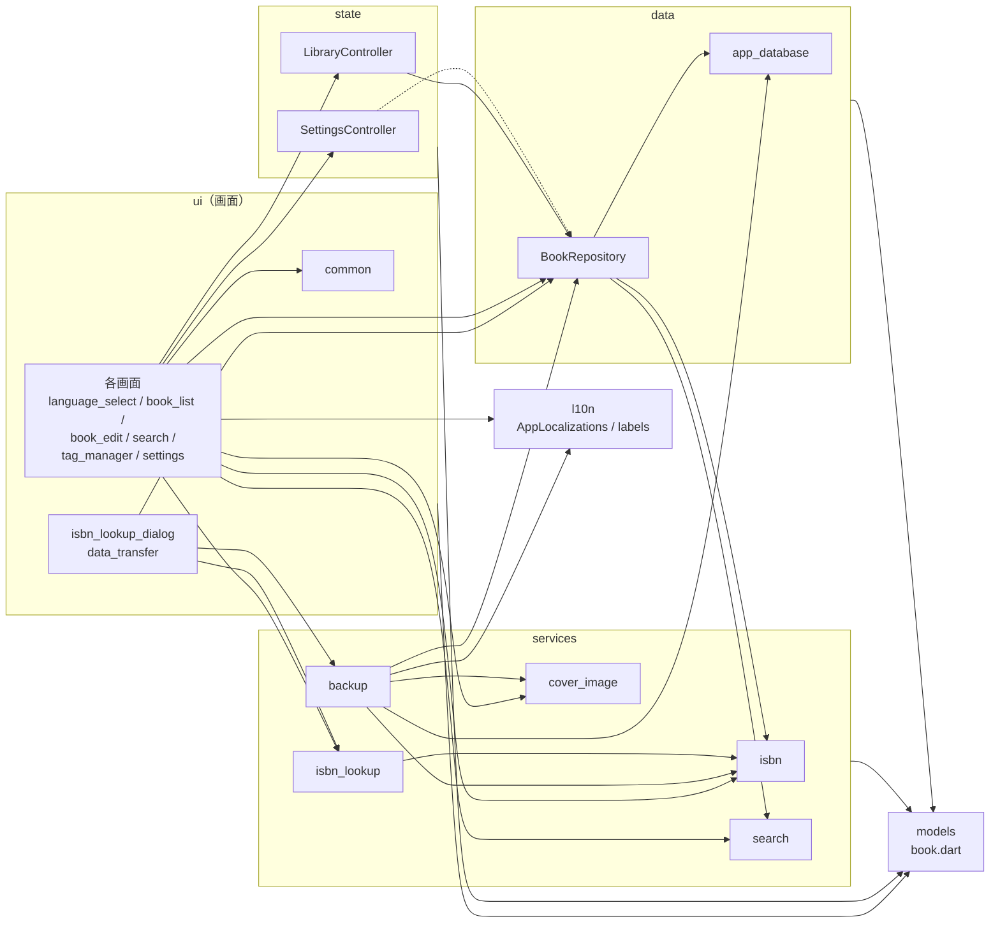
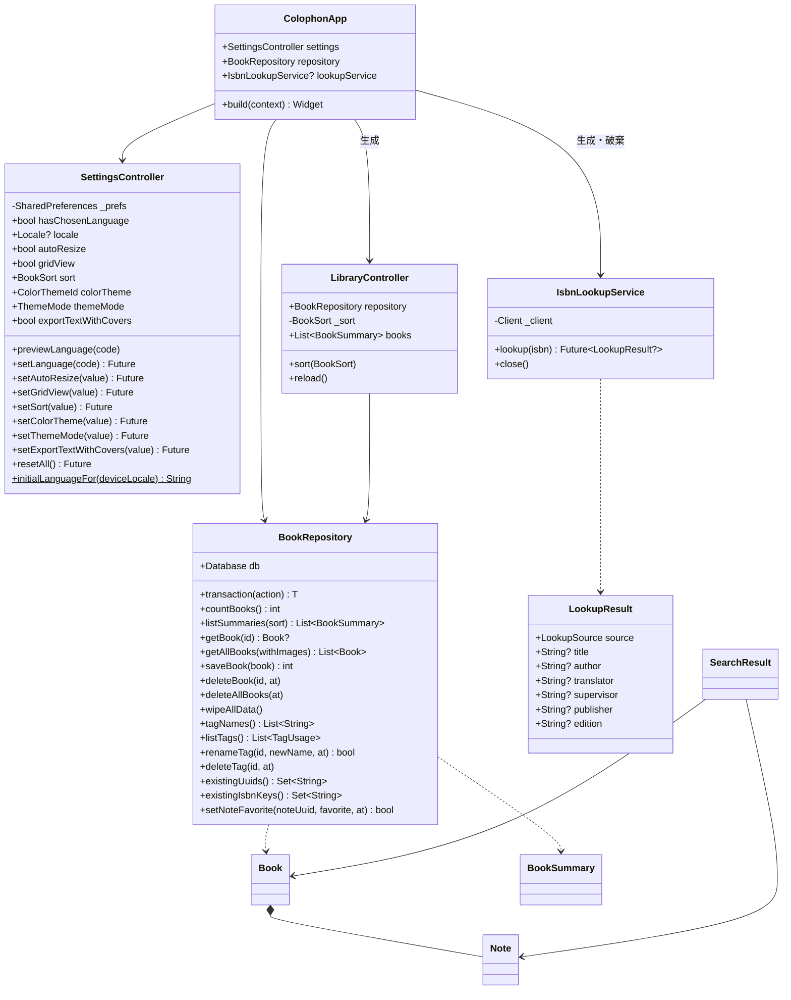
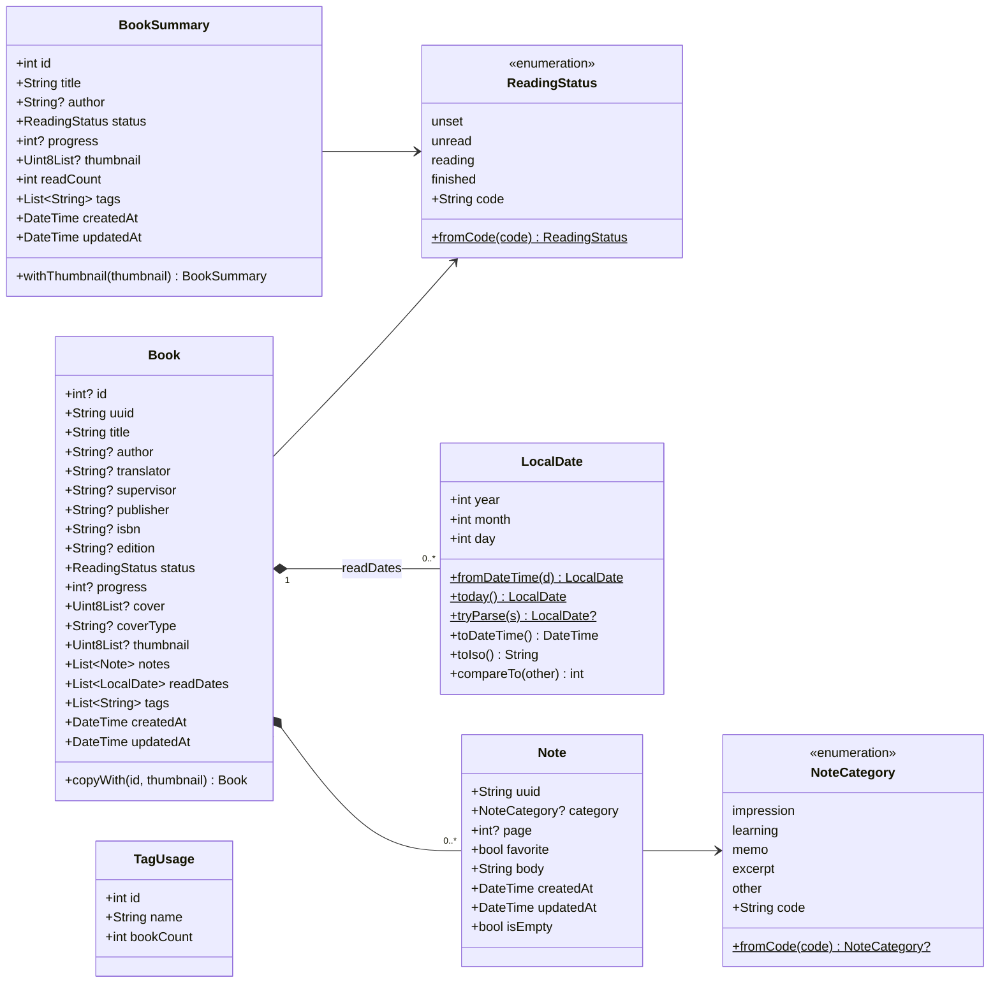
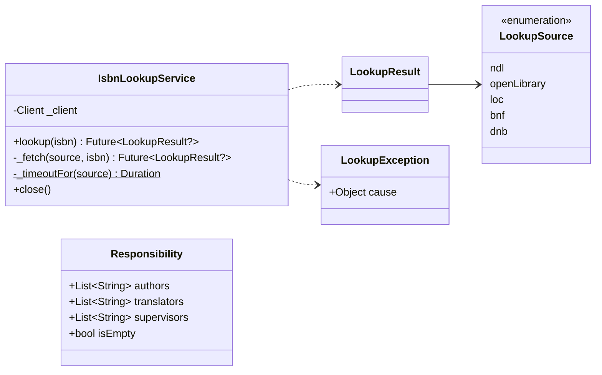
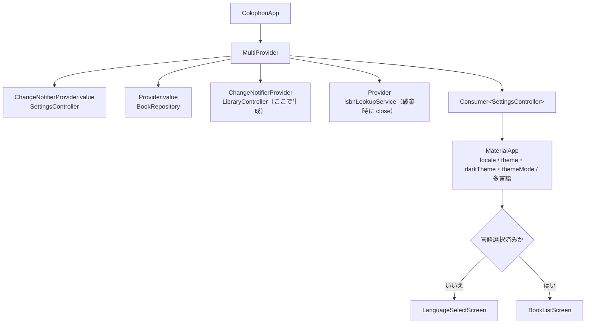
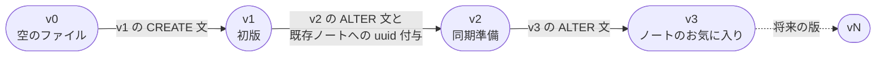
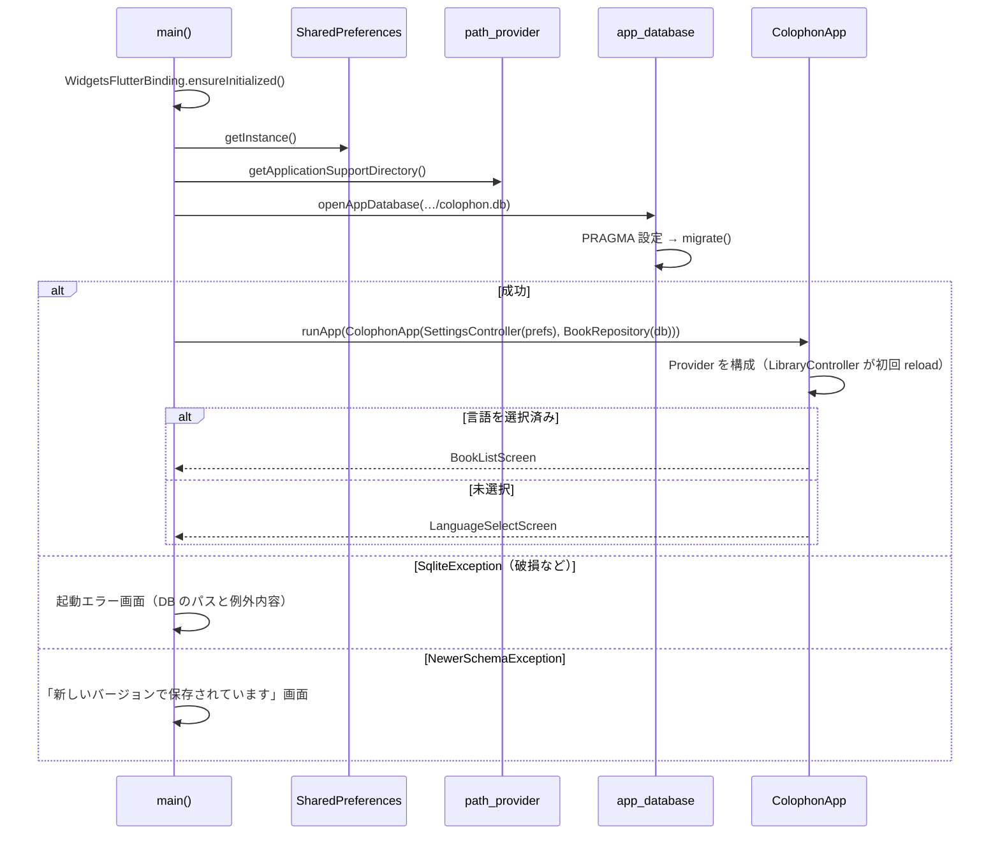
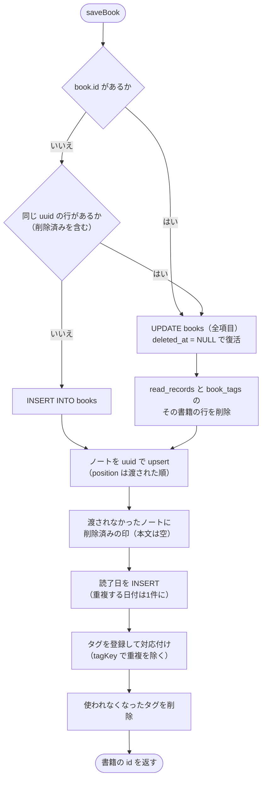
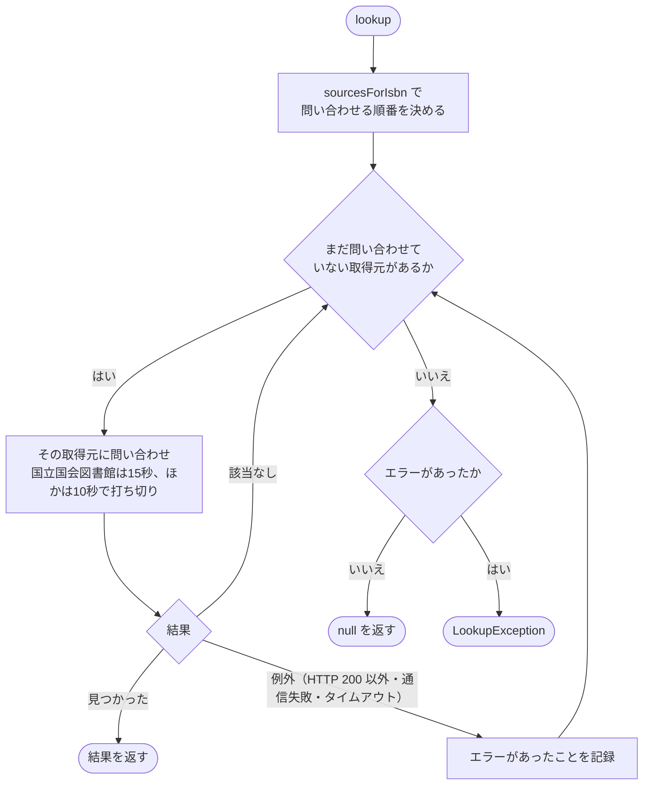

# Colophon 詳細設計書

日本語 | [English](detail-design.md)

| 項目 | 内容 |
|---|---|
| 対象 | Colophon 1.0.0（DB スキーマ v3／エクスポート形式 v1） |
| 文書の位置づけ | [基本設計書](basic-design.ja.md) で定めた機能を、どのクラス・メソッド・SQL で実現しているかを記す |
| 作成日 | 2026-10-14 |

## 改訂履歴

| 版 | 日付 | 内容 |
|---|---|---|
| 1.0 | 2026-10-14 | 初版 |
| 1.1 | 2026-10-14 | 配色テーマ・明るさの設定とステータスのアイコンを追加（[5.12](#512-配色テーマ)） |
| 1.2 | 2026-10-14 | テキストのエクスポートに書影を含めるオプションを追加（[5.8](#58-エクスポート)） |
| 1.3 | 2026-10-14 | ISBN 取得の取得元を変更（Google Books を外し、Open Library・米国議会図書館・フランス国立図書館・ドイツ国立図書館を追加）（[5.6](#56-isbn-からの取得)） |
| 1.4 | 2026-10-14 | ノートのお気に入りを追加（スキーマ v3、`setNoteFavorite`、検索の絞り込み、テキストの★）（[5.13](#513-ノートのお気に入り)） |
| 1.5 | 2026-10-15 | 書籍のビューアモードを追加（[5.14](#514-ビューアモード)。登録済みの書籍は保存後にビューアへ戻る）。日付を年付きで表示 |
| 1.6 | 2026-10-15 | すべてのデータの削除と、各 OS の配布用パッケージを追加（[5.15](#515-すべてのデータの削除と配布用パッケージ)） |
| 1.7 | 2026-10-15 | アプリアイコンの原本と書き出し先を追加（[5.15](#515-すべてのデータの削除と配布用パッケージ)） |

## 目次

1. [実装方針](#1-実装方針)
2. [モジュール構成](#2-モジュール構成)
3. [クラス設計](#3-クラス設計)
4. [データベース詳細設計](#4-データベース詳細設計)
5. [処理詳細](#5-処理詳細)
6. [入力チェック](#6-入力チェック)
7. [メッセージ](#7-メッセージ)
8. [エラー処理](#8-エラー処理)
9. [設定値・定数](#9-設定値定数)
10. [多言語対応](#10-多言語対応)
11. [プラットフォーム固有の設定](#11-プラットフォーム固有の設定)
12. [テスト設計](#12-テスト設計)

> 図は Mermaid で記述している（表示方法は [基本設計書](basic-design.ja.md) の冒頭を参照）。

---

## 1. 実装方針

### 1.1 使用技術とパッケージ

| 区分 | 名称 | バージョン（pubspec） | 用途 |
|---|---|---|---|
| 言語・基盤 | Dart / Flutter | Dart ^3.13.5（Flutter 3.47 以降） | |
| DB | `sqlite3` | ^3.7.1 | SQLite へのアクセス（同期 API）。ネイティブライブラリはビルド時に自動取得 |
| 状態管理 | `provider` | ^6.1.5 | 画面への依存オブジェクトの受け渡しと変更通知 |
| 設定保存 | `shared_preferences` | ^2.5.6 | 端末ごとの設定 |
| ファイル | `file_picker` | ^13.1.0 | ファイルを開く・保存するダイアログ |
| 画像 | `image` | ^4.12.0 | 画像の読み込み・縮小・JPEG/PNG 変換 |
| ZIP | `archive` | ^4.5.2 | エクスポート ZIP の作成・読み込み |
| HTTP | `http` | ^1.6.0 | ISBN 取得の通信 |
| XML | `xml` | ^7.1.0 | 国立国会図書館サーチの応答の解析 |
| 文字正規化 | `unorm_dart` | ^0.3.3 | NFKC 正規化（全角・半角の同一視） |
| ID | `uuid` | ^4.6.0 | 書籍・ノートの ID（UUID v4） |
| その他 | `intl`、`path`、`path_provider`、`package_info_plus`、`flutter_localizations` | | 多言語・パス操作・保存先の取得・バージョン表示 |

### 1.2 設計上の決まりごと

| 方針 | 内容 | 理由 |
|---|---|---|
| 層の依存方向 | `ui` → `state` → `data`、`ui` → `services` → `data`。`models` はどこからでも参照可。逆向きの依存は作らない | 画面を作り直しても業務ロジックを流用できるように |
| DB アクセスは同期 | `sqlite3` の同期 API をメインスレッドで呼ぶ | 個人の蔵書規模（数千冊）では十分速く、非同期化より単純 |
| 重い処理は Isolate | 画像処理と ZIP 作成は `Isolate.run` で別スレッドにする | 画面が固まらないように |
| 保存は1トランザクション | 1冊の保存、インポート全体をそれぞれ1トランザクションにまとめる | 途中で失敗しても中途半端なデータを残さない |
| 日時は UTC の文字列 | ISO 8601（例 `2026-10-14T03:00:00.000Z`）で保存し、表示時に端末の時刻へ変換 | 端末のタイムゾーンに依存しない |
| 読了日は日付のみ | `LocalDate`（`yyyy-MM-dd`）で扱い、時刻・タイムゾーンを持たない | 「その日に読み終えた」という意味を保つ |
| コード値で保存 | ステータス・分類は英字コードで保存し、表示時に翻訳する | 言語を切り替えてもデータに影響しない |
| 削除は印を付ける | 行を残して `deleted_at` を記録する | 将来の同期で削除を伝えるため |

---

## 2. モジュール構成

### 2.1 ファイル一覧

| パス | 主な内容 |
|---|---|
| `lib/main.dart` | 起動処理。DB を開き、失敗時は起動エラー画面を出す |
| `lib/app.dart` | `ColophonApp`。Provider の構成、テーマ、言語、最初の画面の決定 |
| `lib/models/book.dart` | `ReadingStatus`、`NoteCategory`、`LocalDate`、`Note`、`Book`、`BookSummary`、`TagUsage` |
| `lib/data/app_database.dart` | スキーマ定義、移行（`migrate`）、接続の初期設定 |
| `lib/data/book_repository.dart` | `BookRepository`（書籍・ノート・読了日・タグの読み書き） |
| `lib/services/isbn.dart` | ISBN の正規化・検証・同一判定キー |
| `lib/services/isbn_lookup.dart` | `IsbnLookupService`、応答の解析、責任表示の振り分け |
| `lib/services/cover_image.dart` | 書影の検証・縮小・形式変換・サムネイル作成 |
| `lib/services/search.dart` | 検索条件・検索処理・文字の正規化・タグの同一判定キー |
| `lib/services/backup.dart` | エクスポート（テキスト・ZIP・SQLite）とインポート |
| `lib/state/settings_controller.dart` | `SettingsController`（端末設定）と対応言語の一覧 |
| `lib/state/library_controller.dart` | `LibraryController`（書籍一覧の状態） |
| `lib/l10n/app_*.arb` | 7言語の文言 |
| `lib/l10n/app_localizations*.dart` | ARB から自動生成されるコード（手で編集しない） |
| `lib/l10n/labels.dart` | コード値を文言に変換する拡張メソッド |
| `lib/ui/common.dart` | 共通の部品（確認ダイアログ、処理中表示、書影表示、ステータス表示など） |
| `lib/ui/app_theme.dart` | 配色テーマ（`buildTheme`）、ステータスの色（`StatusColors`）とアイコン（`statusIcon`） |
| `lib/ui/language_select_screen.dart` | SC-01 言語選択 |
| `lib/ui/book_list_screen.dart` | SC-02 書籍一覧 |
| `lib/ui/book_edit_screen.dart` | SC-03 書籍の表示・登録・編集（モードの切り替えと編集モード） |
| `lib/ui/book_viewer.dart` | SC-03 のビューアモード（`BookViewer`） |
| `lib/ui/isbn_lookup_dialog.dart` | SC-04 ISBN 取得結果 |
| `lib/ui/search_screen.dart` | SC-05 検索 |
| `lib/ui/tag_manager_screen.dart` | SC-06 タグ管理 |
| `lib/ui/settings_screen.dart` | SC-07 設定 |
| `lib/ui/data_transfer.dart` | SC-08 エクスポート／SC-09 インポートの操作の流れ |
| `installer/` | 配布用パッケージの作成スクリプトと設定（Windows・macOS・Linux。[5.15](#515-すべてのデータの削除と配布用パッケージ)） |

### 2.2 依存関係



`settings -.-> repo` は並び順の型 `BookSort` だけを参照している。

---

## 3. クラス設計

### 3.1 全体のクラス図



関数として実装している処理（`searchBooks`、`processCover`、`exportZip`、`applyImport` など）は、各節の表で示す。

### 3.2 モデル（`lib/models/book.dart`）



| クラス | 補足 |
|---|---|
| `ReadingStatus.fromCode` | 未知のコード・null は `unset` |
| `NoteCategory.fromCode` | 未知のコード・null は null（分類なし） |
| `LocalDate.tryParse` | `yyyy-MM-dd` 以外、実在しない日付（例 2026-02-30）は null |
| `Note` | `uuid` 省略時は UUID v4 を生成。`updatedAt` 省略時は `createdAt` |
| `Note.isEmpty` | 本文が空白のみ、かつ分類・ページが null |
| `Book` | すべて不変（final）。`notes`・`readDates`・`tags` の省略時は空リスト |
| `Book.copyWith` | `id` と `thumbnail` だけを差し替える（インポート時のサムネイル再生成用） |
| `BookSummary` | 一覧表示用。書影本体・ノートを持たないので軽い |

### 3.3 データアクセス

#### `lib/data/app_database.dart`

| 要素 | 内容 |
|---|---|
| `schemaVersion` | 現在のスキーマバージョン（3） |
| `openAppDatabase(path)` | ファイルを開いて `prepareDatabase` |
| `openInMemoryDatabase()` | メモリ上の DB（テスト用） |
| `prepareDatabase(db)` | `PRAGMA foreign_keys = ON`、`PRAGMA busy_timeout = 3000` の後に `migrate` |
| `readSchemaVersion(db)` | `PRAGMA user_version` を返す |
| `migrate(db, {target})` | 現在のバージョンから `target`（既定は最新）まで順に移行。DB の方が新しければ `NewerSchemaException` |
| `NewerSchemaException` | 新しいアプリで作られた DB。開かずに案内する |

#### `BookRepository`（`lib/data/book_repository.dart`）

| メソッド | 処理 |
|---|---|
| `transaction(action)` | `BEGIN`〜`COMMIT`。例外時は `ROLLBACK` して再送出。すでにトランザクション中（`db.autocommit == false`）なら外側にまとめる |
| `countBooks()` | 削除済みでない書籍の件数 |
| `listSummaries({sort})` | 一覧用の書籍。読了回数はサブクエリで数える。並び順は `recent`=`created_at DESC, id DESC`、`title`=`title COLLATE NOCASE, id` |
| `getBook(id)` | 1冊を関連データ込みで返す。削除済みなら null |
| `getAllBooks({withImages})` | 全書籍を関連データ込みで返す（`created_at, id` 順）。`withImages: false` で書影・サムネイルを読まない（検索・テキスト出力用） |
| `saveBook(book)` | 書籍の保存（[5.2](#52-書籍の保存)） |
| `deleteBook(id, {at})` | 削除済みの印を付ける（[5.3](#53-書籍の削除)） |
| `deleteAllBooks({at})` | 全書籍に削除済みの印を付ける |
| `wipeAllData()` | 全テーブルの行を物理的に消去し、`VACUUM` でファイルを詰め直す（削除済みの印も残さない）。「すべてのデータを削除」で使う |
| `tagNames()` | タグ名の一覧（`name_key` 順） |
| `listTags()` | タグと付いている冊数 |
| `renameTag(id, newName, {at})` | 同じ `name_key` の別タグがあれば false。そのタグが付いた書籍の `updated_at` を更新してから改名 |
| `deleteTag(id, {at})` | そのタグが付いた書籍の `updated_at` を更新してから削除（`book_tags` は外部キーで連動削除） |
| `existingUuids()` | 削除済みでない書籍の uuid の集合（インポートの重複判定用） |
| `existingIsbnKeys()` | 削除済みでない書籍の ISBN 同一判定キーの集合 |
| `setNoteFavorite(noteUuid, favorite, {at})` | ノート1件のお気に入りを切り替えてすぐ保存し、ノートとその書籍の `updated_at` を更新する。対象がない・削除済みなら false（[5.13](#513-ノートのお気に入り)） |

### 3.4 業務処理（services）

#### `isbn.dart`

| 関数 | 処理 |
|---|---|
| `normalizeIsbn(input)` | NFKC 正規化 → 空白・各種ハイフン（`- ‐ ‑ – — ― − ー`）を除去 → 大文字化 |
| `isValidIsbn(input)` | ISBN-10（重み 10〜1、合計が 11 の倍数、末尾 X=10）または ISBN-13（重み 1,3 交互、合計が 10 の倍数） |
| `isbnMatchKey(input)` | 正しい ISBN なら ISBN-13 にそろえた文字列、そうでなければ null |

#### `isbn_lookup.dart`



| 関数 | 処理 |
|---|---|
| `parseNdlResponse(xml)` | 最初の `item` から書籍名（`dc:title`、なければ `title`）＋巻次、責任表示、出版社、版を取り出す。`item` がなければ null |
| `sourcesForIsbn(isbn)` | ISBN の国・言語の番号から問い合わせる順番を返す（[5.6](#56-isbn-からの取得)） |
| `requestUri(source, isbn)` | 各取得元への要求 URL |
| `parseOpenLibraryResponse(json, isbn)` | `ISBN:{isbn}` の要素から書籍名（`title: subtitle`）、著者（`, ` 区切り）、最初の出版社。要素がなければ null |
| `parseDublinCoreResponse(xml, source)` | 米国議会図書館・フランス国立図書館・ドイツ国立図書館の SRU 応答（Dublin Core）の最初のレコードから、書籍名・著者・翻訳者・出版社を取り出す。レコードがなければ null |
| `cleanCatalogTitle(raw)` | 目録の書名から「 / 著者名」と末尾の区切り記号を除く |
| `cleanCatalogPublisher(raw, source)` | 出版者表示から出版地を除き、出版社名だけにする |
| `parseCatalogCreator(raw, source)` | 目録の著者表示を名前と役割（`CreatorRole`: 著者・翻訳者・その他）に分け、「姓, 名」を「名 姓」にする |
| `parseResponsibility(statement)` | 責任表示を役割ごとに振り分ける（[5.6](#56-isbn-からの取得)） |

#### `cover_image.dart`

| 要素 | 内容 |
|---|---|
| `ProcessedCover` | `bytes`、`mimeType`、`thumbnail`、`width`、`height`、`resized` |
| `processCover(bytes, {autoResize})` | `processCoverSync` を `Isolate.run` で実行 |
| `processCoverSync(bytes, {autoResize})` | 書影の処理本体（[5.5](#55-書影の処理)）。読めない画像は `CoverImageException` |
| `makeThumbnail(bytes)` | サムネイルだけを作る（インポート用、Isolate）。読めなければ null |
| `mimeTypeOf(bytes)` | 先頭バイトから jpg/png/gif/webp/bmp を判定。それ以外は null |
| `extensionOfMime(mime)` | MIME タイプからエクスポート用の拡張子（不明は `jpg`） |

#### `search.dart`

| 要素 | 内容 |
|---|---|
| `SearchField` | `title`、`author`、`translator`、`supervisor`、`publisher`、`isbn`、`notes` |
| `SearchQuery` | `text`、`fields`（既定はすべて）、`statuses`、`categories`（null は分類なし）、`favoritesOnly`（お気に入りのノートだけ）、`tags`、`readFrom`、`readTo` |
| `SearchResult` | `book` と、一致した `matchedNotes` |
| `normalizeForSearch(s)` | NFKC 正規化 → 小文字化 |
| `tagKey(name)` | 前後の空白を除いて `normalizeForSearch`。タグの同一判定とDBの `name_key` に使う |
| `searchBooks(books, query)` | 検索本体（[5.7](#57-検索)） |

#### `backup.dart`

| 要素 | 内容 |
|---|---|
| `backupFormatName` / `backupFormatVersion` / `backupJsonFileName` | `colophon` / `1` / `books.json` |
| `exportText(books, l, {now, coverPaths})` | テキスト形式（[5.8](#58-エクスポート)）。`coverPaths`（uuid → ZIP 内のパス）を渡すと書影の行を出す |
| `exportTextWithCovers(books, l, {now})` | テキスト＋書影の ZIP（`colophon.txt` と `covers/`）。ZIP 作成は Isolate で実行 |
| `coverFileName(number, book)` | 書影の画像ファイル名（`番号_書籍名.拡張子`） |
| `exportZip(books, {now})` / `exportZipInBackground(books)` | ZIP 形式（後者は Isolate で実行） |
| `exportSqlite(db)` | `VACUUM INTO` で一時ファイルに書き出してバイト列を返す |
| `readBackup(bytes)` | 先頭バイトで形式を判定して読み込む（[5.9](#59-インポート)） |
| `readZipBackup(bytes)` / `readSqliteBackup(bytes)` | 各形式の読み込み |
| `applyImport(repo, books, mode)` | 読み込んだ書籍を DB へ反映し `ImportResult(added, skipped)` を返す |
| `InvalidBackupException` / `NewerBackupException` | Colophon のデータでない／新しい形式 |
| `ImportMode` | `replace`（すべて置き換え）／`merge`（追加） |

### 3.5 状態管理（state）

| クラス | 保持するもの | 変更通知のタイミング |
|---|---|---|
| `SettingsController` | 表示言語（確定値と選択中のプレビュー値）、配色テーマ（`ColorThemeId`）、明るさ（`ThemeMode`）、書影の自動縮小、一覧の表示形式、並び順、テキストのエクスポートに書影を含めるか | 各 setter の呼び出し時（保存より先に通知） |
| `LibraryController` | 書籍一覧（`List<BookSummary>`）と並び順 | `reload()` の完了時、`sort` の変更時 |

`SettingsController.locale` は、初回の言語選択中は選びかけの言語（プレビュー）を、それ以外は確定した言語を返す。`supportedLanguages` に対応言語のコードと自言語表記を定義する。

### 3.6 画面（ui）

#### Provider の構成



#### 画面とウィジェット

| クラス | 種類 | 主な責務 |
|---|---|---|
| `LanguageSelectScreen` | Stateful | 端末の言語から初期候補を決め、選択のたびに `previewLanguage`、続けるで `setLanguage` |
| `BookListScreen` | Stateless | 一覧／格子の切り替え、並び替え、メニュー。`openBookEditor` で SC-03 を開く |
| `BookEditScreen` | Stateful | 書籍1冊の表示・編集（下表）。登録済みはビューアモード、新規は編集モードで開く |
| `BookViewer` | Stateless | ビューアモードの表示。保存済みの `Book` を受け取り、入力済みの項目だけを出す（[5.14](#514-ビューアモード)） |
| `_NoteDraft` | 内部クラス | 編集中のノート1件（uuid・分類・お気に入り・ページと本文の入力欄）。`toNote(now)` で内容（お気に入りを含む）が変わったときだけ `updatedAt` を更新 |
| `_NoteCard` | Stateless | ノート1件の入力欄と上下移動・削除ボタン。並べ替えても状態がずれないよう `ObjectKey(_NoteDraft)` を付ける |
| `_TagEditor` | Stateful | タグ入力。`Autocomplete` に親の入力欄とフォーカスを渡す |
| `showIsbnLookupDialog` | 関数＋Stateful | 反映する項目（`LookupField`）と値の Map を返す |
| `SearchScreen` | Stateful | 検索対象の全書籍（画像なし）を保持し、条件の変更で `searchBooks` を実行 |
| `TagManagerScreen` | Stateful | `listTags` を表示し、改名・削除後に一覧と書籍一覧を再読み込み |
| `SettingsScreen` | Stateless | 設定の変更。配色テーマは `_ThemeSwatch`（いまの明るさでの主色とステータスの色の見本）を並べて選ぶ。バージョンは `PackageInfo` から取得 |
| `runExport` / `runImport` | 関数 | エクスポート・インポートの操作の流れ（[5.8](#58-エクスポート)・[5.9](#59-インポート)） |
| `deleteAllDataFlow` | 関数 | 「すべてのデータを削除」の二段階確認と実行（[5.15](#515-すべてのデータの削除と配布用パッケージ)） |
| `confirmDialog` / `showMessage` / `runWithProgress` | 関数 | 確認ダイアログ、下部のメッセージ、処理中ダイアログを出しながらの非同期処理 |
| `FavoriteButton` | Stateless | ノートのお気に入りボタン（☆／★）。編集画面のノート欄と検索結果のノートで使う |
| `CoverThumbnail` / `StatusBadge` / `ContentWidth` | Stateless | 書影（なければ仮表紙）、ステータス表示（`StatusColors` の色＋`statusIcon` のアイコン＋文字）、広い画面での最大幅 |

#### `BookEditScreen` の内部状態

| 状態 | 型 | 内容 |
|---|---|---|
| `_title` ほか | `TextEditingController` ×8 | 書籍名・著者・翻訳者・監修・出版社・ISBN・版数・進捗 |
| `_tagInput` / `_tagFocus` | 入力欄・フォーカス | タグ入力欄（保存時に入力途中の文字を確定するため親が持つ） |
| `_original` | `Book?` | 編集前の書籍（新規は null） |
| `_uuid` | `String` | 書籍の uuid（新規は生成） |
| `_status`、`_cover`、`_coverType`、`_thumbnail` | | ステータスと書影 |
| `_readDates`、`_tags`、`_notes` | リスト | 読了日・タグ・ノート（`_NoteDraft`） |
| `_knownTags` | `List<String>` | 入力候補にする既存タグ |
| `_dirty` | `bool` | 未保存の変更があるか |
| `_viewMode` | `bool` | ビューアモードか（登録済みの書籍は true で開く） |
| `_lifecycle` | `AppLifecycleListener` | ウィンドウを閉じる要求の受け取り |

---

## 4. データベース詳細設計

### 4.1 接続時の設定

| 設定 | 値 | 目的 |
|---|---|---|
| `PRAGMA foreign_keys` | ON | 外部キー制約と連動削除を有効にする |
| `PRAGMA busy_timeout` | 3000（ミリ秒） | 別の接続が書き込み中でもすぐには失敗しない |
| `PRAGMA user_version` | スキーマバージョン | 移行の要否の判定 |
| ファイル | アプリ用フォルダの `colophon.db` | `path_provider` の `getApplicationSupportDirectory()` |

### 4.2 テーブル定義

#### books（書籍）

| 列 | 型 | NULL | 制約・既定値 | 内容 |
|---|---|---|---|---|
| `id` | INTEGER | | PRIMARY KEY | 端末内の連番 |
| `uuid` | TEXT | 不可 | UNIQUE | 端末をまたぐ ID（UUID v4） |
| `title` | TEXT | 不可 | | 書籍名 |
| `author` | TEXT | 可 | | 著者 |
| `translator` | TEXT | 可 | | 翻訳者 |
| `supervisor` | TEXT | 可 | | 監修 |
| `publisher` | TEXT | 可 | | 出版社 |
| `isbn` | TEXT | 可 | | ISBN（入力どおり） |
| `edition` | TEXT | 可 | | 版数 |
| `status` | TEXT | 不可 | 既定 `'unset'`、CHECK（4種のコード） | ステータス |
| `progress` | INTEGER | 可 | CHECK（0〜100） | 進捗 |
| `cover` | BLOB | 可 | | 書影 |
| `cover_type` | TEXT | 可 | | 書影の MIME タイプ |
| `thumbnail` | BLOB | 可 | | 一覧用の縮小画像（JPEG） |
| `created_at` | TEXT | 不可 | | 登録日時（UTC） |
| `updated_at` | TEXT | 不可 | | 更新日時（UTC） |
| `deleted_at` | TEXT | 可 | | 削除日時（null なら有効） |

空文字の任意項目は NULL として保存する（`_blankToNull`）。書影が null のときは `cover_type`・`thumbnail` も NULL にする。

#### notes（ノート）

| 列 | 型 | NULL | 制約・既定値 | 内容 |
|---|---|---|---|---|
| `id` | INTEGER | | PRIMARY KEY | |
| `book_id` | INTEGER | 不可 | FK → books(id) ON DELETE CASCADE | |
| `position` | INTEGER | 不可 | | 並び順（0から） |
| `category` | TEXT | 可 | CHECK（5種のコード） | 分類（null は分類なし） |
| `page` | INTEGER | 可 | CHECK（1以上） | ページ |
| `favorite` | INTEGER | 不可 | 既定 0、CHECK（0 または 1） | お気に入り（v3 で追加） |
| `body` | TEXT | 不可 | | 本文（削除時は空文字） |
| `created_at` | TEXT | 不可 | | |
| `updated_at` | TEXT | 不可 | | |
| `uuid` | TEXT | 可（運用上は必須） | UNIQUE INDEX `notes_uuid` | 端末をまたぐ ID |
| `deleted_at` | TEXT | 可 | | 削除日時 |

#### read_records（読了記録）

| 列 | 型 | NULL | 制約 | 内容 |
|---|---|---|---|---|
| `id` | INTEGER | | PRIMARY KEY | |
| `book_id` | INTEGER | 不可 | FK → books(id) ON DELETE CASCADE | |
| `finished_on` | TEXT | 不可 | | 読了日（`yyyy-MM-dd`） |

#### tags（タグ）

| 列 | 型 | NULL | 制約 | 内容 |
|---|---|---|---|---|
| `id` | INTEGER | | PRIMARY KEY | |
| `name` | TEXT | 不可 | | 表示名（最初に登録した表記） |
| `name_key` | TEXT | 不可 | UNIQUE | 同一判定キー（`tagKey(name)`） |

#### book_tags（書籍とタグの対応）

| 列 | 型 | NULL | 制約 |
|---|---|---|---|
| `book_id` | INTEGER | 不可 | PK、FK → books(id) ON DELETE CASCADE |
| `tag_id` | INTEGER | 不可 | PK、FK → tags(id) ON DELETE CASCADE |

#### インデックス

| 名前 | 対象 | 種類 |
|---|---|---|
| `notes_book` | notes(book_id, position) | 通常 |
| `read_records_book` | read_records(book_id) | 通常 |
| `notes_uuid` | notes(uuid) | UNIQUE |

### 4.3 スキーマの移行



| 版 | 内容 |
|---|---|
| v1 | 5テーブルとインデックス `notes_book`・`read_records_book` を作成 |
| v2 | `books.deleted_at`・`notes.uuid`・`notes.deleted_at` を追加。既存ノートに SQL で UUID v4 形式の値を振り、`notes_uuid` を作成 |
| v3 | `notes.favorite`（既定 0）を追加。既存ノートはお気に入りなしになる |

- 各版の手順は1トランザクションで実行し、最後に `PRAGMA user_version = N` を設定する。失敗したら ROLLBACK してその版のまま。
- 既存の版の SQL は書き換えない。変更は新しい版として `_migrations` に追加する。
- DB の `user_version` がアプリの `schemaVersion` より大きければ `NewerSchemaException`（起動時は案内画面、インポート時は `NewerBackupException`）。

### 4.4 主な SQL

**ノートの保存（uuid での upsert）**

```sql
INSERT INTO notes (uuid, book_id, position, category, page, body, favorite, created_at, updated_at)
VALUES (?, ?, ?, ?, ?, ?, ?, ?, ?)
ON CONFLICT (uuid) DO UPDATE SET
  book_id = excluded.book_id, position = excluded.position, category = excluded.category,
  page = excluded.page, body = excluded.body, favorite = excluded.favorite,
  created_at = excluded.created_at, updated_at = excluded.updated_at, deleted_at = NULL;
```

**外したノートに削除済みの印を付ける**

```sql
UPDATE notes SET deleted_at = ?, updated_at = ?, body = ''
WHERE book_id = ? AND deleted_at IS NULL AND uuid NOT IN (?, ?, ...);
```

**一覧の取得**

```sql
SELECT b.id, b.title, b.author, b.status, b.progress, b.thumbnail, b.created_at, b.updated_at,
       (SELECT COUNT(*) FROM read_records r WHERE r.book_id = b.id) AS read_count
FROM books b
WHERE b.deleted_at IS NULL
ORDER BY b.created_at DESC, b.id DESC;   -- 書籍名順は b.title COLLATE NOCASE ASC, b.id ASC
```

**タグの登録と対応付け**

```sql
INSERT OR IGNORE INTO tags (name, name_key) VALUES (?, ?);
INSERT OR IGNORE INTO book_tags (book_id, tag_id) SELECT ?, id FROM tags WHERE name_key = ?;
DELETE FROM tags WHERE id NOT IN (SELECT tag_id FROM book_tags);   -- 使われなくなったタグ
```

---

## 5. 処理詳細

### 5.1 起動



### 5.2 書籍の保存

`BookEditScreen._save()` の手順:

1. `Form.validate()`（[6. 入力チェック](#6-入力チェック)）。NG なら終了。
2. `_commitPendingTag()`: タグ欄に残った文字を、同じ `tagKey` のタグがなければ追加。
3. 進捗: `int.tryParse` の結果が 0〜100 ならその値、それ以外は null（非表示の欄に残った範囲外の値を捨てる）。
4. ノート: 各 `_NoteDraft.toNote(now)` のうち `isEmpty` でないもの。
5. `Book` を組み立てる（`createdAt` は編集前の値、新規は now。`updatedAt` は now）。
6. `BookRepository.saveBook`。例外なら「エラーが発生しました」を表示して画面に留まる。
7. `LibraryController.reload()`、「保存しました」を表示。登録済みの書籍は `_viewMode = true` にしてビューアモードへ戻る（画面は閉じない）。新規登録は `_close()` で一覧へ戻る（戻るべきビューアがなく、続けて別の本を登録しやすいため）。

`BookRepository.saveBook(book)` の手順（全体で1トランザクション）:



### 5.3 書籍の削除

`deleteBook(id, {at})`（`at` の既定は現在時刻）を1トランザクションで行う。

| 対象 | 処理 |
|---|---|
| books | `deleted_at`・`updated_at` を `at` に。`cover`・`cover_type`・`thumbnail` を NULL |
| notes | 有効なノートの `deleted_at`・`updated_at` を `at` に。`body` を空文字 |
| read_records / book_tags | その書籍の行を物理削除（書籍の属性として、同期時は書籍と一緒に送る） |
| tags | 使われなくなったタグを削除 |

### 5.4 未保存の変更の扱い（編集画面）

| 仕組み | 内容 |
|---|---|
| `_dirty` の設定 | 各入力欄のリスナー（`_markDirty`）と、書影・ステータス・読了日・タグ・ノートの変更（`_change`）で true |
| 画面内の戻る | `PopScope(canPop: !_dirty)`。戻れなかったときに `_confirmLeave` で破棄を確認 |
| ビューアへの切り替え | `_setViewMode(true)`。`_dirty` なら「保存して表示（`_saveBook` が成功したら切り替え）／破棄して表示（`_load(_original)` で戻す）／キャンセル」を選ぶ |
| ウィンドウを閉じる | `AppLifecycleListener.onExitRequested` で `_dirty` なら確認し、`AppExitResponse.cancel` か `exit` を返す |
| 保存・削除・破棄の後 | `_close()`: `_dirty = false` にして再描画し、次のフレームで `Navigator.pop`（`canPop` は再描画後に反映されるため） |

### 5.5 書影の処理

`processCoverSync(bytes, autoResize)`:

| 手順 | 内容 |
|---|---|
| 1. 読み込み | `img.decodeImage`。失敗・例外なら `CoverImageException` |
| 2. 向きの補正 | `img.bakeOrientation`（EXIF の回転情報を画素に反映） |
| 3. 縮小判定 | `autoResize` かつ（長辺 > 2000px または バイト数 > 2MB） |
| 4a. 縮小する | 長辺が 2000px を超えていれば長辺 2000px に縮小（`Interpolation.average`）。透過部分を白で塗り、JPEG 品質 85 で保存。`resized = true` |
| 4b. 一般的でない形式 | `mimeTypeOf` が null なら、透過ありは PNG、なしは JPEG 品質 90 に変換 |
| 4c. そのまま | 元のバイト列と判定した MIME タイプ |
| 5. サムネイル | 長辺 360px 以下に縮小し、透過を白で塗って JPEG 品質 80 |

### 5.6 ISBN からの取得

**問い合わせる順番（`sourcesForIsbn`）**: ISBN-10 は ISBN-13 に直してから、先頭の番号で決める。

| ISBN の先頭 | 順番 |
|---|---|
| `9784` | 国立国会図書館 → Open Library |
| `9782`・`97910` | フランス国立図書館 → Open Library |
| `9783` | ドイツ国立図書館 → Open Library |
| `9780`・`9781` | Open Library → 米国議会図書館 |
| それ以外 | 国立国会図書館 → Open Library → 米国議会図書館 |

この順番は、2026-10 に各国の図書館目録から集めた6言語150冊で各サービスの取得率を測った結果に基づく（国立国会図書館と4館を合わせて149冊を取得。Google Books は API キーなしの共有上限に達していて取得できなかった）。

`IsbnLookupService.lookup(isbn)`:



見つからず、途中に通信エラーの取得元があった場合は、その取得元に本があったかもしれないので null（見つからない）ではなく `LookupException`（接続を確認してください）にする。

要求ヘッダー `User-Agent: Colophon (https://github.com/colophonbooks)` を付ける（Open Library がアプリ名と連絡先の明示を求めているため）。応答は UTF-8 として読む。
**責任表示の振り分け（`parseResponsibility`）**

1. 責任表示を `, ， ; ；` で区切る。
2. 各部分を「名前＋空白（または括弧）＋役割語」として照合する。役割語の前に空白か括弧がないものは役割語とみなさない（「山田文」の「文」を誤認しないため）。
3. 役割語のない部分は保留し、次に現れた役割語の対象に含める。最後まで残った保留は著者とする。

| 役割語 | 振り分け先 |
|---|---|
| 著、作、文、絵、編、編著、著者、原作、原著 | 著者 |
| 訳、翻訳、共訳、編訳、訳・解説、訳・注 | 翻訳者 |
| 監修、監訳 | 監修 |
| 解説、注、校注、装丁、装画、イラスト | 使わない |

責任表示がない場合は `dc:creator` の値から生没年（例 `, 1959-`）を除いて著者とする。外国語資料の書名に付く言語の注記（「 : [中国語]」など）は除く。同じ名前は1回だけにし、国立国会図書館の結果は「、」、ほかの取得元は「, 」で連結する。

**目録の表記の整え方（米国議会図書館・フランス国立図書館・ドイツ国立図書館）**

| 項目 | フランス国立図書館 | ドイツ国立図書館 | 米国議会図書館 |
|---|---|---|---|
| 書名（元の表記） | `Jaune : histoire d'une couleur / Michel Pastoureau` | `0 1 2 : Roman / Daniel Wisser` | `Art history /` |
| 書名の処理 | 最初の「 / 」以降を除き、末尾の区切り記号（`/ : ; , .` と空白）を除く | 同左 | 同左 |
| 著者（元の表記） | `Pastoureau, Michel (1947-....). Auteur du texte` | `Liedtke, Rüdiger [Verfasser]` | `Stokstad, Marilyn, 1929-2016.` |
| 役割の取り出し | 最後の「. 」の後ろ | 末尾の `[…]` | 末尾の `, author.` など |
| 生没年 | 末尾の `(…)` を除く | ― | 末尾の `, 1929-2016` などを除く |
| 出版社（元の表記） | `Points (Paris)` | `München : Luchterhand Literaturverlag` | `Upper Saddle River, NJ : Pearson/Prentice Hall,` |
| 出版社の処理 | 末尾の `(出版地)` を除く | 最後の「 : 」の後ろ | 同左 |

- 名前は、カンマで2つに分かれる「姓, 名」なら「名 姓」に並べ替える（`Pastoureau, Michel` → `Michel Pastoureau`）。
- 末尾のピリオドは除くが、イニシャル（`Yuval N.` の `N.`）の点は残す。

| 役割（元の表記） | 振り分け先 |
|---|---|
| Traducteur、Traductrice、Übersetzer、Übersetzerin、translator | 翻訳者 |
| Auteur du texte、Auteur、Verfasser、Verfasserin、author、editor、Herausgeber、Herausgeberin、Directeur de publication、Éditeur scientifique、compiler、役割の記載なし | 著者 |
| それ以外（Illustrator、Illustrateur、Préfacier など） | その他（著者が1人もいないときだけ著者として使う。絵本などのため） |

### 5.7 検索

| 項目 | 内容 |
|---|---|
| 検索対象の読み込み | `SearchScreen` の表示時と、結果から編集画面を開いて戻ったときに `getAllBooks(withImages: false)` と `tagNames()` を読み込む |
| 実行のタイミング | キーワード入力は最後の入力から 200ms 後、その他の条件は変更の直後 |
| 正規化 | キーワード・対象文字列とも `normalizeForSearch`（NFKC＋小文字化）。キーワードは空白で分割 |
| 書籍の絞り込み | ステータス（いずれか）、タグ（`tagKey` で比較し、すべてを含む）、読了日（いずれかの読了日が範囲内。両端を含む） |
| 分類・お気に入りで絞り込む場合 | 選んだ分類（未選択ならすべて）かつ、お気に入りのみなら `favorite` のノートのうち、キーワードがなければすべて、あれば（ノート本文が検索対象のとき）全語を含むもの。1件以上ある書籍を返す |
| 分類を選ばない場合 | キーワードなし → 絞り込みを通った全書籍。あり → 各語が「選んだ書籍項目の連結文字列」か「いずれかのノート本文」に含まれる書籍。いずれかの語を含むノートを添える |
| ISBN の一致 | 書籍項目の連結文字列に加え、ハイフン等を除いた ISBN と、同様に正規化した語でも比較 |
| 表示 | 結果の書籍のサムネイルは `LibraryController.books` から id で引く |

### 5.8 エクスポート

`runExport(context)` の流れ: 件数0なら案内して終了 → 形式を選ぶ（テキストの下の「書影も含める（ZIPで保存）」のチェックは `SettingsController.exportTextWithCovers` に即時保存し、次回も同じ状態で表示）→ 処理中ダイアログを出しながらデータを作る → `FilePicker.saveFile`（初期ファイル名 `colophon-yyyyMMdd-HHmm.{txt|zip|sqlite}`）→ 保存できたら「エクスポートしました」。データ作成・保存で例外があれば「エクスポートに失敗しました」。

| 形式 | 作り方 |
|---|---|
| テキスト | `getAllBooks(withImages: false)` → `exportText` → UTF-8 |
| テキスト＋書影 | `getAllBooks()` → `exportTextWithCovers`。書影のある書籍ごとに `coverFileName` でファイル名を決めて `covers/` に無圧縮で入れ、そのパスをテキストに書く。拡張子は `.zip` |
| ZIP | `getAllBooks()` → `exportZipInBackground`（処理中ダイアログを表示）。書影は無圧縮（`CompressionType.none`）、`books.json` は deflate、JSON はインデント2 |
| SQLite | `exportSqlite(db)`: 一時フォルダへ `VACUUM INTO` → 読み込み → 一時フォルダを削除。削除済みの印の行も含む |

**テキスト形式の例**（表示言語が日本語の場合）

```text
Colophon エクスポート（2026-10-14 12:00）
1冊

========================================
[001] サピエンス全史
========================================
書影: covers/001_サピエンス全史.jpg
著者: ユヴァル・ノア・ハラリ
翻訳者: 柴田裕之
ISBN: 978-4-309-22671-2
ステータス: 読書中 (40%)
読了日: 2025-05-05
タグ: 歴史
登録日: 2026-01-02 12:04
更新日: 2026-10-14 11:58

[ノート]
- ★ [学び] p.30
  認知革命が転換点だった
```

入力されている項目だけを出力する。書籍には通し番号（冊数に応じた桁数、最低3桁）を付ける。「書影」の行は、書影を含めて書き出したときの、書影のある書籍だけに出る。進捗は読書中で値があるときだけ付ける。日時は端末の時刻で表示する。

**書影のファイル名（`coverFileName`）**

| 規則 | 例 |
|---|---|
| `{通し番号}_{書籍名}.{拡張子}`。拡張子は書影の形式（`extensionOfMime`） | `001_サピエンス全史.jpg` |
| `\ / : * ? " < > \|` と制御文字は `_` に置き換える | `A/B: C?` → `002_A_B_ C_.png` |
| 連続する空白は1つにし、前後の空白を除く | |
| 書籍名は60文字まで（文字単位で切る） | |
| 末尾のピリオド・空白を除く（Windows で使えないため） | `end...` → `003_end.jpg` |
| 書籍名が空になったら番号だけ | `...` → `004.jpg` |

番号が書籍ごとに違うので、同じ書籍名の本が複数あってもファイル名は重ならない。

### 5.9 インポート

**形式の判定（`readBackup`）**

| 先頭のバイト | 判定 |
|---|---|
| `SQLite format 3\0` | SQLite → `readSqliteBackup` |
| `PK\x03\x04` | ZIP → `readZipBackup` |
| その他 | `InvalidBackupException` |

**ZIP の検証と読み替え（`readZipBackup`）**

| 対象 | 不正なときの扱い |
|---|---|
| ZIP として読めない・`books.json` がない・JSON として読めない | `InvalidBackupException` |
| `format` が `colophon` でない、`books` が配列でない、`version` が整数でない | `InvalidBackupException` |
| `version` が現在の形式より新しい | `NewerBackupException` |
| 書籍の `title` が空・文字列でない | その書籍を読み飛ばす |
| `uuid` がない | 新しい UUID を振る |
| `status` が未知のコード | `unset` |
| `progress` が 0〜100 の整数でない | null |
| `cover` のファイルがない・画像形式を判定できない | 書影なし |
| `readDates` の不正な日付 | その日付を捨てる |
| ノートの `page` が1以上の整数でない／`category` が未知 | null |
| ノートの `uuid` がない | 新しい UUID を振る |
| ノートの `favorite` が `true` でない（項目なしを含む） | お気に入りなし |
| 本文・分類・ページがすべて空のノート | 捨てる |
| 日時が読めない | 書籍の `createdAt` は現在時刻、その他は書籍の `createdAt` |

書影がある書籍はサムネイルを作り直す（`makeThumbnail`）。

**SQLite の読み込み（`readSqliteBackup`）**: 一時フォルダにコピーして開き、`books` テーブルがない・`user_version` が1未満なら `InvalidBackupException`。`prepareDatabase` で一時コピーを現在のスキーマへ移行してから `getAllBooks()` で読む（新しい版なら `NewerBackupException`）。サムネイルがない書籍は作り直す。最後に一時フォルダを削除する。

**反映（`applyImport`）**: 基本設計書 [8.5](basic-design.ja.md#85-インポート) の判定を1トランザクションで行う。書籍は `id` を持たない `Book` として `saveBook` に渡し、同じ uuid の削除済み書籍があれば復活させる。

`runImport(context)` の画面側の流れ: ファイルを選ぶ（`zip`/`sqlite`/`sqlite3`/`db`）→ 処理中ダイアログを出しながら `readBackup` → 冊数を示して方法を選ぶ（0冊なら両方とも選べない）→ 置き換えで現在1冊以上なら確認 → `applyImport` → `LibraryController.reload()` → 結果を表示。

### 5.10 一覧の再読み込み

`LibraryController.reload()` は `listSummaries` を呼び、前回の一覧で **id と `updatedAt` が同じ書籍**は前回のサムネイルのバイト列（同じオブジェクト）を使い回す。`Image.memory` はバイト列の同一性で画像キャッシュを引くため、毎回新しい配列にすると全書影のデコードがやり直しになる。

### 5.11 タグ入力

| 操作 | 動作 |
|---|---|
| 文字を入力 | 既存タグのうち、`normalizeForSearch` で部分一致し、まだ付いていないものを候補に出す |
| ↑↓キーで候補を選んで Enter | 選んだ候補を追加（`_navigated` が true のときは `Autocomplete` の確定処理を使う） |
| 候補を選ばずに Enter | 入力した文字をそのまま追加（同じ `tagKey` のタグがすでに付いていれば何もしない） |
| 候補をクリック | その候補を追加 |
| 入力したまま保存 | 保存時に入力途中の文字をタグとして確定 |

### 5.12 配色テーマ

`buildTheme(id, brightness)` が `ColorScheme` と `StatusColors`（`ThemeExtension`）を持つ `ThemeData` を作る。`MaterialApp` には明るい版（`theme`）と暗い版（`darkTheme`）を渡し、`themeMode` で切り替える。

| テーマ（`ColorThemeId`） | `ColorScheme` の作り方 | ステータスの色 |
|---|---|---|
| `leather`（初期値） | `ColorScheme.fromSeed`（`#7B5536`、`tonalSpot`） | 配色から（下記） |
| `forest` | 同（`#2F6B4F`） | 配色から |
| `ocean` | 同（`#1F4E79`） | 配色から |
| `rose` | 同（`#8E3B5E`） | 配色から |
| `monochrome` | `fromSeed`（`#808080`、`DynamicSchemeVariant.monochrome`）。この変種でも赤のまま残るエラー系4色をグレーに置き換える | 固定（下表） |
| `universal` | `fromSeed`（`#005AFF`＝CUD 推奨配色の青、`DynamicSchemeVariant.fidelity`：基準色を主色にほぼそのまま使う） | 固定（下表） |

「配色から」は、未設定＝`surfaceContainerHighest`／`onSurfaceVariant`、未読＝`secondaryContainer`、読書中＝`primaryContainer`、読了＝`tertiaryContainer`（文字はそれぞれの `on〜`）。

**固定のステータス色**（背景／文字）

| テーマ・明るさ | 未設定 | 未読 | 読書中 | 読了 |
|---|---|---|---|---|
| モノクロ・明 | `#F2F2F2` / `#303030` | `#B3B3B3` / `#000000` | `#737373` / `#FFFFFF` | `#1E1E1E` / `#FFFFFF` |
| モノクロ・暗 | `#2C2C2C` / `#E0E0E0` | `#5E5E5E` / `#FFFFFF` | `#9E9E9E` / `#000000` | `#EDEDED` / `#000000` |
| ユニバーサル・明 | `#E6E6E6` / `#333333` | `#4DC4FF` / `#00205C` | `#F6AA00` / `#2B1A00` | `#005AFF` / `#FFFFFF` |
| ユニバーサル・暗 | `#3A3A3A` / `#E6E6E6` | `#0B3D91` / `#DDEEFF` | `#F6AA00` / `#1A1000` | `#4DC4FF` / `#001A33` |

ユニバーサルの `#005AFF`（青）・`#4DC4FF`（空色）・`#F6AA00`（オレンジ）はカラーユニバーサルデザイン推奨配色セットの色。青系とオレンジ系は、P型・D型でも T型でも色相の差が残る組み合わせで、さらに明るさにも差を付けている。

**ステータスのアイコン**（`statusIcon`）: 未設定＝`radio_button_unchecked`、未読＝`book_outlined`、読書中＝`bookmark`、読了＝`check_circle`。一覧のステータス表示、編集画面のステータス選択、検索の絞り込み、テーマの見本で使う。

**検証**（`test/theme_test.dart`）

| 確認 | 方法 | 基準 |
|---|---|---|
| コントラスト | 全テーマ×明暗で、`onSurface`/`surface`、`onSurfaceVariant`/`surface`、`onPrimary`/`primary`、`onPrimaryContainer`/`primaryContainer`、`onError`/`error`、`error`/`surface`、各ステータスの文字/背景の比を WCAG 2.x の式で計算 | 4.5 以上 |
| モノクロ | 主要な `ColorScheme` の色とステータスの色が R=G=B か | すべてグレー |
| 色覚による見分け | モノクロとユニバーサルのステータス背景色を、一般色覚と Machado ら（2009）の行列による P型・D型・T型（重度 1.0）のシミュレーションで変換し、CIELAB の色差（CIE76）を全組み合わせで計算 | ΔE 20 以上 |
### 5.13 ノートのお気に入り

| 操作場所 | 動作 | 保存のタイミング |
|---|---|---|
| 編集画面のノート欄（`_NoteCard` の `FavoriteButton`） | `_NoteDraft.favorite` を切り替え、未保存の変更として扱う | 保存ボタン（`saveBook` の upsert で `favorite` を書く） |
| 検索結果のノート（`_ResultTile` の `FavoriteButton`） | `BookRepository.setNoteFavorite` を呼び、検索対象を読み込み直す | 押した時点 |

- 検索結果からの切り替えでは、ノートと書籍の `updated_at` を更新する（将来の同期で変更を伝えるため）。
- 「お気に入りのノートだけ」で絞り込んでいる最中に☆を外すと、そのノートは結果から消える（読み込み直しで条件に合わなくなるため）。
- テキストのエクスポートでは、お気に入りのノートの見出しの先頭に「★」を付ける（表示言語にかかわらず同じ記号）。JSON には `favorite`（真偽値）を書き、SQLite には `notes.favorite` がそのまま入る。
- お気に入りの印だけが付いた空のノート（本文・分類・ページなし）は、ほかの空のノートと同じく保存しない。
### 5.14 ビューアモード

| 項目 | 内容 |
|---|---|
| 初期モード | `BookEditScreen.initState` で、登録済みの書籍は `_viewMode = true`、新規は false |
| 切り替え | 上部バーの `SegmentedButton<bool>`（表示／編集）。新規登録では出さない。ビューアモードでは削除・保存ボタンを出さず、Ctrl+S も働かない（`BookViewer` に入れ替わるため） |
| 表示する内容 | 常に保存済みの `_original`。編集モードの入力欄の内容は使わない |
| 未保存の変更 | 「保存して表示」は `_saveBook()`（入力チェック→保存→`_load(保存後の書籍)`、画面は閉じない）。入力エラーなら編集モードのまま。「破棄して表示」は `_load(_original)` で入力欄とノート（`_NoteDraft` を作り直す）を元に戻す |
| 保存ボタン | 編集モードの「保存」（Ctrl+S／⌘S）は `_saveBook()` のあと、登録済みの書籍ならビューアモードへ戻る。新規登録は一覧へ戻る |

`BookViewer` の表示規則:

- 書誌項目は `trim()` して空でないものだけ。項目名は `bodySmall`、値は `bodyMedium` の1行（`Text.rich`）。
- 読了日・タグ・ノートは、空なら見出しごと出さない。
- ノートの見出しは、分類（`labels.dart` の `category`）とページ（`p.N`）を「 · 」でつなぐ。両方ないノートは本文だけ。お気に入りは見出し行の右に★（`Icon` のみで操作なし）。
- 全体を `SelectionArea` で包み、文字を選択してコピーできるようにする。
### 5.15 すべてのデータの削除と配布用パッケージ

**すべてのデータを削除（`deleteAllDataFlow`）**

1. 案内のダイアログ（冊数を表示）。「キャンセル／先にエクスポート（`runExport`）／削除へ進む」から選ぶ。
2. 最終確認のダイアログ。「削除したデータは元に戻せないことを理解しました」にチェックするまで「すべて削除」は押せない。
3. 実行: `Navigator.popUntil(isFirst)` で最初の画面に戻す → `BookRepository.wipeAllData()` → `LibraryController.reload()` → `SettingsController.resetAll()`（`SharedPreferences.clear()` と既定値への戻し。表示言語も未選択になり、言語選択画面が表示される）。

削除済みの印（同期用）も残さず物理的に消す。データベースのファイル自体は空の状態で残る（アプリを動かし続けるため）。ファイルごと消すのはアンインストールの役割とする。

**配布用パッケージ**（作り方は [BUILDING.ja.md](../../BUILDING.ja.md)）

| OS | 形式 | ファイル | アンインストール時の書籍データ |
|---|---|---|---|
| Windows | Inno Setup のインストーラー（使う人ごと・管理者権限不要。VC++ ランタイムの DLL を同梱） | `installer/windows/colophon.iss`、`build-installer.ps1`、`Languages/ChineseSimplified.isl` | `CurUninstallStepChanged`（`usPostUninstall`）で確認し、「はい」なら `%APPDATA%\colophonbooks\Colophon` を削除。既定は「いいえ」。サイレント時は残す |
| macOS | .dmg（`hdiutil`） | `installer/macos/build-dmg.sh`、`UNINSTALL.txt` | 残る（macOS の仕組み）。案内文を同梱 |
| Linux | Flatpak（`org.freedesktop.Platform`） | `installer/linux/io.github.colophonbooks.colophon.yml`、`build-flatpak.sh` | `flatpak uninstall --delete-data` で削除 |
| Linux | .deb（`dpkg-deb`） | `installer/linux/build-deb.sh` | 残る（Debian の決まり） |

Linux の 2 形式は、デスクトップ登録（`.desktop`）とアプリ情報（AppStream の `.metainfo.xml`）、アイコン（`installer/linux/icons/hicolor/`）を共有する。

**アプリアイコン**

原本は `tool/icon/generate.mjs`（図柄と色の定義）。実行すると下表のファイルを書き出す（手順は [BUILDING.ja.md](../../BUILDING.ja.md)）。書き出したファイルもリポジトリに含め、アプリのビルドに Node.js を要らないようにする。

| 書き出し先 | サイズ（px） | 台座の余白 |
|---|---|---|
| `windows/runner/resources/app_icon.ico`（PNG 圧縮の項目を並べた .ico。インストーラーのアイコンも兼ねる） | 16, 20, 24, 32, 40, 48, 64, 256 | 詰める（台座が枠の約 95%） |
| `macos/Runner/Assets.xcassets/AppIcon.appiconset/app_icon_*.png` | 16, 32, 64, 128, 256, 512, 1024 | macOS の標準（1024 中 824）。64 以上は台座の下に影 |
| `installer/linux/icons/hicolor/<サイズ>/apps/io.github.colophonbooks.colophon.png` と `scalable/apps/….svg` | 16, 24, 32, 48, 64, 128, 256, 512 と SVG | 32 以下は詰める。48 以上は macOS と同じ（影なし） |

細部はサイズで減らす。96px 以上はすべて描く。48〜64px は付箋の折り返しを省く。40px 以下は本の帯と棚も省く（つぶれて濁るため）。
---

## 6. 入力チェック

| 画面 | 項目 | ルール | エラー時のメッセージキー |
|---|---|---|---|
| SC-03 | 書籍名 | 前後の空白を除いて1文字以上 | `titleRequired` |
| SC-03 | 進捗 | 空、または 0〜100 の整数（数字以外は入力できない） | `progressInvalid` |
| SC-03 | ノートのページ | 空、または1以上の整数（数字以外は入力できない） | `pageInvalid` |
| SC-03 | ISBN | 空、または正しい ISBN。正しくなくても保存可（警告のみ） | `isbnInvalidWarning`（警告） |
| SC-03 | ISBN から取得 | 正しい ISBN であること | `isbnLookupInvalid` |
| SC-06 | タグ名 | 空でないこと、ほかのタグと同じ `tagKey` でないこと | `tagNameRequired`、`tagExists` |

---

## 7. メッセージ

主なメッセージ（キーは `lib/l10n/app_en.arb` のもの。表示は日本語版の例）。

| キー | 種類 | 表示（日本語） | 表示するとき |
|---|---|---|---|
| `saved` | 情報 | 保存しました。 | 書籍の保存後 |
| `coverResized` | 情報 | 画像を {width} × {height} px に縮小しました。 | 書影を自動縮小したとき |
| `coverLoadFailed` | エラー | この画像は読み込めませんでした。 | 書影として読めない画像 |
| `lookupNotFound` | 情報 | このISBNの書籍は見つかりませんでした。 | ISBN 取得で該当なし |
| `lookupFailed` | エラー | 書籍情報を取得できませんでした。… | ISBN 取得で見つからず、通信エラーの取得元があった |
| `exportDone` / `exportFailed` / `exportEmpty` | 情報／エラー／情報 | エクスポートしました。／エクスポートに失敗しました。／エクスポートする書籍がありません。 | エクスポートの完了・失敗・0冊のとき |
| `importDone` | 情報 | インポートが完了しました。追加：{added}冊／スキップ：{skipped}冊 | インポート後 |
| `importInvalidFile` / `importNewerVersion` / `importFailed` | エラー | Colophon のデータではない／新しい版のファイル／インポートできない | インポート失敗 |
| `genericError` | エラー | エラーが発生しました。 | 保存時の予期しないエラー |
| `deleteBookConfirm` / `deleteNoteConfirm` / `deleteTagConfirm` / `importReplaceConfirm` / `unsavedBody` | 確認 | 「…」を削除しますか？ など | 取り消せない操作の前 |
| `askAddReadDateBody` | 確認 | 今日（{date}）の日付で読了記録を追加しますか？ | ステータスを読了に変えたとき |

---

## 8. エラー処理

| 例外・状況 | 発生箇所 | 処理する場所 | 利用者への表示 |
|---|---|---|---|
| `NewerSchemaException` | `migrate`（起動時） | `main` | 「新しいバージョンで保存されています」画面 |
| `SqliteException` | `openAppDatabase`（起動時） | `main` | DB のパスと例外内容を示す起動エラー画面 |
| 保存時の例外 | `saveBook` | `BookEditScreen._save` | `genericError`。画面は閉じない |
| `CoverImageException` | `processCoverSync` | `BookEditScreen._pickCover` | `coverLoadFailed` |
| `LookupException` | `IsbnLookupService.lookup` | `BookEditScreen._lookupIsbn` | `lookupFailed` |
| `InvalidBackupException` | `readBackup` 系 | `runImport` | `importInvalidFile` |
| `NewerBackupException` | `readBackup` 系 | `runImport` | `importNewerVersion` |
| その他の例外 | 読み込み・反映 | `runImport` | `importFailed`（反映はロールバック済み） |
| 例外 | エクスポートの作成・保存 | `runExport` | `exportFailed` |
| 利用者のキャンセル | ファイル選択・保存ダイアログ | 各呼び出し元 | 何も表示しない |

業務上の想定内の状況（該当なし・入力誤り・重複など）は例外にせず、戻り値（null、false、`ImportResult` の件数）で返す。非同期処理の後は `mounted`（`context.mounted`）を確認してから画面を操作する。

---

## 9. 設定値・定数

### 9.1 端末設定（shared_preferences）

| キー | 型 | 既定値 | 内容 |
|---|---|---|---|
| `language` | String | なし（初回の言語選択を表示） | 表示言語のコード（`en`/`ja`/`zh`/`fr`/`es`/`de`/`ko`） |
| `autoResizeCover` | bool | true | 書影の自動縮小 |
| `gridView` | bool | false | 書影の一覧で表示するか |
| `sort` | String | `recent` | 並び順（`recent`/`title`） |
| `colorTheme` | String | `leather` | 配色テーマ（`leather`/`forest`/`ocean`/`rose`/`monochrome`/`universal`） |
| `themeMode` | String | `system` | 明るさ（`system`/`light`/`dark`） |
| `exportTextWithCovers` | bool | false | テキストのエクスポートに書影を含めるか（前回の選択） |

### 9.2 定数

| 名前 | 値 | 場所 |
|---|---|---|
| `schemaVersion` | 3 | `app_database.dart` |
| `backupFormatVersion` | 1 | `backup.dart` |
| `coverMaxSide` | 2000（px） | `cover_image.dart` |
| `coverMaxBytes` | 2,097,152（2MB） | `cover_image.dart` |
| `thumbnailSide` | 360（px） | `cover_image.dart` |
| JPEG 品質 | 縮小 85／形式変換 90／サムネイル 80 | `cover_image.dart` |
| ISBN 取得のタイムアウト | 国立国会図書館15秒、ほかは10秒 | `isbn_lookup.dart` |
| 検索の入力待ち | 200ms | `search_screen.dart` |
| `busy_timeout` | 3000ms | `app_database.dart` |
| 日付選択の範囲 | 1900-01-01〜2200-12-31 | `common.dart` |
| 書影の一覧の最大幅 | 1マス 170px | `book_list_screen.dart` |
| 内容の最大幅 | 760px（一覧・検索は 960px） | `common.dart` ほか |
| 配色テーマの基準色 | [5.12](#512-配色テーマ) を参照 | `app_theme.dart` |
| ウィンドウの初期サイズ（Windows） | 1100 × 800 | `windows/runner/main.cpp` |

---

## 10. 多言語対応

| 項目 | 内容 |
|---|---|
| 仕組み | Flutter の `gen-l10n`。`l10n.yaml` で `arb-dir: lib/l10n`、テンプレート `app_en.arb`、`nullable-getter: false` |
| 対応言語 | `en`（テンプレート）、`ja`、`zh`（簡体字）、`fr`、`es`、`de`、`ko` |
| 生成物 | `lib/l10n/app_localizations.dart` と各言語のファイル（`flutter pub get`／`run`／`build` で自動生成） |
| 複数形 | ICU 形式（例 `{count, plural, =1{1 book} other{{count} books}}`）。日本語・中国語・韓国語は `other` のみ |
| コード値の文言 | `labels.dart` の拡張メソッド `status`・`category`・`searchField`・`sourceName` |
| 日付の表示 | `formatDate`（`common.dart`）＝ `intl` の `DateFormat.yMMMd`（表示言語の書式・年を含む。例 2025年3月1日／Mar 1, 2025）。`MaterialLocalizations.formatMediumDate` は年を含まないため使わない |
| 言語の追加 | ARB ファイルを追加し、`supportedLanguages` に1行追加 |

---

## 11. プラットフォーム固有の設定

| OS | ファイル | 設定 |
|---|---|---|
| 共通 | — | 識別子 `io.github.colophonbooks.colophon`、表示名 `Colophon` |
| Windows | `windows/runner/Runner.rc` | CompanyName `colophonbooks`、ProductName `Colophon`（データ保存先 `%APPDATA%\colophonbooks\Colophon` を決める） |
| Windows | `windows/runner/main.cpp` | ウィンドウ名 `Colophon`、初期サイズ 1100 × 800 |
| macOS | `macos/Runner/Configs/AppInfo.xcconfig` | `PRODUCT_NAME`、`PRODUCT_BUNDLE_IDENTIFIER` |
| macOS | `macos/Runner/*.entitlements` | `com.apple.security.network.client`（ISBN 取得）、`com.apple.security.files.user-selected.read-write`（ファイルの選択・保存） |
| Linux | `linux/CMakeLists.txt`、`my_application.cc` | `APPLICATION_ID`、ウィンドウ名 |
| Android | `android/app/build.gradle.kts`、`AndroidManifest.xml` | `namespace`・`applicationId`、`android.permission.INTERNET`、ラベル |
| iOS | `ios/Runner.xcodeproj`、`Info.plist` | バンドル ID、表示名 |

---

## 12. テスト設計

`flutter test` で実行する（2026-10-15 時点で153件）。DB を使うテストはメモリ上の SQLite（`openInMemoryDatabase`）を使う。

| ファイル | 対象 | 主な確認内容 |
|---|---|---|
| `test/isbn_test.dart` | `isbn.dart` | ISBN-10/13 の検証、全角・ハイフン、X、同一判定キー（不正な ISBN は null） |
| `test/repository_test.dart` | `BookRepository`、移行 | 保存と読み込み、置き換え、重複の除去、並び順、削除済みの印、復活、ノート ID、タグ管理（ASCII 以外の同一判定を含む）、タグ変更時の更新日時、入れ子トランザクションのロールバック、v1→v2・v2→v3 移行、新しい版の拒否、ノートのお気に入り（保存・即時切り替え・削除済みは対象外） |
| `test/search_test.dart` | `searchBooks` | 大文字小文字・全角半角、複数語の AND（書籍項目とノートをまたぐ）、検索対象、ISBN のハイフン、ノート分類（分類なし含む）、お気に入り（分類との組み合わせ）、ステータス、タグ（AND・全角）、読了日の範囲 |
| `test/backup_test.dart` | `backup.dart` | ZIP の構成、ZIP・SQLite の往復で全項目が一致、不正なファイル・新しい形式の拒否、不正値の読み替え、テキストの書式（日本語・英語・通し番号・お気に入りの★）、テキスト＋書影の ZIP の構成、書影のファイル名の規則、置き換え・追加の判定、削除済みの印と復活 |
| `test/cover_image_test.dart` | `cover_image.dart` | 縮小の条件（2000px・2MB）、自動縮小オフ、サムネイルの大きさ、TIFF の変換、画像でないデータ |
| `test/isbn_lookup_test.dart` | `isbn_lookup.dart` | 問い合わせる順番の振り分け、各取得元の実応答（2026-10 取得）の解析（国立国会図書館・Open Library・米国議会図書館・フランス国立図書館・ドイツ国立図書館）、責任表示と目録の著者表示の振り分け、取得元の切り替え（`MockClient`）、通信エラーと「見つからない」の区別、User-Agent |
| `test/theme_test.dart` | `app_theme.dart` | 全テーマ×明暗のコントラスト比、モノクロがグレーだけか、色覚シミュレーションでのステータス色の見分け、アイコンの重複なし（[5.12](#512-配色テーマ)） |
| `test/widget_test.dart` | 画面 | 初回の言語選択、書籍名だけでの登録と必須チェック、入力途中のタグと範囲外の進捗での保存、進捗%の表示条件、一覧の切り替え、配色テーマ・明るさの切り替えと保存、エクスポートの「書影も含める」の保存、編集画面と検索結果でのお気に入りの切り替え、ビューアモード（開いたときのモード・未入力項目と編集用操作を出さない・★は切り替わらない・モード切り替えでの保存／破棄／キャンセル・保存後にビューアへ戻る・入力エラー時は編集モードのまま・年付きの日付）、未保存時の破棄確認 |
| `test/settings_test.dart` | `SettingsController` | 既定値、全設定の保存と読み込み、すべての初期化（`resetAll`）、壊れた保存値での起動 |
| `test/helpers.dart` | — | テスト用の DB とサンプル書籍の作成 |
