# Colophon 詳細設計書

日本語 | [English](detail-design.md)

| 項目 | 内容 |
|---|---|
| 対象 | Colophon 1.1.0（DB スキーマ v4／エクスポート形式 v1／同期データ形式 v1） |
| 文書の位置づけ | [基本設計書](basic-design.ja.md) で定めた機能を、どのクラス・メソッド・SQL で実現しているかを記す |
| 作成日 | 2026-10-14 |

## 改訂履歴

| 版 | 日付 | 内容 |
|---|---|---|
| 1.0 | 2026-10-14 | 初版 |
| 1.1 | 2026-10-14 | 配色テーマ・明るさの設定とステータスのアイコンを追加（[5.12](#512-配色テーマ)） |
| 1.2 | 2026-10-14 | テキストのエクスポートに書影を含めるオプションを追加（[5.8](#58-エクスポート)） |
| 1.3 | 2026-10-14 | ISBN 取得の取得元を変更（Google Books を外し、Open Library・米国議会図書館・フランス国立図書館・ドイツ国立図書館を追加）（[5.6](#56-isbn-からの取得)） |
| 1.4 | 2026-10-14 | ノートのお気に入りを追加（スキーマ v3、`setNoteFavorite`、検索の絞り込み、テキストの★）（[5.13](#513-ノートのお気に入り)） |
| 1.5 | 2026-10-15 | 書籍のビューアモードを追加（[5.14](#514-ビューアモード)。登録済みの書籍は保存後にビューアへ戻る）。日付を年付きで表示 |
| 1.6 | 2026-10-15 | すべてのデータの削除と、各 OS の配布用パッケージを追加（[5.15](#515-すべてのデータの削除と配布用パッケージ)） |
| 1.7 | 2026-10-15 | アプリアイコンの原本と書き出し先を追加（[5.15](#515-すべてのデータの削除と配布用パッケージ)） |
| 1.8 | 2026-10-15 | Google ドライブ同期を追加（[5.16](#516-google-ドライブ同期)。ログイン、同期データの形式、統合の規則、同期エンジン、自動同期、エラーの分類、ファイル、ビルド時の設定）。スキーマ v4（`books.cover_hash`）、記録時刻の `AppClock`、`saveBook` の `removedNotes`、`deleteAllBooks` の `afterEachUpdate`、インポート時の更新日時、すべてのデータの削除の範囲、関連する表・図・テストを更新 |
| 1.9 | 2026-10-16 | 対象のバージョンを 1.1.0 に更新 |
| 1.10 | 2026-10-18 | 一覧の並べ替えにステータス順（`BookSort.statusAscending`・`statusDescending`）を追加（一覧の取得の SQL） |

## 目次

1. [実装方針](#1-実装方針)
2. [モジュール構成](#2-モジュール構成)
3. [クラス設計](#3-クラス設計)
4. [データベース詳細設計](#4-データベース詳細設計)
5. [処理詳細](#5-処理詳細)
6. [入力チェック](#6-入力チェック)
7. [メッセージ](#7-メッセージ)
8. [エラー処理](#8-エラー処理)
9. [設定値・定数](#9-設定値定数)
10. [多言語対応](#10-多言語対応)
11. [プラットフォーム固有の設定](#11-プラットフォーム固有の設定)
12. [テスト設計](#12-テスト設計)

> 図は Mermaid で記述している（表示方法は [基本設計書](basic-design.ja.md) の冒頭を参照）。

---

## 1. 実装方針

### 1.1 使用技術とパッケージ

| 区分 | 名称 | バージョン（pubspec） | 用途 |
|---|---|---|---|
| 言語・基盤 | Dart / Flutter | Dart ^3.13.5（Flutter 3.47 以降） | |
| DB | `sqlite3` | ^3.7.1 | SQLite へのアクセス（同期 API）。ネイティブライブラリはビルド時に自動取得 |
| 状態管理 | `provider` | ^6.1.5 | 画面への依存オブジェクトの受け渡しと変更通知 |
| 設定保存 | `shared_preferences` | ^2.5.6 | 端末ごとの設定 |
| ファイル | `file_picker` | ^13.1.0 | ファイルを開く・保存するダイアログ |
| 画像 | `image` | ^4.12.0 | 画像の読み込み・縮小・JPEG/PNG 変換 |
| ZIP | `archive` | ^4.5.2 | エクスポート ZIP の作成・読み込み |
| HTTP | `http` | ^1.6.0 | ISBN 取得の通信、Google のトークン無効化の要求 |
| Google API | `googleapis` | ^17.0.0 | Google ドライブ API（v3）の呼び出し |
| Google 認証 | `googleapis_auth` | ^2.3.4 | 認可コードの交換、アクセストークンの自動更新 |
| 安全な保管 | `flutter_secure_storage` | ^11.2.0 | Google のログイン情報を OS の安全な保管場所に保存 |
| ブラウザ起動 | `url_launcher` | ^6.3.3 | ログイン画面をブラウザで開く |
| ハッシュ | `crypto` | ^3.0.7 | 書影の SHA-256、PKCE のコードチャレンジ、テスト用の Drive の MD5 |
| XML | `xml` | ^7.1.0 | 国立国会図書館サーチの応答の解析 |
| 文字正規化 | `unorm_dart` | ^0.3.3 | NFKC 正規化（全角・半角の同一視） |
| ID | `uuid` | ^4.6.0 | 書籍・ノートの ID（UUID v4） |
| その他 | `intl`、`path`、`path_provider`、`package_info_plus`、`flutter_localizations` | | 多言語・パス操作・保存先の取得・バージョン表示 |

### 1.2 設計上の決まりごと

| 方針 | 内容 | 理由 |
|---|---|---|
| 層の依存方向 | `ui` → `state` → `data`、`ui` → `services` → `data`、`state` → `sync` → `data`。`models` はどこからでも参照可。逆向きの依存は作らない（例外は [2.2](#22-依存関係) の注記） | 画面を作り直しても業務ロジックを流用できるように |
| DB アクセスは同期 | `sqlite3` の同期 API をメインスレッドで呼ぶ | 個人の蔵書規模（数千冊）では十分速く、非同期化より単純 |
| 重い処理は Isolate | 画像処理と ZIP 作成は `Isolate.run` で別スレッドにする | 画面が固まらないように |
| 保存は1トランザクション | 1冊の保存、インポート全体をそれぞれ1トランザクションにまとめる | 途中で失敗しても中途半端なデータを残さない |
| 日時は UTC の文字列 | ISO 8601（例 `2026-10-14T03:00:00.000Z`）で保存し、表示時に端末の時刻へ変換 | 端末のタイムゾーンに依存しない |
| 記録時刻は `AppClock` | 作成・更新・削除日時は `AppClock.now()`（端末の UTC 時刻＋サーバー時刻との差）で記録する。画面に出すだけの時刻には使わない | 同期で端末どうしの記録時刻を比べるため、端末の時計のずれを補正する |
| 読了日は日付のみ | `LocalDate`（`yyyy-MM-dd`）で扱い、時刻・タイムゾーンを持たない | 「その日に読み終えた」という意味を保つ |
| コード値で保存 | ステータス・分類は英字コードで保存し、表示時に翻訳する | 言語を切り替えてもデータに影響しない |
| 削除は印を付ける | 行を残して `deleted_at` を記録する | 同期で削除を伝えるため |

---

## 2. モジュール構成

### 2.1 ファイル一覧

| パス | 主な内容 |
|---|---|
| `lib/main.dart` | 起動処理。DB を開き、失敗時は起動エラー画面を出す。同期の部品（`SyncController`・`SyncEngine` など）を組み立てる。開発用の `COLOPHON_DATA_DIR`（[5.16.12](#51612-ビルド時の設定と開発用の本棚)） |
| `lib/app.dart` | `ColophonApp`。Provider の構成、テーマ、言語、最初の画面の決定。終了前の同期（`_SyncBeforeExit`。SC-12） |
| `lib/models/book.dart` | `ReadingStatus`、`NoteCategory`、`LocalDate`、`Note`、`Book`、`BookSummary`、`TagUsage` |
| `lib/data/app_database.dart` | スキーマ定義、移行（`migrate`）、接続の初期設定 |
| `lib/data/book_repository.dart` | `BookRepository`（書籍・ノート・読了日・タグの読み書き） |
| `lib/services/isbn.dart` | ISBN の正規化・検証・同一判定キー |
| `lib/services/isbn_lookup.dart` | `IsbnLookupService`、応答の解析、責任表示の振り分け |
| `lib/services/cover_image.dart` | 書影の検証・縮小・形式変換・サムネイル作成 |
| `lib/services/search.dart` | 検索条件・検索処理・文字の正規化・タグの同一判定キー |
| `lib/services/backup.dart` | エクスポート（テキスト・ZIP・SQLite）とインポート |
| `lib/services/app_clock.dart` | `AppClock`（記録時刻。サーバー時刻との差で補正した現在時刻） |
| `lib/services/google_auth.dart` | Google ログイン（PKCE・ループバックでの待ち受け・トークンの交換と保存・ログアウト） |
| `lib/sync/sync_snapshot.dart` | 同期データの形式（`SyncSnapshot`・`SyncBook`・`SyncNote`・`SyncCover`） |
| `lib/sync/sync_plan.dart` | 統合の規則（`planSync`）と初めての同期の方法（`FirstSyncMode`） |
| `lib/sync/drive_store.dart` | Google ドライブの appDataFolder の操作（`DriveStore`・`GoogleDriveStore`）とサーバー時刻の測定 |
| `lib/sync/sync_engine.dart` | 同期1回分の手順（`SyncEngine`）と失敗の分類（`SyncFailure`） |
| `lib/sync/sync_state.dart` | 同期の記録（`SyncState`・`FileSyncStateStore`） |
| `lib/sync/sync_backup.dart` | 初めての同期の前のバックアップ（`writeSyncBackup`） |
| `lib/state/settings_controller.dart` | `SettingsController`（端末設定）と対応言語の一覧 |
| `lib/state/library_controller.dart` | `LibraryController`（書籍一覧の状態） |
| `lib/state/sync_controller.dart` | `SyncController`（ログイン状態、同期の実行と結果、自動同期） |
| `lib/l10n/app_*.arb` | 7言語の文言 |
| `lib/l10n/app_localizations*.dart` | ARB から自動生成されるコード（手で編集しない） |
| `lib/l10n/labels.dart` | コード値を文言に変換する拡張メソッド |
| `lib/ui/common.dart` | 共通の部品（確認ダイアログ、処理中表示、書影表示、ステータス表示など） |
| `lib/ui/app_theme.dart` | 配色テーマ（`buildTheme`）、ステータスの色（`StatusColors`）とアイコン（`statusIcon`） |
| `lib/ui/language_select_screen.dart` | SC-01 言語選択 |
| `lib/ui/book_list_screen.dart` | SC-02 書籍一覧 |
| `lib/ui/book_edit_screen.dart` | SC-03 書籍の表示・登録・編集（モードの切り替えと編集モード） |
| `lib/ui/book_viewer.dart` | SC-03 のビューアモード（`BookViewer`） |
| `lib/ui/isbn_lookup_dialog.dart` | SC-04 ISBN 取得結果 |
| `lib/ui/search_screen.dart` | SC-05 検索 |
| `lib/ui/tag_manager_screen.dart` | SC-06 タグ管理 |
| `lib/ui/settings_screen.dart` | SC-07 設定（すべてのデータの削除の範囲を含む） |
| `lib/ui/sync_settings.dart` | SC-07 の同期欄、SC-10 Google ログイン、SC-11 初めての同期 |
| `lib/ui/data_transfer.dart` | SC-08 エクスポート／SC-09 インポートの操作の流れ |
| `installer/` | 配布用パッケージの作成スクリプトと設定（Windows・macOS・Linux。[5.15](#515-すべてのデータの削除と配布用パッケージ)・[5.16.12](#51612-ビルド時の設定と開発用の本棚)） |

### 2.2 依存関係

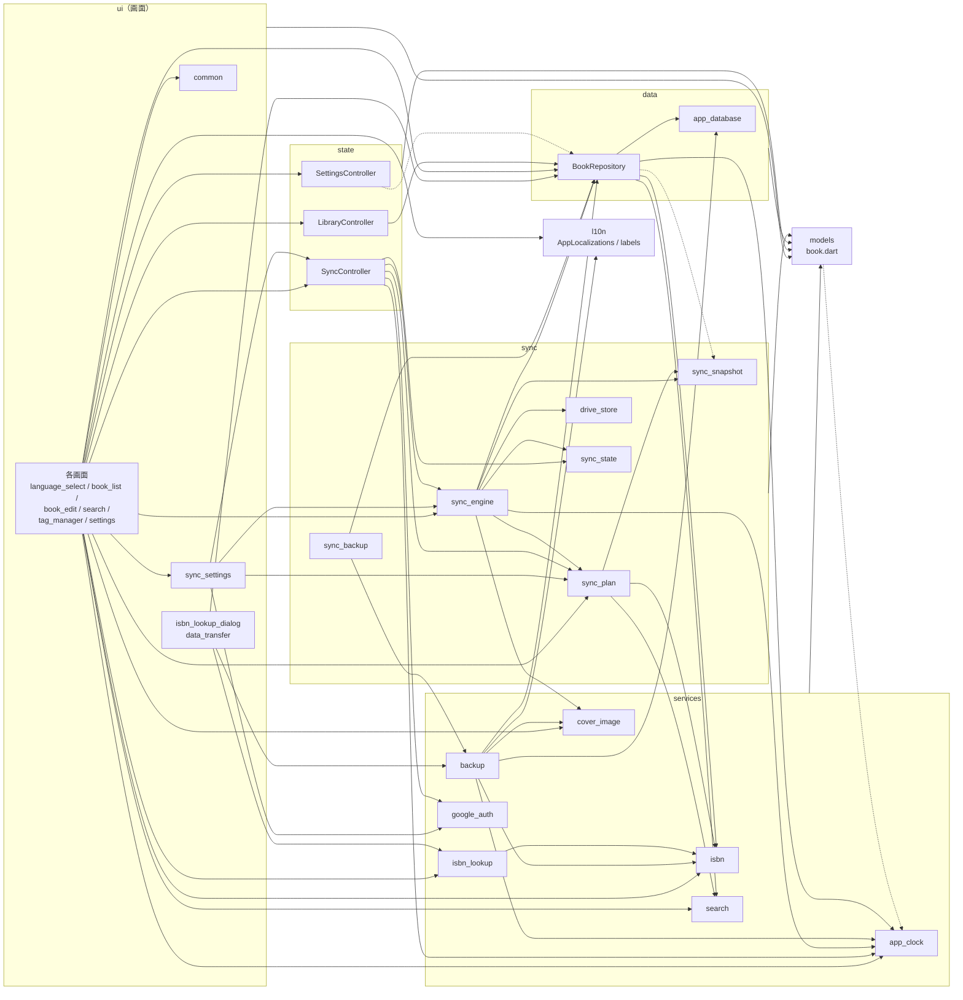

- `settings -.-> repo` は並び順の型 `BookSort` だけを参照している。
- `repo -.-> snapshot` と `models -.-> clock` は、層の依存方向の例外である。`BookRepository` は同期データの型（`SyncSnapshot`・`SyncBook`・`SyncNote`・`SyncCover`）と `coverHashOf` だけを、`Note` は作成日時の既定値に `AppClock.now()` だけを参照する。
- `main.dart` は、同期の部品（`GoogleAuthService`・`FileSyncStateStore`・`GoogleDriveStore`・`SyncEngine`・`writeSyncBackup`・`SyncController`）をすべて組み立てる（[5.1](#51-起動)）。

---

## 3. クラス設計

### 3.1 全体のクラス図

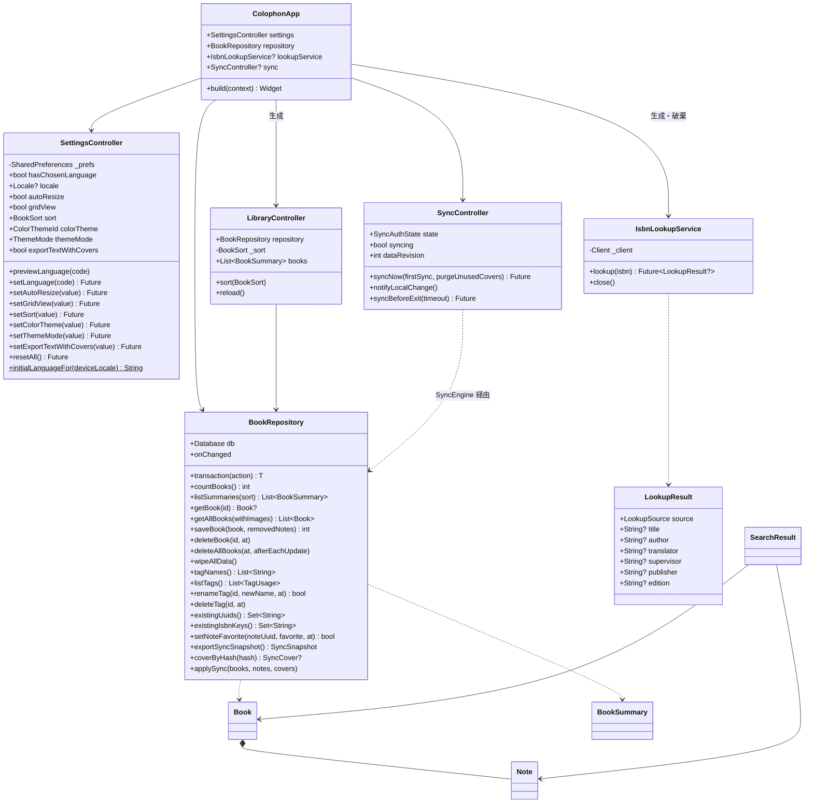

関数として実装している処理（`searchBooks`、`processCover`、`exportZip`、`applyImport` など）は、各節の表で示す。同期のクラスは [5.16.1](#5161-モジュール構成) に示す。

### 3.2 モデル（`lib/models/book.dart`）

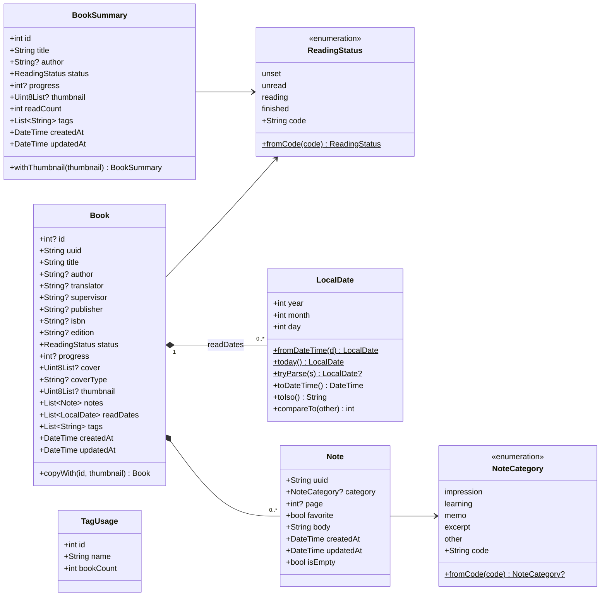

| クラス | 補足 |
|---|---|
| `ReadingStatus.fromCode` | 未知のコード・null は `unset` |
| `NoteCategory.fromCode` | 未知のコード・null は null（分類なし） |
| `LocalDate.tryParse` | `yyyy-MM-dd` 以外、実在しない日付（例 2026-02-30）は null |
| `Note` | `uuid` 省略時は UUID v4 を生成。`createdAt` 省略時は `AppClock.now()`。`updatedAt` 省略時は `createdAt`（それも省略時は `AppClock.now()`） |
| `Note.isEmpty` | 本文が空白のみ、かつ分類・ページが null |
| `Book` | すべて不変（final）。`notes`・`readDates`・`tags` の省略時は空リスト |
| `Book.copyWith` | `id` と `thumbnail` だけを差し替える（インポート時のサムネイル再生成用） |
| `BookSummary` | 一覧表示用。書影本体・ノートを持たないので軽い |

### 3.3 データアクセス

#### `lib/data/app_database.dart`

| 要素 | 内容 |
|---|---|
| `schemaVersion` | 現在のスキーマバージョン（4） |
| `openAppDatabase(path)` | ファイルを開いて `prepareDatabase` |
| `openInMemoryDatabase()` | メモリ上の DB（テスト用） |
| `prepareDatabase(db)` | `PRAGMA foreign_keys = ON`、`PRAGMA busy_timeout = 3000` の後に `migrate` |
| `readSchemaVersion(db)` | `PRAGMA user_version` を返す |
| `migrate(db, {target})` | 現在のバージョンから `target`（既定は最新）まで順に移行。DB の方が新しければ `NewerSchemaException` |
| `NewerSchemaException` | 新しいアプリで作られた DB。開かずに案内する |

#### `BookRepository`（`lib/data/book_repository.dart`）

| メソッド | 処理 |
|---|---|
| `onChanged` | 利用者の操作でデータが変わったときに呼ぶコールバック（自動同期の予約に使う。`main` で `SyncController.notifyLocalChange` を設定）。`saveBook`・`setNoteFavorite`・`deleteBook`・`deleteAllBooks`・`renameTag`・`deleteTag` が呼ぶ。同期での書き込み（`applySync`）と `wipeAllData` では呼ばない |
| `transaction(action)` | `BEGIN`〜`COMMIT`。例外時は `ROLLBACK` して再送出。すでにトランザクション中（`db.autocommit == false`）なら外側にまとめる |
| `countBooks()` | 削除済みでない書籍の件数 |
| `listSummaries({sort})` | 一覧用の書籍。読了回数はサブクエリで数える。並び順は `recent`=`created_at DESC, id DESC`、`title`=`title COLLATE NOCASE, id` |
| `getBook(id)` | 1冊を関連データ込みで返す。削除済みなら null |
| `getAllBooks({withImages})` | 全書籍を関連データ込みで返す（`created_at, id` 順）。`withImages: false` で書影・サムネイルを読まない（検索・テキスト出力用） |
| `saveBook(book, {removedNotes})` | 書籍の保存（[5.2](#52-書籍の保存)）。書影の SHA-256 を `cover_hash` に記録する |
| `deleteBook(id, {at})` | 削除済みの印を付ける（[5.3](#53-書籍の削除)） |
| `deleteAllBooks({at, afterEachUpdate})` | 全書籍に削除済みの印を付ける（インポートの「すべて置き換える」、すべてのデータの削除の「すべてのパソコン」）。`afterEachUpdate` なら、印の日時を各書籍の `updated_at` ＋1マイクロ秒と `at` の遅い方にする（時計が進んでいた端末で付いた未来の日時の書籍も、同期で確実に削除するため） |
| `wipeAllData()` | 全テーブルの行を物理的に消去し、`VACUUM` でファイルを詰め直す（削除済みの印も残さない）。「すべてのデータを削除」で使う |
| `tagNames()` | タグ名の一覧（`name_key` 順） |
| `listTags()` | タグと付いている冊数 |
| `renameTag(id, newName, {at})` | 同じ `name_key` の別タグがあれば false。そのタグが付いた書籍の `updated_at` を更新してから改名 |
| `deleteTag(id, {at})` | そのタグが付いた書籍の `updated_at` を更新してから削除（`book_tags` は外部キーで連動削除） |
| `existingUuids()` | 削除済みでない書籍の uuid の集合（インポートの重複判定用） |
| `existingIsbnKeys()` | 削除済みでない書籍の ISBN 同一判定キーの集合 |
| `setNoteFavorite(noteUuid, favorite, {at})` | ノート1件のお気に入りを切り替えてすぐ保存し、ノートとその書籍の `updated_at` を更新する。対象がない・削除済みなら false（[5.13](#513-ノートのお気に入り)） |
| `exportSyncSnapshot()` | 削除済みの印も含めた全データを同期データ（`SyncSnapshot`）の形で取り出す。書影の中身は含めない。v4 より前に保存した書影の `cover_hash` が空なら、ここで計算して埋める（[5.16.2](#5162-同期データの形式)） |
| `coverByHash(hash)` | `cover_hash` が一致する書影（中身・MIME タイプ・サムネイル）。なければ null |
| `applySync({books, notes, covers})` | 同期で決まった内容を、渡された日時のまま1トランザクションで書き込む（[5.16.5](#5165-同期1回の流れ)） |

### 3.4 業務処理（services）

#### `isbn.dart`

| 関数 | 処理 |
|---|---|
| `normalizeIsbn(input)` | NFKC 正規化 → 空白・各種ハイフン（`- ‐ ‑ – — ― − ー`）を除去 → 大文字化 |
| `isValidIsbn(input)` | ISBN-10（重み 10〜1、合計が 11 の倍数、末尾 X=10）または ISBN-13（重み 1,3 交互、合計が 10 の倍数） |
| `isbnMatchKey(input)` | 正しい ISBN なら ISBN-13 にそろえた文字列、そうでなければ null |

#### `isbn_lookup.dart`

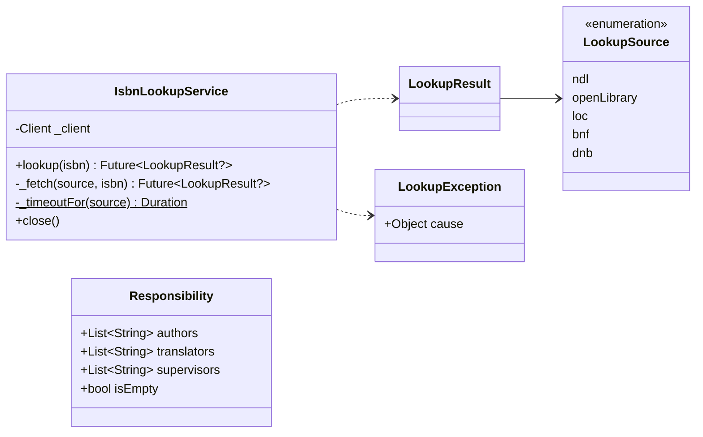

| 関数 | 処理 |
|---|---|
| `parseNdlResponse(xml)` | 最初の `item` から書籍名（`dc:title`、なければ `title`）＋巻次、責任表示、出版社、版を取り出す。`item` がなければ null |
| `sourcesForIsbn(isbn)` | ISBN の国・言語の番号から問い合わせる順番を返す（[5.6](#56-isbn-からの取得)） |
| `requestUri(source, isbn)` | 各取得元への要求 URL |
| `parseOpenLibraryResponse(json, isbn)` | `ISBN:{isbn}` の要素から書籍名（`title: subtitle`）、著者（`, ` 区切り）、最初の出版社。要素がなければ null |
| `parseDublinCoreResponse(xml, source)` | 米国議会図書館・フランス国立図書館・ドイツ国立図書館の SRU 応答（Dublin Core）の最初のレコードから、書籍名・著者・翻訳者・出版社を取り出す。レコードがなければ null |
| `cleanCatalogTitle(raw)` | 目録の書名から「 / 著者名」と末尾の区切り記号を除く |
| `cleanCatalogPublisher(raw, source)` | 出版者表示から出版地を除き、出版社名だけにする |
| `parseCatalogCreator(raw, source)` | 目録の著者表示を名前と役割（`CreatorRole`: 著者・翻訳者・その他）に分け、「姓, 名」を「名 姓」にする |
| `parseResponsibility(statement)` | 責任表示を役割ごとに振り分ける（[5.6](#56-isbn-からの取得)） |

#### `cover_image.dart`

| 要素 | 内容 |
|---|---|
| `ProcessedCover` | `bytes`、`mimeType`、`thumbnail`、`width`、`height`、`resized` |
| `processCover(bytes, {autoResize})` | `processCoverSync` を `Isolate.run` で実行 |
| `processCoverSync(bytes, {autoResize})` | 書影の処理本体（[5.5](#55-書影の処理)）。読めない画像は `CoverImageException` |
| `makeThumbnail(bytes)` | サムネイルだけを作る（インポート用、Isolate）。読めなければ null |
| `mimeTypeOf(bytes)` | 先頭バイトから jpg/png/gif/webp/bmp を判定。それ以外は null |
| `extensionOfMime(mime)` | MIME タイプからエクスポート用の拡張子（不明は `jpg`） |

#### `search.dart`

| 要素 | 内容 |
|---|---|
| `SearchField` | `title`、`author`、`translator`、`supervisor`、`publisher`、`isbn`、`notes` |
| `SearchQuery` | `text`、`fields`（既定はすべて）、`statuses`、`categories`（null は分類なし）、`favoritesOnly`（お気に入りのノートだけ）、`tags`、`readFrom`、`readTo` |
| `SearchResult` | `book` と、一致した `matchedNotes` |
| `normalizeForSearch(s)` | NFKC 正規化 → 小文字化 |
| `tagKey(name)` | 前後の空白を除いて `normalizeForSearch`。タグの同一判定とDBの `name_key` に使う |
| `searchBooks(books, query)` | 検索本体（[5.7](#57-検索)） |

#### `app_clock.dart`・`google_auth.dart`

| 要素 | 内容 |
|---|---|
| `AppClock.offset` / `AppClock.now()` | サーバー時刻との差と、それで補正した現在時刻（UTC）。作成・更新・削除日時の記録に使う（[5.16.7](#5167-記録時刻の補正)） |
| `GoogleOAuthConfig` | クライアント ID・シークレット。`fromEnvironment()` でビルド時の値を読む。ID が空なら `isConfigured` が false |
| `GoogleAuth` | ログインの窓口（`restore`・`beginSignIn`・`clientFor`・`signOut`）。実装は `GoogleAuthService`、設定なしのビルドでは `UnconfiguredGoogleAuth` |
| `LoopbackSignIn` | ブラウザでのログイン1回分。127.0.0.1 での待ち受けと認可コードの受け取り（[5.16.10](#51610-google-ログイン)） |
| `CredentialStore` | ログイン情報の保存先。実装は `SecureCredentialStore`（OS の安全な保管場所）と `MemoryCredentialStore`（テスト用） |

#### `backup.dart`

| 要素 | 内容 |
|---|---|
| `backupFormatName` / `backupFormatVersion` / `backupJsonFileName` | `colophon` / `1` / `books.json` |
| `exportText(books, l, {now, coverPaths})` | テキスト形式（[5.8](#58-エクスポート)）。`coverPaths`（uuid → ZIP 内のパス）を渡すと書影の行を出す |
| `exportTextWithCovers(books, l, {now})` | テキスト＋書影の ZIP（`colophon.txt` と `covers/`）。ZIP 作成は Isolate で実行 |
| `coverFileName(number, book)` | 書影の画像ファイル名（`番号_書籍名.拡張子`） |
| `exportZip(books, {now})` / `exportZipInBackground(books)` | ZIP 形式（後者は Isolate で実行） |
| `exportSqlite(db)` | `VACUUM INTO` で一時ファイルに書き出してバイト列を返す |
| `readBackup(bytes)` | 先頭バイトで形式を判定して読み込む（[5.9](#59-インポート)） |
| `readZipBackup(bytes)` / `readSqliteBackup(bytes)` | 各形式の読み込み |
| `applyImport(repo, books, mode, {now})` | 読み込んだ書籍を DB へ反映し `ImportResult(added, skipped)` を返す。書籍とノートの更新日時は `now`（既定は `AppClock.now()`）にする（[5.9](#59-インポート)） |
| `InvalidBackupException` / `NewerBackupException` | Colophon のデータでない／新しい形式 |
| `ImportMode` | `replace`（すべて置き換え）／`merge`（追加） |

### 3.5 状態管理（state）

| クラス | 保持するもの | 変更通知のタイミング |
|---|---|---|
| `SettingsController` | 表示言語（確定値と選択中のプレビュー値）、配色テーマ（`ColorThemeId`）、明るさ（`ThemeMode`）、書影の自動縮小、一覧の表示形式、並び順、テキストのエクスポートに書影を含めるか | 各 setter の呼び出し時（保存より先に通知） |
| `LibraryController` | 書籍一覧（`List<BookSummary>`）と並び順 | `reload()` の完了時、`sort` の変更時 |
| `SyncController` | ログイン状態（`SyncAuthState`）、アカウントのメールアドレス、同期中か、最終同期日時、最後の失敗の理由、初めての同期の選択待ちか、同期によるデータの版（`dataRevision`）、自動同期の予約 | 状態の変化時、同期の開始時と終了時（[5.16.8](#5168-自動同期)） |

`SettingsController.locale` は、初回の言語選択中は選びかけの言語（プレビュー）を、それ以外は確定した言語を返す。`supportedLanguages` に対応言語のコードと自言語表記を定義する。

### 3.6 画面（ui）

#### Provider の構成

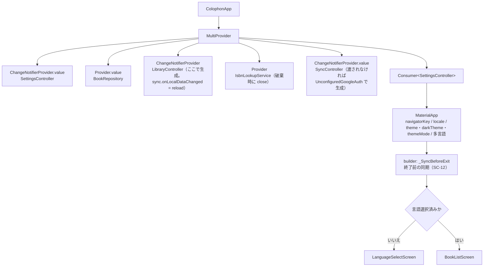

#### 画面とウィジェット

| クラス | 種類 | 主な責務 |
|---|---|---|
| `LanguageSelectScreen` | Stateful | 端末の言語から初期候補を決め、選択のたびに `previewLanguage`、続けるで `setLanguage` |
| `BookListScreen` | Stateless | 一覧／格子の切り替え、並び替え、メニュー。`openBookEditor` で SC-03 を開く |
| `BookEditScreen` | Stateful | 書籍1冊の表示・編集（下表）。登録済みはビューアモード、新規は編集モードで開く |
| `BookViewer` | Stateless | ビューアモードの表示。保存済みの `Book` を受け取り、入力済みの項目だけを出す（[5.14](#514-ビューアモード)） |
| `_NoteDraft` | 内部クラス | 編集中のノート1件（uuid・分類・お気に入り・ページと本文の入力欄）。`toNote(now)` で内容（お気に入りを含む）が変わったときだけ `updatedAt` を更新 |
| `_NoteCard` | Stateless | ノート1件の入力欄と上下移動・削除ボタン。並べ替えても状態がずれないよう `ObjectKey(_NoteDraft)` を付ける |
| `_TagEditor` | Stateful | タグ入力。`Autocomplete` に親の入力欄とフォーカスを渡す |
| `showIsbnLookupDialog` | 関数＋Stateful | 反映する項目（`LookupField`）と値の Map を返す |
| `SearchScreen` | Stateful | 検索対象の全書籍（画像なし）を保持し、条件の変更で `searchBooks` を実行 |
| `TagManagerScreen` | Stateful | `listTags` を表示し、改名・削除後に一覧と書籍一覧を再読み込み |
| `SettingsScreen` | Stateless | 設定の変更。配色テーマは `_ThemeSwatch`（いまの明るさでの主色とステータスの色の見本）を並べて選ぶ。バージョンは `PackageInfo` から取得 |
| `runExport` / `runImport` | 関数 | エクスポート・インポートの操作の流れ（[5.8](#58-エクスポート)・[5.9](#59-インポート)） |
| `deleteAllDataFlow` / `_deleteEverywhere` | 関数 | 「すべてのデータを削除」の二段階確認と実行（[5.15](#515-すべてのデータの削除と配布用パッケージ)）。ログイン中は削除する範囲（`_DeleteScope`）を選び、「すべてのパソコン」なら2回同期する |
| `SyncSettingsSection` | Stateless | SC-07 の同期欄。`SyncController` の状態で表示を切り替える（[5.16.13](#51613-画面との連携)） |
| `syncSignInFlow` / `_SignInDialog` | 関数＋Stateless | SC-10。ログインを始め、待っている間はリンクのコピーと中止ができるダイアログを出す。ログインできたら `syncNowFlow` |
| `syncNowFlow` / `_FirstSyncDialog` | 関数＋Stateful | 今すぐ同期。`SyncNeedsFirstChoice` が返ったら SC-11 で方法を選んでもらい、`firstSync` を付けて同期し直す |
| `_SyncBeforeExit` / `_ExitSyncDialog` | Stateful／Stateless | SC-12。`AppLifecycleListener.onExitRequested` で、未送信の変更があれば同期してから終了する（`app.dart`） |
| `confirmDialog` / `showMessage` / `runWithProgress` | 関数 | 確認ダイアログ、下部のメッセージ、処理中ダイアログを出しながらの非同期処理 |
| `FavoriteButton` | Stateless | ノートのお気に入りボタン（☆／★）。編集画面のノート欄と検索結果のノートで使う |
| `CoverThumbnail` / `StatusBadge` / `ContentWidth` | Stateless | 書影（なければ仮表紙）、ステータス表示（`StatusColors` の色＋`statusIcon` のアイコン＋文字）、広い画面での最大幅 |

#### `BookEditScreen` の内部状態

| 状態 | 型 | 内容 |
|---|---|---|
| `_title` ほか | `TextEditingController` ×8 | 書籍名・著者・翻訳者・監修・出版社・ISBN・版数・進捗 |
| `_tagInput` / `_tagFocus` | 入力欄・フォーカス | タグ入力欄（保存時に入力途中の文字を確定するため親が持つ） |
| `_original` | `Book?` | 編集前の書籍（新規は null） |
| `_uuid` | `String` | 書籍の uuid（新規は生成） |
| `_status`、`_cover`、`_coverType`、`_thumbnail` | | ステータスと書影 |
| `_readDates`、`_tags`、`_notes` | リスト | 読了日・タグ・ノート（`_NoteDraft`） |
| `_knownTags` | `List<String>` | 入力候補にする既存タグ |
| `_dirty` | `bool` | 未保存の変更があるか |
| `_viewMode` | `bool` | ビューアモードか（登録済みの書籍は true で開く） |
| `_lifecycle` | `AppLifecycleListener` | ウィンドウを閉じる要求の受け取り |
| `_sync` / `_syncRevision` | `SyncController` / `int` | 同期でデータが変わったことの検知（`dataRevision` が前回と違えば読み直す。[5.16.13](#51613-画面との連携)） |

---

## 4. データベース詳細設計

### 4.1 接続時の設定

| 設定 | 値 | 目的 |
|---|---|---|
| `PRAGMA foreign_keys` | ON | 外部キー制約と連動削除を有効にする |
| `PRAGMA busy_timeout` | 3000（ミリ秒） | 別の接続が書き込み中でもすぐには失敗しない |
| `PRAGMA user_version` | スキーマバージョン | 移行の要否の判定 |
| ファイル | アプリ用フォルダの `colophon.db` | `path_provider` の `getApplicationSupportDirectory()`。開発用に `COLOPHON_DATA_DIR` を渡したビルドではそのフォルダ（[5.16.12](#51612-ビルド時の設定と開発用の本棚)） |

### 4.2 テーブル定義

#### books（書籍）

| 列 | 型 | NULL | 制約・既定値 | 内容 |
|---|---|---|---|---|
| `id` | INTEGER | | PRIMARY KEY | 端末内の連番 |
| `uuid` | TEXT | 不可 | UNIQUE | 端末をまたぐ ID（UUID v4） |
| `title` | TEXT | 不可 | | 書籍名 |
| `author` | TEXT | 可 | | 著者 |
| `translator` | TEXT | 可 | | 翻訳者 |
| `supervisor` | TEXT | 可 | | 監修 |
| `publisher` | TEXT | 可 | | 出版社 |
| `isbn` | TEXT | 可 | | ISBN（入力どおり） |
| `edition` | TEXT | 可 | | 版数 |
| `status` | TEXT | 不可 | 既定 `'unset'`、CHECK（4種のコード） | ステータス |
| `progress` | INTEGER | 可 | CHECK（0〜100） | 進捗 |
| `cover` | BLOB | 可 | | 書影 |
| `cover_type` | TEXT | 可 | | 書影の MIME タイプ |
| `thumbnail` | BLOB | 可 | | 一覧用の縮小画像（JPEG） |
| `created_at` | TEXT | 不可 | | 登録日時（UTC） |
| `updated_at` | TEXT | 不可 | | 更新日時（UTC） |
| `deleted_at` | TEXT | 可 | | 削除日時（null なら有効） |
| `cover_hash` | TEXT | 可 | | 書影の SHA-256（16進の小文字）。同期で書影を中身ごとのファイルとして扱うため（v4 で追加） |

空文字の任意項目は NULL として保存する（`_blankToNull`）。書影が null のときは `cover_type`・`thumbnail`・`cover_hash` も NULL にする。

#### notes（ノート）

| 列 | 型 | NULL | 制約・既定値 | 内容 |
|---|---|---|---|---|
| `id` | INTEGER | | PRIMARY KEY | |
| `book_id` | INTEGER | 不可 | FK → books(id) ON DELETE CASCADE | |
| `position` | INTEGER | 不可 | | 並び順（0から） |
| `category` | TEXT | 可 | CHECK（5種のコード） | 分類（null は分類なし） |
| `page` | INTEGER | 可 | CHECK（1以上） | ページ |
| `favorite` | INTEGER | 不可 | 既定 0、CHECK（0 または 1） | お気に入り（v3 で追加） |
| `body` | TEXT | 不可 | | 本文（削除時は空文字） |
| `created_at` | TEXT | 不可 | | |
| `updated_at` | TEXT | 不可 | | |
| `uuid` | TEXT | 可（運用上は必須） | UNIQUE INDEX `notes_uuid` | 端末をまたぐ ID |
| `deleted_at` | TEXT | 可 | | 削除日時 |

#### read_records（読了記録）

| 列 | 型 | NULL | 制約 | 内容 |
|---|---|---|---|---|
| `id` | INTEGER | | PRIMARY KEY | |
| `book_id` | INTEGER | 不可 | FK → books(id) ON DELETE CASCADE | |
| `finished_on` | TEXT | 不可 | | 読了日（`yyyy-MM-dd`） |

#### tags（タグ）

| 列 | 型 | NULL | 制約 | 内容 |
|---|---|---|---|---|
| `id` | INTEGER | | PRIMARY KEY | |
| `name` | TEXT | 不可 | | 表示名（最初に登録した表記） |
| `name_key` | TEXT | 不可 | UNIQUE | 同一判定キー（`tagKey(name)`） |

#### book_tags（書籍とタグの対応）

| 列 | 型 | NULL | 制約 |
|---|---|---|---|
| `book_id` | INTEGER | 不可 | PK、FK → books(id) ON DELETE CASCADE |
| `tag_id` | INTEGER | 不可 | PK、FK → tags(id) ON DELETE CASCADE |

#### インデックス

| 名前 | 対象 | 種類 |
|---|---|---|
| `notes_book` | notes(book_id, position) | 通常 |
| `read_records_book` | read_records(book_id) | 通常 |
| `notes_uuid` | notes(uuid) | UNIQUE |

### 4.3 スキーマの移行

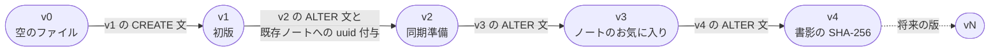

| 版 | 内容 |
|---|---|
| v1 | 5テーブルとインデックス `notes_book`・`read_records_book` を作成 |
| v2 | `books.deleted_at`・`notes.uuid`・`notes.deleted_at` を追加。既存ノートに SQL で UUID v4 形式の値を振り、`notes_uuid` を作成 |
| v3 | `notes.favorite`（既定 0）を追加。既存ノートはお気に入りなしになる |
| v4 | `books.cover_hash` を追加。既存の書影の値は SQL では計算できないので空のまま移行し、同期データを作るとき（`exportSyncSnapshot`）に埋める |

- 各版の手順は1トランザクションで実行し、最後に `PRAGMA user_version = N` を設定する。失敗したら ROLLBACK してその版のまま。
- 既存の版の SQL は書き換えない。変更は新しい版として `_migrations` に追加する。
- DB の `user_version` がアプリの `schemaVersion` より大きければ `NewerSchemaException`（起動時は案内画面、インポート時は `NewerBackupException`）。

### 4.4 主な SQL

**ノートの保存（uuid での upsert）**

```sql
INSERT INTO notes (uuid, book_id, position, category, page, body, favorite, created_at, updated_at)
VALUES (?, ?, ?, ?, ?, ?, ?, ?, ?)
ON CONFLICT (uuid) DO UPDATE SET
  book_id = excluded.book_id, position = excluded.position, category = excluded.category,
  page = excluded.page, body = excluded.body, favorite = excluded.favorite,
  created_at = excluded.created_at, updated_at = excluded.updated_at, deleted_at = NULL;
```

**外したノートに削除済みの印を付ける**

```sql
-- removedNotes なし: 渡されなかったノートすべて
UPDATE notes SET deleted_at = ?, updated_at = ?, body = ''
WHERE book_id = ? AND deleted_at IS NULL AND uuid NOT IN (?, ?, ...);
-- removedNotes あり: removedNotes のうち渡されなかったノートだけ
UPDATE notes SET deleted_at = ?, updated_at = ?, body = ''
WHERE book_id = ? AND deleted_at IS NULL AND uuid IN (?, ?, ...);
```

**同期でのノートの書き込み（`applySync`。uuid での upsert）**

```sql
INSERT INTO notes (uuid, book_id, position, category, page, body, favorite, created_at, updated_at, deleted_at)
VALUES (?, ?, (SELECT COALESCE(MAX(position), -1) + 1 FROM notes WHERE book_id = ?), ?, ?, ?, ?, ?, ?, ?)
ON CONFLICT (uuid) DO UPDATE SET
  book_id = excluded.book_id, category = excluded.category, page = excluded.page, body = excluded.body,
  favorite = excluded.favorite, created_at = excluded.created_at, updated_at = excluded.updated_at,
  deleted_at = excluded.deleted_at;   -- 並び順は後で noteOrder にそろえる
```

**一覧の取得**

```sql
SELECT b.id, b.title, b.author, b.status, b.progress, b.thumbnail, b.created_at, b.updated_at,
       (SELECT COUNT(*) FROM read_records r WHERE r.book_id = b.id) AS read_count,
       (SELECT MAX(finished_on) FROM read_records r WHERE r.book_id = b.id) AS last_read
FROM books b
WHERE b.deleted_at IS NULL
ORDER BY {並び順};
```

| `BookSort` | `ORDER BY` |
|---|---|
| `recent`（登録日の新しい順） | `b.created_at DESC, b.id DESC` |
| `title`（書籍名順） | `b.title COLLATE NOCASE ASC, b.id ASC` |
| `statusAscending`（未設定→読了） | ステータスの順位（unset=0, unread=1, reading=2, finished=3）`ASC` → 読書中は `COALESCE(progress, 0) ASC` → 読了は `last_read IS NULL ASC`（読了日なしを最後）, `last_read ASC` → `b.title COLLATE NOCASE ASC, b.id ASC` |
| `statusDescending`（読了→未設定） | ステータスの順位 `DESC` → 読書中は `COALESCE(progress, 0) DESC` → 読了は `last_read IS NULL ASC`, `last_read DESC` → `b.title COLLATE NOCASE ASC, b.id ASC` |

読書中・読了の条件は `CASE WHEN b.status = … THEN … END` で書き、ほかのステータスでは NULL（並びに影響しない）にする。並び方は `SettingsController` が列挙子の名前で保存する。

**タグの登録と対応付け**

```sql
INSERT OR IGNORE INTO tags (name, name_key) VALUES (?, ?);
INSERT OR IGNORE INTO book_tags (book_id, tag_id) SELECT ?, id FROM tags WHERE name_key = ?;
DELETE FROM tags WHERE id NOT IN (SELECT tag_id FROM book_tags);   -- 使われなくなったタグ
```

---

## 5. 処理詳細

### 5.1 起動

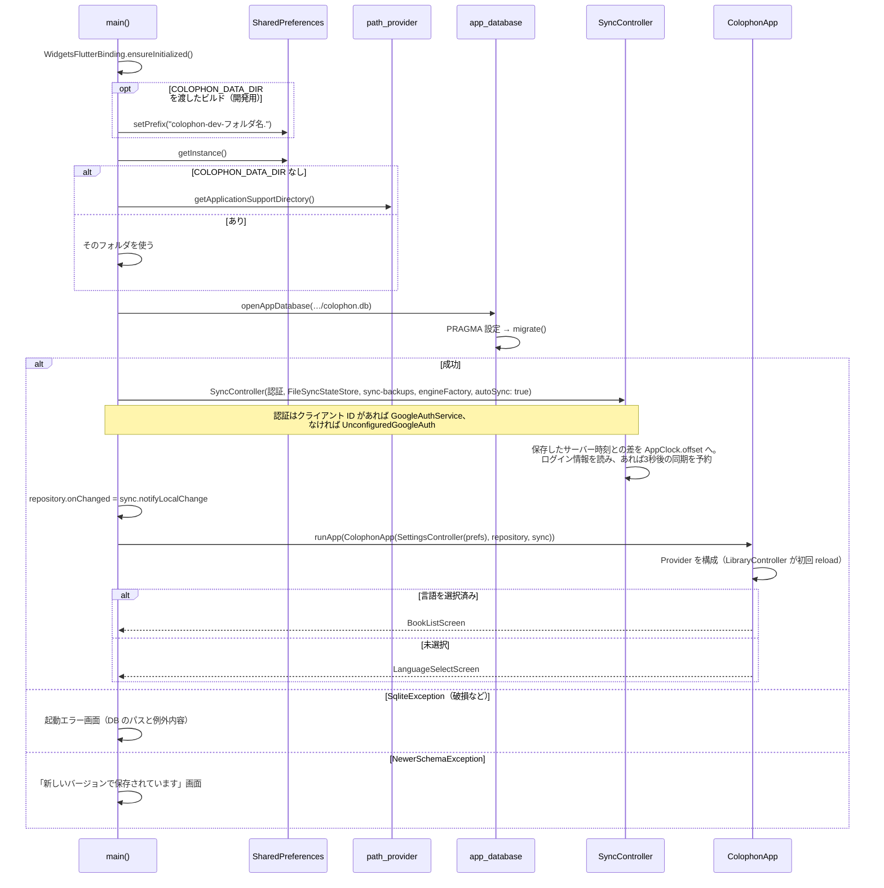

### 5.2 書籍の保存

`BookEditScreen._save()`（本体は `_saveBook()`）の手順:

1. `_closeIfDeletedElsewhere()`: 登録済みの書籍が同期でほかのパソコンから削除されていたら、知らせて画面を閉じ、保存しない（[5.16.13](#51613-画面との連携)）。
2. `Form.validate()`（[6. 入力チェック](#6-入力チェック)）。NG なら終了。
3. `_commitPendingTag()`: タグ欄に残った文字を、同じ `tagKey` のタグがなければ追加。
4. 進捗: `int.tryParse` の結果が 0〜100 ならその値、それ以外は null（非表示の欄に残った範囲外の値を捨てる）。
5. ノート: 各 `_NoteDraft.toNote(now)` のうち `isEmpty` でないもの（`now` は `AppClock.now()`）。
6. `Book` を組み立てる（`createdAt` は編集前の値、新規は now。`updatedAt` は now）。
7. `BookRepository.saveBook(book, removedNotes: 編集前のノートの uuid の集合)`。削除済みにするのは、この画面で外したノートだけになる（開いている間に同期で届いたノートは残す）。例外なら「エラーが発生しました」を表示して画面に留まる。
8. `LibraryController.reload()`、「保存しました」を表示。登録済みの書籍は `_viewMode = true` にしてビューアモードへ戻る（画面は閉じない）。新規登録は `_close()` で一覧へ戻る（戻るべきビューアがなく、続けて別の本を登録しやすいため）。

`BookRepository.saveBook(book, {removedNotes})` の手順（全体で1トランザクション）:

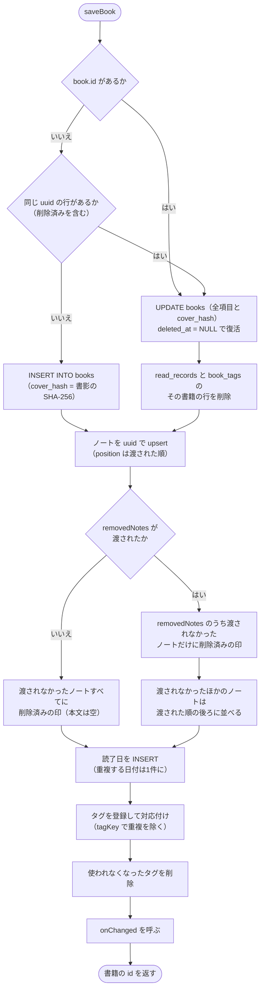

削除済みの印の日時は `book.updatedAt`。`onChanged` はトランザクションの中から呼ぶ（自動同期を予約するだけで、DB には触れない）。

### 5.3 書籍の削除

`deleteBook(id, {at})`（`at` の既定は `AppClock.now()`）を1トランザクションで行い、最後に `onChanged` を呼ぶ。

| 対象 | 処理 |
|---|---|
| books | `deleted_at`・`updated_at` を `at` に。`cover`・`cover_type`・`thumbnail`・`cover_hash` を NULL |
| notes | 有効なノートの `deleted_at`・`updated_at` を `at` に。`body` を空文字 |
| read_records / book_tags | その書籍の行を物理削除（書籍の属性として、同期時は書籍と一緒に送る） |
| tags | 使われなくなったタグを削除 |

### 5.4 未保存の変更の扱い（編集画面）

| 仕組み | 内容 |
|---|---|
| `_dirty` の設定 | 各入力欄のリスナー（`_markDirty`）と、書影・ステータス・読了日・タグ・ノートの変更（`_change`）で true |
| 画面内の戻る | `PopScope(canPop: !_dirty)`。戻れなかったときに `_confirmLeave` で破棄を確認 |
| ビューアへの切り替え | `_setViewMode(true)`。`_dirty` なら「保存して表示（`_saveBook` が成功したら切り替え）／破棄して表示（DB から読み直した最新の内容で `_load` する。新規は `_original`。ほかのパソコンで削除されていれば知らせて閉じる）／キャンセル」を選ぶ |
| ウィンドウを閉じる | `AppLifecycleListener.onExitRequested` で `_dirty` なら確認し、`AppExitResponse.cancel` か `exit` を返す |
| 保存・削除・破棄の後 | `_close()`: `_dirty = false` にして再描画し、次のフレームで `Navigator.pop`（`canPop` は再描画後に反映されるため） |

### 5.5 書影の処理

`processCoverSync(bytes, autoResize)`:

| 手順 | 内容 |
|---|---|
| 1. 読み込み | `img.decodeImage`。失敗・例外なら `CoverImageException` |
| 2. 向きの補正 | `img.bakeOrientation`（EXIF の回転情報を画素に反映） |
| 3. 縮小判定 | `autoResize` かつ（長辺 > 2000px または バイト数 > 2MB） |
| 4a. 縮小する | 長辺が 2000px を超えていれば長辺 2000px に縮小（`Interpolation.average`）。透過部分を白で塗り、JPEG 品質 85 で保存。`resized = true` |
| 4b. 一般的でない形式 | `mimeTypeOf` が null なら、透過ありは PNG、なしは JPEG 品質 90 に変換 |
| 4c. そのまま | 元のバイト列と判定した MIME タイプ |
| 5. サムネイル | 長辺 360px 以下に縮小し、透過を白で塗って JPEG 品質 80 |

### 5.6 ISBN からの取得

**問い合わせる順番（`sourcesForIsbn`）**: ISBN-10 は ISBN-13 に直してから、先頭の番号で決める。

| ISBN の先頭 | 順番 |
|---|---|
| `9784` | 国立国会図書館 → Open Library |
| `9782`・`97910` | フランス国立図書館 → Open Library |
| `9783` | ドイツ国立図書館 → Open Library |
| `9780`・`9781` | Open Library → 米国議会図書館 |
| それ以外 | 国立国会図書館 → Open Library → 米国議会図書館 |

この順番は、2026-10 に各国の図書館目録から集めた6言語150冊で各サービスの取得率を測った結果に基づく（国立国会図書館と4館を合わせて149冊を取得。Google Books は API キーなしの共有上限に達していて取得できなかった）。

`IsbnLookupService.lookup(isbn)`:


見つからず、途中に通信エラーの取得元があった場合は、その取得元に本があったかもしれないので null（見つからない）ではなく `LookupException`（接続を確認してください）にする。

要求ヘッダー `User-Agent: Colophon (https://github.com/colophonbooks)` を付ける（Open Library がアプリ名と連絡先の明示を求めているため）。応答は UTF-8 として読む。
**責任表示の振り分け（`parseResponsibility`）**

1. 責任表示を `, ， ; ；` で区切る。
2. 各部分を「名前＋空白（または括弧）＋役割語」として照合する。役割語の前に空白か括弧がないものは役割語とみなさない（「山田文」の「文」を誤認しないため）。
3. 役割語のない部分は保留し、次に現れた役割語の対象に含める。最後まで残った保留は著者とする。

| 役割語 | 振り分け先 |
|---|---|
| 著、作、文、絵、編、編著、著者、原作、原著 | 著者 |
| 訳、翻訳、共訳、編訳、訳・解説、訳・注 | 翻訳者 |
| 監修、監訳 | 監修 |
| 解説、注、校注、装丁、装画、イラスト | 使わない |

責任表示がない場合は `dc:creator` の値から生没年（例 `, 1959-`）を除いて著者とする。外国語資料の書名に付く言語の注記（「 : [中国語]」など）は除く。同じ名前は1回だけにし、国立国会図書館の結果は「、」、ほかの取得元は「, 」で連結する。

**目録の表記の整え方（米国議会図書館・フランス国立図書館・ドイツ国立図書館）**

| 項目 | フランス国立図書館 | ドイツ国立図書館 | 米国議会図書館 |
|---|---|---|---|
| 書名（元の表記） | `Jaune : histoire d'une couleur / Michel Pastoureau` | `0 1 2 : Roman / Daniel Wisser` | `Art history /` |
| 書名の処理 | 最初の「 / 」以降を除き、末尾の区切り記号（`/ : ; , .` と空白）を除く | 同左 | 同左 |
| 著者（元の表記） | `Pastoureau, Michel (1947-....). Auteur du texte` | `Liedtke, Rüdiger [Verfasser]` | `Stokstad, Marilyn, 1929-2016.` |
| 役割の取り出し | 最後の「. 」の後ろ | 末尾の `[…]` | 末尾の `, author.` など |
| 生没年 | 末尾の `(…)` を除く | ― | 末尾の `, 1929-2016` などを除く |
| 出版社（元の表記） | `Points (Paris)` | `München : Luchterhand Literaturverlag` | `Upper Saddle River, NJ : Pearson/Prentice Hall,` |
| 出版社の処理 | 末尾の `(出版地)` を除く | 最後の「 : 」の後ろ | 同左 |

- 名前は、カンマで2つに分かれる「姓, 名」なら「名 姓」に並べ替える（`Pastoureau, Michel` → `Michel Pastoureau`）。
- 末尾のピリオドは除くが、イニシャル（`Yuval N.` の `N.`）の点は残す。

| 役割（元の表記） | 振り分け先 |
|---|---|
| Traducteur、Traductrice、Übersetzer、Übersetzerin、translator | 翻訳者 |
| Auteur du texte、Auteur、Verfasser、Verfasserin、author、editor、Herausgeber、Herausgeberin、Directeur de publication、Éditeur scientifique、compiler、役割の記載なし | 著者 |
| それ以外（Illustrator、Illustrateur、Préfacier など） | その他（著者が1人もいないときだけ著者として使う。絵本などのため） |

### 5.7 検索

| 項目 | 内容 |
|---|---|
| 検索対象の読み込み | `SearchScreen` の表示時と、結果から編集画面を開いて戻ったときに `getAllBooks(withImages: false)` と `tagNames()` を読み込む |
| 実行のタイミング | キーワード入力は最後の入力から 200ms 後、その他の条件は変更の直後 |
| 正規化 | キーワード・対象文字列とも `normalizeForSearch`（NFKC＋小文字化）。キーワードは空白で分割 |
| 書籍の絞り込み | ステータス（いずれか）、タグ（`tagKey` で比較し、すべてを含む）、読了日（いずれかの読了日が範囲内。両端を含む） |
| 分類・お気に入りで絞り込む場合 | 選んだ分類（未選択ならすべて）かつ、お気に入りのみなら `favorite` のノートのうち、キーワードがなければすべて、あれば（ノート本文が検索対象のとき）全語を含むもの。1件以上ある書籍を返す |
| 分類を選ばない場合 | キーワードなし → 絞り込みを通った全書籍。あり → 各語が「選んだ書籍項目の連結文字列」か「いずれかのノート本文」に含まれる書籍。いずれかの語を含むノートを添える |
| ISBN の一致 | 書籍項目の連結文字列に加え、ハイフン等を除いた ISBN と、同様に正規化した語でも比較 |
| 表示 | 結果の書籍のサムネイルは `LibraryController.books` から id で引く |

### 5.8 エクスポート

`runExport(context)` の流れ: 件数0なら案内して終了 → 形式を選ぶ（テキストの下の「書影も含める（ZIPで保存）」のチェックは `SettingsController.exportTextWithCovers` に即時保存し、次回も同じ状態で表示）→ 処理中ダイアログを出しながらデータを作る → `FilePicker.saveFile`（初期ファイル名 `colophon-yyyyMMdd-HHmm.{txt|zip|sqlite}`）→ 保存できたら「エクスポートしました」。データ作成・保存で例外があれば「エクスポートに失敗しました」。

| 形式 | 作り方 |
|---|---|
| テキスト | `getAllBooks(withImages: false)` → `exportText` → UTF-8 |
| テキスト＋書影 | `getAllBooks()` → `exportTextWithCovers`。書影のある書籍ごとに `coverFileName` でファイル名を決めて `covers/` に無圧縮で入れ、そのパスをテキストに書く。拡張子は `.zip` |
| ZIP | `getAllBooks()` → `exportZipInBackground`（処理中ダイアログを表示）。書影は無圧縮（`CompressionType.none`）、`books.json` は deflate、JSON はインデント2 |
| SQLite | `exportSqlite(db)`: 一時フォルダへ `VACUUM INTO` → 読み込み → 一時フォルダを削除。削除済みの印の行も含む |

**テキスト形式の例**（表示言語が日本語の場合）

```text
Colophon エクスポート（2026-10-14 12:00）
1冊

========================================
[001] サピエンス全史
========================================
書影: covers/001_サピエンス全史.jpg
著者: ユヴァル・ノア・ハラリ
翻訳者: 柴田裕之
ISBN: 978-4-309-22671-2
ステータス: 読書中 (40%)
読了日: 2025-05-05
タグ: 歴史
登録日: 2026-01-02 12:04
更新日: 2026-10-14 11:58

[ノート]
- ★ [学び] p.30
  認知革命が転換点だった
```

入力されている項目だけを出力する。書籍には通し番号（冊数に応じた桁数、最低3桁）を付ける。「書影」の行は、書影を含めて書き出したときの、書影のある書籍だけに出る。進捗は読書中で値があるときだけ付ける。日時は端末の時刻で表示する。

**書影のファイル名（`coverFileName`）**

| 規則 | 例 |
|---|---|
| `{通し番号}_{書籍名}.{拡張子}`。拡張子は書影の形式（`extensionOfMime`） | `001_サピエンス全史.jpg` |
| `\ / : * ? " < > \|` と制御文字は `_` に置き換える | `A/B: C?` → `002_A_B_ C_.png` |
| 連続する空白は1つにし、前後の空白を除く | |
| 書籍名は60文字まで（文字単位で切る） | |
| 末尾のピリオド・空白を除く（Windows で使えないため） | `end...` → `003_end.jpg` |
| 書籍名が空になったら番号だけ | `...` → `004.jpg` |

番号が書籍ごとに違うので、同じ書籍名の本が複数あってもファイル名は重ならない。

### 5.9 インポート

**形式の判定（`readBackup`）**

| 先頭のバイト | 判定 |
|---|---|
| `SQLite format 3\0` | SQLite → `readSqliteBackup` |
| `PK\x03\x04` | ZIP → `readZipBackup` |
| その他 | `InvalidBackupException` |

**ZIP の検証と読み替え（`readZipBackup`）**

| 対象 | 不正なときの扱い |
|---|---|
| ZIP として読めない・`books.json` がない・JSON として読めない | `InvalidBackupException` |
| `format` が `colophon` でない、`books` が配列でない、`version` が整数でない | `InvalidBackupException` |
| `version` が現在の形式より新しい | `NewerBackupException` |
| 書籍の `title` が空・文字列でない | その書籍を読み飛ばす |
| `uuid` がない | 新しい UUID を振る |
| `status` が未知のコード | `unset` |
| `progress` が 0〜100 の整数でない | null |
| `cover` のファイルがない・画像形式を判定できない | 書影なし |
| `readDates` の不正な日付 | その日付を捨てる |
| ノートの `page` が1以上の整数でない／`category` が未知 | null |
| ノートの `uuid` がない | 新しい UUID を振る |
| ノートの `favorite` が `true` でない（項目なしを含む） | お気に入りなし |
| 本文・分類・ページがすべて空のノート | 捨てる |
| 日時が読めない | 書籍の `createdAt` は現在時刻、その他は書籍の `createdAt` |

書影がある書籍はサムネイルを作り直す（`makeThumbnail`）。

**SQLite の読み込み（`readSqliteBackup`）**: 一時フォルダにコピーして開き、`books` テーブルがない・`user_version` が1未満なら `InvalidBackupException`。`prepareDatabase` で一時コピーを現在のスキーマへ移行してから `getAllBooks()` で読む（新しい版なら `NewerBackupException`）。サムネイルがない書籍は作り直す。最後に一時フォルダを削除する。

**反映（`applyImport`）**: 基本設計書 [8.5](basic-design.ja.md#85-インポート) の判定を1トランザクションで行う。書籍は `id` を持たない `Book` として `saveBook` に渡し、同じ uuid の削除済み書籍があれば復活させる。取り込む書籍とノートの `updatedAt` は `now`（既定は `AppClock.now()`）に置き換え、`createdAt` はファイルの値のままにする。「すべて置き換える」の `deleteAllBooks` にも同じ `now` を渡す。ファイルの更新日時のままだと、同期でクラウドに残っている内容の方が新しいと判定され、取り込んだ内容が元に戻されるため。`readZipBackup` で日時が読めない場合の「現在時刻」も `AppClock.now()` である。

`runImport(context)` の画面側の流れ: ファイルを選ぶ（`zip`/`sqlite`/`sqlite3`/`db`）→ 処理中ダイアログを出しながら `readBackup` → 冊数を示して方法を選ぶ（0冊なら両方とも選べない）→ 置き換えで現在1冊以上なら確認 → `applyImport` → `LibraryController.reload()` → 結果を表示。

### 5.10 一覧の再読み込み

`LibraryController.reload()` は `listSummaries` を呼び、前回の一覧で **id と `updatedAt` が同じ書籍**は前回のサムネイルのバイト列（同じオブジェクト）を使い回す。`Image.memory` はバイト列の同一性で画像キャッシュを引くため、毎回新しい配列にすると全書影のデコードがやり直しになる。

### 5.11 タグ入力

| 操作 | 動作 |
|---|---|
| 文字を入力 | 既存タグのうち、`normalizeForSearch` で部分一致し、まだ付いていないものを候補に出す |
| ↑↓キーで候補を選んで Enter | 選んだ候補を追加（`_navigated` が true のときは `Autocomplete` の確定処理を使う） |
| 候補を選ばずに Enter | 入力した文字をそのまま追加（同じ `tagKey` のタグがすでに付いていれば何もしない） |
| 候補をクリック | その候補を追加 |
| 入力したまま保存 | 保存時に入力途中の文字をタグとして確定 |

### 5.12 配色テーマ

`buildTheme(id, brightness)` が `ColorScheme` と `StatusColors`（`ThemeExtension`）を持つ `ThemeData` を作る。`MaterialApp` には明るい版（`theme`）と暗い版（`darkTheme`）を渡し、`themeMode` で切り替える。

| テーマ（`ColorThemeId`） | `ColorScheme` の作り方 | ステータスの色 |
|---|---|---|
| `leather`（初期値） | `ColorScheme.fromSeed`（`#7B5536`、`tonalSpot`） | 配色から（下記） |
| `forest` | 同（`#2F6B4F`） | 配色から |
| `ocean` | 同（`#1F4E79`） | 配色から |
| `rose` | 同（`#8E3B5E`） | 配色から |
| `monochrome` | `fromSeed`（`#808080`、`DynamicSchemeVariant.monochrome`）。この変種でも赤のまま残るエラー系4色をグレーに置き換える | 固定（下表） |
| `universal` | `fromSeed`（`#005AFF`＝CUD 推奨配色の青、`DynamicSchemeVariant.fidelity`：基準色を主色にほぼそのまま使う） | 固定（下表） |

「配色から」は、未設定＝`surfaceContainerHighest`／`onSurfaceVariant`、未読＝`secondaryContainer`、読書中＝`primaryContainer`、読了＝`tertiaryContainer`（文字はそれぞれの `on〜`）。

**固定のステータス色**（背景／文字）

| テーマ・明るさ | 未設定 | 未読 | 読書中 | 読了 |
|---|---|---|---|---|
| モノクロ・明 | `#F2F2F2` / `#303030` | `#B3B3B3` / `#000000` | `#737373` / `#FFFFFF` | `#1E1E1E` / `#FFFFFF` |
| モノクロ・暗 | `#2C2C2C` / `#E0E0E0` | `#5E5E5E` / `#FFFFFF` | `#9E9E9E` / `#000000` | `#EDEDED` / `#000000` |
| ユニバーサル・明 | `#E6E6E6` / `#333333` | `#4DC4FF` / `#00205C` | `#F6AA00` / `#2B1A00` | `#005AFF` / `#FFFFFF` |
| ユニバーサル・暗 | `#3A3A3A` / `#E6E6E6` | `#0B3D91` / `#DDEEFF` | `#F6AA00` / `#1A1000` | `#4DC4FF` / `#001A33` |

ユニバーサルの `#005AFF`（青）・`#4DC4FF`（空色）・`#F6AA00`（オレンジ）はカラーユニバーサルデザイン推奨配色セットの色。青系とオレンジ系は、P型・D型でも T型でも色相の差が残る組み合わせで、さらに明るさにも差を付けている。

**ステータスのアイコン**（`statusIcon`）: 未設定＝`radio_button_unchecked`、未読＝`book_outlined`、読書中＝`bookmark`、読了＝`check_circle`。一覧のステータス表示、編集画面のステータス選択、検索の絞り込み、テーマの見本で使う。

**検証**（`test/theme_test.dart`）

| 確認 | 方法 | 基準 |
|---|---|---|
| コントラスト | 全テーマ×明暗で、`onSurface`/`surface`、`onSurfaceVariant`/`surface`、`onPrimary`/`primary`、`onPrimaryContainer`/`primaryContainer`、`onError`/`error`、`error`/`surface`、各ステータスの文字/背景の比を WCAG 2.x の式で計算 | 4.5 以上 |
| モノクロ | 主要な `ColorScheme` の色とステータスの色が R=G=B か | すべてグレー |
| 色覚による見分け | モノクロとユニバーサルのステータス背景色を、一般色覚と Machado ら（2009）の行列による P型・D型・T型（重度 1.0）のシミュレーションで変換し、CIELAB の色差（CIE76）を全組み合わせで計算 | ΔE 20 以上 |
### 5.13 ノートのお気に入り

| 操作場所 | 動作 | 保存のタイミング |
|---|---|---|
| 編集画面のノート欄（`_NoteCard` の `FavoriteButton`） | `_NoteDraft.favorite` を切り替え、未保存の変更として扱う | 保存ボタン（`saveBook` の upsert で `favorite` を書く） |
| 検索結果のノート（`_ResultTile` の `FavoriteButton`） | `BookRepository.setNoteFavorite` を呼び、検索対象を読み込み直す | 押した時点 |

- 検索結果からの切り替えでは、ノートと書籍の `updated_at` を `AppClock.now()` に更新する（同期で変更を伝えるため）。
- 「お気に入りのノートだけ」で絞り込んでいる最中に☆を外すと、そのノートは結果から消える（読み込み直しで条件に合わなくなるため）。
- テキストのエクスポートでは、お気に入りのノートの見出しの先頭に「★」を付ける（表示言語にかかわらず同じ記号）。JSON には `favorite`（真偽値）を書き、SQLite には `notes.favorite` がそのまま入る。
- お気に入りの印だけが付いた空のノート（本文・分類・ページなし）は、ほかの空のノートと同じく保存しない。
### 5.14 ビューアモード

| 項目 | 内容 |
|---|---|
| 初期モード | `BookEditScreen.initState` で、登録済みの書籍は `_viewMode = true`、新規は false |
| 切り替え | 上部バーの `SegmentedButton<bool>`（表示／編集）。新規登録では出さない。ビューアモードでは削除・保存ボタンを出さず、Ctrl+S も働かない（`BookViewer` に入れ替わるため） |
| 表示する内容 | 常に保存済みの `_original`。編集モードの入力欄の内容は使わない |
| 未保存の変更 | 「保存して表示」は `_saveBook()`（入力チェック→保存→`_load(保存後の書籍)`、画面は閉じない）。入力エラーなら編集モードのまま。「破棄して表示」は、DB から読み直した最新の内容（編集中に同期で変わっていることがあるため）で `_load` し、入力欄とノート（`_NoteDraft` を作り直す）を戻す。ほかのパソコンで削除されていれば知らせて閉じる |
| 保存ボタン | 編集モードの「保存」（Ctrl+S／⌘S）は `_saveBook()` のあと、登録済みの書籍ならビューアモードへ戻る。新規登録は一覧へ戻る |

`BookViewer` の表示規則:

- 書誌項目は `trim()` して空でないものだけ。項目名は `bodySmall`、値は `bodyMedium` の1行（`Text.rich`）。
- 読了日・タグ・ノートは、空なら見出しごと出さない。
- ノートの見出しは、分類（`labels.dart` の `category`）とページ（`p.N`）を「 · 」でつなぐ。両方ないノートは本文だけ。お気に入りは見出し行の右に★（`Icon` のみで操作なし）。
- 全体を `SelectionArea` で包み、文字を選択してコピーできるようにする。
### 5.15 すべてのデータの削除と配布用パッケージ

**すべてのデータを削除（`deleteAllDataFlow`）**

1. 案内のダイアログ（冊数を表示）。「キャンセル／先にエクスポート（`runExport`）／削除へ進む」から選ぶ。
2. 最終確認のダイアログ。「削除したデータは元に戻せないことを理解しました」にチェックするまで「すべて削除」は押せない。ログイン中（`SyncAuthState.signedIn`）は、同じダイアログで削除する範囲（`_DeleteScope.thisComputer`（初期値）／`everywhere`）も選ぶ。
3. 実行中の同期があれば終わるまで待つ（`SyncController.whenIdle()`。途中の同期が、消した後に書き込まないように）。
4. 「すべてのパソコン」なら `_deleteEverywhere`（下表）。失敗したらここで終える。
5. ログイン中なら `SyncController.signOut()`（どちらの範囲でも。消した後にクラウドから取り戻さないため）→ `SyncController.deleteLocalBackups()`（`sync-backups/` を消す。ログインしていなくても行う）。
6. `Navigator.popUntil(isFirst)` で最初の画面に戻す → `BookRepository.wipeAllData()` → `LibraryController.reload()` → `SettingsController.resetAll()`（`SharedPreferences.clear()` と既定値への戻し。表示言語も未選択になり、言語選択画面が表示される）。

**`_deleteEverywhere`**（「Google ドライブから削除しています…」のダイアログを出したまま行う）

| 手順 | 処理 | 失敗したとき |
|---|---|---|
| 1 | `whenIdle()` のあと `syncNow(firstSync: FirstSyncMode.merge)`。ほかのパソコンで足された書籍もこのパソコンに集める（このパソコンが知らない書籍は消せないため）。初めての同期にあたる場合は「統合する」で同期する | 結果が `SyncDone` でない、またはクラウドに読めない記録があった → `deleteEverywhereSyncFailed`（何も削除していない） |
| 2 | `deleteAllBooks(afterEachUpdate: true)` → `LibraryController.reload()` | — |
| 3 | `syncNow(purgeUnusedCovers: true)`。削除済みの印を送り、使われていない書影を猶予なしで Drive から消す | `SyncDone` でない、読めない記録があった、または手順2の前に書籍があったのに送信しなかった → `deleteEverywherePartial`（このパソコンの書籍は削除済み。ログインしたままなので次の同期で送られる） |

削除済みの印（同期用）も残さず物理的に消す。データベースのファイル自体は空の状態で残る（アプリを動かし続けるため）。ファイルごと消すのはアンインストールの役割とする。

**配布用パッケージ**（作り方は [BUILDING.ja.md](../../BUILDING.ja.md)）

| OS | 形式 | ファイル | アンインストール時の書籍データ |
|---|---|---|---|
| Windows | Inno Setup のインストーラー（使う人ごと・管理者権限不要。VC++ ランタイムの DLL を同梱） | `installer/windows/colophon.iss`、`build-installer.ps1`、`Languages/ChineseSimplified.isl` | `CurUninstallStepChanged`（`usPostUninstall`）で確認し、「はい」なら `%APPDATA%\colophonbooks\Colophon` を削除。既定は「いいえ」。サイレント時は残す |
| macOS | .dmg（`hdiutil`） | `installer/macos/build-dmg.sh`、`UNINSTALL.txt` | 残る（macOS の仕組み）。案内文を同梱 |
| Linux | Flatpak（`org.freedesktop.Platform`） | `installer/linux/io.github.colophonbooks.colophon.yml`、`build-flatpak.sh` | `flatpak uninstall --delete-data` で削除 |
| Linux | .deb（`dpkg-deb`） | `installer/linux/build-deb.sh` | 残る（Debian の決まり） |

Linux の 2 形式は、デスクトップ登録（`.desktop`）とアプリ情報（AppStream の `.metainfo.xml`）、アイコン（`installer/linux/icons/hicolor/`）を共有する。同期のための設定（ビルド時の値の読み込み、Linux の Secret Service など）は [5.16.12](#51612-ビルド時の設定と開発用の本棚) を参照。`sync-state.json` と `sync-backups/` は本棚と同じフォルダにあるので、アンインストール時は本棚と同じ扱いになる。Google ドライブ上の同期データは、アンインストールでは消えない（書籍・ノートの内容と書影を消すには、すべてのデータの削除で「すべてのパソコン」を選ぶ。同期データのファイルには削除済みの印（ID と日時）が残る）。

**アプリアイコン**

原本は `tool/icon/generate.mjs`（図柄と色の定義）。実行すると下表のファイルを書き出す（手順は [BUILDING.ja.md](../../BUILDING.ja.md)）。書き出したファイルもリポジトリに含め、アプリのビルドに Node.js を要らないようにする。

| 書き出し先 | サイズ（px） | 台座の余白 |
|---|---|---|
| `windows/runner/resources/app_icon.ico`（PNG 圧縮の項目を並べた .ico。インストーラーのアイコンも兼ねる） | 16, 20, 24, 32, 40, 48, 64, 256 | 詰める（台座が枠の約 95%） |
| `macos/Runner/Assets.xcassets/AppIcon.appiconset/app_icon_*.png` | 16, 32, 64, 128, 256, 512, 1024 | macOS の標準（1024 中 824）。64 以上は台座の下に影 |
| `installer/linux/icons/hicolor/<サイズ>/apps/io.github.colophonbooks.colophon.png` と `scalable/apps/….svg` | 16, 24, 32, 48, 64, 128, 256, 512 と SVG | 32 以下は詰める。48 以上は macOS と同じ（影なし） |

細部はサイズで減らす。96px 以上はすべて描く。48〜64px は付箋の折り返しを省く。40px 以下は本の帯と棚も省く（つぶれて濁るため）。

### 5.16 Google ドライブ同期

基本設計書の [8.7](basic-design.ja.md#87-同期)〜[8.10](basic-design.ja.md#810-すべてのデータの削除と同期) で定めた同期を、次のクラスと関数で実現する。

#### 5.16.1 モジュール構成

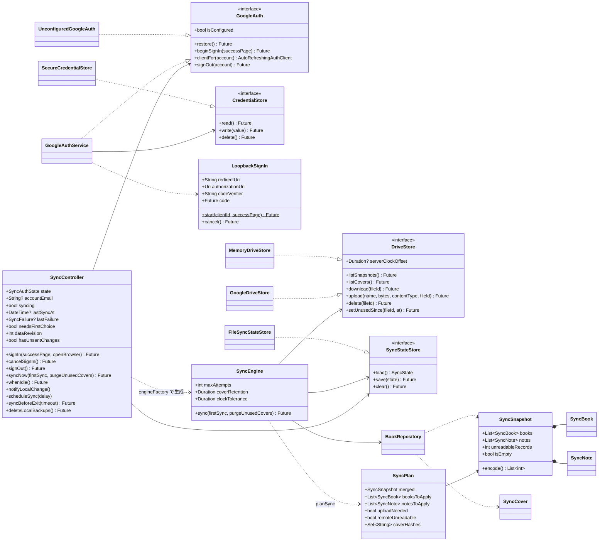

| クラス・関数 | ファイル | 役割 |
|---|---|---|
| `SyncController` | `state/sync_controller.dart` | ログイン状態（`SyncAuthState`: `unavailable`・`loading`・`signedOut`・`signingIn`・`signedIn`）、同期の実行と結果、自動同期の予約（[5.16.8](#5168-自動同期)）。`engineFactory` が認証済みクライアントから `SyncEngine` を作る |
| `GoogleAuthService` / `UnconfiguredGoogleAuth` | `services/google_auth.dart` | ログイン・ログイン情報の保存と復元・ログアウト（[5.16.10](#51610-google-ログイン)）。クライアント ID のないビルドでは後者を使う |
| `SyncEngine` | `sync/sync_engine.dart` | 同期1回分の手順（[5.16.5](#5165-同期1回の流れ)）と、例外の `SyncException(SyncFailure)` への変換（[5.16.9](#5169-エラーの分類と利用者への表示)）。結果は `SyncDone` か `SyncNeedsFirstChoice` |
| `planSync` / `SyncPlan` / `FirstSyncMode` | `sync/sync_plan.dart` | 統合の規則（[5.16.3](#5163-統合の規則plansync)）と初めての同期の方法（[5.16.4](#5164-初めての同期)） |
| `SyncSnapshot` / `SyncBook` / `SyncNote` / `SyncCover` / `coverHashOf` | `sync/sync_snapshot.dart` | 同期データの形式（[5.16.2](#5162-同期データの形式)） |
| `DriveStore` / `GoogleDriveStore` / `MemoryDriveStore` | `sync/drive_store.dart` | Drive の appDataFolder の操作。`GoogleDriveStore` はサーバー時刻との差も測る（[5.16.7](#5167-記録時刻の補正)）。`MemoryDriveStore` はテスト用 |
| `SyncState` / `FileSyncStateStore` | `sync/sync_state.dart` | 同期の記録（[5.16.11](#51611-端末に置くファイル)） |
| `writeSyncBackup` | `sync/sync_backup.dart` | 初めての同期の前のバックアップ（[5.16.11](#51611-端末に置くファイル)） |

#### 5.16.2 同期データの形式

`colophon-sync.json`（`SyncSnapshot.encode()`。UTF-8 の JSON）の最上位:

| 項目 | 型 | 内容 |
|---|---|---|
| `format` | 文字列 | `colophon-sync`（書くときに付ける。読むときは確かめない） |
| `version` | 整数 | 形式の版 `syncFormatVersion`（1）。整数でなければ `FormatException`（壊れたデータとして扱う）、1 より大きければ `UnsupportedSyncFormatException` |
| `books` | 配列 | 書籍（`SyncBook`。下表） |
| `notes` | 配列 | ノート（`SyncNote`。下表） |

**書籍（`SyncBook`）**。「削除済み」の列が ○ の項目だけを、削除済みの書籍（`deletedAt` あり）でも書く。

| 項目 | 型 | 削除済み | 内容・読むときの扱い |
|---|---|---|---|
| `uuid` | 文字列 | ○ | 書籍の ID |
| `title` | 文字列 | | 書籍名。なければ空文字 |
| `author`・`translator`・`supervisor`・`publisher`・`isbn`・`edition` | 文字列／null | | 書誌項目 |
| `status` | 文字列 | | ステータスのコード。未知の値は `unset` |
| `progress` | 整数／null | | 0〜100 の整数でなければ null |
| `coverHash` | 文字列／null | | 書影の SHA-256（16進）。書影がなければ null |
| `coverType` | 文字列／null | | 書影の MIME タイプ |
| `readDates` | 文字列の配列 | | 読了日（`yyyy-MM-dd`）。正しくない日付は捨て、重複を除いて並べる |
| `tags` | 文字列の配列 | | タグの表示名。前後の空白を除き、空のものは捨てる |
| `noteOrder` | 文字列の配列 | | 削除されていないノートの uuid を表示順に並べたもの |
| `createdAt` | 文字列（ISO 8601、UTC） | ○ | なければ `updatedAt`、それもなければ 1970-01-01 |
| `updatedAt` | 同上 | ○ | なければ 1970-01-01（どの記録より古いので、統合で負ける） |
| `deletedAt` | 同上 | ○ | 削除日時。あれば削除済み |

**ノート（`SyncNote`）**

| 項目 | 型 | 削除済み | 内容・読むときの扱い |
|---|---|---|---|
| `uuid` | 文字列 | ○ | ノートの ID |
| `bookUuid` | 文字列 | ○ | 書籍の uuid |
| `category` | 文字列／null | | 分類のコード。未知の値は null |
| `page` | 整数／null | | 1以上の整数でなければ null |
| `body` | 文字列 | | 本文。なければ空文字 |
| `favorite` | 真偽値 | | なければ false |
| `createdAt`・`updatedAt`・`deletedAt` | 文字列（ISO 8601、UTC） | ○ | 書籍と同じ |

- 範囲外・未知の値は、アプリが保存するときと同じ規則で直して読む。直さないと、書き込むたびに値が変わって同期が落ち着かない、または DB の制約で書き込めないため。
- 1件ずつ読み、読めない記録（`uuid` がない、型が違うなど）は飛ばして `unreadableRecords` に数える（1件のせいで統合全体を止めないため）。
- ファイル全体が読めない（JSON でない、最上位や `books`・`notes` の構造が違う）場合は `SyncFailure.remoteCorrupt`。
- `isEmpty` は、削除されていない書籍・ノートが1件もないこと。
- 日時は `toUtc().toIso8601String()` で書く。
- `exportSyncSnapshot` は、削除済みでない書籍の `coverType` を、`cover_hash` があるときだけ出す。

**書影のファイル**

| 項目 | 内容 |
|---|---|
| 名前 | `cover-` ＋ 書影の SHA-256（`coverHashOf`。16進の小文字） |
| 中身 | 書影のバイト列そのまま（DB の `books.cover` と同じ） |
| Content-Type | 書影の MIME タイプ（不明なら `application/octet-stream`） |
| `appProperties.unusedSince` | どの書籍からも使われなくなった日時（ISO 8601、UTC）。使われている書影には付けない |

一覧用の縮小画像は送らず、受け取った端末で `makeThumbnail` で作る（`SyncCover.thumbnail`）。

#### 5.16.3 統合の規則（`planSync`）

`planSync({local, remote, firstSync, now})` は、この端末の同期データ（`exportSyncSnapshot` の結果）とクラウドの同期データを統合して `SyncPlan` を返す。`now` は、ISBN でまとめた書籍や置き換えで削除する書籍・ノートに付ける日時。

| 手順 | 規則 |
|---|---|
| 1. クラウドが空 | `remote` が null（同期データのファイルがない）なら、この端末の内容をそのまま送る（`uploadNeeded = true`、書き込むものなし） |
| 2. 突き合わせ | 書籍・ノートとも uuid で突き合わせ、`updatedAt` が新しい方を採る。同時刻なら削除済みの方、それでも決まらなければクラウド側（`_newer`。どの端末でも同じ結果になるように） |
| 3. 復活した書籍のノート | 統合後のノートが削除済み、その書籍は統合後に削除されておらず、どちらかの端末の書籍がノートと同じ削除日時で削除済み（書籍と一緒に消えた）だった場合、どちらかに削除されていない版があれば、それを `updatedAt` を書籍の更新日時にそろえて採る |
| 4. 書籍の削除をノートへ | 統合後に削除済みの書籍に、削除されていないノートが残れば、書籍の `updatedAt`・`deletedAt` で削除済みにする（ノートを変えると書籍の更新日時も進むので、書籍の削除はノートの変更より後に起きている） |
| 5. ノートの並び順 | 各書籍の `noteOrder` を削除されていないノートだけにし、入っていないノートを作成日時順（同じなら uuid 順）に後ろへ付ける。どの端末でも同じ結果になるので、1回送れば落ち着く |
| 6. 書き込む差分 | この端末の内容と違う書籍・ノートを `booksToApply`・`notesToApply` にする。ただし、この端末にない書籍・ノートの削除済みの印は書き込まない（消すものがない） |
| 7. 送る必要 | クラウドの内容と違うものが1件でもあれば `uploadNeeded` |
| 8. 読めない記録 | `remote.unreadableRecords` が 0 でなければ `uploadNeeded = false`、`remoteUnreadable = true`。送ると、その記録（削除の印かもしれない）がクラウドから消えるため。書き込みは行う |

- 内容の比較（`_same`）は `toJson()` を JSON 文字列にして行う。ただしタグは `tagKey` の集合を並べたもので比べ、表記（「SF」と「sf」など）の違いを差分にしない（端末ごとに表記が違っても、書き込みを繰り返さないため）。
- 書籍は、読了日・タグ・`noteOrder` を含めて1単位で採否を決める。ノートは書籍とは別に1件ずつ決める。
- `SyncPlan.coverHashes` は、統合後に削除されていない書籍が参照する書影の SHA-256 の集合。

#### 5.16.4 初めての同期

`SyncEngine` は、`SyncState.hasSynced` が false で、クラウドの同期データがあって空でなく、この端末の同期データも空でないときを初めての同期とする。方法（`FirstSyncMode`）が渡されていなければ、`SyncNeedsFirstChoice(localBooks, remoteBooks)`（両方の削除されていない書籍の数）を返して止まる。それ以外の場合は `firstSync` を渡しても使わない。

| モード | 処理 |
|---|---|
| `merge` | `_combineSameIsbn`（下記）でこの端末の内容を書き換えてから、[5.16.3](#5163-統合の規則plansync) の手順2〜8で統合する。書き込む差分は、書き換える前の実際の内容と比べて求める |
| `useRemote` | `_replaceLocal`: 統合結果はクラウドの内容そのまま。この端末と違うクラウドの書籍・ノートを書き込み、この端末だけにある削除されていない書籍・ノートを `now` で削除済みにする。`uploadNeeded = false` |
| `useLocal` | `_replaceRemote`: 統合結果はこの端末の内容。両方にあって内容が違う書籍・ノートは `updatedAt` を `now` にして送り、この端末にも同じ日時を書き込む（元の日時のままだと、ほかの端末に残る新しい日時の版が次の同期で勝ち、置き換えた内容が戻されるため）。クラウドだけにある削除されていない書籍・ノートは `now` で削除済みにして送る。`uploadNeeded = true` |

`_combineSameIsbn(local, remote, now)`:

- この端末だけにある（uuid がクラウドにない）削除されていない書籍と、クラウドだけにある削除されていない書籍で、`isbnMatchKey` が同じもの（正しい ISBN だけ。ISBN-10 と ISBN-13 は同一視）を組にする。クラウド側は ISBN ごとに最初の1冊を使う。
- まとめた書籍: uuid はクラウド側（ほかの端末とそろえるため）、書誌項目などは `updatedAt` が新しい方、読了日は両方の和集合を並べたもの、タグは `tagKey` で重複を除いた和集合（`tagKey` 順）、`noteOrder` はクラウド側の後ろにこの端末側の残り、`updatedAt` は `now`。
- この端末側の元の書籍は `now` で削除済みの印にし、そのノートは書籍の uuid をまとめ先に付け替えて `updatedAt` を `now` にする。

#### 5.16.5 同期1回の流れ

`SyncEngine.sync({firstSync, purgeUnusedCovers})`。ほかの端末との行き違いでやり直す場合も含めて、最大 `maxAttempts`（3）回試みる。

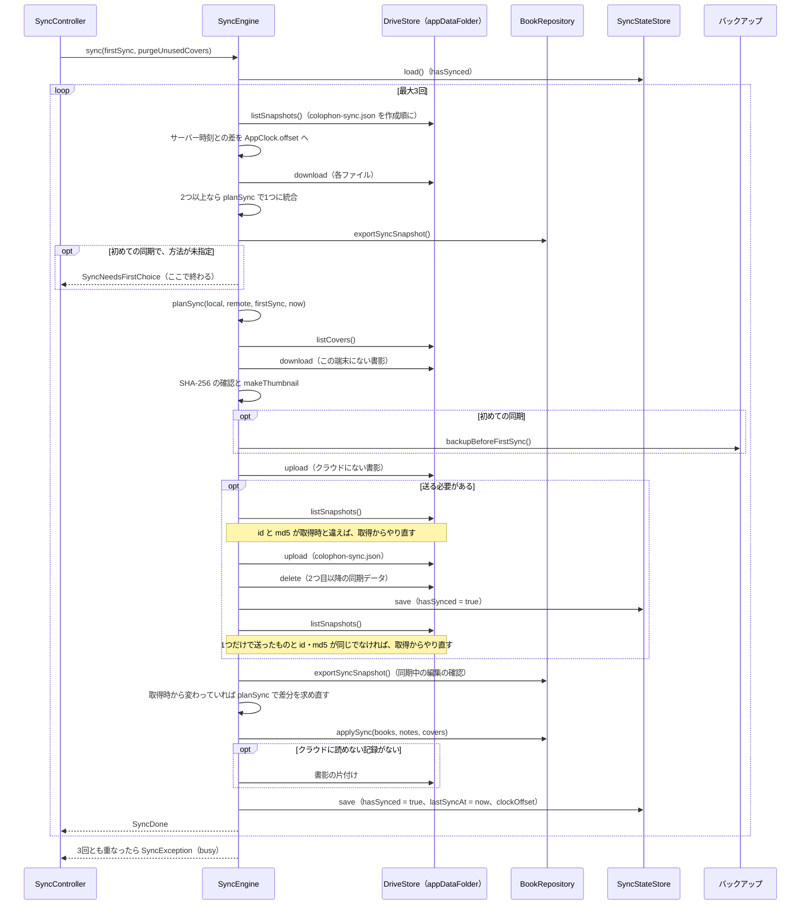

| 手順 | 詳細 |
|---|---|
| 取得 | `listSnapshots` は `name = 'colophon-sync.json' and trashed = false` を作成日時順に返す（ページを `pageSize` 1000 でたどる）。一覧から読むまでの間にほかの端末がファイルを消して 404 になったら、取得からやり直す |
| 複数の同期データ | 2台が同時に初めて送ると2つになることがある。古い順に `planSync(local: そのファイル, remote: それまでの統合結果)` で1つにまとめ、読めない記録の数は合計する |
| 初めての同期 | [5.16.4](#5164-初めての同期) の条件に当たり、方法が未指定なら `SyncNeedsFirstChoice` を返す（何も書かない） |
| 送るか | `plan.uploadNeeded`、または同期データのファイルが2つ以上（1つにまとめるため。読めない記録があるときを除く） |
| バックアップ | 初めての同期なら、Drive に何か書く前に `backupBeforeFirstSync`（`writeSyncBackup`）を呼ぶ。失敗したら（`FileSystemException` → `localStorage`）どこも変えずに終わる |
| 書影 | [5.16.6](#5166-書影の扱い) |
| 送る直前の確認 | もう一度 `listSnapshots` し、ファイルの数・id・`md5Checksum` が取得時と同じでなければ、取得からやり直す（相手の変更を上書きしないため）。版番号ではなく MD5 で比べるのは、中身が同じでも版番号が進むことがあるため |
| 送信 | 1つ目のファイルを `files.update` で上書き（なければ `files.create` で appDataFolder に作成）し、2つ目以降を削除する。送った時点で `hasSynced = true` を保存する（この後で止まっても、初めての同期の選択を聞き直さないため。`lastSyncAt` はまだ前回の値） |
| 送った直後の確認 | `listSnapshots` が1つだけで、送ったものと id・MD5 が同じでなければ（ほかの端末が上書きした）、取得からやり直す |
| 同期中の編集 | `exportSyncSnapshot` をもう一度取り、取得時の内容と違えば、`planSync(local: 今の内容, remote: 統合結果)` で書き込む差分を求め直す（通信中に利用者が編集した内容を上書きしないため）。ここから `applySync` までは `await` を挟まない。残った編集は次の同期で送られる |
| 書き込み | `applySync`（下表）。ここまで失敗しても、この端末の DB は書き換えていない |
| 記録 | `hasSynced = true`、`lastSyncAt = AppClock.now()`、`clockOffset = AppClock.offset` を保存し、`SyncDone(booksChanged, notesChanged, uploaded, remoteUnreadable)` を返す |

`BookRepository.applySync({books, notes, covers})`（1トランザクション。日時は渡された値をそのまま使う）:

| 手順 | 処理 |
|---|---|
| 1 | 書き込む書籍が使う書影を、渡された `covers` とこの端末の DB（`coverByHash`）から先にすべて確保する（途中で別の書籍の書影を差し替えると、この端末にしかない書影が見つからなくなるため） |
| 2 | 削除済みでない書籍を書き込む。この端末にない uuid は INSERT、ある uuid は UPDATE（`deleted_at = NULL` で復活）し、読了日（正しい日付だけ）とタグを入れ直す。書影は `cover_hash` が変わったときだけ差し替え（書影が足りなければ `StateError` で全体を取り消す）、`cover_type` は同期データの値にそろえる |
| 3 | ノートを uuid で upsert する（[4.4](#44-主な-sql)）。書籍がこの端末にないノートは書き込まない。削除済みのノートは分類・ページを null、本文を空、お気に入りを 0 にする |
| 4 | 削除済みの書籍に印を付け（`_markDeleted`。ノートも削除済みにし、書影・読了日・タグを消す）、`updated_at` を同期データの値にする |
| 5 | 書き込んだ書籍のノートの並び順を `noteOrder` にそろえる（`_orderNotes`。`noteOrder` にないノートは今の順のまま後ろへ） |
| 6 | 使われなくなったタグを削除する |

`applySync` は `onChanged` を呼ばない（同期による書き込みで、次の自動同期を予約しないため）。

#### 5.16.6 書影の扱い

| 場面 | 処理 |
|---|---|
| 取得 | 書き込む書籍（削除済みでない）の `coverHash` のうち、この端末の DB にないものを Drive から取得する。Drive にない、または中身の SHA-256 が名前と違えば `SyncFailure.missingCover`（この端末は書き換えない） |
| 送信 | 統合後に必要な書影（`SyncPlan.coverHashes`）のうち Drive にないものを、この端末の DB か取得した書影から送る。同期データを送る必要がない回でも行う（ほかの端末との行き違いで消えた場合に補うため）。同期データより先に送る |
| 片付け | Drive の書影ごとに、使われていて `unusedSince` があれば外す。使われていなければ、`purgeUnusedCovers` ならすぐ削除、`unusedSince` がなければ今の日時を付け、付けてから `coverRetention`（7日）以上たっていれば削除する。片付けの失敗は無視する（同期は成功とする）。クラウドに読めない記録があるときは行わない（その記録が使う書影を消さないため） |

猶予を置くのは、しばらく同期していなかった端末が古い同期データを元に送ってきても、書影を失わないようにするため。

#### 5.16.7 記録時刻の補正

| 要素 | 内容 |
|---|---|
| 測定 | `GoogleDriveStore` の HTTP クライアント（`_ClockClient`）が、応答ごとに `Date` ヘッダーと端末の UTC 時刻の差（サーバー − 端末）を測る（`serverClockOffset`）。Date ヘッダーは秒単位なので、2秒未満の差は 0 とする（`measureClockOffset`）。読めないヘッダーは無視する |
| 反映 | `SyncEngine` は `listSnapshots` の直後に、測った差が今の `AppClock.offset` から `clockTolerance`（5秒）を超えてずれていれば `AppClock.offset` を置き換える（記録時刻が小刻みに戻らないように） |
| 保存 | `SyncState.clockOffset` として `sync-state.json` に保存し、次の起動時に `SyncController` が `AppClock.offset` に戻す（まだ通信していない間の記録時刻も補正するため。保存先を渡されない仮の `SyncController` では戻さない） |
| 使う場所 | `AppClock.now()` は、書籍・ノートの作成・更新・削除日時、タグの変更・お気に入りの切り替えでの更新日時、インポート時の日時、統合で付ける日時、最終同期日時に使う。画面に出すだけの時刻には使わない |

#### 5.16.8 自動同期

`SyncController` は、`autoSync` が true のとき（`main` では true、テストでは既定の false）、次のように同期を予約する。予約は1つだけで、予約し直すと前の予約は取り消す。

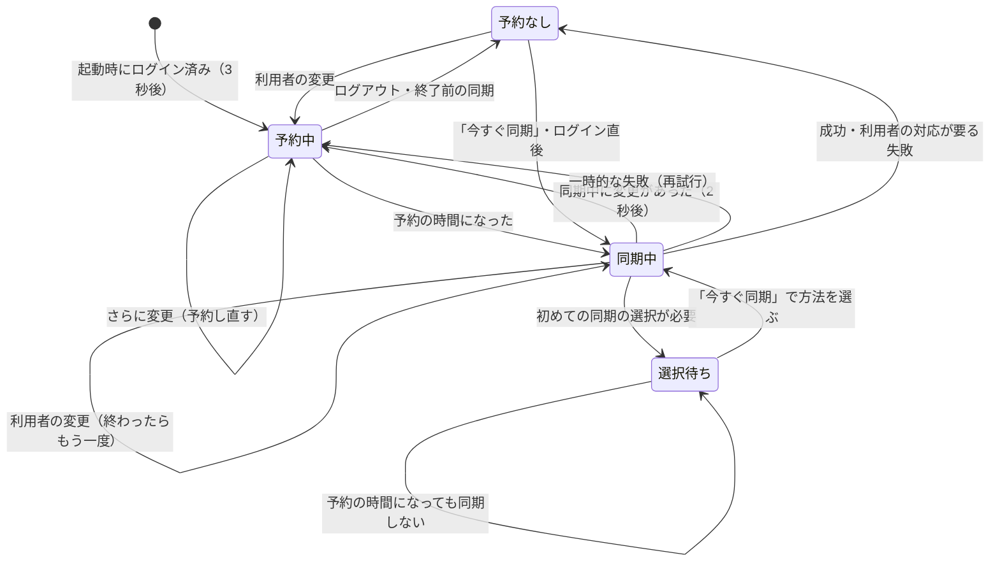

| 項目 | 値 | 内容 |
|---|---|---|
| `startupDelay` | 3秒 | 保存したログイン情報を読めたら、この時間の後に同期する |
| `changeDelay` | 30秒 | 最後の変更（`notifyLocalChange`）からの待ち時間。変更のたびに予約し直す |
| `maxChangeDelay` | 5分 | 最初の変更からの最長の待ち時間。残りが `changeDelay` より短ければ、残りの時間（0 未満なら 0）で予約する |
| 同期中の変更 | 2秒 | 同期中に変更があれば（`_again`）、終わってから2秒後にもう一度同期する |
| `retryDelays` | 1・2・5・15・30分 | 一時的な失敗（`network`・`busy`・`missingCover`・`other`。想定外の例外を含む）の後の再試行。回数ごとに次の値を使い、最後の値を繰り返す。成功すれば回数を戻す。利用者の対応が要る失敗（`auth`・`quota`・`newerFormat`・`remoteCorrupt`・`localStorage`）は再試行しない |
| 終了時 | 10秒ずつ | `syncBeforeExit` は、実行中の同期を最大10秒待ち、送っていない変更があれば同期1回を最大10秒待つ |

- `notifyLocalChange` は `BookRepository.onChanged` から呼ばれる。`_dirty`（前回の同期の開始後に利用者がデータを変えたか）を立て、同期中なら `_again` を立てるだけにする。
- 同期を始めるときに `_dirty` を下ろし、失敗したら元に戻す（送れなかった変更として扱う）。`hasUnsentChanges` は、自動同期が有効・ログイン中・選択待ちでない・（`_dirty` または `_again`）のとき true。
- 初めての同期の選択が要る（`needsFirstChoice`）間は、予約の時間になっても同期せず、終了時の同期もしない。選択が要らない結果が出れば解除する。
- `syncBeforeExit`: 予約を取り消し、実行中の同期を待ってから、利用者の変更があれば同期する。時間切れでも終了は止めない（送れなかった変更は次の起動時に送る）。終了が取りやめられた場合に備え、送れていない変更があれば `changeDelay` で予約し直す。
- `signOut`: 予約を取り消し、実行中の同期が終わるのを待ってから（`whenIdle`）、クライアントを閉じ、アカウントと各状態を初期化し、`SyncStateStore.clear()`（`sync-state.json` を消す）と `GoogleAuth.signOut` を行う。
- 同期でこの端末のデータが変わったら（`SyncDone.localChanged`）、`dataRevision` を増やし、`onLocalDataChanged`（`LibraryController.reload`）を呼ぶ。

#### 5.16.9 エラーの分類と利用者への表示

`SyncEngine.sync` は例外を `SyncException(SyncFailure)` にして投げる。`SyncController` はそれを `lastFailure` に残し（成功すれば null に戻す）、同期欄に赤字で表示する。「今すぐ同期」からの同期ではスナックバーにも出す。

| `SyncFailure` | 元になる例外・状況 | メッセージキー | 自動の再試行 |
|---|---|---|---|
| `network` | `SocketException`、`http.ClientException`、`TimeoutException`、`HandshakeException`、Drive API の 429・5xx、理由が `rateLimitExceeded`・`userRateLimitExceeded`・`backendError`・`internalError` のエラー、`ServerRequestFailedException`（`invalid_grant` 以外） | `syncErrorNetwork` | する |
| `auth` | Drive API の 401、上記以外の理由の 403、`AccessDeniedException`、`ServerRequestFailedException`（`invalid_grant`。更新用トークンが無効） | `syncErrorAuth` | しない |
| `quota` | 理由が `storageQuotaExceeded` のエラー | `syncErrorQuota` | しない |
| `newerFormat` | `UnsupportedSyncFormatException` | `syncErrorNewerFormat` | しない |
| `remoteCorrupt` | 同期データのファイルを読めない、`FormatException` | `syncErrorRemoteCorrupt` | しない |
| `busy` | 送る前後の確認や 404 でのやり直しが3回続いた | `syncErrorBusy` | する |
| `missingCover` | Drive に必要な書影がない・中身が名前と違う、`applySync` の `StateError`（書影が足りない） | `syncErrorMissingCover` | する |
| `localStorage` | `SqliteException`、`FileSystemException`（DB・バックアップ・`sync-state.json` の保存の失敗） | `syncErrorLocalStorage` | しない |
| `other` | 上記以外の Drive API のエラー、`SyncController` が受けた想定外の例外 | `syncErrorOther` | する |

- Drive API のエラー（`DetailedApiRequestError`）は `classifyApiFailure(status, reasons)` で、401 → `auth`、`storageQuotaExceeded` → `quota`、429・5xx・一時的な理由 → `network`、そのほかの 403 → `auth`、それ以外 → `other` の順に判定する。
- クラウドに読めない記録があって送らなかった場合（`SyncDone.remoteUnreadable`）は失敗ではなく、`syncWarningUnreadable` を表示する。

#### 5.16.10 Google ログイン

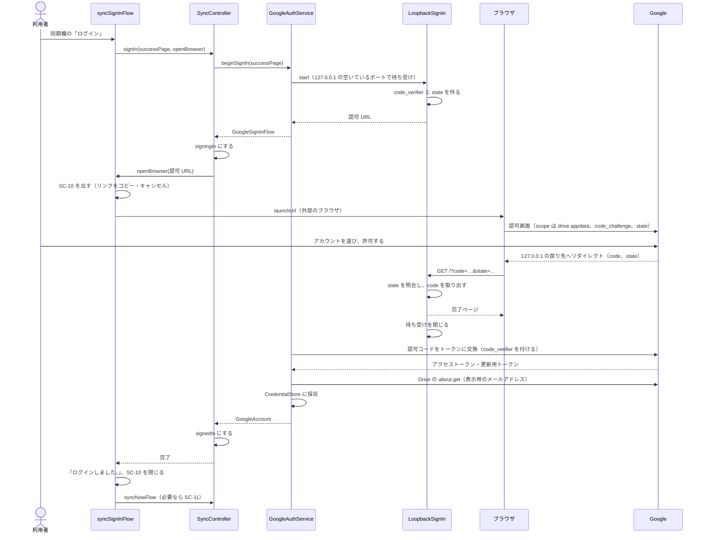

| 項目 | 内容 |
|---|---|
| スコープ | `https://www.googleapis.com/auth/drive.appdata`（`DriveApi.driveAppdataScope`）だけ |
| 認可 URL | `https://accounts.google.com/o/oauth2/v2/auth`。`client_id`・`response_type=code`・`redirect_uri`・`scope`・`code_challenge`・`code_challenge_method=S256`・`state` |
| PKCE | `code_verifier` は RFC 7636 で使える文字（英数字と `-._~`）から `Random.secure()` で64文字。`code_challenge` はその SHA-256 を base64url にして `=` を除いたもの |
| `state` | 24バイトの乱数を base64url（`=` なし） |
| 待ち受け | `HttpServer.bind(InternetAddress.loopbackIPv4, 0)`。戻り先は `http://127.0.0.1:{ポート}`。`/` 以外への要求（favicon など）と、受け取った後の要求には 404 を返す |
| 戻り先の解析 | `parseAuthorizationCallback`: `state` が違う → `invalidResponse`、`error=access_denied` → `denied`、ほかの `error` → `failed`、`code` がない → `invalidResponse`。失敗時はブラウザに `Colophon: {理由}` を表示する |
| 中止 | `cancelSignIn` → `LoopbackSignIn.cancel`。`cancelled` で終え、待ち受けを閉じる。`googleapis_auth` の `clientViaUserConsent` を使わないのは、待ち受けを途中で止める手段がなく、利用者がブラウザを閉じると待ち受けが残り続けるため |
| トークンの交換 | `obtainAccessCredentialsViaCodeExchange`（`redirectUrl`・`codeVerifier` を付ける）。失敗は `GoogleSignInFailure.failed`。クライアントシークレットが空なら null として渡す |
| メールアドレス | Drive の `about.get(fields: user(emailAddress))`。取れなくてもログインは成功とする |
| 保存 | `{"credentials": AccessCredentials の JSON, "email": …}` を `CredentialStore` に書く。`restore()` は、ない・読めない・壊れている場合に null（ログアウト中）を返す |
| 認証済みクライアント | `clientFor` は `autoRefreshingClient` を返す。トークンが更新されたら（`credentialUpdates`）保存し直す |
| ログアウト | `POST https://oauth2.googleapis.com/revoke`（`token` は更新用トークン、なければアクセストークン）。通信の失敗は無視し、保存した内容を消す |
| 画面への通知 | 失敗・中止では `SyncController` がログアウト状態に戻し、`GoogleSignInException` を投げ直す。`syncSignInFlow` は `cancelled` なら何も出さず、`denied` は `syncSignInDenied`、`invalidResponse`・`failed` は `syncSignInFailed` を表示する。ブラウザを開けなくても待ち続ける（SC-10 のリンクをコピーして使える） |

#### 5.16.11 端末に置くファイル

| ファイル | 場所 | 内容 |
|---|---|---|
| `sync-state.json` | 本棚（`colophon.db`）と同じフォルダ | `{"hasSynced": 真偽値, "lastSyncAt": ISO 8601 か null, "clockOffsetMs": 整数}`。`FileSyncStateStore` が `.tmp` に書いてから名前を変えて置き換える（書きかけで止まっても壊れないように）。ない・壊れている場合は未同期として扱う。ログアウトで削除する |
| `sync-backups/colophon-before-first-sync-{yyyyMMdd-HHmmss}.zip` | 同上 | 初めての同期の前のバックアップ（`writeSyncBackup`）。`exportZipInBackground(getAllBooks())` と同じ ZIP 形式で、インポートで戻せる。日時は端末の時刻。新しい3つを残して古いものは消す。すべてのデータの削除で `sync-backups/` ごと消す |
| ログイン情報 | OS の安全な保管場所（`flutter_secure_storage`。Windows: DPAPI で暗号化したファイル、macOS: キーチェーン、Linux: Secret Service） | キー `google_account`（開発用の本棚では `google_account_dev_{フォルダ名}`）。値は上記の JSON |

- 同期の記録を設定（SharedPreferences）に入れないのは、記録が本棚に属するため。本棚のフォルダを分けて動かす試験版どうしで混ざらず、本棚を別の場所へ移しても一緒に動く。
- macOS では従来型のキーチェーンを使う（`usesDataProtectionKeychain: false`）。署名していない配布版でも、Keychain Sharing の権限なしで動くようにするため。

#### 5.16.12 ビルド時の設定と開発用の本棚

| 値（`--dart-define`） | 読む場所 | 内容 |
|---|---|---|
| `COLOPHON_GOOGLE_CLIENT_ID` | `GoogleOAuthConfig.fromEnvironment()` | Google Cloud に登録したデスクトップアプリ用のクライアント ID。空なら `main` は `UnconfiguredGoogleAuth` を使い、同期欄は「使えません」になる |
| `COLOPHON_GOOGLE_CLIENT_SECRET` | 同上 | デスクトップアプリのクライアントシークレット。Google の説明どおり秘密として扱えない値で、PKCE と組み合わせて使う |
| `COLOPHON_DATA_DIR` | `main.dart` | 開発用。本棚・`sync-state.json`・`sync-backups/` をこのフォルダに置き、`SharedPreferences` の接頭辞を `colophon-dev-{フォルダ名}.`、ログイン情報のキーを `google_account_dev_{フォルダ名}` にする。試験版が普段の本棚を新しい版へ移行し、配布中の版で開けなくなるのを防ぐ。フォルダ名を変えて2つ動かせば、1台で2台分の同期を試せる |

配布用パッケージの作成スクリプト（`build-installer.ps1`・`build-dmg.sh`・`build-deb.sh`・`build-flatpak.sh`）は、環境変数 `COLOPHON_DART_DEFINES` が指すファイル、なければ `~/.colophon/dart-defines.json`（Windows は `%USERPROFILE%\.colophon\dart-defines.json`）があれば `--dart-define-from-file` で渡す。なければ警告を出し、同期を使えないアプリを作る（手順は [BUILDING.ja.md](../../BUILDING.ja.md)）。

| OS | 同期のための設定 |
|---|---|
| macOS | `Release.entitlements` に `com.apple.security.network.server` を追加（ログインの戻り先を 127.0.0.1 で待ち受けるため。`DebugProfile.entitlements` には元からある） |
| Linux（.deb） | `Depends` に `libsecret-1-0` を追加（ログイン情報を Secret Service に保存するため） |
| Linux（Flatpak） | `finish-args` に `--talk-name=org.freedesktop.secrets` を追加（Secret Service）。`--share=network` は ISBN 取得と同期に使う |

#### 5.16.13 画面との連携

| 画面・部品 | 処理 |
|---|---|
| `SyncSettingsSection` | `context.watch<SyncController>()` で状態ごとに表示する（基本設計書の SC-07 同期欄）。最終同期日時は `DateFormat.yMMMd(言語).add_Hm()` で端末の時刻。失敗は `syncFailureMessage` で文言にし、`colorScheme.error` の色で出す。失敗がなければ、選択待ちの案内（`syncNeedsChoice`）、読めない記録の注意（`syncWarningUnreadable`）の順に出す |
| `syncNowFlow` | `syncNow()` → `SyncNeedsFirstChoice` なら `_FirstSyncDialog`（初期選択 `merge`）→ 選べば `syncNow(firstSync: 選んだ方法)`。`SyncDone` なら `syncDone`（読めない記録があれば `syncWarningUnreadable`）、失敗なら理由をスナックバーで出す |
| `_signOutFlow` | 確認（`syncSignOutTitle`・`syncSignOutBody`）の後に `SyncController.signOut()` |
| `LibraryController` | `ColophonApp` が `sync.onLocalDataChanged = library.reload` を設定し、同期でデータが変わったら一覧を読み直す |
| `BookEditScreen` | `SyncController` を購読し、`dataRevision` が変わったとき、登録済みの書籍で `_dirty` でなく、この画面が最前面（`ModalRoute.isCurrent`）なら `getBook` で読み直す。null（削除済み）なら `bookDeletedElsewhere` を出して閉じる。保存時と「破棄して表示」のときも削除を確かめる（`_closeIfDeletedElsewhere`） |
| `_SyncBeforeExit` | `MaterialApp.builder` に置く。`AppLifecycleListener.onExitRequested` で、`hasUnsentChanges` なら閉じられない `_ExitSyncDialog`（`PopScope(canPop: false)`）を出し、`syncBeforeExit()` と「同期せずに終了」の早い方を待って `AppExitResponse.exit` を返す。送っていない変更がなければダイアログを出さず、`syncBeforeExit()`（実行中の同期を待つだけ）の後で終了する |
| `deleteAllDataFlow` | ログイン中は削除する範囲を選ぶ（[5.15](#515-すべてのデータの削除と配布用パッケージ)） |
| `SearchScreen`・`TagManagerScreen` | 同期による読み直しはしない（表示時などに読み込む） |

---

## 6. 入力チェック

| 画面 | 項目 | ルール | エラー時のメッセージキー |
|---|---|---|---|
| SC-03 | 書籍名 | 前後の空白を除いて1文字以上 | `titleRequired` |
| SC-03 | 進捗 | 空、または 0〜100 の整数（数字以外は入力できない） | `progressInvalid` |
| SC-03 | ノートのページ | 空、または1以上の整数（数字以外は入力できない） | `pageInvalid` |
| SC-03 | ISBN | 空、または正しい ISBN。正しくなくても保存可（警告のみ） | `isbnInvalidWarning`（警告） |
| SC-03 | ISBN から取得 | 正しい ISBN であること | `isbnLookupInvalid` |
| SC-06 | タグ名 | 空でないこと、ほかのタグと同じ `tagKey` でないこと | `tagNameRequired`、`tagExists` |

---

## 7. メッセージ

主なメッセージ（キーは `lib/l10n/app_en.arb` のもの。表示は日本語版の例）。

| キー | 種類 | 表示（日本語） | 表示するとき |
|---|---|---|---|
| `saved` | 情報 | 保存しました。 | 書籍の保存後 |
| `coverResized` | 情報 | 画像を {width} × {height} px に縮小しました。 | 書影を自動縮小したとき |
| `coverLoadFailed` | エラー | この画像は読み込めませんでした。 | 書影として読めない画像 |
| `lookupNotFound` | 情報 | このISBNの書籍は見つかりませんでした。 | ISBN 取得で該当なし |
| `lookupFailed` | エラー | 書籍情報を取得できませんでした。… | ISBN 取得で見つからず、通信エラーの取得元があった |
| `exportDone` / `exportFailed` / `exportEmpty` | 情報／エラー／情報 | エクスポートしました。／エクスポートに失敗しました。／エクスポートする書籍がありません。 | エクスポートの完了・失敗・0冊のとき |
| `importDone` | 情報 | インポートが完了しました。追加：{added}冊／スキップ：{skipped}冊 | インポート後 |
| `importInvalidFile` / `importNewerVersion` / `importFailed` | エラー | Colophon のデータではない／新しい版のファイル／インポートできない | インポート失敗 |
| `genericError` | エラー | エラーが発生しました。 | 保存時の予期しないエラー |
| `deleteBookConfirm` / `deleteNoteConfirm` / `deleteTagConfirm` / `importReplaceConfirm` / `unsavedBody` | 確認 | 「…」を削除しますか？ など | 取り消せない操作の前 |
| `askAddReadDateBody` | 確認 | 今日（{date}）の日付で読了記録を追加しますか？ | ステータスを読了に変えたとき |
| `syncUnavailable` | 情報 | このビルドでは同期を使えません（…）。 | クライアント ID なしのビルドの同期欄 |
| `syncSignInDone` / `syncSignInDenied` / `syncSignInFailed` | 情報／情報／エラー | ログインしました。／ログインが取り消されました。／ログインできませんでした。… | ログインの完了・拒否・失敗 |
| `syncBrowserPage` | 情報 | Colophon にログインしました。このタブを閉じて、アプリに戻ってください。 | ログイン後のブラウザの完了ページ |
| `syncSignOutTitle` / `syncSignOutBody` | 確認 | ログアウトしますか？／このパソコンでの同期を止めます。… | ログアウトの前 |
| `syncDone` | 情報 | 同期しました。 | 「今すぐ同期」の完了 |
| `syncFirstTitle` / `syncFirstBody` | 確認 | 初めての同期／このパソコンに{local}冊、Google ドライブに{remote}冊の書籍があります。… | SC-11 |
| `syncErrorNetwork` ほか `syncError*` | エラー | 接続できませんでした。… など | 同期の失敗（[5.16.9](#5169-エラーの分類と利用者への表示)） |
| `syncWarningUnreadable` | 注意 | Google ドライブの同期データの一部が読めなかったため、このパソコンからの送信を見合わせました。 | クラウドに読めない記録があった |
| `syncNeedsChoice` | 情報 | 初めての同期の方法を選ぶ必要があります。「今すぐ同期」を押してください。 | 自動同期で初めての同期の選択が要ると分かった |
| `deleteScopeTitle` / `deleteScopeThisPc` / `deleteScopeEverywhere` | 確認 | 削除する範囲／このパソコンだけ／Google ドライブとすべてのパソコン | ログイン中のすべてのデータの削除 |
| `deleteEverywhereSyncFailed` / `deleteEverywherePartial` | エラー | Google ドライブに接続できなかったため、何も削除していません。…／このパソコンの書籍は削除しましたが、Google ドライブへの反映に失敗しました。… | 「すべてのパソコン」の1回目・2回目の同期の失敗 |
| `bookDeletedElsewhere` | 情報 | この書籍は、ほかのパソコンで削除されました。 | 開いている書籍がほかのパソコンで削除された |
| `syncOnExitTitle` / `syncOnExitBody` / `syncOnExitSkip` | 情報 | Google ドライブと同期しています…／同期が終わったら終了します。／同期せずに終了 | SC-12 |

---

## 8. エラー処理

| 例外・状況 | 発生箇所 | 処理する場所 | 利用者への表示 |
|---|---|---|---|
| `NewerSchemaException` | `migrate`（起動時） | `main` | 「新しいバージョンで保存されています」画面 |
| `SqliteException` | `openAppDatabase`（起動時） | `main` | DB のパスと例外内容を示す起動エラー画面 |
| 保存時の例外 | `saveBook` | `BookEditScreen._save` | `genericError`。画面は閉じない |
| `CoverImageException` | `processCoverSync` | `BookEditScreen._pickCover` | `coverLoadFailed` |
| `LookupException` | `IsbnLookupService.lookup` | `BookEditScreen._lookupIsbn` | `lookupFailed` |
| `InvalidBackupException` | `readBackup` 系 | `runImport` | `importInvalidFile` |
| `NewerBackupException` | `readBackup` 系 | `runImport` | `importNewerVersion` |
| その他の例外 | 読み込み・反映 | `runImport` | `importFailed`（反映はロールバック済み） |
| 例外 | エクスポートの作成・保存 | `runExport` | `exportFailed` |
| 利用者のキャンセル | ファイル選択・保存ダイアログ | 各呼び出し元 | 何も表示しない |
| `GoogleSignInException` | `LoopbackSignIn`・`GoogleAuthService`（ログイン） | `syncSignInFlow` | `cancelled` は何も出さない。`denied` は `syncSignInDenied`、ほかは `syncSignInFailed`。ログアウト状態に戻る |
| `SyncException` | `SyncEngine.sync`（[5.16.9](#5169-エラーの分類と利用者への表示) の分類） | `SyncController._run` | `lastFailure` に残し、同期欄に赤字で表示。「今すぐ同期」ではスナックバーにも。一時的な失敗は自動で再試行 |
| その他の例外 | 同期中 | `SyncController._run` | `SyncFailure.other`（`syncErrorOther`）。自動で再試行 |
| 開いている書籍がほかのパソコンで削除済み | 同期（`applySync`） | `BookEditScreen` | `bookDeletedElsewhere` を出して画面を閉じる。保存しない |

業務上の想定内の状況（該当なし・入力誤り・重複など）は例外にせず、戻り値（null、false、`ImportResult` の件数）で返す。非同期処理の後は `mounted`（`context.mounted`）を確認してから画面を操作する。

---

## 9. 設定値・定数

### 9.1 端末設定（shared_preferences）

| キー | 型 | 既定値 | 内容 |
|---|---|---|---|
| `language` | String | なし（初回の言語選択を表示） | 表示言語のコード（`en`/`ja`/`zh`/`fr`/`es`/`de`/`ko`） |
| `autoResizeCover` | bool | true | 書影の自動縮小 |
| `gridView` | bool | false | 書影の一覧で表示するか |
| `sort` | String | `recent` | 並び順（`recent`/`title`） |
| `colorTheme` | String | `leather` | 配色テーマ（`leather`/`forest`/`ocean`/`rose`/`monochrome`/`universal`） |
| `themeMode` | String | `system` | 明るさ（`system`/`light`/`dark`） |
| `exportTextWithCovers` | bool | false | テキストのエクスポートに書影を含めるか（前回の選択） |

同期の記録（一度同期したか・最終同期日時・サーバー時刻との差）は設定には入れず、本棚と同じフォルダの `sync-state.json` に保存する（[5.16.11](#51611-端末に置くファイル)）。開発用の `COLOPHON_DATA_DIR` を渡したビルドでは、キーの接頭辞を `colophon-dev-{フォルダ名}.` にする（[5.16.12](#51612-ビルド時の設定と開発用の本棚)）。

### 9.2 定数

| 名前 | 値 | 場所 |
|---|---|---|
| `schemaVersion` | 4 | `app_database.dart` |
| `backupFormatVersion` | 1 | `backup.dart` |
| `syncFormatVersion` | 1 | `sync_snapshot.dart` |
| 同期のファイル名 | `colophon-sync.json`（`syncSnapshotFileName`）、`cover-{SHA-256}`（`syncCoverPrefix`） | `drive_store.dart` |
| 同期のやり直しの上限（`maxAttempts`） | 3回 | `sync_engine.dart` |
| 使われなくなった書影の猶予（`coverRetention`） | 7日 | `sync_engine.dart` |
| サーバー時刻の補正をし直す差（`clockTolerance`） | 5秒 | `sync_engine.dart` |
| サーバー時刻の差を 0 とみなす範囲 | 2秒未満 | `drive_store.dart`（`measureClockOffset`） |
| 自動同期の待ち時間 | 起動 3秒／変更 30秒（最長 5分）／同期中の変更 2秒 | `sync_controller.dart` |
| 自動の再試行の間隔（`retryDelays`） | 1・2・5・15・30分 | `sync_controller.dart` |
| 終了時の同期の待ち時間 | 10秒（実行中の同期の終了待ち、同期1回のそれぞれ） | `sync_controller.dart`（`syncBeforeExit`） |
| 初めての同期の前のバックアップの保持数 | 3 | `sync_backup.dart` |
| Drive のファイル一覧の1ページの件数 | 1000 | `drive_store.dart` |
| `coverMaxSide` | 2000（px） | `cover_image.dart` |
| `coverMaxBytes` | 2,097,152（2MB） | `cover_image.dart` |
| `thumbnailSide` | 360（px） | `cover_image.dart` |
| JPEG 品質 | 縮小 85／形式変換 90／サムネイル 80 | `cover_image.dart` |
| ISBN 取得のタイムアウト | 国立国会図書館15秒、ほかは10秒 | `isbn_lookup.dart` |
| 検索の入力待ち | 200ms | `search_screen.dart` |
| `busy_timeout` | 3000ms | `app_database.dart` |
| 日付選択の範囲 | 1900-01-01〜2200-12-31 | `common.dart` |
| 書影の一覧の最大幅 | 1マス 170px | `book_list_screen.dart` |
| 内容の最大幅 | 760px（一覧・検索は 960px） | `common.dart` ほか |
| 配色テーマの基準色 | [5.12](#512-配色テーマ) を参照 | `app_theme.dart` |
| ウィンドウの初期サイズ（Windows） | 1100 × 800 | `windows/runner/main.cpp` |

---

## 10. 多言語対応

| 項目 | 内容 |
|---|---|
| 仕組み | Flutter の `gen-l10n`。`l10n.yaml` で `arb-dir: lib/l10n`、テンプレート `app_en.arb`、`nullable-getter: false` |
| 対応言語 | `en`（テンプレート）、`ja`、`zh`（簡体字）、`fr`、`es`、`de`、`ko` |
| 生成物 | `lib/l10n/app_localizations.dart` と各言語のファイル（`flutter pub get`／`run`／`build` で自動生成） |
| 複数形 | ICU 形式（例 `{count, plural, =1{1 book} other{{count} books}}`）。日本語・中国語・韓国語は `other` のみ |
| コード値の文言 | `labels.dart` の拡張メソッド `status`・`category`・`searchField`・`sourceName` |
| 日付の表示 | `formatDate`（`common.dart`）＝ `intl` の `DateFormat.yMMMd`（表示言語の書式・年を含む。例 2025年3月1日／Mar 1, 2025）。`MaterialLocalizations.formatMediumDate` は年を含まないため使わない |
| 言語の追加 | ARB ファイルを追加し、`supportedLanguages` に1行追加 |

---

## 11. プラットフォーム固有の設定

| OS | ファイル | 設定 |
|---|---|---|
| 共通 | — | 識別子 `io.github.colophonbooks.colophon`、表示名 `Colophon` |
| Windows | `windows/runner/Runner.rc` | CompanyName `colophonbooks`、ProductName `Colophon`（データ保存先 `%APPDATA%\colophonbooks\Colophon` を決める） |
| Windows | `windows/runner/main.cpp` | ウィンドウ名 `Colophon`、初期サイズ 1100 × 800 |
| macOS | `macos/Runner/Configs/AppInfo.xcconfig` | `PRODUCT_NAME`、`PRODUCT_BUNDLE_IDENTIFIER` |
| macOS | `macos/Runner/*.entitlements` | `com.apple.security.network.client`（ISBN 取得・同期）、`com.apple.security.network.server`（同期のログインで 127.0.0.1 の戻り先を待ち受ける。`Release.entitlements` にも追加）、`com.apple.security.files.user-selected.read-write`（ファイルの選択・保存） |
| Linux | `linux/CMakeLists.txt`、`my_application.cc` | `APPLICATION_ID`、ウィンドウ名 |
| Linux | `installer/linux/build-deb.sh`、`io.github.colophonbooks.colophon.yml` | .deb の `Depends` に `libsecret-1-0`、Flatpak の `--talk-name=org.freedesktop.secrets`（ログイン情報を Secret Service に保存するため。[5.16.12](#51612-ビルド時の設定と開発用の本棚)） |
| Android | `android/app/build.gradle.kts`、`AndroidManifest.xml` | `namespace`・`applicationId`、`android.permission.INTERNET`、ラベル |
| iOS | `ios/Runner.xcodeproj`、`Info.plist` | バンドル ID、表示名 |

---

## 12. テスト設計

`flutter test` で実行する（2026-10-15 時点で271件）。DB を使うテストはメモリ上の SQLite（`openInMemoryDatabase`）を使う。同期のテストは、Drive をメモリ上の `MemoryDriveStore`、ログインを `FakeGoogleAuth`（`test/sync_fakes.dart`）、ログイン情報を `MemoryCredentialStore`、同期の記録を `MemorySyncStateStore`、Google への HTTP を `MockClient` に差し替え、Google には接続しない（ループバックでの待ち受けのテストだけは 127.0.0.1 に実際に接続する）。

| ファイル | 対象 | 主な確認内容 |
|---|---|---|
| `test/isbn_test.dart` | `isbn.dart` | ISBN-10/13 の検証、全角・ハイフン、X、同一判定キー（不正な ISBN は null） |
| `test/repository_test.dart` | `BookRepository`、移行 | 保存と読み込み、置き換え、重複の除去、並び順、削除済みの印、復活、ノート ID、タグ管理（ASCII 以外の同一判定を含む）、タグ変更時の更新日時、入れ子トランザクションのロールバック、v1→v2・v2→v3・v3→v4 移行（書影の SHA-256 は同期データを作るときに埋める）、新しい版の拒否、ノートのお気に入り（保存・即時切り替え・削除済みは対象外） |
| `test/search_test.dart` | `searchBooks` | 大文字小文字・全角半角、複数語の AND（書籍項目とノートをまたぐ）、検索対象、ISBN のハイフン、ノート分類（分類なし含む）、お気に入り（分類との組み合わせ）、ステータス、タグ（AND・全角）、読了日の範囲 |
| `test/backup_test.dart` | `backup.dart` | ZIP の構成、ZIP・SQLite の往復で全項目が一致、不正なファイル・新しい形式の拒否、不正値の読み替え、テキストの書式（日本語・英語・通し番号・お気に入りの★）、テキスト＋書影の ZIP の構成、書影のファイル名の規則、置き換え・追加の判定、削除済みの印と復活、取り込んだ書籍とノートの更新日時が取り込んだ時刻になること |
| `test/cover_image_test.dart` | `cover_image.dart` | 縮小の条件（2000px・2MB）、自動縮小オフ、サムネイルの大きさ、TIFF の変換、画像でないデータ |
| `test/isbn_lookup_test.dart` | `isbn_lookup.dart` | 問い合わせる順番の振り分け、各取得元の実応答（2026-10 取得）の解析（国立国会図書館・Open Library・米国議会図書館・フランス国立図書館・ドイツ国立図書館）、責任表示と目録の著者表示の振り分け、取得元の切り替え（`MockClient`）、通信エラーと「見つからない」の区別、User-Agent |
| `test/theme_test.dart` | `app_theme.dart` | 全テーマ×明暗のコントラスト比、モノクロがグレーだけか、色覚シミュレーションでのステータス色の見分け、アイコンの重複なし（[5.12](#512-配色テーマ)） |
| `test/widget_test.dart` | 画面 | 初回の言語選択、書籍名だけでの登録と必須チェック、入力途中のタグと範囲外の進捗での保存、進捗%の表示条件、一覧の切り替え、配色テーマ・明るさの切り替えと保存、エクスポートの「書影も含める」の保存、編集画面と検索結果でのお気に入りの切り替え、ビューアモード（開いたときのモード・未入力項目と編集用操作を出さない・★は切り替わらない・モード切り替えでの保存／破棄／キャンセル・保存後にビューアへ戻る・入力エラー時は編集モードのまま・年付きの日付）、未保存時の破棄確認 |
| `test/settings_test.dart` | `SettingsController` | 既定値、全設定の保存と読み込み、すべての初期化（`resetAll`）、壊れた保存値での起動 |
| `test/google_auth_test.dart` | `google_auth.dart` | PKCE（RFC 7636 の例との一致、コードベリファイアの文字）、認可 URL（`drive.appdata` だけ、PKCE と `state`）、戻り先 URL の解析（`state` の不一致、拒否、コードなし）、ループバックでの待ち受け（127.0.0.1 だけ、favicon などの無視、中止）、コードの交換と保存、メールアドレスが取れない場合、壊れた保存内容、ログアウト（通信失敗でも消す）、保存形式の往復、クライアント ID なし |
| `test/sync_test.dart` | `sync_plan.dart`、`sync_snapshot.dart`、`BookRepository` の同期部分 | 統合の規則（新しい方・同時刻・削除と編集の前後・ノートごとの判定・書籍と一緒に消えたノートの復活・タグの表記・必要な書影）、初めての同期の3つの方法（ISBN でのまとめ、ISBN がない・不正な書籍）、同期データの形式（往復、削除済みは書名などを持たない、不正値の直し方、読めない記録、新しい版）、2台の端末での同期（書影・ノートの順番・タグ・読了日、別々のノート、削除、書影の差し替え、編集画面を開いている間に届いたノート、書影が届いていない場合） |
| `test/sync_engine_test.dart` | `SyncEngine`、`FileSyncStateStore`、`writeSyncBackup` | 最初の端末と空の端末、変わっていなければ送らない、初めての同期の選択とバックアップ、割り込み（取り込み直し・混み合い）、同期データが2つある場合、新しい版・壊れた同期データ、クラウドに書影がない場合、読めない記録、サーバー時刻の補正、書影の片付けと補充、同期中の編集、バックアップの失敗、一覧の後に消えたファイル、通信エラーの分類（403 の理由）、同期の記録の保存、バックアップを3つ残す |
| `test/sync_controller_test.dart` | `SyncController`（ログイン）、同期欄 | 設定なしのビルド、保存したログイン情報での開始、ブラウザでのログイン（ブラウザが開けない場合、中止・拒否）、ログアウト、同期欄の表示とログアウトの確認 |
| `test/sync_ui_test.dart` | `SyncController`（同期）、設定画面 | 最終同期日時の記録とデータ変更の通知、失敗の理由、起動時のサーバー時刻の差の反映、同期中のログアウト、想定外の失敗、バックアップの削除、ログアウトで同期の記録を消す、「今すぐ同期」と赤字の失敗表示、初めての同期のダイアログ、すべてのデータの削除の範囲（「このパソコンだけ」、「すべてのパソコン」での削除済みの印・未来の日時の書籍・書影の即時削除、読めない記録や接続できない場合は消さない） |
| `test/auto_sync_test.dart` | 自動同期、終了時の同期、開いている書籍の画面 | 変更の通知（同期の書き込みでは通知しない）、起動時・変更後の同期と待ち時間の延長・最長の待ち時間、同期中の変更、選択待ちでは進めない、終了時の同期、一時的な失敗の再試行と再試行しない失敗、ログアウトで予約を取りやめる、SC-12 の表示と「同期せずに終了」、同期で変わった書籍の表示し直し、ほかのパソコンで削除された書籍を閉じる・保存で復活させない |
| `test/helpers.dart` / `test/sync_fakes.dart` | — | テスト用の DB とサンプル書籍の作成／同期のテスト用の偽物（ログイン・Drive など） |
