# Colophon Detailed Design

[日本語](detail-design.ja.md) | English

| Item | Details |
|---|---|
| Scope | Colophon 1.1.0 (DB schema v4 / export format v1 / sync data format v1) |
| Purpose of this document | Describes which classes, methods, and SQL implement the functions defined in the [Basic Design](basic-design.md) |
| Created | 2026-10-14 |

## Revision history

| Version | Date | Changes |
|---|---|---|
| 1.0 | 2026-10-14 | First edition |
| 1.1 | 2026-10-14 | Added color themes, the brightness setting, and status icons ([5.12](#512-color-themes)) |
| 1.2 | 2026-10-14 | Added the option to include covers in text export ([5.8](#58-export)) |
| 1.3 | 2026-10-14 | Changed ISBN lookup sources (removed Google Books; added Open Library, the Library of Congress, the Bibliothèque nationale de France, and the German National Library) ([5.6](#56-isbn-lookup)) |
| 1.4 | 2026-10-14 | Added favorite notes (schema v3, `setNoteFavorite`, search filter, ★ in text export) ([5.13](#513-favorite-notes)) |
| 1.5 | 2026-10-15 | Added a viewer mode for books ([5.14](#514-viewer-mode); registered books return to it after saving). Dates now include the year |
| 1.6 | 2026-10-15 | Added deleting all data and distribution packages for each OS ([5.15](#515-deleting-all-data-and-distribution-packages)) |
| 1.7 | 2026-10-15 | Added the app icon source and its output files ([5.15](#515-deleting-all-data-and-distribution-packages)) |
| 1.8 | 2026-10-15 | Added Google Drive sync ([5.16](#516-google-drive-sync): sign-in, sync data format, merge rules, sync engine, automatic sync, error classification, files, build-time configuration). Updated schema v4 (`books.cover_hash`), `AppClock` for recorded times, `removedNotes` of `saveBook`, `afterEachUpdate` of `deleteAllBooks`, update times on import, the scope of deleting all data, and the related tables, diagrams, and tests |
| 1.9 | 2026-10-16 | Updated the target version to 1.1.0 |
| 1.10 | 2026-10-18 | Added sorting the list by status (`BookSort.statusAscending`, `statusDescending`) (the list query) |

## Contents

1. [Implementation policy](#1-implementation-policy)
2. [Module structure](#2-module-structure)
3. [Class design](#3-class-design)
4. [Database design](#4-database-design)
5. [Process details](#5-process-details)
6. [Input validation](#6-input-validation)
7. [Messages](#7-messages)
8. [Error handling](#8-error-handling)
9. [Settings and constants](#9-settings-and-constants)
10. [Localization](#10-localization)
11. [Platform-specific settings](#11-platform-specific-settings)
12. [Test design](#12-test-design)

> Diagrams are written in Mermaid (see the top of the [Basic Design](basic-design.md) for how to view them).

---

## 1. Implementation policy

### 1.1 Technologies and packages

| Category | Name | Version (pubspec) | Purpose |
|---|---|---|---|
| Language / framework | Dart / Flutter | Dart ^3.13.5 (Flutter 3.47 or later) | |
| Database | `sqlite3` | ^3.7.1 | SQLite access (synchronous API). The native library is fetched automatically at build time |
| State management | `provider` | ^6.1.5 | Passing dependencies to screens and notifying changes |
| Settings storage | `shared_preferences` | ^2.5.6 | Per-device settings |
| Files | `file_picker` | ^13.1.0 | Open / save file dialogs |
| Images | `image` | ^4.12.0 | Decoding, resizing, JPEG/PNG conversion |
| ZIP | `archive` | ^4.5.2 | Creating and reading export ZIP files |
| HTTP | `http` | ^1.6.0 | ISBN lookup requests, Google token revocation |
| Google APIs | `googleapis` | ^17.0.0 | Calling the Google Drive API (v3) |
| Google auth | `googleapis_auth` | ^2.3.4 | Authorization code exchange, automatic access token refresh |
| Secure storage | `flutter_secure_storage` | ^11.2.0 | Storing Google sign-in credentials in the OS secure storage |
| Browser launch | `url_launcher` | ^6.3.3 | Opening the sign-in page in the browser |
| Hashing | `crypto` | ^3.0.7 | Cover SHA-256, PKCE code challenge, MD5 in the in-memory test Drive |
| XML | `xml` | ^7.1.0 | Parsing National Diet Library Search responses |
| Text normalization | `unorm_dart` | ^0.3.3 | NFKC normalization (treating full-/half-width as equal) |
| IDs | `uuid` | ^4.6.0 | Book and note IDs (UUID v4) |
| Others | `intl`, `path`, `path_provider`, `package_info_plus`, `flutter_localizations` | | Localization, path handling, storage location, version display |

### 1.2 Design rules

| Rule | Details | Reason |
|---|---|---|
| Dependency direction | `ui` → `state` → `data`, `ui` → `services` → `data`, `state` → `sync` → `data`. `models` may be used anywhere. No reverse dependencies (exceptions are noted in [2.2](#22-dependencies)) | So that business logic survives a rewrite of the screens |
| Synchronous DB access | Call the synchronous `sqlite3` API on the main isolate | Fast enough for a personal library (thousands of books) and simpler than async |
| Heavy work in isolates | Image processing and ZIP creation use `Isolate.run` | Keeps the UI responsive |
| One transaction per save | Saving one book, and an entire import, each run in a single transaction | No half-written data remains after a failure |
| Timestamps as UTC strings | Stored as ISO 8601 (e.g. `2026-10-14T03:00:00.000Z`) and converted to local time for display | Independent of the device's time zone |
| Recorded times via `AppClock` | Created, updated, and deleted times are recorded with `AppClock.now()` (the device's UTC time plus the difference from the server time). Not used for times that are only displayed | Sync compares recorded times across devices, so device clock errors are corrected |
| Finish dates are date-only | Handled as `LocalDate` (`yyyy-MM-dd`) without time or time zone | Keeps the meaning "finished on that day" |
| Store codes | Status and category are stored as English codes and translated for display | Switching the language does not affect the data |
| Mark deletions | Rows are kept and `deleted_at` is recorded | So that sync can propagate deletions |

---

## 2. Module structure

### 2.1 Files

| Path | Main contents |
|---|---|
| `lib/main.dart` | Startup. Opens the DB and shows a startup error screen on failure. Assembles the sync parts (`SyncController`, `SyncEngine`, etc.). The development option `COLOPHON_DATA_DIR` ([5.16.12](#51612-build-time-configuration-and-development-libraries)) |
| `lib/app.dart` | `ColophonApp`: provider setup, theme, language, choice of the first screen. Sync before exit (`_SyncBeforeExit`, SC-12) |
| `lib/models/book.dart` | `ReadingStatus`, `NoteCategory`, `LocalDate`, `Note`, `Book`, `BookSummary`, `TagUsage` |
| `lib/data/app_database.dart` | Schema definition, migration (`migrate`), connection setup |
| `lib/data/book_repository.dart` | `BookRepository` (reads and writes books, notes, finish dates, tags) |
| `lib/services/isbn.dart` | ISBN normalization, validation, and matching key |
| `lib/services/isbn_lookup.dart` | `IsbnLookupService`, response parsing, splitting the statement of responsibility |
| `lib/services/cover_image.dart` | Cover validation, reduction, format conversion, thumbnails |
| `lib/services/search.dart` | Search query, search process, text normalization, tag matching key |
| `lib/services/backup.dart` | Export (text, ZIP, SQLite) and import |
| `lib/services/app_clock.dart` | `AppClock` (recorded time: the current time corrected by the difference from the server time) |
| `lib/services/google_auth.dart` | Google sign-in (PKCE, loopback listener, token exchange and storage, sign-out) |
| `lib/sync/sync_snapshot.dart` | Sync data format (`SyncSnapshot`, `SyncBook`, `SyncNote`, `SyncCover`) |
| `lib/sync/sync_plan.dart` | Merge rules (`planSync`) and first-sync methods (`FirstSyncMode`) |
| `lib/sync/drive_store.dart` | Operations on Google Drive's appDataFolder (`DriveStore`, `GoogleDriveStore`) and server time measurement |
| `lib/sync/sync_engine.dart` | The steps of one sync (`SyncEngine`) and failure classification (`SyncFailure`) |
| `lib/sync/sync_state.dart` | The sync record (`SyncState`, `FileSyncStateStore`) |
| `lib/sync/sync_backup.dart` | Backup before the first sync (`writeSyncBackup`) |
| `lib/state/settings_controller.dart` | `SettingsController` (per-device settings) and the list of supported languages |
| `lib/state/library_controller.dart` | `LibraryController` (state of the book list) |
| `lib/state/sync_controller.dart` | `SyncController` (sign-in state, running syncs and their results, automatic sync) |
| `lib/l10n/app_*.arb` | UI strings for 7 languages |
| `lib/l10n/app_localizations*.dart` | Code generated from the ARB files (do not edit by hand) |
| `lib/l10n/labels.dart` | Extension methods that turn codes into UI strings |
| `lib/ui/common.dart` | Shared widgets and helpers (confirmation dialog, progress dialog, cover, status badge, etc.) |
| `lib/ui/app_theme.dart` | Color themes (`buildTheme`), status colors (`StatusColors`), and status icons (`statusIcon`) |
| `lib/ui/language_select_screen.dart` | SC-01 Language selection |
| `lib/ui/book_list_screen.dart` | SC-02 Library |
| `lib/ui/book_edit_screen.dart` | SC-03 View / add / edit book (mode switch and edit mode) |
| `lib/ui/book_viewer.dart` | SC-03 viewer mode (`BookViewer`) |
| `lib/ui/isbn_lookup_dialog.dart` | SC-04 ISBN lookup result |
| `lib/ui/search_screen.dart` | SC-05 Search |
| `lib/ui/tag_manager_screen.dart` | SC-06 Tag manager |
| `lib/ui/settings_screen.dart` | SC-07 Settings (including the scope of deleting all data) |
| `lib/ui/sync_settings.dart` | The sync section of SC-07, SC-10 Google sign-in, SC-11 First sync |
| `lib/ui/data_transfer.dart` | SC-08 Export / SC-09 Import flows |
| `installer/` | Scripts and settings for building distribution packages (Windows, macOS, Linux; [5.15](#515-deleting-all-data-and-distribution-packages), [5.16.12](#51612-build-time-configuration-and-development-libraries)) |

### 2.2 Dependencies

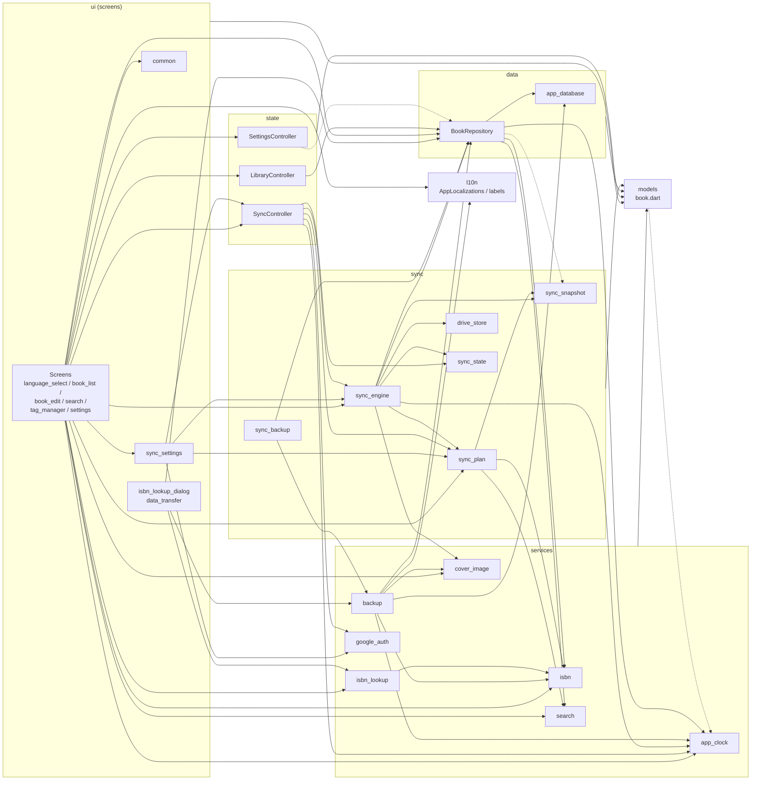

- `settings -.-> repo` only refers to the sort-order type `BookSort`.
- `repo -.-> snapshot` and `models -.-> clock` are exceptions to the dependency direction. `BookRepository` refers only to the sync data types (`SyncSnapshot`, `SyncBook`, `SyncNote`, `SyncCover`) and `coverHashOf`; `Note` refers only to `AppClock.now()` for the default created time.
- `main.dart` assembles all the sync parts (`GoogleAuthService`, `FileSyncStateStore`, `GoogleDriveStore`, `SyncEngine`, `writeSyncBackup`, `SyncController`) ([5.1](#51-startup)).

---

## 3. Class design

### 3.1 Overall class diagram

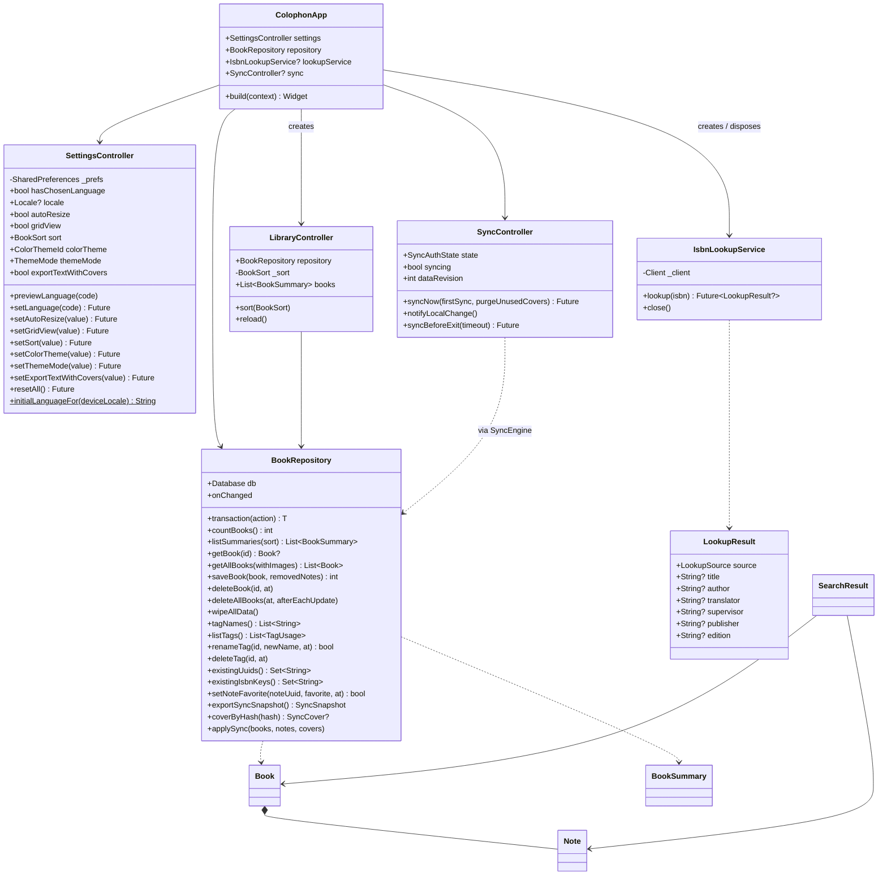

Processes implemented as top-level functions (`searchBooks`, `processCover`, `exportZip`, `applyImport`, etc.) are listed in the tables of each section. The sync classes are shown in [5.16.1](#5161-module-structure).

### 3.2 Models (`lib/models/book.dart`)

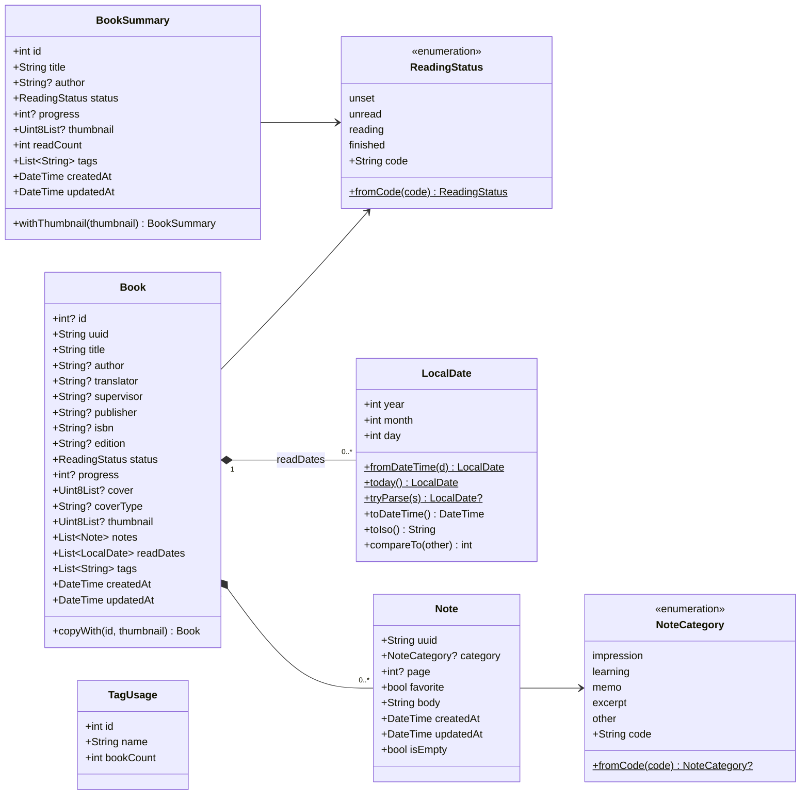

| Class | Notes |
|---|---|
| `ReadingStatus.fromCode` | Unknown codes and null become `unset` |
| `NoteCategory.fromCode` | Unknown codes and null become null (no category) |
| `LocalDate.tryParse` | Returns null for anything other than `yyyy-MM-dd` and for non-existent dates (e.g. 2026-02-30) |
| `Note` | Generates a UUID v4 when `uuid` is omitted. `createdAt` defaults to `AppClock.now()`. `updatedAt` defaults to `createdAt` (or `AppClock.now()` if that is omitted too) |
| `Note.isEmpty` | The text is blank and both category and page are null |
| `Book` | Fully immutable (final). `notes`, `readDates`, and `tags` default to empty lists |
| `Book.copyWith` | Replaces only `id` and `thumbnail` (used to regenerate thumbnails on import) |
| `BookSummary` | For the list view. Light, because it holds neither the cover image nor notes |

### 3.3 Data access

#### `lib/data/app_database.dart`

| Element | Details |
|---|---|
| `schemaVersion` | Current schema version (4) |
| `openAppDatabase(path)` | Opens the file and calls `prepareDatabase` |
| `openInMemoryDatabase()` | In-memory database (for tests) |
| `prepareDatabase(db)` | `PRAGMA foreign_keys = ON` and `PRAGMA busy_timeout = 3000`, then `migrate` |
| `readSchemaVersion(db)` | Returns `PRAGMA user_version` |
| `migrate(db, {target})` | Migrates step by step from the current version up to `target` (latest by default). Throws `NewerSchemaException` if the DB is newer |
| `NewerSchemaException` | A DB created by a newer app. It is not opened; the user is told why |

#### `BookRepository` (`lib/data/book_repository.dart`)

| Method | Behavior |
|---|---|
| `onChanged` | Callback invoked when user actions change data (used to schedule automatic sync; `main` sets it to `SyncController.notifyLocalChange`). Called by `saveBook`, `setNoteFavorite`, `deleteBook`, `deleteAllBooks`, `renameTag`, and `deleteTag`. Not called by sync writes (`applySync`) or `wipeAllData` |
| `transaction(action)` | `BEGIN` … `COMMIT`; on an exception, `ROLLBACK` and rethrow. If a transaction is already open (`db.autocommit == false`), joins the outer one |
| `countBooks()` | Number of books that are not deleted |
| `listSummaries({sort})` | Books for the list. Read count via a subquery. Order: `recent` = `created_at DESC, id DESC`; `title` = `title COLLATE NOCASE, id` |
| `getBook(id)` | One book with related data, or null if deleted |
| `getAllBooks({withImages})` | All books with related data (`created_at, id` order). `withImages: false` skips covers and thumbnails (for search and text export) |
| `saveBook(book, {removedNotes})` | Saves a book ([5.2](#52-saving-a-book)). Records the SHA-256 of the cover in `cover_hash` |
| `deleteBook(id, {at})` | Marks a book as deleted ([5.3](#53-deleting-a-book)) |
| `deleteAllBooks({at, afterEachUpdate})` | Marks every book as deleted (import "Replace all"; "every computer" in deleting all data). With `afterEachUpdate`, each marker time is the later of `at` and the book's `updated_at` + 1 microsecond (so that books with future times set on a computer whose clock ran fast are reliably deleted through sync) |
| `wipeAllData()` | Physically deletes the rows of every table and compacts the file with `VACUUM` (no deletion markers remain). Used by "Delete all data" |
| `tagNames()` | Tag names (ordered by `name_key`) |
| `listTags()` | Tags with the number of books that have them |
| `renameTag(id, newName, {at})` | Returns false if another tag has the same `name_key`. Updates `updated_at` of books with the tag, then renames it |
| `deleteTag(id, {at})` | Updates `updated_at` of books with the tag, then deletes it (`book_tags` rows cascade) |
| `existingUuids()` | Set of uuids of books that are not deleted (for import duplicate checks) |
| `existingIsbnKeys()` | Set of ISBN matching keys of books that are not deleted |
| `setNoteFavorite(noteUuid, favorite, {at})` | Toggles one note's favorite and saves immediately, updating `updated_at` of the note and its book. Returns false if the note does not exist or is deleted ([5.13](#513-favorite-notes)) |
| `exportSyncSnapshot()` | Returns all data, deletion markers included, as sync data (`SyncSnapshot`), without cover contents. Fills in `cover_hash` for covers saved before v4 ([5.16.2](#5162-sync-data-format)) |
| `coverByHash(hash)` | The cover (contents, MIME type, thumbnail) whose `cover_hash` matches, or null |
| `applySync({books, notes, covers})` | Writes what sync decided, keeping the given times, in one transaction ([5.16.5](#5165-one-sync-step-by-step)) |

### 3.4 Services

#### `isbn.dart`

| Function | Behavior |
|---|---|
| `normalizeIsbn(input)` | NFKC normalization → remove spaces and hyphen variants (`- ‐ ‑ – — ― − ー`) → uppercase |
| `isValidIsbn(input)` | ISBN-10 (weights 10 to 1, sum divisible by 11, trailing X = 10) or ISBN-13 (alternating weights 1 and 3, sum divisible by 10) |
| `isbnMatchKey(input)` | For a valid ISBN, the ISBN-13 form; otherwise null |

#### `isbn_lookup.dart`

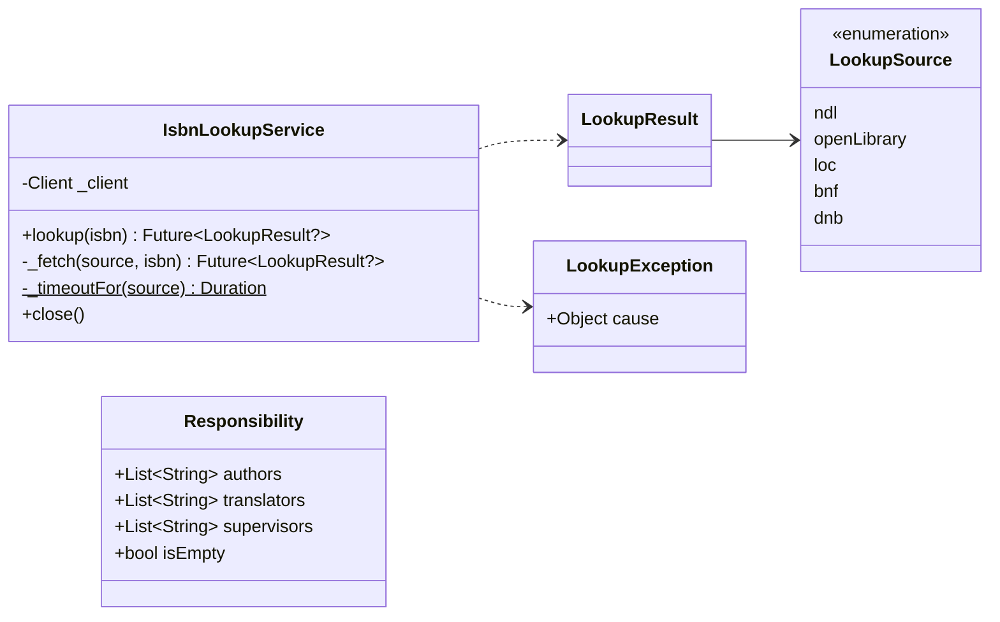

| Function | Behavior |
|---|---|
| `parseNdlResponse(xml)` | From the first `item`: title (`dc:title`, falling back to `title`) plus volume, statement of responsibility, publisher, and edition. Null if there is no `item` |
| `sourcesForIsbn(isbn)` | Returns the query order from the ISBN's country/language prefix ([5.6](#56-isbn-lookup)) |
| `requestUri(source, isbn)` | Request URL for each source |
| `parseOpenLibraryResponse(json, isbn)` | From the `ISBN:{isbn}` entry: title (`title: subtitle`), authors (joined with `, `), first publisher. Null if there is no entry |
| `parseDublinCoreResponse(xml, source)` | From the first record of an SRU response (Dublin Core) of the Library of Congress, BnF, or German National Library: title, authors, translators, publisher. Null if there is no record |
| `cleanCatalogTitle(raw)` | Removes " / author" and trailing punctuation from a catalog title |
| `cleanCatalogPublisher(raw, source)` | Removes the place of publication, keeping only the publisher name |
| `parseCatalogCreator(raw, source)` | Splits a catalog creator entry into a name and a role (`CreatorRole`: author, translator, other) and turns "Last, First" into "First Last" |
| `parseResponsibility(statement)` | Splits the statement of responsibility by role ([5.6](#56-isbn-lookup)) |

#### `cover_image.dart`

| Element | Details |
|---|---|
| `ProcessedCover` | `bytes`, `mimeType`, `thumbnail`, `width`, `height`, `resized` |
| `processCover(bytes, {autoResize})` | Runs `processCoverSync` with `Isolate.run` |
| `processCoverSync(bytes, {autoResize})` | Main cover processing ([5.5](#55-cover-processing)). Throws `CoverImageException` for unreadable images |
| `makeThumbnail(bytes)` | Creates only the thumbnail (for import, in an isolate). Null if unreadable |
| `mimeTypeOf(bytes)` | Detects jpg/png/gif/webp/bmp from the first bytes; null otherwise |
| `extensionOfMime(mime)` | File extension for export (`jpg` if unknown) |

#### `search.dart`

| Element | Details |
|---|---|
| `SearchField` | `title`, `author`, `translator`, `supervisor`, `publisher`, `isbn`, `notes` |
| `SearchQuery` | `text`, `fields` (all by default), `statuses`, `categories` (null means no category), `favoritesOnly` (favorite notes only), `tags`, `readFrom`, `readTo` |
| `SearchResult` | `book` and the matching `matchedNotes` |
| `normalizeForSearch(s)` | NFKC normalization → lowercase |
| `tagKey(name)` | Trims, then `normalizeForSearch`. Used for tag sameness and the DB column `name_key` |
| `searchBooks(books, query)` | The search itself ([5.7](#57-search)) |

#### `app_clock.dart`, `google_auth.dart`

| Element | Details |
|---|---|
| `AppClock.offset` / `AppClock.now()` | The difference from the server time, and the current time (UTC) corrected by it. Used to record created, updated, and deleted times ([5.16.7](#5167-correcting-recorded-times)) |
| `GoogleOAuthConfig` | Client ID and secret. `fromEnvironment()` reads the build-time values. `isConfigured` is false when the ID is empty |
| `GoogleAuth` | The sign-in interface (`restore`, `beginSignIn`, `clientFor`, `signOut`). Implemented by `GoogleAuthService`; builds without settings use `UnconfiguredGoogleAuth` |
| `LoopbackSignIn` | One browser sign-in: listening on 127.0.0.1 and receiving the authorization code ([5.16.10](#51610-google-sign-in)) |
| `CredentialStore` | Where sign-in credentials are stored. Implemented by `SecureCredentialStore` (OS secure storage) and `MemoryCredentialStore` (for tests) |

#### `backup.dart`

| Element | Details |
|---|---|
| `backupFormatName` / `backupFormatVersion` / `backupJsonFileName` | `colophon` / `1` / `books.json` |
| `exportText(books, l, {now, coverPaths})` | Text format ([5.8](#58-export)). Passing `coverPaths` (uuid → path in the ZIP) adds a cover line |
| `exportTextWithCovers(books, l, {now})` | Text + covers ZIP (`colophon.txt` and `covers/`). The ZIP is built in an isolate |
| `coverFileName(number, book)` | File name of a cover image (`number_title.ext`) |
| `exportZip(books, {now})` / `exportZipInBackground(books)` | ZIP format (the latter runs in an isolate) |
| `exportSqlite(db)` | Writes to a temporary file with `VACUUM INTO` and returns the bytes |
| `readBackup(bytes)` | Detects the format from the first bytes and reads it ([5.9](#59-import)) |
| `readZipBackup(bytes)` / `readSqliteBackup(bytes)` | Readers for each format |
| `applyImport(repo, books, mode, {now})` | Applies the books to the DB and returns `ImportResult(added, skipped)`. The update time of books and notes is set to `now` (default `AppClock.now()`) ([5.9](#59-import)) |
| `InvalidBackupException` / `NewerBackupException` | Not Colophon data / newer format |
| `ImportMode` | `replace` (replace all) / `merge` (add) |

### 3.5 State

| Class | Holds | Notifies listeners when |
|---|---|---|
| `SettingsController` | Display language (saved value and in-progress preview), color theme (`ColorThemeId`), brightness (`ThemeMode`), automatic cover reduction, library view, sort order, whether text export includes covers | Each setter is called (before persisting) |
| `LibraryController` | Book list (`List<BookSummary>`) and sort order | `reload()` completes; `sort` changes |
| `SyncController` | Sign-in state (`SyncAuthState`), account email, whether syncing, last sync time, reason for the last failure, whether the first-sync choice is pending, data revision changed by sync (`dataRevision`), scheduled automatic sync | The state changes; a sync starts or ends ([5.16.8](#5168-automatic-sync)) |

`SettingsController.locale` returns the language being previewed during first-launch selection, and the saved language otherwise. `supportedLanguages` defines each supported language's code and its name in that language.

### 3.6 Screens (ui)

#### Provider setup

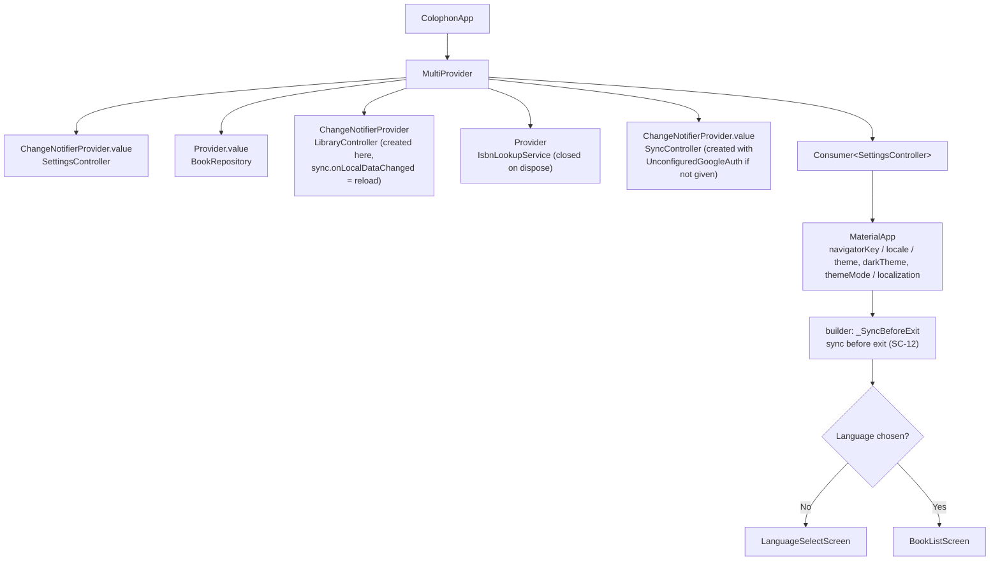

#### Screens and widgets

| Class | Kind | Main responsibility |
|---|---|---|
| `LanguageSelectScreen` | Stateful | Picks the initial choice from the device language, calls `previewLanguage` on each selection and `setLanguage` on Continue |
| `BookListScreen` | Stateless | List / grid switch, sorting, menu. Opens SC-03 via `openBookEditor` |
| `BookEditScreen` | Stateful | Views or edits one book (see the table below). Registered books open in viewer mode, new books in edit mode |
| `BookViewer` | Stateless | Viewer mode display. Takes the saved `Book` and shows only filled-in fields ([5.14](#514-viewer-mode)) |
| `_NoteDraft` | Internal class | One note being edited (uuid, category, favorite, page and text fields). `toNote(now)` updates `updatedAt` only when the content (including favorite) changed |
| `_NoteCard` | Stateless | Fields and move/delete buttons for one note. Keyed with `ObjectKey(_NoteDraft)` so state stays with the note when reordered |
| `_TagEditor` | Stateful | Tag input. Passes the parent's text field and focus node to `Autocomplete` |
| `showIsbnLookupDialog` | Function + Stateful | Returns a map of the fields to apply (`LookupField`) and their values |
| `SearchScreen` | Stateful | Holds all books (without images) and runs `searchBooks` when conditions change |
| `TagManagerScreen` | Stateful | Shows `listTags`; reloads it and the book list after renaming or deleting |
| `SettingsScreen` | Stateless | Changes settings. Color themes are chosen from `_ThemeSwatch` previews (primary color and status colors at the current brightness). The version comes from `PackageInfo` |
| `runExport` / `runImport` | Functions | Export and import flows ([5.8](#58-export), [5.9](#59-import)) |
| `deleteAllDataFlow` / `_deleteEverywhere` | Functions | Two-step confirmation and execution of "Delete all data" ([5.15](#515-deleting-all-data-and-distribution-packages)). While signed in, the scope (`_DeleteScope`) is chosen; "every computer" syncs twice |
| `SyncSettingsSection` | Stateless | The sync section of SC-07. Switches its display by the `SyncController` state ([5.16.13](#51613-interaction-with-screens)) |
| `syncSignInFlow` / `_SignInDialog` | Function + Stateless | SC-10. Starts sign-in and, while waiting, shows a dialog where the link can be copied and sign-in cancelled. Calls `syncNowFlow` after signing in |
| `syncNowFlow` / `_FirstSyncDialog` | Function + Stateful | Sync now. When `SyncNeedsFirstChoice` is returned, asks for the method in SC-11 and syncs again with `firstSync` |
| `_SyncBeforeExit` / `_ExitSyncDialog` | Stateful / Stateless | SC-12. On `AppLifecycleListener.onExitRequested`, syncs unsent changes before exiting (`app.dart`) |
| `confirmDialog` / `showMessage` / `runWithProgress` | Functions | Confirmation dialog, snack bar message, async work with a progress dialog |
| `FavoriteButton` | Stateless | A note's favorite button (☆ / ★). Used in note fields on the edit screen and in search results |
| `CoverThumbnail` / `StatusBadge` / `ContentWidth` | Stateless | Cover (or placeholder), status badge (`StatusColors` colors + `statusIcon` icon + text), max content width on wide screens |

#### Internal state of `BookEditScreen`

| State | Type | Contents |
|---|---|---|
| `_title` etc. | 8 × `TextEditingController` | Title, author, translator, supervisor, publisher, ISBN, edition, progress |
| `_tagInput` / `_tagFocus` | Text field / focus node | The tag field (owned by the parent so that leftover text can be committed on save) |
| `_original` | `Book?` | The book before editing (null for a new book) |
| `_uuid` | `String` | The book's uuid (generated for a new book) |
| `_status`, `_cover`, `_coverType`, `_thumbnail` | | Status and cover |
| `_readDates`, `_tags`, `_notes` | Lists | Finish dates, tags, notes (`_NoteDraft`) |
| `_knownTags` | `List<String>` | Existing tags used as suggestions |
| `_dirty` | `bool` | Whether there are unsaved changes |
| `_viewMode` | `bool` | Whether in viewer mode (true when opening a registered book) |
| `_lifecycle` | `AppLifecycleListener` | Receives window-close requests |
| `_sync` / `_syncRevision` | `SyncController` / `int` | Detects data changed by sync (reloads when `dataRevision` differs from the last value; [5.16.13](#51613-interaction-with-screens)) |

---

## 4. Database design

### 4.1 Connection settings

| Setting | Value | Purpose |
|---|---|---|
| `PRAGMA foreign_keys` | ON | Enables foreign key constraints and cascading deletes |
| `PRAGMA busy_timeout` | 3000 (ms) | Do not fail immediately while another connection is writing |
| `PRAGMA user_version` | Schema version | Decides whether migration is needed |
| File | `colophon.db` in the app data folder | `getApplicationSupportDirectory()` from `path_provider`. In builds given the development option `COLOPHON_DATA_DIR`, that folder ([5.16.12](#51612-build-time-configuration-and-development-libraries)) |

### 4.2 Table definitions

#### books

| Column | Type | NULL | Constraints / default | Contents |
|---|---|---|---|---|
| `id` | INTEGER | | PRIMARY KEY | Local sequence number |
| `uuid` | TEXT | No | UNIQUE | ID across devices (UUID v4) |
| `title` | TEXT | No | | Title |
| `author` | TEXT | Yes | | Author |
| `translator` | TEXT | Yes | | Translator |
| `supervisor` | TEXT | Yes | | Supervisor |
| `publisher` | TEXT | Yes | | Publisher |
| `isbn` | TEXT | Yes | | ISBN (as entered) |
| `edition` | TEXT | Yes | | Edition |
| `status` | TEXT | No | Default `'unset'`, CHECK (4 codes) | Status |
| `progress` | INTEGER | Yes | CHECK (0–100) | Progress |
| `cover` | BLOB | Yes | | Cover image |
| `cover_type` | TEXT | Yes | | MIME type of the cover |
| `thumbnail` | BLOB | Yes | | Reduced image for lists (JPEG) |
| `created_at` | TEXT | No | | Created (UTC) |
| `updated_at` | TEXT | No | | Updated (UTC) |
| `deleted_at` | TEXT | Yes | | Deleted (null while active) |
| `cover_hash` | TEXT | Yes | | SHA-256 of the cover (lowercase hex). Lets sync treat covers as files named after their contents (added in v4) |

Empty optional fields are stored as NULL (`_blankToNull`). When the cover is null, `cover_type`, `thumbnail`, and `cover_hash` are NULL too.

#### notes

| Column | Type | NULL | Constraints / default | Contents |
|---|---|---|---|---|
| `id` | INTEGER | | PRIMARY KEY | |
| `book_id` | INTEGER | No | FK → books(id) ON DELETE CASCADE | |
| `position` | INTEGER | No | | Display order (from 0) |
| `category` | TEXT | Yes | CHECK (5 codes) | Category (null means none) |
| `page` | INTEGER | Yes | CHECK (≥ 1) | Page |
| `favorite` | INTEGER | No | Default 0, CHECK (0 or 1) | Favorite (added in v3) |
| `body` | TEXT | No | | Text (empty string once deleted) |
| `created_at` | TEXT | No | | |
| `updated_at` | TEXT | No | | |
| `uuid` | TEXT | Yes (required in practice) | UNIQUE INDEX `notes_uuid` | ID across devices |
| `deleted_at` | TEXT | Yes | | Deleted |

#### read_records

| Column | Type | NULL | Constraints | Contents |
|---|---|---|---|---|
| `id` | INTEGER | | PRIMARY KEY | |
| `book_id` | INTEGER | No | FK → books(id) ON DELETE CASCADE | |
| `finished_on` | TEXT | No | | Finish date (`yyyy-MM-dd`) |

#### tags

| Column | Type | NULL | Constraints | Contents |
|---|---|---|---|---|
| `id` | INTEGER | | PRIMARY KEY | |
| `name` | TEXT | No | | Display name (the spelling registered first) |
| `name_key` | TEXT | No | UNIQUE | Matching key (`tagKey(name)`) |

#### book_tags

| Column | Type | NULL | Constraints |
|---|---|---|---|
| `book_id` | INTEGER | No | PK, FK → books(id) ON DELETE CASCADE |
| `tag_id` | INTEGER | No | PK, FK → tags(id) ON DELETE CASCADE |

#### Indexes

| Name | Target | Kind |
|---|---|---|
| `notes_book` | notes(book_id, position) | Regular |
| `read_records_book` | read_records(book_id) | Regular |
| `notes_uuid` | notes(uuid) | UNIQUE |

### 4.3 Schema migration

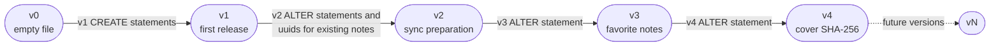

| Version | Contents |
|---|---|
| v1 | Creates the 5 tables and the indexes `notes_book` and `read_records_book` |
| v2 | Adds `books.deleted_at`, `notes.uuid`, and `notes.deleted_at`. Assigns UUID v4-formatted values to existing notes in SQL and creates `notes_uuid` |
| v3 | Adds `notes.favorite` (default 0). Existing notes become non-favorites |
| v4 | Adds `books.cover_hash`. SQL cannot compute the value for existing covers, so they migrate with it empty; it is filled in when sync data is built (`exportSyncSnapshot`) |

- Each version's steps run in one transaction and end with `PRAGMA user_version = N`. On failure they roll back and the DB stays at the previous version.
- SQL of released versions is never rewritten. Changes are added as a new version in `_migrations`.
- If the DB's `user_version` is greater than the app's `schemaVersion`, `NewerSchemaException` is thrown (at startup: an explanation screen; on import: `NewerBackupException`).

### 4.4 Main SQL

**Saving notes (upsert by uuid)**

```sql
INSERT INTO notes (uuid, book_id, position, category, page, body, favorite, created_at, updated_at)
VALUES (?, ?, ?, ?, ?, ?, ?, ?, ?)
ON CONFLICT (uuid) DO UPDATE SET
  book_id = excluded.book_id, position = excluded.position, category = excluded.category,
  page = excluded.page, body = excluded.body, favorite = excluded.favorite,
  created_at = excluded.created_at, updated_at = excluded.updated_at, deleted_at = NULL;
```

**Marking removed notes as deleted**

```sql
-- without removedNotes: every note not given
UPDATE notes SET deleted_at = ?, updated_at = ?, body = ''
WHERE book_id = ? AND deleted_at IS NULL AND uuid NOT IN (?, ?, ...);
-- with removedNotes: only the notes in removedNotes that were not given
UPDATE notes SET deleted_at = ?, updated_at = ?, body = ''
WHERE book_id = ? AND deleted_at IS NULL AND uuid IN (?, ?, ...);
```

**Writing notes during sync (`applySync`; upsert by uuid)**

```sql
INSERT INTO notes (uuid, book_id, position, category, page, body, favorite, created_at, updated_at, deleted_at)
VALUES (?, ?, (SELECT COALESCE(MAX(position), -1) + 1 FROM notes WHERE book_id = ?), ?, ?, ?, ?, ?, ?, ?)
ON CONFLICT (uuid) DO UPDATE SET
  book_id = excluded.book_id, category = excluded.category, page = excluded.page, body = excluded.body,
  favorite = excluded.favorite, created_at = excluded.created_at, updated_at = excluded.updated_at,
  deleted_at = excluded.deleted_at;   -- the order is aligned with noteOrder afterwards
```

**Loading the list**

```sql
SELECT b.id, b.title, b.author, b.status, b.progress, b.thumbnail, b.created_at, b.updated_at,
       (SELECT COUNT(*) FROM read_records r WHERE r.book_id = b.id) AS read_count,
       (SELECT MAX(finished_on) FROM read_records r WHERE r.book_id = b.id) AS last_read
FROM books b
WHERE b.deleted_at IS NULL
ORDER BY {sort order};
```

| `BookSort` | `ORDER BY` |
|---|---|
| `recent` (recently added) | `b.created_at DESC, b.id DESC` |
| `title` (title) | `b.title COLLATE NOCASE ASC, b.id ASC` |
| `statusAscending` (Not set → Finished) | status rank (unset=0, unread=1, reading=2, finished=3) `ASC` → for reading, `COALESCE(progress, 0) ASC` → for finished, `last_read IS NULL ASC` (no finish date last), `last_read ASC` → `b.title COLLATE NOCASE ASC, b.id ASC` |
| `statusDescending` (Finished → Not set) | status rank `DESC` → for reading, `COALESCE(progress, 0) DESC` → for finished, `last_read IS NULL ASC`, `last_read DESC` → `b.title COLLATE NOCASE ASC, b.id ASC` |

The reading and finished conditions are written as `CASE WHEN b.status = … THEN … END`, which is NULL (no effect on the order) for other statuses. `SettingsController` saves the sort by the enum value's name.

**Registering and linking tags**

```sql
INSERT OR IGNORE INTO tags (name, name_key) VALUES (?, ?);
INSERT OR IGNORE INTO book_tags (book_id, tag_id) SELECT ?, id FROM tags WHERE name_key = ?;
DELETE FROM tags WHERE id NOT IN (SELECT tag_id FROM book_tags);   -- tags no longer used
```

---

## 5. Process details

### 5.1 Startup

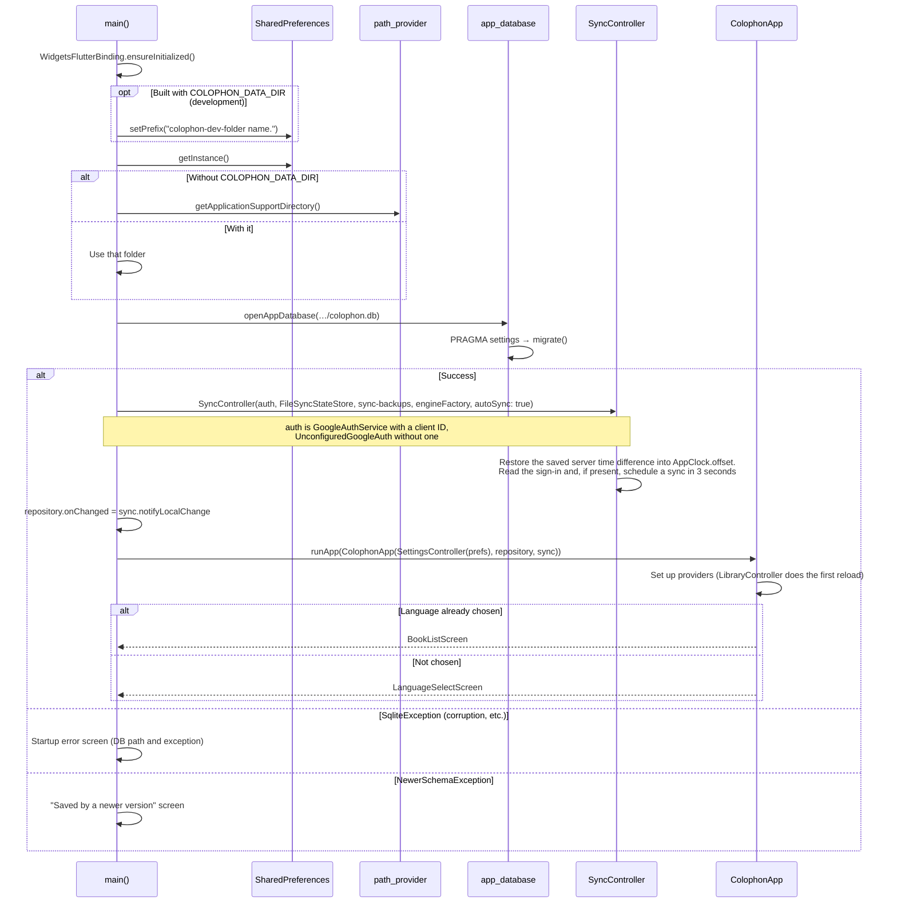

### 5.2 Saving a book

Steps of `BookEditScreen._save()` (the main part is `_saveBook()`):

1. `_closeIfDeletedElsewhere()`: if the registered book was deleted on another computer through sync, tell the user, close the screen, and do not save ([5.16.13](#51613-interaction-with-screens)).
2. `Form.validate()` ([6. Input validation](#6-input-validation)). Stop if invalid.
3. `_commitPendingTag()`: adds the text left in the tag field unless a tag with the same `tagKey` exists.
4. Progress: the result of `int.tryParse` if it is 0–100, otherwise null (discards an out-of-range value left in the hidden field).
5. Notes: every `_NoteDraft.toNote(now)` that is not `isEmpty` (`now` is `AppClock.now()`).
6. Build the `Book` (`createdAt` keeps the original value, or now for a new book; `updatedAt` is now).
7. `BookRepository.saveBook(book, removedNotes: the set of uuids of the notes before editing)`. Only notes removed on this screen are marked as deleted (notes that arrived through sync while it was open are kept). On an exception, show "Something went wrong." and stay on the screen.
8. `LibraryController.reload()` and show "Saved.". A registered book switches to viewer mode with `_viewMode = true` (the screen stays open). A new book returns to the library with `_close()` (there is no viewer to return to, and this makes adding the next book easy).

Steps of `BookRepository.saveBook(book, {removedNotes})` (all in one transaction):

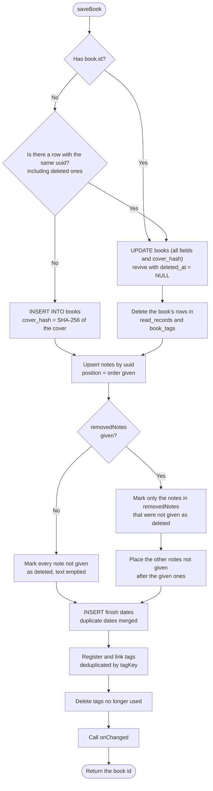

The deletion markers use `book.updatedAt`. `onChanged` is called inside the transaction (it only schedules automatic sync and does not touch the DB).

### 5.3 Deleting a book

`deleteBook(id, {at})` (`at` defaults to `AppClock.now()`) runs in one transaction and finally calls `onChanged`.

| Target | Processing |
|---|---|
| books | Set `deleted_at` and `updated_at` to `at`. Set `cover`, `cover_type`, `thumbnail`, `cover_hash` to NULL |
| notes | Set `deleted_at` and `updated_at` of active notes to `at`. Set `body` to an empty string |
| read_records / book_tags | Physically delete the book's rows (they are book attributes and will be sent with the book during sync) |
| tags | Delete tags no longer used |

### 5.4 Handling unsaved changes (edit screen)

| Mechanism | Details |
|---|---|
| Setting `_dirty` | Set to true by listeners on each text field (`_markDirty`) and by changes to the cover, status, finish dates, tags, and notes (`_change`) |
| Back within the app | `PopScope(canPop: !_dirty)`. When the pop is blocked, `_confirmLeave` asks whether to discard |
| Switching to the viewer | `_setViewMode(true)`. When `_dirty`, the user chooses "Save and view" (switch if `_saveBook` succeeds) / "Discard and view" (`_load` the latest contents read again from the DB, or `_original` for a new book; if the book was deleted on another computer, tell the user and close) / "Cancel" |
| Closing the window | `AppLifecycleListener.onExitRequested` asks when `_dirty` and returns `AppExitResponse.cancel` or `exit` |
| After save / delete / discard | `_close()`: sets `_dirty = false`, rebuilds, and calls `Navigator.pop` on the next frame (because `canPop` takes effect only after the rebuild) |

### 5.5 Cover processing

`processCoverSync(bytes, autoResize)`:

| Step | Details |
|---|---|
| 1. Decode | `img.decodeImage`. Failure or exception → `CoverImageException` |
| 2. Fix orientation | `img.bakeOrientation` (applies the EXIF rotation to the pixels) |
| 3. Decide reduction | `autoResize` and (long side > 2000 px or size > 2 MB) |
| 4a. Reduce | If the long side exceeds 2000 px, resize it to 2000 px (`Interpolation.average`). Fill transparency with white and save as JPEG quality 85. `resized = true` |
| 4b. Uncommon format | If `mimeTypeOf` returns null, convert to PNG (with transparency) or JPEG quality 90 (without) |
| 4c. Keep | The original bytes with the detected MIME type |
| 5. Thumbnail | Reduce to a long side of at most 360 px, fill transparency with white, JPEG quality 80 |

### 5.6 ISBN lookup

**Query order (`sourcesForIsbn`)**: ISBN-10s are converted to ISBN-13 first; the order is decided by the leading digits.

| ISBN prefix | Order |
|---|---|
| `9784` | National Diet Library → Open Library |
| `9782`, `97910` | BnF → Open Library |
| `9783` | German National Library → Open Library |
| `9780`, `9781` | Open Library → Library of Congress |
| Others | National Diet Library → Open Library → Library of Congress |

This order is based on success rates measured in 2026-10 with 150 books in 6 languages sampled from national library catalogs (the National Diet Library plus the four other sources found 149 books; Google Books returned nothing because its keyless shared quota was exhausted).

`IsbnLookupService.lookup(isbn)`:

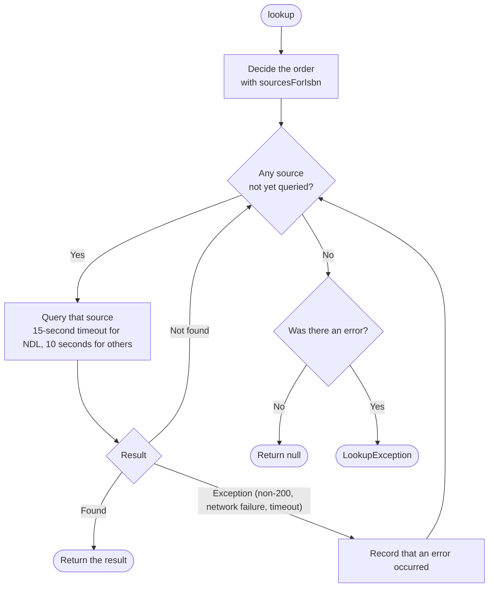

If nothing is found and some source failed, the result is `LookupException` ("check your connection") instead of null ("not found"), because the failed source might have had the book.

Requests carry the header `User-Agent: Colophon (https://github.com/colophonbooks)` (Open Library asks apps to identify themselves and a contact). Responses are decoded as UTF-8.
**Splitting the statement of responsibility (`parseResponsibility`)**

1. Split the statement on `, ， ; ；`.
2. Match each part as "name + space (or bracket) + role word". A role word without a preceding space or bracket is not treated as a role (so the final 文 of a name like 山田文 is not mistaken for a role).
3. Parts without a role word are held and assigned to the next role word that appears. Any parts still held at the end become authors.

| Role words | Assigned to |
|---|---|
| 著, 作, 文, 絵, 編, 編著, 著者, 原作, 原著 | Author |
| 訳, 翻訳, 共訳, 編訳, 訳・解説, 訳・注 | Translator |
| 監修, 監訳 | Supervisor |
| 解説, 注, 校注, 装丁, 装画, イラスト | Not used |

If there is no statement of responsibility, the `dc:creator` values become authors after removing life dates (e.g. `, 1959-`). Language notes appended to titles of foreign-language materials (such as " : [中国語]") are removed. Duplicate names are kept once. Names from the National Diet Library are joined with "、" and those from other sources with ", ".

**Normalizing catalog entries (Library of Congress, BnF, German National Library)**

| Item | BnF | German National Library | Library of Congress |
|---|---|---|---|
| Title (as given) | `Jaune : histoire d'une couleur / Michel Pastoureau` | `0 1 2 : Roman / Daniel Wisser` | `Art history /` |
| Title processing | Drop everything from the first " / ", then trailing punctuation (`/ : ; , .` and spaces) | Same | Same |
| Creator (as given) | `Pastoureau, Michel (1947-....). Auteur du texte` | `Liedtke, Rüdiger [Verfasser]` | `Stokstad, Marilyn, 1929-2016.` |
| Role extraction | After the last ". " | Trailing `[…]` | Trailing `, author.` etc. |
| Life dates | Drop the trailing `(…)` | — | Drop trailing `, 1929-2016` etc. |
| Publisher (as given) | `Points (Paris)` | `München : Luchterhand Literaturverlag` | `Upper Saddle River, NJ : Pearson/Prentice Hall,` |
| Publisher processing | Drop the trailing `(place)` | After the last " : " | Same |

- A name split into two by a comma ("Last, First") is reordered to "First Last" (`Pastoureau, Michel` → `Michel Pastoureau`).
- A trailing period is removed, except after an initial (the `N.` in `Yuval N.`).

| Role (as given) | Assigned to |
|---|---|
| Traducteur, Traductrice, Übersetzer, Übersetzerin, translator | Translator |
| Auteur du texte, Auteur, Verfasser, Verfasserin, author, editor, Herausgeber, Herausgeberin, Directeur de publication, Éditeur scientifique, compiler, or no role | Author |
| Anything else (Illustrator, Illustrateur, Préfacier, etc.) | Other (used as authors only when there is no author at all, e.g. picture books) |

### 5.7 Search

| Item | Details |
|---|---|
| Loading the search data | When `SearchScreen` opens and when returning from an edit screen opened from a result, loads `getAllBooks(withImages: false)` and `tagNames()` |
| When to search | 200 ms after the last keystroke for keywords; immediately for other conditions |
| Normalization | Both keywords and target text go through `normalizeForSearch` (NFKC + lowercase). Keywords are split on whitespace |
| Book filters | Status (any of), tags (compared by `tagKey`; all required), finish date (any finish date within the range, inclusive) |
| Filtering by category or favorite | Notes of the selected categories (all if none selected) and, with favorites only, with `favorite` set: all of them if there are no keywords; otherwise (when note text is a search target) those containing every word. Returns books with at least one such note |
| Without a category | No keywords → every book passing the filters. With keywords → books where each word appears in the concatenated selected book fields or in some note's text. Notes containing any word are attached |
| ISBN matching | Besides the concatenated book fields, compares the ISBN with hyphens etc. removed against the similarly normalized word |
| Display | Thumbnails of result books are looked up by id in `LibraryController.books` |

### 5.8 Export

Flow of `runExport(context)`: if there are no books, explain and stop → choose a format (the "Include covers (saved as a ZIP)" checkbox under Text is saved immediately to `SettingsController.exportTextWithCovers` and shown the same way next time) → build the data with a progress dialog → `FilePicker.saveFile` (default file name `colophon-yyyyMMdd-HHmm.{txt|zip|sqlite}`) → when saved, show "Exported.". Any exception while building or saving shows "Export failed.".

| Format | How it is built |
|---|---|
| Text | `getAllBooks(withImages: false)` → `exportText` → UTF-8 |
| Text + covers | `getAllBooks()` → `exportTextWithCovers`. For each book with a cover, `coverFileName` decides the file name; the image is stored uncompressed under `covers/` and its path is written in the text. Extension `.zip` |
| ZIP | `getAllBooks()` → `exportZipInBackground` (with a progress dialog). Covers are stored uncompressed (`CompressionType.none`); `books.json` uses deflate, with 2-space JSON indentation |
| SQLite | `exportSqlite(db)`: `VACUUM INTO` a temporary folder → read → delete the folder. Includes rows marked as deleted |

**Text format example** (display language: English)

```text
Colophon export (2026-10-14 12:00)
1 book

========================================
[001] Sapiens: A Brief History of Humankind
========================================
Cover: covers/001_Sapiens_ A Brief History of Humankind.jpg
Author: Yuval Noah Harari
ISBN: 978-0-06-231609-7
Status: Reading (40%)
Finished reading on: 2025-05-05
Tags: History
Added: 2026-01-02 12:04
Updated: 2026-10-14 11:58

[Notes]
- ★ [Learnings] p.30
  The Cognitive Revolution was the turning point
```

Only fields with values are written. Each book gets a sequence number (at least 3 digits, more for larger libraries). The "Cover" line appears only when covers are included, and only for books that have one. Progress is added only while Reading and when a value exists. Times are shown in the device's local time.

**Cover file names (`coverFileName`)**

| Rule | Example |
|---|---|
| `{number}_{title}.{ext}`; the extension follows the image format (`extensionOfMime`) | `001_Dune.jpg` |
| `\ / : * ? " < > \|` and control characters become `_` | `A/B: C?` → `002_A_B_ C_.png` |
| Runs of whitespace become one space; leading and trailing spaces are removed | |
| Titles are cut to 60 characters | |
| Trailing periods and spaces are removed (Windows does not allow them) | `end...` → `003_end.jpg` |
| If the title becomes empty, only the number is used | `...` → `004.jpg` |

Because every book has a different number, books with the same title never get the same file name.

### 5.9 Import

**Format detection (`readBackup`)**

| First bytes | Result |
|---|---|
| `SQLite format 3\0` | SQLite → `readSqliteBackup` |
| `PK\x03\x04` | ZIP → `readZipBackup` |
| Anything else | `InvalidBackupException` |

**ZIP validation and normalization (`readZipBackup`)**

| Target | When invalid |
|---|---|
| Not a readable ZIP, no `books.json`, not valid JSON | `InvalidBackupException` |
| `format` is not `colophon`, `books` is not an array, `version` is not an integer | `InvalidBackupException` |
| `version` is newer than the current format | `NewerBackupException` |
| A book's `title` is empty or not a string | Skip that book |
| No `uuid` | Assign a new UUID |
| Unknown `status` code | `unset` |
| `progress` is not an integer 0–100 | null |
| The `cover` file is missing or its image format cannot be detected | No cover |
| Invalid dates in `readDates` | Drop those dates |
| A note's `page` is not an integer ≥ 1 / unknown `category` | null |
| A note has no `uuid` | Assign a new UUID |
| A note's `favorite` is not `true` (including missing) | Not a favorite |
| A note whose text, category, and page are all empty | Drop it |
| Unreadable timestamps | The book's `createdAt` becomes now; others fall back to the book's `createdAt` |

Books with a cover get a regenerated thumbnail (`makeThumbnail`).

**Reading SQLite (`readSqliteBackup`)**: copies the bytes to a temporary folder and opens them. If there is no `books` table or `user_version` is below 1, throws `InvalidBackupException`. Migrates the temporary copy to the current schema with `prepareDatabase`, then reads it with `getAllBooks()` (a newer version throws `NewerBackupException`). Regenerates missing thumbnails. Finally deletes the temporary folder.

**Applying (`applyImport`)**: performs the checks in section [8.5 of the Basic Design](basic-design.md#85-import) in one transaction. Each book is passed to `saveBook` as a `Book` without an `id`; a deleted book with the same uuid is revived. The `updatedAt` of imported books and notes is replaced with `now` (default `AppClock.now()`), while `createdAt` keeps the file's value. `deleteAllBooks` for "Replace all" gets the same `now`. With the file's update times, sync would judge the contents left in the cloud newer and revert the import. The "now" used by `readZipBackup` for unreadable times is also `AppClock.now()`.

Screen-side flow of `runImport(context)`: choose a file (`zip`/`sqlite`/`sqlite3`/`db`) → `readBackup` with a progress dialog → show the count and choose a method (neither is selectable for 0 books) → confirm if replacing while 1 or more books exist → `applyImport` → `LibraryController.reload()` → show the result.

### 5.10 Reloading the list

`LibraryController.reload()` calls `listSummaries` and, for books whose **id and `updatedAt` are unchanged** from the previous list, reuses the previous thumbnail bytes (the same object). `Image.memory` looks up its image cache by the identity of the byte list, so creating a new list every time would decode every cover again.

### 5.11 Tag input

| Action | Behavior |
|---|---|
| Type text | Suggests existing tags that partially match via `normalizeForSearch` and are not yet attached |
| Choose a suggestion with ↑/↓ and press Enter | Adds the chosen suggestion (when `_navigated` is true, `Autocomplete`'s own submit is used) |
| Press Enter without choosing | Adds the typed text as is (does nothing if a tag with the same `tagKey` is already attached) |
| Click a suggestion | Adds that suggestion |
| Save with text left in the field | The leftover text is committed as a tag on save |

### 5.12 Color themes

`buildTheme(id, brightness)` creates a `ThemeData` holding a `ColorScheme` and `StatusColors` (a `ThemeExtension`). `MaterialApp` receives a light version (`theme`) and a dark version (`darkTheme`) and switches between them with `themeMode`.

| Theme (`ColorThemeId`) | How the `ColorScheme` is built | Status colors |
|---|---|---|
| `leather` (default) | `ColorScheme.fromSeed` (`#7B5536`, `tonalSpot`) | From the scheme (below) |
| `forest` | Same (`#2F6B4F`) | From the scheme |
| `ocean` | Same (`#1F4E79`) | From the scheme |
| `rose` | Same (`#8E3B5E`) | From the scheme |
| `monochrome` | `fromSeed` (`#808080`, `DynamicSchemeVariant.monochrome`). The four error colors, which stay red even in this variant, are replaced with grays | Fixed (table below) |
| `universal` | `fromSeed` (`#005AFF` = blue from the CUD recommended palette, `DynamicSchemeVariant.fidelity`: uses the seed almost unchanged as the primary color) | Fixed (table below) |

"From the scheme" means: Not set = `surfaceContainerHighest` / `onSurfaceVariant`, Unread = `secondaryContainer`, Reading = `primaryContainer`, Finished = `tertiaryContainer` (text uses the matching `on…` color).

**Fixed status colors** (background / text)

| Theme, brightness | Not set | Unread | Reading | Finished |
|---|---|---|---|---|
| Monochrome, light | `#F2F2F2` / `#303030` | `#B3B3B3` / `#000000` | `#737373` / `#FFFFFF` | `#1E1E1E` / `#FFFFFF` |
| Monochrome, dark | `#2C2C2C` / `#E0E0E0` | `#5E5E5E` / `#FFFFFF` | `#9E9E9E` / `#000000` | `#EDEDED` / `#000000` |
| Universal, light | `#E6E6E6` / `#333333` | `#4DC4FF` / `#00205C` | `#F6AA00` / `#2B1A00` | `#005AFF` / `#FFFFFF` |
| Universal, dark | `#3A3A3A` / `#E6E6E6` | `#0B3D91` / `#DDEEFF` | `#F6AA00` / `#1A1000` | `#4DC4FF` / `#001A33` |

The Universal colors `#005AFF` (blue), `#4DC4FF` (sky blue), and `#F6AA00` (orange) come from the Color Universal Design recommended palette. Blue versus orange keeps a hue difference under protan, deutan, and tritan vision, and the colors also differ in lightness.

**Status icons** (`statusIcon`): Not set = `radio_button_unchecked`, Unread = `book_outlined`, Reading = `bookmark`, Finished = `check_circle`. Used in the list's status badge, the status selector on the edit screen, search filters, and theme previews.

**Verification** (`test/theme_test.dart`)

| Check | Method | Criterion |
|---|---|---|
| Contrast | For every theme × brightness, compute with the WCAG 2.x formula the ratios of `onSurface`/`surface`, `onSurfaceVariant`/`surface`, `onPrimary`/`primary`, `onPrimaryContainer`/`primaryContainer`, `onError`/`error`, `error`/`surface`, and each status's text/background | 4.5 or more |
| Monochrome | Whether the main `ColorScheme` colors and status colors have R = G = B | All gray |
| Distinguishability across color vision | Convert the Monochrome and Universal status backgrounds for normal vision and for protan, deutan, and tritan vision (Machado et al. 2009 matrices, severity 1.0), then compute the CIELAB color difference (CIE76) for every pair | ΔE 20 or more |
### 5.13 Favorite notes

| Where | Behavior | When it is saved |
|---|---|---|
| Note fields on the edit screen (`FavoriteButton` in `_NoteCard`) | Toggles `_NoteDraft.favorite`, treated as an unsaved change | On Save (`saveBook`'s upsert writes `favorite`) |
| Notes in search results (`FavoriteButton` in `_ResultTile`) | Calls `BookRepository.setNoteFavorite` and reloads the search data | Immediately |

- Toggling from search results updates `updated_at` of the note and its book to `AppClock.now()` (so sync can propagate the change).
- Un-starring a note while filtering by "Favorite notes only" removes it from the results (it no longer matches after the reload).
- Text export prefixes the heading of each favorite note with "★" (the same symbol in every display language). JSON stores `favorite` (boolean); SQLite contains `notes.favorite` as is.
- An empty note with only the favorite mark (no text, category, or page) is not saved, like any other empty note.
### 5.14 Viewer mode

| Item | Details |
|---|---|
| Initial mode | In `BookEditScreen.initState`, `_viewMode = true` for a registered book, false for a new one |
| Switching | `SegmentedButton<bool>` (View / Edit) in the app bar. Not shown when adding a new book. Viewer mode shows no Delete or Save button, and Ctrl+S does nothing (the body is replaced by `BookViewer`) |
| Content shown | Always the saved `_original`; edit-mode field contents are not used |
| Unsaved changes | "Save and view" runs `_saveBook()` (validate → save → `_load(saved book)`, without closing the screen); on a validation error the screen stays in edit mode. "Discard and view" reverts the fields and notes (recreating `_NoteDraft`s) by `_load`ing the latest contents read again from the DB (they may have changed through sync while editing); if the book was deleted on another computer, the user is told and the screen closes |
| Save button | Save in edit mode (Ctrl+S / ⌘S) runs `_saveBook()`, then returns to viewer mode for a registered book, or to the library for a new book |

`BookViewer` display rules:

- Bibliographic fields are shown only when non-empty after `trim()`. Label in `bodySmall`, value in `bodyMedium`, on one line (`Text.rich`).
- Finish dates, tags, and notes are omitted together with their headings when empty.
- A note's caption joins its category (`category` in `labels.dart`) and page (`p.N`) with " · ". Notes with neither show only the text. Favorites show ★ at the right of the caption row (an `Icon` only, no action).
- The whole view is wrapped in `SelectionArea` so text can be selected and copied.
### 5.15 Deleting all data and distribution packages

**Delete all data (`deleteAllDataFlow`)**

1. An explanation dialog (showing the number of books). Choose "Cancel", "Export first" (`runExport`), or "Continue to delete".
2. A final confirmation dialog. "Delete everything" cannot be pressed until "I understand that deleted data cannot be restored" is checked. While signed in (`SyncAuthState.signedIn`), the same dialog also asks for the scope (`_DeleteScope.thisComputer` (default) / `everywhere`).
3. Wait for a running sync to finish (`SyncController.whenIdle()`, so that it does not write after deletion).
4. For "every computer", `_deleteEverywhere` (table below). Stop here if it fails.
5. If signed in, `SyncController.signOut()` (for either scope, so that deleted data is not brought back from the cloud) → `SyncController.deleteLocalBackups()` (deletes `sync-backups/`; done even when not signed in).
6. Return to the first screen with `Navigator.popUntil(isFirst)` → `BookRepository.wipeAllData()` → `LibraryController.reload()` → `SettingsController.resetAll()` (`SharedPreferences.clear()` and back to defaults; the display language becomes unset, so the language selection screen appears).

**`_deleteEverywhere`** (runs while a "Deleting from Google Drive…" dialog is shown)

| Step | Processing | On failure |
|---|---|---|
| 1 | `whenIdle()`, then `syncNow(firstSync: FirstSyncMode.merge)`. Gathers books added on other computers onto this one (books this computer does not know cannot be deleted). If it counts as a first sync, it uses "Combine" | Result is not `SyncDone`, or the cloud had unreadable records → `deleteEverywhereSyncFailed` (nothing deleted) |
| 2 | `deleteAllBooks(afterEachUpdate: true)` → `LibraryController.reload()` | — |
| 3 | `syncNow(purgeUnusedCovers: true)`. Sends the deletion markers and deletes unused covers from Drive without the grace period | Not `SyncDone`, unreadable records, or nothing was sent although there were books before step 2 → `deleteEverywherePartial` (books on this computer are already deleted; still signed in, so the next sync sends them) |

Deletion markers (for sync) are physically removed too. The database file itself remains, empty, so the app can keep running; deleting the file is left to uninstallation.

**Distribution packages** (how to build: [BUILDING.md](../../BUILDING.md))

| OS | Format | Files | Library on uninstall |
|---|---|---|---|
| Windows | Inno Setup installer (per user, no administrator rights; bundles the VC++ runtime DLLs) | `installer/windows/colophon.iss`, `build-installer.ps1`, `Languages/ChineseSimplified.isl` | `CurUninstallStepChanged` (`usPostUninstall`) asks; "Yes" deletes `%APPDATA%\colophonbooks\Colophon`. Default "No". Kept on silent uninstall |
| macOS | .dmg (`hdiutil`) | `installer/macos/build-dmg.sh`, `UNINSTALL.txt` | Kept (how macOS works). Instructions are included |
| Linux | Flatpak (`org.freedesktop.Platform`) | `installer/linux/io.github.colophonbooks.colophon.yml`, `build-flatpak.sh` | Deleted with `flatpak uninstall --delete-data` |
| Linux | .deb (`dpkg-deb`) | `installer/linux/build-deb.sh` | Kept (Debian policy) |

Both Linux formats share the desktop entry (`.desktop`), the AppStream metadata (`.metainfo.xml`), and the icons (`installer/linux/icons/hicolor/`). For the sync-related settings (reading build-time values, Secret Service on Linux, etc.), see [5.16.12](#51612-build-time-configuration-and-development-libraries). `sync-state.json` and `sync-backups/` are in the same folder as the library, so uninstallation treats them like the library. The sync data on Google Drive is not removed by uninstallation (to erase the contents of books and notes and the covers, choose "every computer" when deleting all data; the sync data file keeps the deletion markers, i.e. IDs and times).

**App icon**

The source is `tool/icon/generate.mjs`, which defines the artwork and colors. Running it writes the files below (steps in [BUILDING.md](../../BUILDING.md)). The generated files are committed too, so building the app does not need Node.js.

| Output | Sizes (px) | Plate margin |
|---|---|---|
| `windows/runner/resources/app_icon.ico` (PNG-compressed entries; also used by the installer) | 16, 20, 24, 32, 40, 48, 64, 256 | Tight (the plate fills about 95% of the frame) |
| `macos/Runner/Assets.xcassets/AppIcon.appiconset/app_icon_*.png` | 16, 32, 64, 128, 256, 512, 1024 | macOS standard (824 of 1024). A shadow under the plate at 64 and above |
| `installer/linux/icons/hicolor/<size>/apps/io.github.colophonbooks.colophon.png` and `scalable/apps/….svg` | 16, 24, 32, 48, 64, 128, 256, 512, and SVG | Tight at 32 and below; macOS standard (no shadow) from 48 |

Detail is reduced with size. Everything is drawn at 96 px and above. At 48–64 px the folded corner of the tab is omitted. At 40 px and below the bands and the shelf are omitted too, because they blur into mud.

### 5.16 Google Drive sync

The sync defined in [8.7](basic-design.md#87-sync)–[8.10](basic-design.md#810-deleting-all-data-and-sync) of the Basic Design is implemented by the following classes and functions.

#### 5.16.1 Module structure

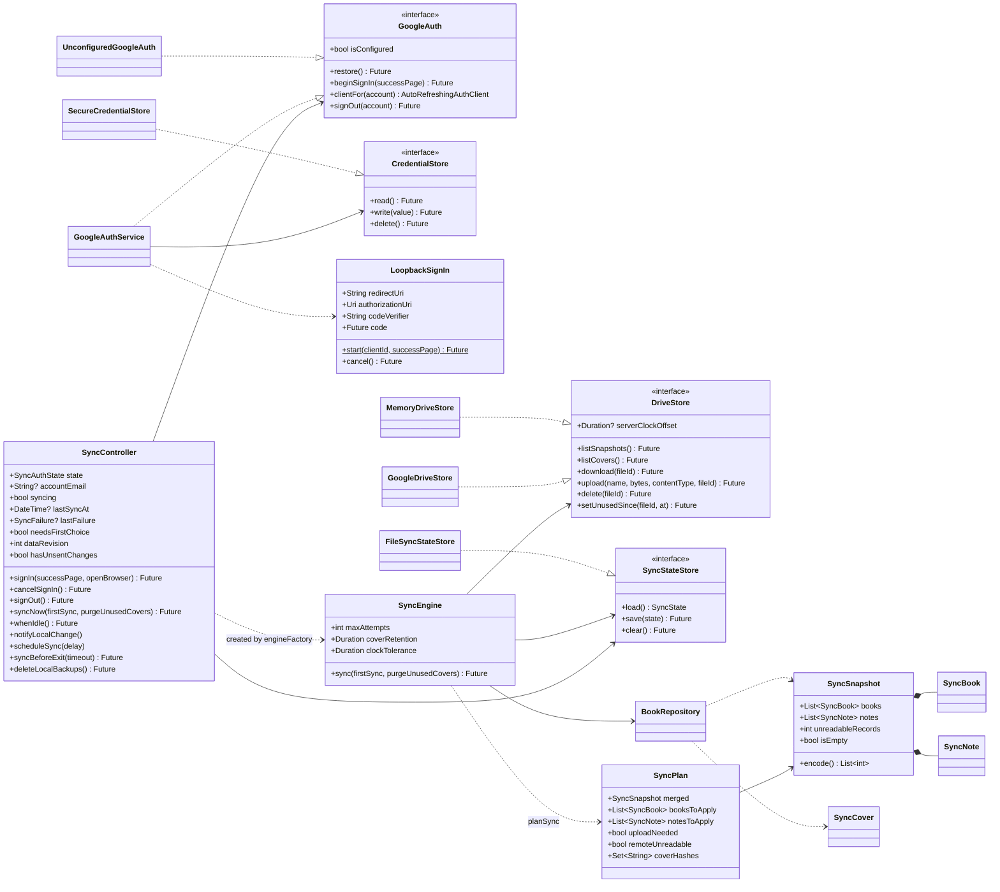

| Class / function | File | Role |
|---|---|---|
| `SyncController` | `state/sync_controller.dart` | Sign-in state (`SyncAuthState`: `unavailable`, `loading`, `signedOut`, `signingIn`, `signedIn`), running syncs and their results, scheduling automatic sync ([5.16.8](#5168-automatic-sync)). `engineFactory` builds a `SyncEngine` from the authenticated client |
| `GoogleAuthService` / `UnconfiguredGoogleAuth` | `services/google_auth.dart` | Sign-in, storing and restoring credentials, sign-out ([5.16.10](#51610-google-sign-in)). Builds without a client ID use the latter |
| `SyncEngine` | `sync/sync_engine.dart` | The steps of one sync ([5.16.5](#5165-one-sync-step-by-step)) and converting exceptions into `SyncException(SyncFailure)` ([5.16.9](#5169-error-classification-and-user-facing-handling)). The result is `SyncDone` or `SyncNeedsFirstChoice` |
| `planSync` / `SyncPlan` / `FirstSyncMode` | `sync/sync_plan.dart` | Merge rules ([5.16.3](#5163-merge-rules-plansync)) and first-sync methods ([5.16.4](#5164-first-sync)) |
| `SyncSnapshot` / `SyncBook` / `SyncNote` / `SyncCover` / `coverHashOf` | `sync/sync_snapshot.dart` | Sync data format ([5.16.2](#5162-sync-data-format)) |
| `DriveStore` / `GoogleDriveStore` / `MemoryDriveStore` | `sync/drive_store.dart` | Operations on Drive's appDataFolder. `GoogleDriveStore` also measures the difference from the server time ([5.16.7](#5167-correcting-recorded-times)). `MemoryDriveStore` is for tests |
| `SyncState` / `FileSyncStateStore` | `sync/sync_state.dart` | The sync record ([5.16.11](#51611-files-on-the-device)) |
| `writeSyncBackup` | `sync/sync_backup.dart` | Backup before the first sync ([5.16.11](#51611-files-on-the-device)) |

#### 5.16.2 Sync data format

Top level of `colophon-sync.json` (`SyncSnapshot.encode()`; UTF-8 JSON):

| Field | Type | Contents |
|---|---|---|
| `format` | String | `colophon-sync` (written; not checked when reading) |
| `version` | Integer | Format version `syncFormatVersion` (1). If not an integer, `FormatException` (treated as damaged data); if greater than 1, `UnsupportedSyncFormatException` |
| `books` | Array | Books (`SyncBook`; table below) |
| `notes` | Array | Notes (`SyncNote`; table below) |

**Books (`SyncBook`)**. Only the fields marked ✓ in the "Deleted" column are written for deleted books (with `deletedAt`).

| Field | Type | Deleted | Contents / handling when read |
|---|---|---|---|
| `uuid` | String | ✓ | Book ID |
| `title` | String | | Title. Empty string if missing |
| `author`, `translator`, `supervisor`, `publisher`, `isbn`, `edition` | String / null | | Bibliographic fields |
| `status` | String | | Status code. Unknown values become `unset` |
| `progress` | Integer / null | | Null unless an integer 0–100 |
| `coverHash` | String / null | | SHA-256 (hex) of the cover. Null without a cover |
| `coverType` | String / null | | MIME type of the cover |
| `readDates` | Array of strings | | Finish dates (`yyyy-MM-dd`). Invalid dates are dropped; duplicates removed and sorted |
| `tags` | Array of strings | | Tag display names. Trimmed; empty ones dropped |
| `noteOrder` | Array of strings | | uuids of non-deleted notes in display order |
| `createdAt` | String (ISO 8601, UTC) | ✓ | Falls back to `updatedAt`, then 1970-01-01 |
| `updatedAt` | Same | ✓ | Falls back to 1970-01-01 (older than any record, so it loses in merging) |
| `deletedAt` | Same | ✓ | Deletion time. Present means deleted |

**Notes (`SyncNote`)**

| Field | Type | Deleted | Contents / handling when read |
|---|---|---|---|
| `uuid` | String | ✓ | Note ID |
| `bookUuid` | String | ✓ | uuid of the book |
| `category` | String / null | | Category code. Unknown values become null |
| `page` | Integer / null | | Null unless an integer ≥ 1 |
| `body` | String | | Text. Empty string if missing |
| `favorite` | Boolean | | False if missing |
| `createdAt`, `updatedAt`, `deletedAt` | String (ISO 8601, UTC) | ✓ | Same as for books |

- Out-of-range and unknown values are corrected by the same rules the app uses when saving. Otherwise values would change on every write and sync would never settle, or DB constraints would reject them.
- Records are read one at a time; unreadable records (no `uuid`, wrong types, etc.) are skipped and counted in `unreadableRecords` (so one record does not stop the whole merge).
- If the file as a whole cannot be read (not JSON, or the top level, `books`, or `notes` has the wrong structure), the result is `SyncFailure.remoteCorrupt`.
- `isEmpty` means there is no non-deleted book or note.
- Times are written with `toUtc().toIso8601String()`.
- `exportSyncSnapshot` writes `coverType` for non-deleted books only when `cover_hash` is set.

**Cover files**

| Item | Details |
|---|---|
| Name | `cover-` + SHA-256 of the cover (`coverHashOf`; lowercase hex) |
| Contents | The cover bytes as they are (the same as `books.cover` in the DB) |
| Content-Type | The cover's MIME type (`application/octet-stream` if unknown) |
| `appProperties.unusedSince` | When the cover stopped being used by any book (ISO 8601, UTC). Not set on covers in use |

Thumbnails for lists are not sent; the receiving device creates them with `makeThumbnail` (`SyncCover.thumbnail`).

#### 5.16.3 Merge rules (`planSync`)

`planSync({local, remote, firstSync, now})` merges this device's sync data (the result of `exportSyncSnapshot`) with the cloud's sync data and returns a `SyncPlan`. `now` is the time given to books combined by ISBN and to books and notes deleted by replacement.

| Step | Rule |
|---|---|
| 1. Empty cloud | If `remote` is null (no sync data file), this device's contents are sent as they are (`uploadNeeded = true`, nothing to write) |
| 2. Matching | Books and notes are matched by uuid; the one with the newer `updatedAt` wins. On a tie, the deleted one wins; if still undecided, the cloud side (`_newer`, so every device reaches the same result) |
| 3. Notes of a revived book | If a merged note is deleted, its book is not deleted after merging, and the book on either device was deleted with the same deletion time as the note (deleted together with the book), the non-deleted version of the note on either side, if any, is taken with its `updatedAt` aligned to the book's |
| 4. Book deletion to notes | Non-deleted notes left on a book that is deleted after merging are marked deleted with the book's `updatedAt` and `deletedAt` (changing a note also advances its book's update time, so the book deletion happened after the note change) |
| 5. Note order | Each book's `noteOrder` is reduced to non-deleted notes, and missing notes are appended in order of creation (then uuid). Every device gets the same result, so it settles after one upload |
| 6. Differences to write | Books and notes that differ from this device become `booksToApply` and `notesToApply`. Deletion markers for books and notes this device does not have are not written (there is nothing to delete) |
| 7. Need to send | `uploadNeeded` if anything differs from the cloud |
| 8. Unreadable records | If `remote.unreadableRecords` is not 0, `uploadNeeded = false` and `remoteUnreadable = true`. Sending would erase those records (possibly deletion markers) from the cloud. Writing still happens |

- Contents are compared (`_same`) as the JSON string of `toJson()`, except that tags are compared as the sorted set of their `tagKey`s, so spelling differences ("SF" vs "sf", etc.) are not differences (otherwise devices with different spellings would keep writing).
- A book is accepted or rejected as one unit including finish dates, tags, and `noteOrder`. Notes are decided one by one, separately from books.
- `SyncPlan.coverHashes` is the set of cover SHA-256s referred to by non-deleted books after merging.

#### 5.16.4 First sync

`SyncEngine` treats a sync as the first sync when `SyncState.hasSynced` is false, the cloud has sync data that is not empty, and this device's sync data is not empty either. Without a method (`FirstSyncMode`), it returns `SyncNeedsFirstChoice(localBooks, remoteBooks)` (the number of non-deleted books on each side) and stops. In other cases a given `firstSync` is ignored.

| Mode | Processing |
|---|---|
| `merge` | Rewrites this device's contents with `_combineSameIsbn` (below), then merges with steps 2–8 of [5.16.3](#5163-merge-rules-plansync). The differences to write are computed against the actual contents before rewriting |
| `useRemote` | `_replaceLocal`: the merged result is exactly the cloud's contents. Writes cloud books and notes that differ from this device, and marks non-deleted books and notes that exist only on this device as deleted at `now`. `uploadNeeded = false` |
| `useLocal` | `_replaceRemote`: the merged result is this device's contents. Books and notes on both sides with different contents are sent with `updatedAt` set to `now`, and the same time is written on this device (with the original times, versions with newer times left on other devices would win at the next sync and bring the replaced contents back). Non-deleted books and notes only in the cloud are marked deleted at `now` and sent. `uploadNeeded = true` |

`_combineSameIsbn(local, remote, now)`:

- Pairs non-deleted books only on this device (uuid not in the cloud) with non-deleted books only in the cloud that have the same `isbnMatchKey` (valid ISBNs only; ISBN-10 and ISBN-13 are treated as equal). On the cloud side, the first book per ISBN is used.
- The combined book: the cloud's uuid (to match other devices), bibliographic fields etc. from the one with the newer `updatedAt`, finish dates as the sorted union of both, tags as the union deduplicated by `tagKey` (in `tagKey` order), `noteOrder` as the cloud's followed by the rest of this device's, and `updatedAt` = `now`.
- This device's original book becomes a deletion marker at `now`, and its notes are moved to the combined book's uuid with `updatedAt` = `now`.

#### 5.16.5 One sync, step by step

`SyncEngine.sync({firstSync, purgeUnusedCovers})`. Up to `maxAttempts` (3) attempts, counting retries caused by collisions with other devices.

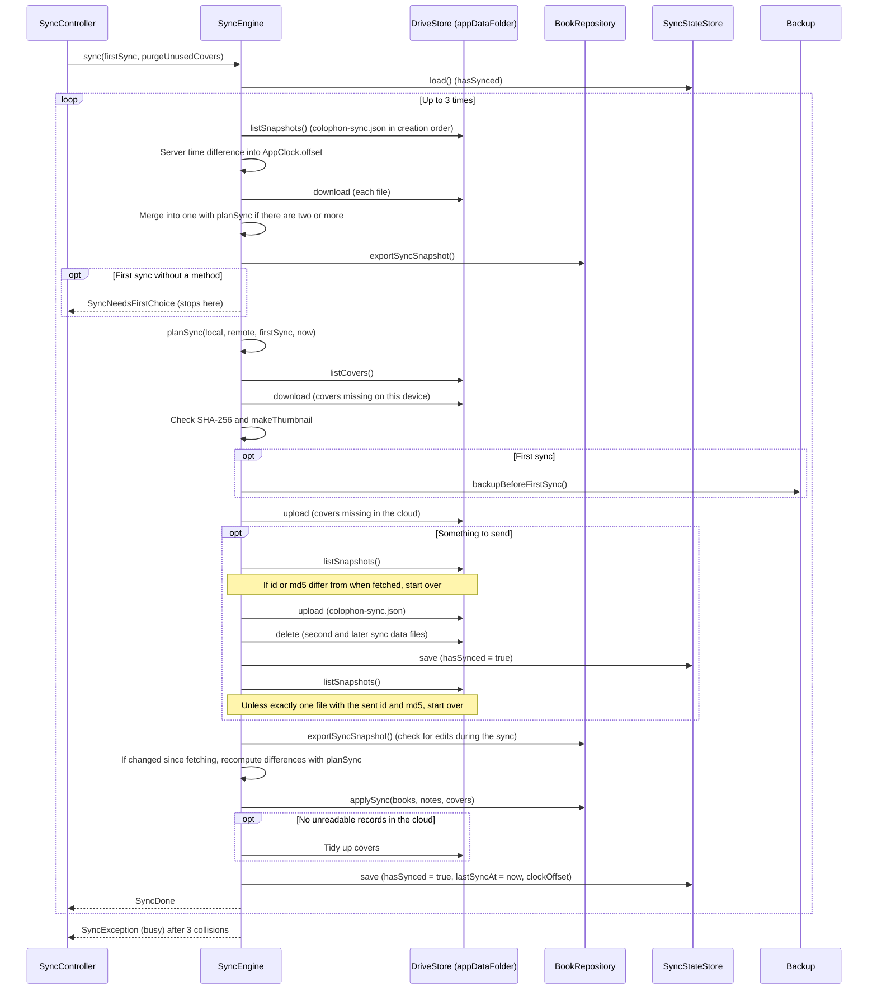

| Step | Details |
|---|---|
| Fetching | `listSnapshots` returns `name = 'colophon-sync.json' and trashed = false` in order of creation (following pages with `pageSize` 1000). If another device deletes a file between listing and reading, causing a 404, the sync starts over from fetching |
| Several sync data files | Two devices sending their first sync at the same time can create two files. They are merged in order from oldest with `planSync(local: that file, remote: the merge so far)`, and their unreadable record counts are added up |
| First sync | If the conditions in [5.16.4](#5164-first-sync) apply and no method was given, returns `SyncNeedsFirstChoice` (nothing is written) |
| Whether to send | `plan.uploadNeeded`, or two or more sync data files (to consolidate them; except when there are unreadable records) |
| Backup | On the first sync, `backupBeforeFirstSync` (`writeSyncBackup`) is called before anything is written to Drive. If it fails (`FileSystemException` → `localStorage`), the sync ends without changing anything |
| Covers | [5.16.6](#5166-covers) |
| Check before sending | `listSnapshots` again; if the number of files, the ids, or `md5Checksum` differ from when fetched, start over from fetching (so the other device's changes are not overwritten). MD5 is used instead of version numbers because a version can advance even when the contents are the same |
| Sending | Overwrites the first file with `files.update` (or creates it in appDataFolder with `files.create`) and deletes the others. `hasSynced = true` is saved at this point (so the first-sync choice is not asked again if the sync stops later; `lastSyncAt` still has the previous value) |
| Check right after sending | Unless `listSnapshots` returns exactly one file with the sent id and MD5 (another device overwrote it), start over from fetching |
| Edits during the sync | `exportSyncSnapshot` is taken again; if it differs from the contents at fetching time, the differences to write are recomputed with `planSync(local: current contents, remote: merged result)` (so edits made while communicating are not overwritten). No `await` comes between this and `applySync`. Remaining edits are sent at the next sync |
| Writing | `applySync` (table below). Until here, the DB on this device has not been changed even if something fails |
| Recording | Saves `hasSynced = true`, `lastSyncAt = AppClock.now()`, `clockOffset = AppClock.offset`, and returns `SyncDone(booksChanged, notesChanged, uploaded, remoteUnreadable)` |

`BookRepository.applySync({books, notes, covers})` (one transaction; the given times are used as they are):

| Step | Processing |
|---|---|
| 1 | Secures every cover needed by the books to write, from the given `covers` and this device's DB (`coverByHash`), before writing anything (replacing another book's cover midway could make a cover that exists only on this device impossible to find) |
| 2 | Writes non-deleted books. uuids not on this device are INSERTed; existing ones are UPDATEd (revived with `deleted_at = NULL`), and their finish dates (valid dates only) and tags are rewritten. The cover is replaced only when `cover_hash` changes (if a cover is missing, `StateError` cancels everything), and `cover_type` is aligned with the sync data |
| 3 | Upserts notes by uuid ([4.4](#44-main-sql)). Notes whose book is not on this device are not written. Deleted notes get null category and page, empty text, and favorite 0 |
| 4 | Marks deleted books (`_markDeleted`: notes are marked deleted too, and the cover, finish dates, and tags are removed), and sets `updated_at` to the sync data's value |
| 5 | Aligns the note order of the written books with `noteOrder` (`_orderNotes`; notes missing from `noteOrder` follow in their current order) |
| 6 | Deletes tags no longer used |

`applySync` does not call `onChanged` (writes by sync must not schedule the next automatic sync).

#### 5.16.6 Covers

| Situation | Processing |
|---|---|
| Fetching | For the books to write (non-deleted), covers whose `coverHash` is not in this device's DB are fetched from Drive. If one is missing on Drive, or its SHA-256 does not match its name, the result is `SyncFailure.missingCover` (this device is not changed) |
| Sending | Covers needed after merging (`SyncPlan.coverHashes`) that are missing on Drive are sent from this device's DB or from the fetched covers. This is done even when the sync data does not need to be sent (to restore covers lost through collisions with other devices). Covers are sent before the sync data |
| Tidying up | For each cover on Drive: if used and `unusedSince` is set, it is removed. If unused: deleted immediately with `purgeUnusedCovers`; otherwise marked with the current time if `unusedSince` is not set, and deleted once `coverRetention` (7 days) or more has passed since the mark. Failures while tidying up are ignored (the sync still succeeds). Skipped while the cloud has unreadable records (so covers used by those records are not deleted) |

The grace period ensures that covers are not lost when a device that has not synced for a while sends data based on an old sync file.

#### 5.16.7 Correcting recorded times

| Element | Details |
|---|---|
| Measuring | The HTTP client of `GoogleDriveStore` (`_ClockClient`) measures, for each response, the difference between the `Date` header and the device's UTC time (server − device) (`serverClockOffset`). The Date header has one-second resolution, so differences under 2 seconds count as 0 (`measureClockOffset`). Unreadable headers are ignored |
| Applying | Right after `listSnapshots`, `SyncEngine` replaces `AppClock.offset` with the measured difference if it differs from the current `AppClock.offset` by more than `clockTolerance` (5 seconds), so recorded times do not jump back and forth slightly |
| Saving | Saved in `sync-state.json` as `SyncState.clockOffset`, and restored into `AppClock.offset` by `SyncController` at the next startup (so times recorded before any communication are corrected too; a temporary `SyncController` without a store does not restore it) |
| Where used | `AppClock.now()` is used for created, updated, and deleted times of books and notes, update times from tag changes and favorite toggles, times on import, times set by merging, and the last sync time. It is not used for times that are only displayed |

#### 5.16.8 Automatic sync

When `autoSync` is true (true in `main`, false by default in tests), `SyncController` schedules syncs as follows. Only one sync is scheduled at a time; rescheduling cancels the previous one.

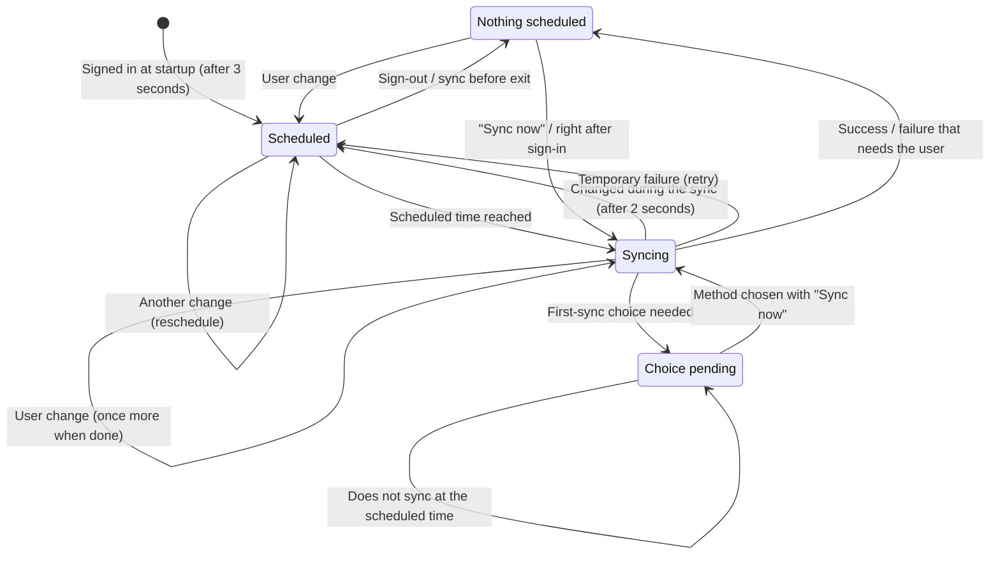

| Item | Value | Details |
|---|---|---|
| `startupDelay` | 3 seconds | When the saved sign-in is read, a sync runs after this delay |
| `changeDelay` | 30 seconds | Delay after the last change (`notifyLocalChange`). Rescheduled on every change |
| `maxChangeDelay` | 5 minutes | Longest delay from the first change. If the remainder is shorter than `changeDelay`, the sync is scheduled for the remainder (0 if negative) |
| Changes during a sync | 2 seconds | If changes happen during a sync (`_again`), another sync runs 2 seconds after it ends |
| `retryDelays` | 1, 2, 5, 15, 30 minutes | Retries after temporary failures (`network`, `busy`, `missingCover`, `other`, including unexpected exceptions). Each retry uses the next value, repeating the last one. A success resets the count. Failures that need the user (`auth`, `quota`, `newerFormat`, `remoteCorrupt`, `localStorage`) are not retried |
| On exit | 10 seconds each | `syncBeforeExit` waits up to 10 seconds for a running sync and, if there are unsent changes, up to 10 seconds for one sync |

- `notifyLocalChange` is called from `BookRepository.onChanged`. It sets `_dirty` (the user changed data since the previous sync started); during a sync it only sets `_again`.
- `_dirty` is cleared when a sync starts and restored when it fails (treated as changes not sent). `hasUnsentChanges` is true when automatic sync is enabled, signed in, no choice is pending, and (`_dirty` or `_again`).
- While the first-sync choice is needed (`needsFirstChoice`), scheduled syncs do not run, and there is no sync on exit. It is cleared when a result that needs no choice comes back.
- `syncBeforeExit`: cancels the schedule, waits for a running sync, then syncs if the user has changes. Timeouts do not stop the exit (unsent changes are sent at the next startup). In case the exit is cancelled, unsent changes are rescheduled with `changeDelay`.
- `signOut`: cancels the schedule, waits for a running sync to finish (`whenIdle`), closes the client, resets the account and every state, and calls `SyncStateStore.clear()` (deletes `sync-state.json`) and `GoogleAuth.signOut`.
- When a sync changes data on this device (`SyncDone.localChanged`), `dataRevision` is incremented and `onLocalDataChanged` (`LibraryController.reload`) is called.

#### 5.16.9 Error classification and user-facing handling

`SyncEngine.sync` turns exceptions into `SyncException(SyncFailure)`. `SyncController` keeps it in `lastFailure` (reset to null on success) and the sync section shows it in red. Syncs started with "Sync now" also show it in a snack bar.

| `SyncFailure` | Source exception / situation | Message key | Automatic retry |
|---|---|---|---|
| `network` | `SocketException`, `http.ClientException`, `TimeoutException`, `HandshakeException`, Drive API 429 and 5xx, errors with reasons `rateLimitExceeded`, `userRateLimitExceeded`, `backendError`, `internalError`, `ServerRequestFailedException` (other than `invalid_grant`) | `syncErrorNetwork` | Yes |
| `auth` | Drive API 401, 403 with other reasons, `AccessDeniedException`, `ServerRequestFailedException` (`invalid_grant`: the refresh token is invalid) | `syncErrorAuth` | No |
| `quota` | Errors with the reason `storageQuotaExceeded` | `syncErrorQuota` | No |
| `newerFormat` | `UnsupportedSyncFormatException` | `syncErrorNewerFormat` | No |
| `remoteCorrupt` | The sync data file cannot be read, `FormatException` | `syncErrorRemoteCorrupt` | No |
| `busy` | Checks before/after sending or 404 retries collided 3 times in a row | `syncErrorBusy` | Yes |
| `missingCover` | A needed cover is missing on Drive or does not match its name, `StateError` from `applySync` (missing cover) | `syncErrorMissingCover` | Yes |
| `localStorage` | `SqliteException`, `FileSystemException` (failure to save the DB, backup, or `sync-state.json`) | `syncErrorLocalStorage` | No |
| `other` | Other Drive API errors, unexpected exceptions caught by `SyncController` | `syncErrorOther` | Yes |

- Drive API errors (`DetailedApiRequestError`) are classified by `classifyApiFailure(status, reasons)` in this order: 401 → `auth`, `storageQuotaExceeded` → `quota`, 429, 5xx, or a temporary reason → `network`, any other 403 → `auth`, everything else → `other`.
- Not sending because of unreadable records in the cloud (`SyncDone.remoteUnreadable`) is not a failure; `syncWarningUnreadable` is shown.

#### 5.16.10 Google sign-in

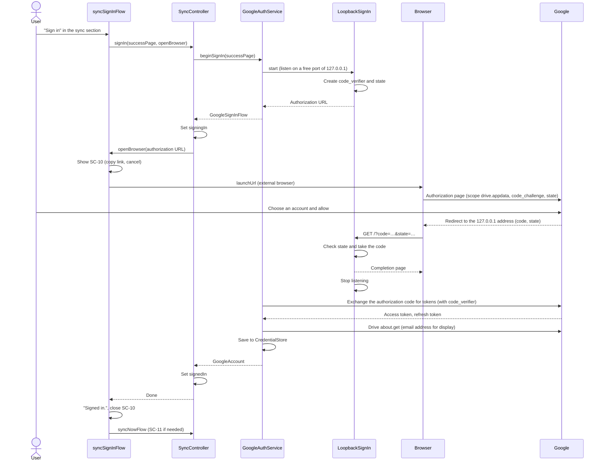

| Item | Details |
|---|---|
| Scope | Only `https://www.googleapis.com/auth/drive.appdata` (`DriveApi.driveAppdataScope`) |
| Authorization URL | `https://accounts.google.com/o/oauth2/v2/auth` with `client_id`, `response_type=code`, `redirect_uri`, `scope`, `code_challenge`, `code_challenge_method=S256`, `state` |
| PKCE | `code_verifier` is 64 characters chosen with `Random.secure()` from the characters allowed by RFC 7636 (letters, digits, and `-._~`). `code_challenge` is its SHA-256 in base64url without `=` |
| `state` | 24 random bytes in base64url (without `=`) |
| Listening | `HttpServer.bind(InternetAddress.loopbackIPv4, 0)`. The redirect is `http://127.0.0.1:{port}`. Requests to paths other than `/` (favicon, etc.) and requests after the code was received get 404 |
| Parsing the redirect | `parseAuthorizationCallback`: different `state` → `invalidResponse`, `error=access_denied` → `denied`, any other `error` → `failed`, no `code` → `invalidResponse`. On failure the browser shows `Colophon: {reason}` |
| Cancelling | `cancelSignIn` → `LoopbackSignIn.cancel`. Ends with `cancelled` and closes the listener. `clientViaUserConsent` from `googleapis_auth` is not used because it offers no way to stop listening midway, and the listener would remain if the user closed the browser |
| Token exchange | `obtainAccessCredentialsViaCodeExchange` (with `redirectUrl` and `codeVerifier`). Failures become `GoogleSignInFailure.failed`. An empty client secret is passed as null |
| Email address | Drive `about.get(fields: user(emailAddress))`. Sign-in succeeds even if it cannot be obtained |
| Saving | Writes `{"credentials": JSON of AccessCredentials, "email": …}` to the `CredentialStore`. `restore()` returns null (signed out) when the value is missing, unreadable, or corrupted |
| Authenticated client | `clientFor` returns `autoRefreshingClient`. Refreshed tokens (`credentialUpdates`) are saved again |
| Sign-out | `POST https://oauth2.googleapis.com/revoke` (`token` is the refresh token, or the access token if there is none). Request failures are ignored, and the saved value is deleted |
| Notifying the screen | On failure or cancellation, `SyncController` returns to signed out and rethrows `GoogleSignInException`. `syncSignInFlow` shows nothing for `cancelled`, `syncSignInDenied` for `denied`, and `syncSignInFailed` for `invalidResponse` and `failed`. It keeps waiting even if the browser cannot be opened (the link in SC-10 can be copied) |

#### 5.16.11 Files on the device

| File | Location | Contents |
|---|---|---|
| `sync-state.json` | Same folder as the library (`colophon.db`) | `{"hasSynced": boolean, "lastSyncAt": ISO 8601 or null, "clockOffsetMs": integer}`. `FileSyncStateStore` writes to `.tmp` and then renames it over the file (so an interrupted write does not corrupt it). A missing or corrupted file is treated as never synced. Deleted on sign-out |
| `sync-backups/colophon-before-first-sync-{yyyyMMdd-HHmmss}.zip` | Same | Backup before the first sync (`writeSyncBackup`). The same ZIP format as `exportZipInBackground(getAllBooks())`, so it can be imported. The time is the device's local time. The newest 3 are kept and older ones deleted. Deleting all data removes the whole `sync-backups/` |
| Sign-in credentials | OS secure storage (`flutter_secure_storage`; Windows: a DPAPI-encrypted file, macOS: Keychain, Linux: Secret Service) | Key `google_account` (`google_account_dev_{folder name}` for development libraries). The value is the JSON above |

- The sync record is not kept in settings (SharedPreferences) because it belongs to the library. Test builds running with separate library folders do not mix their records, and the record moves with the library if the library is moved.
- macOS uses the legacy keychain (`usesDataProtectionKeychain: false`) so that unsigned distribution builds work without the Keychain Sharing entitlement.

#### 5.16.12 Build-time configuration and development libraries

| Value (`--dart-define`) | Read by | Details |
|---|---|---|
| `COLOPHON_GOOGLE_CLIENT_ID` | `GoogleOAuthConfig.fromEnvironment()` | Client ID of a desktop app registered in Google Cloud. If empty, `main` uses `UnconfiguredGoogleAuth` and the sync section shows that sync is not available |
| `COLOPHON_GOOGLE_CLIENT_SECRET` | Same | Client secret of the desktop app. As Google explains, it cannot be kept secret; it is used together with PKCE |
| `COLOPHON_DATA_DIR` | `main.dart` | For development. Puts the library, `sync-state.json`, and `sync-backups/` in this folder, sets the `SharedPreferences` prefix to `colophon-dev-{folder name}.` and the credential key to `google_account_dev_{folder name}`. This prevents test builds from migrating the everyday library to a newer version that the released app cannot open. Running two builds with different folder names lets one computer test sync between two |

The scripts that build distribution packages (`build-installer.ps1`, `build-dmg.sh`, `build-deb.sh`, `build-flatpak.sh`) pass the file named by the environment variable `COLOPHON_DART_DEFINES`, or else `~/.colophon/dart-defines.json` (`%USERPROFILE%\.colophon\dart-defines.json` on Windows), with `--dart-define-from-file` if it exists. Otherwise they warn and build an app that cannot sync (steps in [BUILDING.md](../../BUILDING.md)).

| OS | Setting for sync |
|---|---|
| macOS | Added `com.apple.security.network.server` to `Release.entitlements` (to listen for the sign-in redirect on 127.0.0.1; `DebugProfile.entitlements` already had it) |
| Linux (.deb) | Added `libsecret-1-0` to `Depends` (to store credentials in Secret Service) |
| Linux (Flatpak) | Added `--talk-name=org.freedesktop.secrets` to `finish-args` (Secret Service). `--share=network` is used for ISBN lookup and sync |

#### 5.16.13 Interaction with screens

| Screen / part | Processing |
|---|---|
| `SyncSettingsSection` | Shows each state through `context.watch<SyncController>()` (the SC-07 sync section in the Basic Design). The last sync time uses `DateFormat.yMMMd(language).add_Hm()` in local time. A failure is turned into text by `syncFailureMessage` and shown in `colorScheme.error`. Without a failure, the pending-choice hint (`syncNeedsChoice`) or, failing that, the unreadable-records warning (`syncWarningUnreadable`) is shown |
| `syncNowFlow` | `syncNow()` → if `SyncNeedsFirstChoice`, `_FirstSyncDialog` (default `merge`) → when chosen, `syncNow(firstSync: chosen method)`. On `SyncDone`, `syncDone` (or `syncWarningUnreadable` with unreadable records); on failure, the reason in a snack bar |
| `_signOutFlow` | `SyncController.signOut()` after a confirmation (`syncSignOutTitle`, `syncSignOutBody`) |
| `LibraryController` | `ColophonApp` sets `sync.onLocalDataChanged = library.reload`, so the list is reloaded when sync changes data |
| `BookEditScreen` | Listens to `SyncController`; when `dataRevision` changes, for a registered book that is not `_dirty` and whose screen is on top (`ModalRoute.isCurrent`), reloads it with `getBook`. If null (deleted), shows `bookDeletedElsewhere` and closes. Deletion is also checked on Save and on "Discard and view" (`_closeIfDeletedElsewhere`) |
| `_SyncBeforeExit` | Placed in `MaterialApp.builder`. On `AppLifecycleListener.onExitRequested`, if `hasUnsentChanges`, shows the undismissable `_ExitSyncDialog` (`PopScope(canPop: false)`), waits for whichever comes first of `syncBeforeExit()` and "Close without syncing", and returns `AppExitResponse.exit`. Without unsent changes, no dialog is shown and the app exits after `syncBeforeExit()` (which only waits for a running sync) |
| `deleteAllDataFlow` | While signed in, the scope is chosen ([5.15](#515-deleting-all-data-and-distribution-packages)) |
| `SearchScreen`, `TagManagerScreen` | Not reloaded by sync (they load when shown, etc.) |

---

## 6. Input validation

| Screen | Field | Rule | Message key on error |
|---|---|---|---|
| SC-03 | Title | At least 1 character after trimming | `titleRequired` |
| SC-03 | Progress | Empty, or an integer 0–100 (non-digits cannot be typed) | `progressInvalid` |
| SC-03 | Note page | Empty, or an integer ≥ 1 (non-digits cannot be typed) | `pageInvalid` |
| SC-03 | ISBN | Empty, or a valid ISBN. Saving is allowed even if invalid (warning only) | `isbnInvalidWarning` (warning) |
| SC-03 | Fetch from ISBN | Must be a valid ISBN | `isbnLookupInvalid` |
| SC-06 | Tag name | Not empty, and not the same `tagKey` as another tag | `tagNameRequired`, `tagExists` |

---

## 7. Messages

Main messages (keys from `lib/l10n/app_en.arb`; English text shown).

| Key | Kind | Text (English) | When shown |
|---|---|---|---|
| `saved` | Info | Saved. | After saving a book |
| `coverResized` | Info | The image was reduced to {width} × {height} px. | When a cover was reduced automatically |
| `coverLoadFailed` | Error | This image could not be read. | Image cannot be read as a cover |
| `lookupNotFound` | Info | No book was found for this ISBN. | ISBN lookup found nothing |
| `lookupFailed` | Error | Could not fetch the details. … | ISBN lookup found nothing and some source had a network error |
| `exportDone` / `exportFailed` / `exportEmpty` | Info / error / info | Exported. / Export failed. / There are no books to export. | Export completed, failed, or no books |
| `importDone` | Info | Import finished. Added: {added} / Skipped: {skipped} | After import |
| `importInvalidFile` / `importNewerVersion` / `importFailed` | Error | Not Colophon data / created by a newer version / cannot be imported | Import failures |
| `genericError` | Error | Something went wrong. | Unexpected error while saving |
| `deleteBookConfirm` / `deleteNoteConfirm` / `deleteTagConfirm` / `importReplaceConfirm` / `unsavedBody` | Confirmation | Delete "…"? etc. | Before irreversible actions |
| `askAddReadDateBody` | Confirmation | Add today ({date}) as a date you finished this book? | When the status changes to Finished |
| `syncUnavailable` | Info | Sync is not available in this build (…). | Sync section of a build without a client ID |
| `syncSignInDone` / `syncSignInDenied` / `syncSignInFailed` | Info / info / error | Signed in. / Sign-in was cancelled. / Could not sign in. … | Sign-in completed, denied, or failed |
| `syncBrowserPage` | Info | You are signed in to Colophon. Close this tab and return to the app. | Completion page in the browser after sign-in |
| `syncSignOutTitle` / `syncSignOutBody` | Confirmation | Sign out? / Syncing stops on this computer. … | Before signing out |
| `syncDone` | Info | Synced. | "Sync now" completed |
| `syncFirstTitle` / `syncFirstBody` | Confirmation | First sync / This computer has {local} books and Google Drive has {remote}. … | SC-11 |
| `syncErrorNetwork` and the other `syncError*` | Error | Could not connect. … etc. | Sync failures ([5.16.9](#5169-error-classification-and-user-facing-handling)) |
| `syncWarningUnreadable` | Warning | Part of the sync data on Google Drive could not be read, so this computer did not send its changes. | The cloud had unreadable records |
| `syncNeedsChoice` | Info | Choose how to combine this computer with Google Drive: press "Sync now". | Automatic sync found that the first-sync choice is needed |
| `deleteScopeTitle` / `deleteScopeThisPc` / `deleteScopeEverywhere` | Confirmation | What to delete / This computer only / Google Drive and every computer | Deleting all data while signed in |
| `deleteEverywhereSyncFailed` / `deleteEverywherePartial` | Error | Could not reach Google Drive, so nothing was deleted. … / Books were deleted on this computer, but the deletion could not be sent to Google Drive. … | The first / second sync of "every computer" failed |
| `bookDeletedElsewhere` | Info | This book was deleted on another computer. | The open book was deleted on another computer |
| `syncOnExitTitle` / `syncOnExitBody` / `syncOnExitSkip` | Info | Syncing with Google Drive… / Colophon will close when syncing finishes. / Close without syncing | SC-12 |

---

## 8. Error handling

| Exception / situation | Raised in | Handled in | Shown to the user |
|---|---|---|---|
| `NewerSchemaException` | `migrate` (startup) | `main` | "Saved by a newer version" screen |
| `SqliteException` | `openAppDatabase` (startup) | `main` | Startup error screen with the DB path and exception |
| Exception while saving | `saveBook` | `BookEditScreen._save` | `genericError`; the screen stays open |
| `CoverImageException` | `processCoverSync` | `BookEditScreen._pickCover` | `coverLoadFailed` |
| `LookupException` | `IsbnLookupService.lookup` | `BookEditScreen._lookupIsbn` | `lookupFailed` |
| `InvalidBackupException` | `readBackup` and friends | `runImport` | `importInvalidFile` |
| `NewerBackupException` | `readBackup` and friends | `runImport` | `importNewerVersion` |
| Other exceptions | Reading / applying | `runImport` | `importFailed` (changes already rolled back) |
| Exceptions | Building / saving an export | `runExport` | `exportFailed` |
| User cancels | File open / save dialogs | Each caller | Nothing |
| `GoogleSignInException` | `LoopbackSignIn`, `GoogleAuthService` (sign-in) | `syncSignInFlow` | Nothing for `cancelled`; `syncSignInDenied` for `denied`; `syncSignInFailed` otherwise. Returns to signed out |
| `SyncException` | `SyncEngine.sync` (classified as in [5.16.9](#5169-error-classification-and-user-facing-handling)) | `SyncController._run` | Kept in `lastFailure` and shown in red in the sync section; also in a snack bar for "Sync now". Temporary failures are retried automatically |
| Other exceptions | During sync | `SyncController._run` | `SyncFailure.other` (`syncErrorOther`). Retried automatically |
| The open book was deleted on another computer | Sync (`applySync`) | `BookEditScreen` | Shows `bookDeletedElsewhere` and closes the screen without saving |

Expected business situations (not found, invalid input, duplicates, etc.) are not exceptions; they are returned as values (null, false, the counts in `ImportResult`). After asynchronous work, code checks `mounted` (`context.mounted`) before touching the UI.

---

## 9. Settings and constants

### 9.1 Device settings (shared_preferences)

| Key | Type | Default | Contents |
|---|---|---|---|
| `language` | String | None (first-launch language selection is shown) | Display language code (`en`/`ja`/`zh`/`fr`/`es`/`de`/`ko`) |
| `autoResizeCover` | bool | true | Automatic cover reduction |
| `gridView` | bool | false | Whether to show the cover grid |
| `sort` | String | `recent` | Sort order (`recent`/`title`) |
| `colorTheme` | String | `leather` | Color theme (`leather`/`forest`/`ocean`/`rose`/`monochrome`/`universal`) |
| `themeMode` | String | `system` | Brightness (`system`/`light`/`dark`) |
| `exportTextWithCovers` | bool | false | Whether text export includes covers (last choice) |

The sync record (whether this device has synced, the last sync time, the difference from the server time) is not stored in settings but in `sync-state.json` in the same folder as the library ([5.16.11](#51611-files-on-the-device)). In builds given the development option `COLOPHON_DATA_DIR`, keys are prefixed with `colophon-dev-{folder name}.` ([5.16.12](#51612-build-time-configuration-and-development-libraries)).

### 9.2 Constants

| Name | Value | Location |
|---|---|---|
| `schemaVersion` | 4 | `app_database.dart` |
| `backupFormatVersion` | 1 | `backup.dart` |
| `syncFormatVersion` | 1 | `sync_snapshot.dart` |
| Sync file names | `colophon-sync.json` (`syncSnapshotFileName`), `cover-{SHA-256}` (`syncCoverPrefix`) | `drive_store.dart` |
| Sync attempts (`maxAttempts`) | 3 | `sync_engine.dart` |
| Grace period for unused covers (`coverRetention`) | 7 days | `sync_engine.dart` |
| Difference that triggers re-correcting the server time (`clockTolerance`) | 5 seconds | `sync_engine.dart` |
| Server time difference treated as 0 | Under 2 seconds | `drive_store.dart` (`measureClockOffset`) |
| Automatic sync delays | Startup 3 seconds / change 30 seconds (at most 5 minutes) / changes during a sync 2 seconds | `sync_controller.dart` |
| Automatic retry intervals (`retryDelays`) | 1, 2, 5, 15, 30 minutes | `sync_controller.dart` |
| Waiting on exit | 10 seconds (each for a running sync and for one sync) | `sync_controller.dart` (`syncBeforeExit`) |
| Backups kept before the first sync | 3 | `sync_backup.dart` |
| Drive file list page size | 1000 | `drive_store.dart` |
| `coverMaxSide` | 2000 (px) | `cover_image.dart` |
| `coverMaxBytes` | 2,097,152 (2 MB) | `cover_image.dart` |
| `thumbnailSide` | 360 (px) | `cover_image.dart` |
| JPEG quality | Reduction 85 / conversion 90 / thumbnail 80 | `cover_image.dart` |
| ISBN lookup timeout | 15 seconds for the National Diet Library, 10 seconds for others | `isbn_lookup.dart` |
| Search typing delay | 200 ms | `search_screen.dart` |
| `busy_timeout` | 3000 ms | `app_database.dart` |
| Date picker range | 1900-01-01 to 2200-12-31 | `common.dart` |
| Max cover grid cell width | 170 px | `book_list_screen.dart` |
| Max content width | 760 px (960 px for the list and search) | `common.dart` etc. |
| Color theme seed colors | See [5.12](#512-color-themes) | `app_theme.dart` |
| Initial window size (Windows) | 1100 × 800 | `windows/runner/main.cpp` |

---

## 10. Localization

| Item | Details |
|---|---|
| Mechanism | Flutter `gen-l10n`. `l10n.yaml` sets `arb-dir: lib/l10n`, template `app_en.arb`, `nullable-getter: false` |
| Languages | `en` (template), `ja`, `zh` (Simplified), `fr`, `es`, `de`, `ko` |
| Generated code | `lib/l10n/app_localizations.dart` and per-language files (generated automatically by `flutter pub get` / `run` / `build`) |
| Plurals | ICU format (e.g. `{count, plural, =1{1 book} other{{count} books}}`). Japanese, Chinese, and Korean use only `other` |
| Strings for codes | Extension methods `status`, `category`, `searchField`, `sourceName` in `labels.dart` |
| Date display | `formatDate` (`common.dart`) = `intl`'s `DateFormat.yMMMd` (display-language format, including the year, e.g. Mar 1, 2025 / 2025年3月1日). `MaterialLocalizations.formatMediumDate` is not used because it omits the year |
| Adding a language | Add an ARB file and one line to `supportedLanguages` |

---

## 11. Platform-specific settings

| OS | File | Setting |
|---|---|---|
| All | — | Identifier `io.github.colophonbooks.colophon`, display name `Colophon` |
| Windows | `windows/runner/Runner.rc` | CompanyName `colophonbooks`, ProductName `Colophon` (these decide the data folder `%APPDATA%\colophonbooks\Colophon`) |
| Windows | `windows/runner/main.cpp` | Window title `Colophon`, initial size 1100 × 800 |
| macOS | `macos/Runner/Configs/AppInfo.xcconfig` | `PRODUCT_NAME`, `PRODUCT_BUNDLE_IDENTIFIER` |
| macOS | `macos/Runner/*.entitlements` | `com.apple.security.network.client` (ISBN lookup, sync), `com.apple.security.network.server` (listening for the sign-in redirect on 127.0.0.1; now also in `Release.entitlements`), `com.apple.security.files.user-selected.read-write` (choosing and saving files) |
| Linux | `linux/CMakeLists.txt`, `my_application.cc` | `APPLICATION_ID`, window title |
| Linux | `installer/linux/build-deb.sh`, `io.github.colophonbooks.colophon.yml` | `libsecret-1-0` in the .deb `Depends`, `--talk-name=org.freedesktop.secrets` for Flatpak (to store credentials in Secret Service; [5.16.12](#51612-build-time-configuration-and-development-libraries)) |
| Android | `android/app/build.gradle.kts`, `AndroidManifest.xml` | `namespace` and `applicationId`, `android.permission.INTERNET`, label |
| iOS | `ios/Runner.xcodeproj`, `Info.plist` | Bundle ID, display name |

---

## 12. Test design

Run with `flutter test` (271 tests as of 2026-10-15). Tests that use the database use in-memory SQLite (`openInMemoryDatabase`). Sync tests replace Drive with the in-memory `MemoryDriveStore`, sign-in with `FakeGoogleAuth` (`test/sync_fakes.dart`), credentials with `MemoryCredentialStore`, the sync record with `MemorySyncStateStore`, and HTTP to Google with `MockClient`, so they never connect to Google (only the loopback listener tests actually connect to 127.0.0.1).

| File | Target | Main checks |
|---|---|---|
| `test/isbn_test.dart` | `isbn.dart` | ISBN-10/13 validation, full-width digits and hyphens, X, matching key (null for invalid ISBNs) |
| `test/repository_test.dart` | `BookRepository`, migration | Save and load, replacement of related data, deduplication, sort orders, deletion markers, revival, note IDs, tag management (including non-ASCII sameness), update time on tag changes, rollback of nested transactions, v1→v2, v2→v3, and v3→v4 migrations (cover SHA-256s filled in when sync data is built), rejecting newer versions, favorite notes (saving, immediate toggle, deleted notes excluded) |
| `test/search_test.dart` | `searchBooks` | Case and width insensitivity, multi-word AND (across book fields and notes), search fields, ISBN hyphens, note categories (including none), favorites (combined with categories), status, tags (AND, full-width), finish date range |
| `test/backup_test.dart` | `backup.dart` | ZIP layout, ZIP and SQLite round trips preserving every field, rejecting invalid files and newer formats, normalizing invalid values, text format (Japanese, English, sequence numbers, ★ for favorites), layout of the text + covers ZIP, cover file name rules, replace and add rules, deletion markers and revival, imported books and notes getting the import time as their update time |
| `test/cover_image_test.dart` | `cover_image.dart` | Reduction conditions (2000 px, 2 MB), reduction turned off, thumbnail size, TIFF conversion, non-image data |
| `test/isbn_lookup_test.dart` | `isbn_lookup.dart` | Query order by prefix, parsing real responses (2026-10) from every source (National Diet Library, Open Library, Library of Congress, BnF, German National Library), splitting the statement of responsibility and catalog creator entries, source fallback (`MockClient`), distinguishing network errors from "not found", User-Agent |
| `test/theme_test.dart` | `app_theme.dart` | Contrast ratios for every theme × brightness, Monochrome uses only grays, status colors distinguishable under color-vision simulation, no duplicate icons ([5.12](#512-color-themes)) |
| `test/widget_test.dart` | Screens | First-launch language selection, adding a book with only a title and the required check, saving with leftover tag text and an out-of-range progress value, when progress % is shown, switching views, switching and saving color theme and brightness, remembering "Include covers" for export, toggling favorites on the edit screen and in search results, viewer mode (initial mode, no empty fields or editing controls, ★ does not toggle, save / discard / cancel when switching, returning to the viewer after saving, staying in edit mode on validation errors, dates with the year), discard confirmation for unsaved changes |
| `test/settings_test.dart` | `SettingsController` | Defaults, saving and reloading every setting, resetting everything (`resetAll`), starting with corrupted saved values |
| `test/google_auth_test.dart` | `google_auth.dart` | PKCE (matches the RFC 7636 example, code verifier characters), authorization URL (only `drive.appdata`, PKCE and `state`), parsing the redirect (`state` mismatch, denial, no code), loopback listener (127.0.0.1 only, ignoring favicon etc., cancelling), exchanging and saving the code, email address unavailable, corrupted saved value, sign-out (deletes even when the request fails), saved format round trip, no client ID |
| `test/sync_test.dart` | `sync_plan.dart`, `sync_snapshot.dart`, sync parts of `BookRepository` | Merge rules (newer wins, ties, order of deletion and edit, per-note decisions, reviving notes deleted with their book, tag spelling, needed covers), the three first-sync methods (combining by ISBN, books without or with invalid ISBNs), sync data format (round trip, deleted books carry no title etc., correcting invalid values, unreadable records, newer versions), sync between two devices (covers, note order, tags, finish dates, separate notes, deletion, replacing covers, notes that arrive while the edit screen is open, covers that have not arrived) |
| `test/sync_engine_test.dart` | `SyncEngine`, `FileSyncStateStore`, `writeSyncBackup` | First device and empty device, not sending when unchanged, first-sync choice and backup, interruptions (taking in again, busy), two sync data files, newer or damaged sync data, covers missing in the cloud, unreadable records, server time correction, tidying up and restoring covers, edits during sync, failed backup, files that disappear after listing, error classification (403 reasons), saving the sync record, keeping 3 backups |
| `test/sync_controller_test.dart` | `SyncController` (sign-in), sync section | Builds without settings, starting from a saved sign-in, browser sign-in (browser cannot open, cancel, denial), sign-out, sync section display and sign-out confirmation |
| `test/sync_ui_test.dart` | `SyncController` (sync), Settings screen | Recording the last sync time and notifying data changes, failure reasons, applying the saved server time difference at startup, signing out during a sync, unexpected failures, deleting backups, signing out erases the sync record, "Sync now" and failures in red, the first-sync dialog, scope of deleting all data ("this computer only"; for "every computer": deletion markers, books with future times, immediate cover deletion, nothing deleted with unreadable records or no connection) |
| `test/auto_sync_test.dart` | Automatic sync, sync on exit, open book screen | Change notifications (not for sync writes), syncing at startup and after changes with extended and maximum delays, changes during a sync, not proceeding while a choice is pending, sync on exit, retrying temporary failures and not retrying others, sign-out cancels the schedule, SC-12 display and "Close without syncing", refreshing a book changed by sync, closing a book deleted on another computer and not reviving it on save |
| `test/helpers.dart` / `test/sync_fakes.dart` | — | Creating a test DB and sample books / fakes for sync tests (sign-in, Drive, etc.) |
