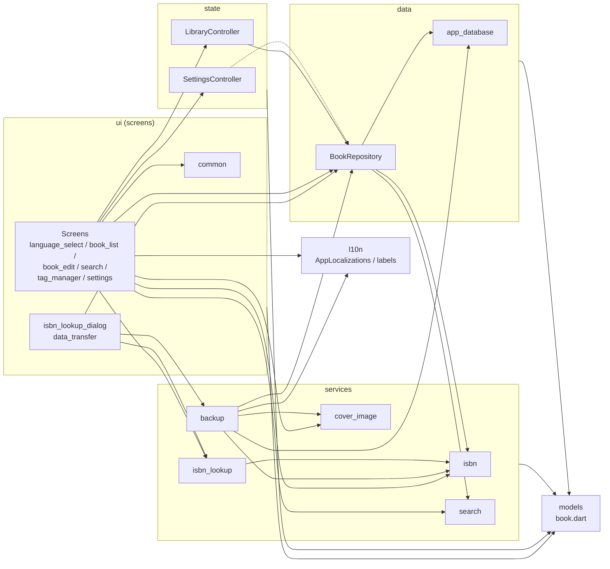
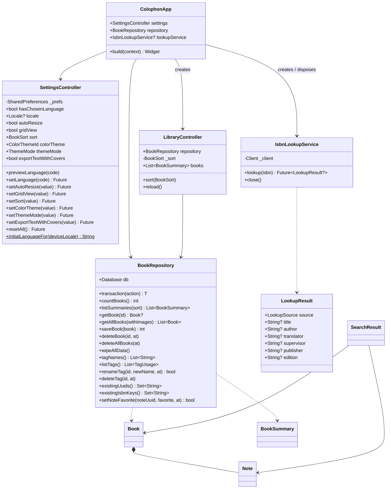
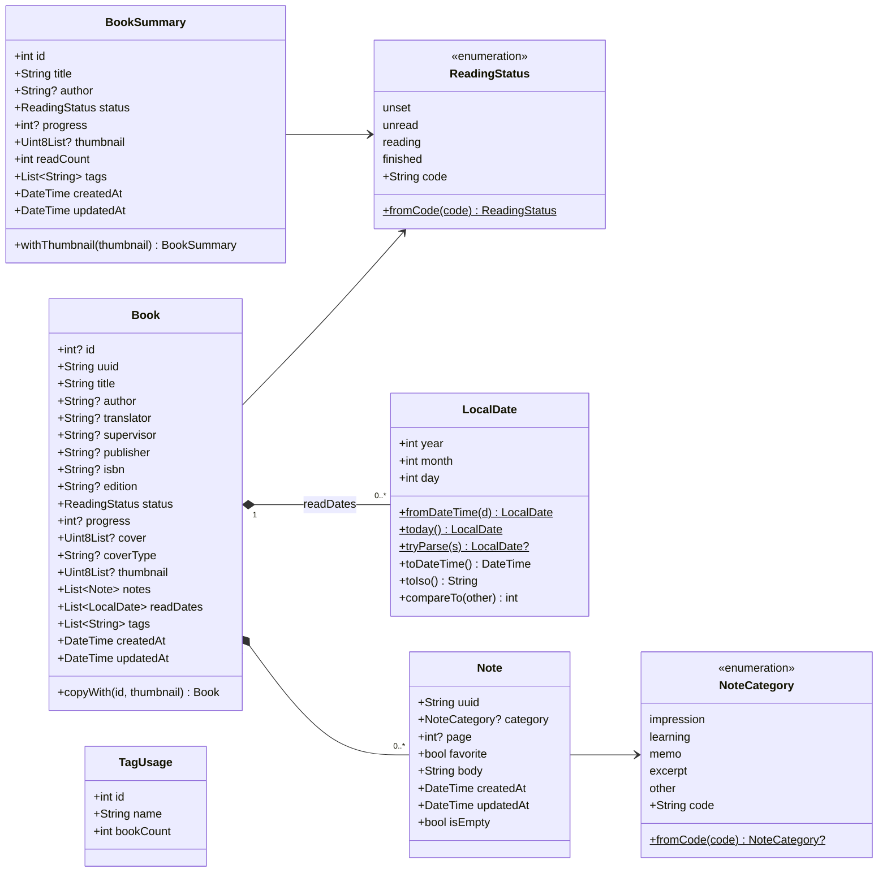
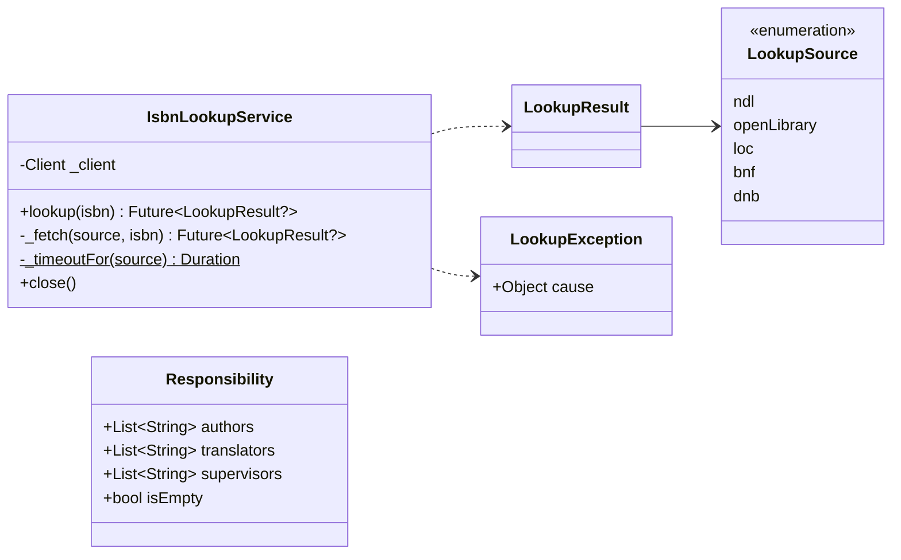
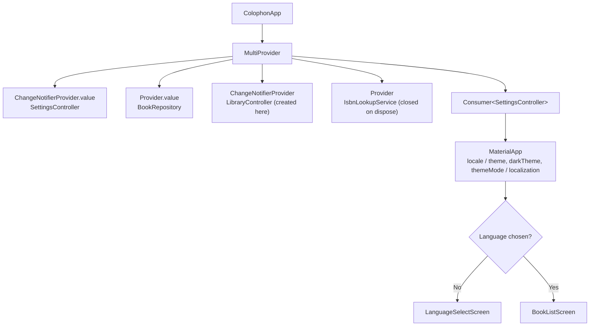
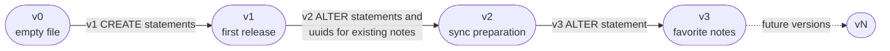
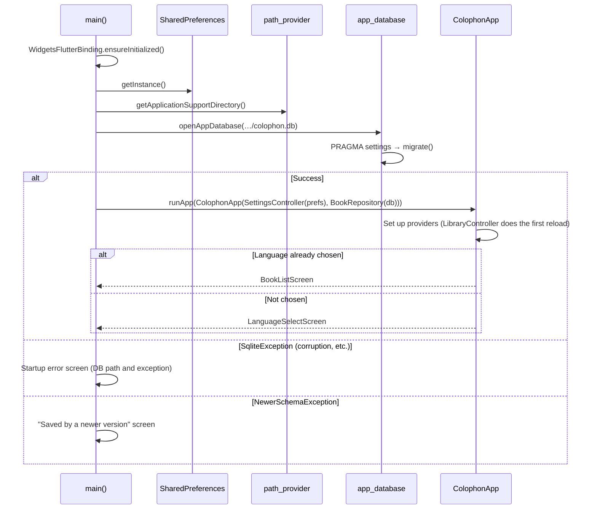
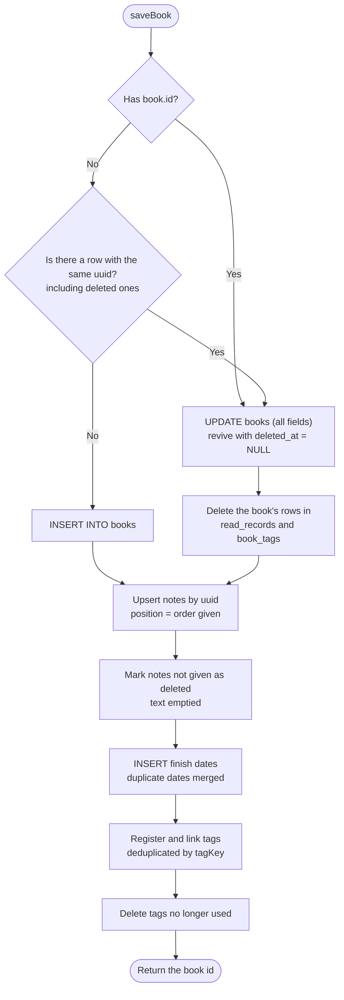

# Colophon Detailed Design

[日本語](detail-design.ja.md) | English

| Item | Details |
|---|---|
| Scope | Colophon 1.0.0 (DB schema v3 / export format v1) |
| Purpose of this document | Describes which classes, methods, and SQL implement the functions defined in the [Basic Design](basic-design.md) |
| Created | 2026-10-14 |

## Revision history

| Version | Date | Changes |
|---|---|---|
| 1.0 | 2026-10-14 | First edition |
| 1.1 | 2026-10-14 | Added color themes, the brightness setting, and status icons ([5.12](#512-color-themes)) |
| 1.2 | 2026-10-14 | Added the option to include covers in text export ([5.8](#58-export)) |
| 1.3 | 2026-10-14 | Changed ISBN lookup sources (removed Google Books; added Open Library, the Library of Congress, the Bibliothèque nationale de France, and the German National Library) ([5.6](#56-isbn-lookup)) |
| 1.4 | 2026-10-14 | Added favorite notes (schema v3, `setNoteFavorite`, search filter, ★ in text export) ([5.13](#513-favorite-notes)) |
| 1.5 | 2026-10-15 | Added a viewer mode for books ([5.14](#514-viewer-mode); registered books return to it after saving). Dates now include the year |
| 1.6 | 2026-10-15 | Added deleting all data and distribution packages for each OS ([5.15](#515-deleting-all-data-and-distribution-packages)) |
| 1.7 | 2026-10-15 | Added the app icon source and its output files ([5.15](#515-deleting-all-data-and-distribution-packages)) |

## Contents

1. [Implementation policy](#1-implementation-policy)
2. [Module structure](#2-module-structure)
3. [Class design](#3-class-design)
4. [Database design](#4-database-design)
5. [Process details](#5-process-details)
6. [Input validation](#6-input-validation)
7. [Messages](#7-messages)
8. [Error handling](#8-error-handling)
9. [Settings and constants](#9-settings-and-constants)
10. [Localization](#10-localization)
11. [Platform-specific settings](#11-platform-specific-settings)
12. [Test design](#12-test-design)

> Diagrams are written in Mermaid (see the top of the [Basic Design](basic-design.md) for how to view them).

---

## 1. Implementation policy

### 1.1 Technologies and packages

| Category | Name | Version (pubspec) | Purpose |
|---|---|---|---|
| Language / framework | Dart / Flutter | Dart ^3.13.5 (Flutter 3.47 or later) | |
| Database | `sqlite3` | ^3.7.1 | SQLite access (synchronous API). The native library is fetched automatically at build time |
| State management | `provider` | ^6.1.5 | Passing dependencies to screens and notifying changes |
| Settings storage | `shared_preferences` | ^2.5.6 | Per-device settings |
| Files | `file_picker` | ^13.1.0 | Open / save file dialogs |
| Images | `image` | ^4.12.0 | Decoding, resizing, JPEG/PNG conversion |
| ZIP | `archive` | ^4.5.2 | Creating and reading export ZIP files |
| HTTP | `http` | ^1.6.0 | ISBN lookup requests |
| XML | `xml` | ^7.1.0 | Parsing National Diet Library Search responses |
| Text normalization | `unorm_dart` | ^0.3.3 | NFKC normalization (treating full-/half-width as equal) |
| IDs | `uuid` | ^4.6.0 | Book and note IDs (UUID v4) |
| Others | `intl`, `path`, `path_provider`, `package_info_plus`, `flutter_localizations` | | Localization, path handling, storage location, version display |

### 1.2 Design rules

| Rule | Details | Reason |
|---|---|---|
| Dependency direction | `ui` → `state` → `data`, `ui` → `services` → `data`. `models` may be used anywhere. No reverse dependencies | So that business logic survives a rewrite of the screens |
| Synchronous DB access | Call the synchronous `sqlite3` API on the main isolate | Fast enough for a personal library (thousands of books) and simpler than async |
| Heavy work in isolates | Image processing and ZIP creation use `Isolate.run` | Keeps the UI responsive |
| One transaction per save | Saving one book, and an entire import, each run in a single transaction | No half-written data remains after a failure |
| Timestamps as UTC strings | Stored as ISO 8601 (e.g. `2026-10-14T03:00:00.000Z`) and converted to local time for display | Independent of the device's time zone |
| Finish dates are date-only | Handled as `LocalDate` (`yyyy-MM-dd`) without time or time zone | Keeps the meaning "finished on that day" |
| Store codes | Status and category are stored as English codes and translated for display | Switching the language does not affect the data |
| Mark deletions | Rows are kept and `deleted_at` is recorded | So that future sync can propagate deletions |

---

## 2. Module structure

### 2.1 Files

| Path | Main contents |
|---|---|
| `lib/main.dart` | Startup. Opens the DB and shows a startup error screen on failure |
| `lib/app.dart` | `ColophonApp`: provider setup, theme, language, choice of the first screen |
| `lib/models/book.dart` | `ReadingStatus`, `NoteCategory`, `LocalDate`, `Note`, `Book`, `BookSummary`, `TagUsage` |
| `lib/data/app_database.dart` | Schema definition, migration (`migrate`), connection setup |
| `lib/data/book_repository.dart` | `BookRepository` (reads and writes books, notes, finish dates, tags) |
| `lib/services/isbn.dart` | ISBN normalization, validation, and matching key |
| `lib/services/isbn_lookup.dart` | `IsbnLookupService`, response parsing, splitting the statement of responsibility |
| `lib/services/cover_image.dart` | Cover validation, reduction, format conversion, thumbnails |
| `lib/services/search.dart` | Search query, search process, text normalization, tag matching key |
| `lib/services/backup.dart` | Export (text, ZIP, SQLite) and import |
| `lib/state/settings_controller.dart` | `SettingsController` (per-device settings) and the list of supported languages |
| `lib/state/library_controller.dart` | `LibraryController` (state of the book list) |
| `lib/l10n/app_*.arb` | UI strings for 7 languages |
| `lib/l10n/app_localizations*.dart` | Code generated from the ARB files (do not edit by hand) |
| `lib/l10n/labels.dart` | Extension methods that turn codes into UI strings |
| `lib/ui/common.dart` | Shared widgets and helpers (confirmation dialog, progress dialog, cover, status badge, etc.) |
| `lib/ui/app_theme.dart` | Color themes (`buildTheme`), status colors (`StatusColors`), and status icons (`statusIcon`) |
| `lib/ui/language_select_screen.dart` | SC-01 Language selection |
| `lib/ui/book_list_screen.dart` | SC-02 Library |
| `lib/ui/book_edit_screen.dart` | SC-03 View / add / edit book (mode switch and edit mode) |
| `lib/ui/book_viewer.dart` | SC-03 viewer mode (`BookViewer`) |
| `lib/ui/isbn_lookup_dialog.dart` | SC-04 ISBN lookup result |
| `lib/ui/search_screen.dart` | SC-05 Search |
| `lib/ui/tag_manager_screen.dart` | SC-06 Tag manager |
| `lib/ui/settings_screen.dart` | SC-07 Settings |
| `lib/ui/data_transfer.dart` | SC-08 Export / SC-09 Import flows |
| `installer/` | Scripts and settings for building distribution packages (Windows, macOS, Linux; [5.15](#515-deleting-all-data-and-distribution-packages)) |

### 2.2 Dependencies



`settings -.-> repo` only refers to the sort-order type `BookSort`.

---

## 3. Class design

### 3.1 Overall class diagram



Processes implemented as top-level functions (`searchBooks`, `processCover`, `exportZip`, `applyImport`, etc.) are listed in the tables of each section.

### 3.2 Models (`lib/models/book.dart`)



| Class | Notes |
|---|---|
| `ReadingStatus.fromCode` | Unknown codes and null become `unset` |
| `NoteCategory.fromCode` | Unknown codes and null become null (no category) |
| `LocalDate.tryParse` | Returns null for anything other than `yyyy-MM-dd` and for non-existent dates (e.g. 2026-02-30) |
| `Note` | Generates a UUID v4 when `uuid` is omitted. `updatedAt` defaults to `createdAt` |
| `Note.isEmpty` | The text is blank and both category and page are null |
| `Book` | Fully immutable (final). `notes`, `readDates`, and `tags` default to empty lists |
| `Book.copyWith` | Replaces only `id` and `thumbnail` (used to regenerate thumbnails on import) |
| `BookSummary` | For the list view. Light, because it holds neither the cover image nor notes |

### 3.3 Data access

#### `lib/data/app_database.dart`

| Element | Details |
|---|---|
| `schemaVersion` | Current schema version (3) |
| `openAppDatabase(path)` | Opens the file and calls `prepareDatabase` |
| `openInMemoryDatabase()` | In-memory database (for tests) |
| `prepareDatabase(db)` | `PRAGMA foreign_keys = ON` and `PRAGMA busy_timeout = 3000`, then `migrate` |
| `readSchemaVersion(db)` | Returns `PRAGMA user_version` |
| `migrate(db, {target})` | Migrates step by step from the current version up to `target` (latest by default). Throws `NewerSchemaException` if the DB is newer |
| `NewerSchemaException` | A DB created by a newer app. It is not opened; the user is told why |

#### `BookRepository` (`lib/data/book_repository.dart`)

| Method | Behavior |
|---|---|
| `transaction(action)` | `BEGIN` … `COMMIT`; on an exception, `ROLLBACK` and rethrow. If a transaction is already open (`db.autocommit == false`), joins the outer one |
| `countBooks()` | Number of books that are not deleted |
| `listSummaries({sort})` | Books for the list. Read count via a subquery. Order: `recent` = `created_at DESC, id DESC`; `title` = `title COLLATE NOCASE, id` |
| `getBook(id)` | One book with related data, or null if deleted |
| `getAllBooks({withImages})` | All books with related data (`created_at, id` order). `withImages: false` skips covers and thumbnails (for search and text export) |
| `saveBook(book)` | Saves a book ([5.2](#52-saving-a-book)) |
| `deleteBook(id, {at})` | Marks a book as deleted ([5.3](#53-deleting-a-book)) |
| `deleteAllBooks({at})` | Marks every book as deleted |
| `wipeAllData()` | Physically deletes the rows of every table and compacts the file with `VACUUM` (no deletion markers remain). Used by "Delete all data" |
| `tagNames()` | Tag names (ordered by `name_key`) |
| `listTags()` | Tags with the number of books that have them |
| `renameTag(id, newName, {at})` | Returns false if another tag has the same `name_key`. Updates `updated_at` of books with the tag, then renames it |
| `deleteTag(id, {at})` | Updates `updated_at` of books with the tag, then deletes it (`book_tags` rows cascade) |
| `existingUuids()` | Set of uuids of books that are not deleted (for import duplicate checks) |
| `existingIsbnKeys()` | Set of ISBN matching keys of books that are not deleted |
| `setNoteFavorite(noteUuid, favorite, {at})` | Toggles one note's favorite and saves immediately, updating `updated_at` of the note and its book. Returns false if the note does not exist or is deleted ([5.13](#513-favorite-notes)) |

### 3.4 Services

#### `isbn.dart`

| Function | Behavior |
|---|---|
| `normalizeIsbn(input)` | NFKC normalization → remove spaces and hyphen variants (`- ‐ ‑ – — ― − ー`) → uppercase |
| `isValidIsbn(input)` | ISBN-10 (weights 10 to 1, sum divisible by 11, trailing X = 10) or ISBN-13 (alternating weights 1 and 3, sum divisible by 10) |
| `isbnMatchKey(input)` | For a valid ISBN, the ISBN-13 form; otherwise null |

#### `isbn_lookup.dart`



| Function | Behavior |
|---|---|
| `parseNdlResponse(xml)` | From the first `item`: title (`dc:title`, falling back to `title`) plus volume, statement of responsibility, publisher, and edition. Null if there is no `item` |
| `sourcesForIsbn(isbn)` | Returns the query order from the ISBN's country/language prefix ([5.6](#56-isbn-lookup)) |
| `requestUri(source, isbn)` | Request URL for each source |
| `parseOpenLibraryResponse(json, isbn)` | From the `ISBN:{isbn}` entry: title (`title: subtitle`), authors (joined with `, `), first publisher. Null if there is no entry |
| `parseDublinCoreResponse(xml, source)` | From the first record of an SRU response (Dublin Core) of the Library of Congress, BnF, or German National Library: title, authors, translators, publisher. Null if there is no record |
| `cleanCatalogTitle(raw)` | Removes " / author" and trailing punctuation from a catalog title |
| `cleanCatalogPublisher(raw, source)` | Removes the place of publication, keeping only the publisher name |
| `parseCatalogCreator(raw, source)` | Splits a catalog creator entry into a name and a role (`CreatorRole`: author, translator, other) and turns "Last, First" into "First Last" |
| `parseResponsibility(statement)` | Splits the statement of responsibility by role ([5.6](#56-isbn-lookup)) |

#### `cover_image.dart`

| Element | Details |
|---|---|
| `ProcessedCover` | `bytes`, `mimeType`, `thumbnail`, `width`, `height`, `resized` |
| `processCover(bytes, {autoResize})` | Runs `processCoverSync` with `Isolate.run` |
| `processCoverSync(bytes, {autoResize})` | Main cover processing ([5.5](#55-cover-processing)). Throws `CoverImageException` for unreadable images |
| `makeThumbnail(bytes)` | Creates only the thumbnail (for import, in an isolate). Null if unreadable |
| `mimeTypeOf(bytes)` | Detects jpg/png/gif/webp/bmp from the first bytes; null otherwise |
| `extensionOfMime(mime)` | File extension for export (`jpg` if unknown) |

#### `search.dart`

| Element | Details |
|---|---|
| `SearchField` | `title`, `author`, `translator`, `supervisor`, `publisher`, `isbn`, `notes` |
| `SearchQuery` | `text`, `fields` (all by default), `statuses`, `categories` (null means no category), `favoritesOnly` (favorite notes only), `tags`, `readFrom`, `readTo` |
| `SearchResult` | `book` and the matching `matchedNotes` |
| `normalizeForSearch(s)` | NFKC normalization → lowercase |
| `tagKey(name)` | Trims, then `normalizeForSearch`. Used for tag sameness and the DB column `name_key` |
| `searchBooks(books, query)` | The search itself ([5.7](#57-search)) |

#### `backup.dart`

| Element | Details |
|---|---|
| `backupFormatName` / `backupFormatVersion` / `backupJsonFileName` | `colophon` / `1` / `books.json` |
| `exportText(books, l, {now, coverPaths})` | Text format ([5.8](#58-export)). Passing `coverPaths` (uuid → path in the ZIP) adds a cover line |
| `exportTextWithCovers(books, l, {now})` | Text + covers ZIP (`colophon.txt` and `covers/`). The ZIP is built in an isolate |
| `coverFileName(number, book)` | File name of a cover image (`number_title.ext`) |
| `exportZip(books, {now})` / `exportZipInBackground(books)` | ZIP format (the latter runs in an isolate) |
| `exportSqlite(db)` | Writes to a temporary file with `VACUUM INTO` and returns the bytes |
| `readBackup(bytes)` | Detects the format from the first bytes and reads it ([5.9](#59-import)) |
| `readZipBackup(bytes)` / `readSqliteBackup(bytes)` | Readers for each format |
| `applyImport(repo, books, mode)` | Applies the books to the DB and returns `ImportResult(added, skipped)` |
| `InvalidBackupException` / `NewerBackupException` | Not Colophon data / newer format |
| `ImportMode` | `replace` (replace all) / `merge` (add) |

### 3.5 State

| Class | Holds | Notifies listeners when |
|---|---|---|
| `SettingsController` | Display language (saved value and in-progress preview), color theme (`ColorThemeId`), brightness (`ThemeMode`), automatic cover reduction, library view, sort order, whether text export includes covers | Each setter is called (before persisting) |
| `LibraryController` | Book list (`List<BookSummary>`) and sort order | `reload()` completes; `sort` changes |

`SettingsController.locale` returns the language being previewed during first-launch selection, and the saved language otherwise. `supportedLanguages` defines each supported language's code and its name in that language.

### 3.6 Screens (ui)

#### Provider setup



#### Screens and widgets

| Class | Kind | Main responsibility |
|---|---|---|
| `LanguageSelectScreen` | Stateful | Picks the initial choice from the device language, calls `previewLanguage` on each selection and `setLanguage` on Continue |
| `BookListScreen` | Stateless | List / grid switch, sorting, menu. Opens SC-03 via `openBookEditor` |
| `BookEditScreen` | Stateful | Views or edits one book (see the table below). Registered books open in viewer mode, new books in edit mode |
| `BookViewer` | Stateless | Viewer mode display. Takes the saved `Book` and shows only filled-in fields ([5.14](#514-viewer-mode)) |
| `_NoteDraft` | Internal class | One note being edited (uuid, category, favorite, page and text fields). `toNote(now)` updates `updatedAt` only when the content (including favorite) changed |
| `_NoteCard` | Stateless | Fields and move/delete buttons for one note. Keyed with `ObjectKey(_NoteDraft)` so state stays with the note when reordered |
| `_TagEditor` | Stateful | Tag input. Passes the parent's text field and focus node to `Autocomplete` |
| `showIsbnLookupDialog` | Function + Stateful | Returns a map of the fields to apply (`LookupField`) and their values |
| `SearchScreen` | Stateful | Holds all books (without images) and runs `searchBooks` when conditions change |
| `TagManagerScreen` | Stateful | Shows `listTags`; reloads it and the book list after renaming or deleting |
| `SettingsScreen` | Stateless | Changes settings. Color themes are chosen from `_ThemeSwatch` previews (primary color and status colors at the current brightness). The version comes from `PackageInfo` |
| `runExport` / `runImport` | Functions | Export and import flows ([5.8](#58-export), [5.9](#59-import)) |
| `deleteAllDataFlow` | Function | Two-step confirmation and execution of "Delete all data" ([5.15](#515-deleting-all-data-and-distribution-packages)) |
| `confirmDialog` / `showMessage` / `runWithProgress` | Functions | Confirmation dialog, snack bar message, async work with a progress dialog |
| `FavoriteButton` | Stateless | A note's favorite button (☆ / ★). Used in note fields on the edit screen and in search results |
| `CoverThumbnail` / `StatusBadge` / `ContentWidth` | Stateless | Cover (or placeholder), status badge (`StatusColors` colors + `statusIcon` icon + text), max content width on wide screens |

#### Internal state of `BookEditScreen`

| State | Type | Contents |
|---|---|---|
| `_title` etc. | 8 × `TextEditingController` | Title, author, translator, supervisor, publisher, ISBN, edition, progress |
| `_tagInput` / `_tagFocus` | Text field / focus node | The tag field (owned by the parent so that leftover text can be committed on save) |
| `_original` | `Book?` | The book before editing (null for a new book) |
| `_uuid` | `String` | The book's uuid (generated for a new book) |
| `_status`, `_cover`, `_coverType`, `_thumbnail` | | Status and cover |
| `_readDates`, `_tags`, `_notes` | Lists | Finish dates, tags, notes (`_NoteDraft`) |
| `_knownTags` | `List<String>` | Existing tags used as suggestions |
| `_dirty` | `bool` | Whether there are unsaved changes |
| `_viewMode` | `bool` | Whether in viewer mode (true when opening a registered book) |
| `_lifecycle` | `AppLifecycleListener` | Receives window-close requests |

---

## 4. Database design

### 4.1 Connection settings

| Setting | Value | Purpose |
|---|---|---|
| `PRAGMA foreign_keys` | ON | Enables foreign key constraints and cascading deletes |
| `PRAGMA busy_timeout` | 3000 (ms) | Do not fail immediately while another connection is writing |
| `PRAGMA user_version` | Schema version | Decides whether migration is needed |
| File | `colophon.db` in the app data folder | `getApplicationSupportDirectory()` from `path_provider` |

### 4.2 Table definitions

#### books

| Column | Type | NULL | Constraints / default | Contents |
|---|---|---|---|---|
| `id` | INTEGER | | PRIMARY KEY | Local sequence number |
| `uuid` | TEXT | No | UNIQUE | ID across devices (UUID v4) |
| `title` | TEXT | No | | Title |
| `author` | TEXT | Yes | | Author |
| `translator` | TEXT | Yes | | Translator |
| `supervisor` | TEXT | Yes | | Supervisor |
| `publisher` | TEXT | Yes | | Publisher |
| `isbn` | TEXT | Yes | | ISBN (as entered) |
| `edition` | TEXT | Yes | | Edition |
| `status` | TEXT | No | Default `'unset'`, CHECK (4 codes) | Status |
| `progress` | INTEGER | Yes | CHECK (0–100) | Progress |
| `cover` | BLOB | Yes | | Cover image |
| `cover_type` | TEXT | Yes | | MIME type of the cover |
| `thumbnail` | BLOB | Yes | | Reduced image for lists (JPEG) |
| `created_at` | TEXT | No | | Created (UTC) |
| `updated_at` | TEXT | No | | Updated (UTC) |
| `deleted_at` | TEXT | Yes | | Deleted (null while active) |

Empty optional fields are stored as NULL (`_blankToNull`). When the cover is null, `cover_type` and `thumbnail` are NULL too.

#### notes

| Column | Type | NULL | Constraints / default | Contents |
|---|---|---|---|---|
| `id` | INTEGER | | PRIMARY KEY | |
| `book_id` | INTEGER | No | FK → books(id) ON DELETE CASCADE | |
| `position` | INTEGER | No | | Display order (from 0) |
| `category` | TEXT | Yes | CHECK (5 codes) | Category (null means none) |
| `page` | INTEGER | Yes | CHECK (≥ 1) | Page |
| `favorite` | INTEGER | No | Default 0, CHECK (0 or 1) | Favorite (added in v3) |
| `body` | TEXT | No | | Text (empty string once deleted) |
| `created_at` | TEXT | No | | |
| `updated_at` | TEXT | No | | |
| `uuid` | TEXT | Yes (required in practice) | UNIQUE INDEX `notes_uuid` | ID across devices |
| `deleted_at` | TEXT | Yes | | Deleted |

#### read_records

| Column | Type | NULL | Constraints | Contents |
|---|---|---|---|---|
| `id` | INTEGER | | PRIMARY KEY | |
| `book_id` | INTEGER | No | FK → books(id) ON DELETE CASCADE | |
| `finished_on` | TEXT | No | | Finish date (`yyyy-MM-dd`) |

#### tags

| Column | Type | NULL | Constraints | Contents |
|---|---|---|---|---|
| `id` | INTEGER | | PRIMARY KEY | |
| `name` | TEXT | No | | Display name (the spelling registered first) |
| `name_key` | TEXT | No | UNIQUE | Matching key (`tagKey(name)`) |

#### book_tags

| Column | Type | NULL | Constraints |
|---|---|---|---|
| `book_id` | INTEGER | No | PK, FK → books(id) ON DELETE CASCADE |
| `tag_id` | INTEGER | No | PK, FK → tags(id) ON DELETE CASCADE |

#### Indexes

| Name | Target | Kind |
|---|---|---|
| `notes_book` | notes(book_id, position) | Regular |
| `read_records_book` | read_records(book_id) | Regular |
| `notes_uuid` | notes(uuid) | UNIQUE |

### 4.3 Schema migration



| Version | Contents |
|---|---|
| v1 | Creates the 5 tables and the indexes `notes_book` and `read_records_book` |
| v2 | Adds `books.deleted_at`, `notes.uuid`, and `notes.deleted_at`. Assigns UUID v4-formatted values to existing notes in SQL and creates `notes_uuid` |
| v3 | Adds `notes.favorite` (default 0). Existing notes become non-favorites |

- Each version's steps run in one transaction and end with `PRAGMA user_version = N`. On failure they roll back and the DB stays at the previous version.
- SQL of released versions is never rewritten. Changes are added as a new version in `_migrations`.
- If the DB's `user_version` is greater than the app's `schemaVersion`, `NewerSchemaException` is thrown (at startup: an explanation screen; on import: `NewerBackupException`).

### 4.4 Main SQL

**Saving notes (upsert by uuid)**

```sql
INSERT INTO notes (uuid, book_id, position, category, page, body, favorite, created_at, updated_at)
VALUES (?, ?, ?, ?, ?, ?, ?, ?, ?)
ON CONFLICT (uuid) DO UPDATE SET
  book_id = excluded.book_id, position = excluded.position, category = excluded.category,
  page = excluded.page, body = excluded.body, favorite = excluded.favorite,
  created_at = excluded.created_at, updated_at = excluded.updated_at, deleted_at = NULL;
```

**Marking removed notes as deleted**

```sql
UPDATE notes SET deleted_at = ?, updated_at = ?, body = ''
WHERE book_id = ? AND deleted_at IS NULL AND uuid NOT IN (?, ?, ...);
```

**Loading the list**

```sql
SELECT b.id, b.title, b.author, b.status, b.progress, b.thumbnail, b.created_at, b.updated_at,
       (SELECT COUNT(*) FROM read_records r WHERE r.book_id = b.id) AS read_count
FROM books b
WHERE b.deleted_at IS NULL
ORDER BY b.created_at DESC, b.id DESC;   -- title order: b.title COLLATE NOCASE ASC, b.id ASC
```

**Registering and linking tags**

```sql
INSERT OR IGNORE INTO tags (name, name_key) VALUES (?, ?);
INSERT OR IGNORE INTO book_tags (book_id, tag_id) SELECT ?, id FROM tags WHERE name_key = ?;
DELETE FROM tags WHERE id NOT IN (SELECT tag_id FROM book_tags);   -- tags no longer used
```

---

## 5. Process details

### 5.1 Startup



### 5.2 Saving a book

Steps of `BookEditScreen._save()`:

1. `Form.validate()` ([6. Input validation](#6-input-validation)). Stop if invalid.
2. `_commitPendingTag()`: adds the text left in the tag field unless a tag with the same `tagKey` exists.
3. Progress: the result of `int.tryParse` if it is 0–100, otherwise null (discards an out-of-range value left in the hidden field).
4. Notes: every `_NoteDraft.toNote(now)` that is not `isEmpty`.
5. Build the `Book` (`createdAt` keeps the original value, or now for a new book; `updatedAt` is now).
6. `BookRepository.saveBook`. On an exception, show "Something went wrong." and stay on the screen.
7. `LibraryController.reload()` and show "Saved.". A registered book switches to viewer mode with `_viewMode = true` (the screen stays open). A new book returns to the library with `_close()` (there is no viewer to return to, and this makes adding the next book easy).

Steps of `BookRepository.saveBook(book)` (all in one transaction):



### 5.3 Deleting a book

`deleteBook(id, {at})` (`at` defaults to now) runs in one transaction.

| Target | Processing |
|---|---|
| books | Set `deleted_at` and `updated_at` to `at`. Set `cover`, `cover_type`, `thumbnail` to NULL |
| notes | Set `deleted_at` and `updated_at` of active notes to `at`. Set `body` to an empty string |
| read_records / book_tags | Physically delete the book's rows (they are book attributes and will be sent with the book during sync) |
| tags | Delete tags no longer used |

### 5.4 Handling unsaved changes (edit screen)

| Mechanism | Details |
|---|---|
| Setting `_dirty` | Set to true by listeners on each text field (`_markDirty`) and by changes to the cover, status, finish dates, tags, and notes (`_change`) |
| Back within the app | `PopScope(canPop: !_dirty)`. When the pop is blocked, `_confirmLeave` asks whether to discard |
| Switching to the viewer | `_setViewMode(true)`. When `_dirty`, the user chooses "Save and view" (switch if `_saveBook` succeeds) / "Discard and view" (revert with `_load(_original)`) / "Cancel" |
| Closing the window | `AppLifecycleListener.onExitRequested` asks when `_dirty` and returns `AppExitResponse.cancel` or `exit` |
| After save / delete / discard | `_close()`: sets `_dirty = false`, rebuilds, and calls `Navigator.pop` on the next frame (because `canPop` takes effect only after the rebuild) |

### 5.5 Cover processing

`processCoverSync(bytes, autoResize)`:

| Step | Details |
|---|---|
| 1. Decode | `img.decodeImage`. Failure or exception → `CoverImageException` |
| 2. Fix orientation | `img.bakeOrientation` (applies the EXIF rotation to the pixels) |
| 3. Decide reduction | `autoResize` and (long side > 2000 px or size > 2 MB) |
| 4a. Reduce | If the long side exceeds 2000 px, resize it to 2000 px (`Interpolation.average`). Fill transparency with white and save as JPEG quality 85. `resized = true` |
| 4b. Uncommon format | If `mimeTypeOf` returns null, convert to PNG (with transparency) or JPEG quality 90 (without) |
| 4c. Keep | The original bytes with the detected MIME type |
| 5. Thumbnail | Reduce to a long side of at most 360 px, fill transparency with white, JPEG quality 80 |

### 5.6 ISBN lookup

**Query order (`sourcesForIsbn`)**: ISBN-10s are converted to ISBN-13 first; the order is decided by the leading digits.

| ISBN prefix | Order |
|---|---|
| `9784` | National Diet Library → Open Library |
| `9782`, `97910` | BnF → Open Library |
| `9783` | German National Library → Open Library |
| `9780`, `9781` | Open Library → Library of Congress |
| Others | National Diet Library → Open Library → Library of Congress |

This order is based on success rates measured in 2026-10 with 150 books in 6 languages sampled from national library catalogs (the National Diet Library plus the four other sources found 149 books; Google Books returned nothing because its keyless shared quota was exhausted).

`IsbnLookupService.lookup(isbn)`:


If nothing is found and some source failed, the result is `LookupException` ("check your connection") instead of null ("not found"), because the failed source might have had the book.

Requests carry the header `User-Agent: Colophon (https://github.com/colophonbooks)` (Open Library asks apps to identify themselves and a contact). Responses are decoded as UTF-8.
**Splitting the statement of responsibility (`parseResponsibility`)**

1. Split the statement on `, ， ; ；`.
2. Match each part as "name + space (or bracket) + role word". A role word without a preceding space or bracket is not treated as a role (so the final 文 of a name like 山田文 is not mistaken for a role).
3. Parts without a role word are held and assigned to the next role word that appears. Any parts still held at the end become authors.

| Role words | Assigned to |
|---|---|
| 著, 作, 文, 絵, 編, 編著, 著者, 原作, 原著 | Author |
| 訳, 翻訳, 共訳, 編訳, 訳・解説, 訳・注 | Translator |
| 監修, 監訳 | Supervisor |
| 解説, 注, 校注, 装丁, 装画, イラスト | Not used |

If there is no statement of responsibility, the `dc:creator` values become authors after removing life dates (e.g. `, 1959-`). Language notes appended to titles of foreign-language materials (such as " : [中国語]") are removed. Duplicate names are kept once. Names from the National Diet Library are joined with "、" and those from other sources with ", ".

**Normalizing catalog entries (Library of Congress, BnF, German National Library)**

| Item | BnF | German National Library | Library of Congress |
|---|---|---|---|
| Title (as given) | `Jaune : histoire d'une couleur / Michel Pastoureau` | `0 1 2 : Roman / Daniel Wisser` | `Art history /` |
| Title processing | Drop everything from the first " / ", then trailing punctuation (`/ : ; , .` and spaces) | Same | Same |
| Creator (as given) | `Pastoureau, Michel (1947-....). Auteur du texte` | `Liedtke, Rüdiger [Verfasser]` | `Stokstad, Marilyn, 1929-2016.` |
| Role extraction | After the last ". " | Trailing `[…]` | Trailing `, author.` etc. |
| Life dates | Drop the trailing `(…)` | — | Drop trailing `, 1929-2016` etc. |
| Publisher (as given) | `Points (Paris)` | `München : Luchterhand Literaturverlag` | `Upper Saddle River, NJ : Pearson/Prentice Hall,` |
| Publisher processing | Drop the trailing `(place)` | After the last " : " | Same |

- A name split into two by a comma ("Last, First") is reordered to "First Last" (`Pastoureau, Michel` → `Michel Pastoureau`).
- A trailing period is removed, except after an initial (the `N.` in `Yuval N.`).

| Role (as given) | Assigned to |
|---|---|
| Traducteur, Traductrice, Übersetzer, Übersetzerin, translator | Translator |
| Auteur du texte, Auteur, Verfasser, Verfasserin, author, editor, Herausgeber, Herausgeberin, Directeur de publication, Éditeur scientifique, compiler, or no role | Author |
| Anything else (Illustrator, Illustrateur, Préfacier, etc.) | Other (used as authors only when there is no author at all, e.g. picture books) |

### 5.7 Search

| Item | Details |
|---|---|
| Loading the search data | When `SearchScreen` opens and when returning from an edit screen opened from a result, loads `getAllBooks(withImages: false)` and `tagNames()` |
| When to search | 200 ms after the last keystroke for keywords; immediately for other conditions |
| Normalization | Both keywords and target text go through `normalizeForSearch` (NFKC + lowercase). Keywords are split on whitespace |
| Book filters | Status (any of), tags (compared by `tagKey`; all required), finish date (any finish date within the range, inclusive) |
| Filtering by category or favorite | Notes of the selected categories (all if none selected) and, with favorites only, with `favorite` set: all of them if there are no keywords; otherwise (when note text is a search target) those containing every word. Returns books with at least one such note |
| Without a category | No keywords → every book passing the filters. With keywords → books where each word appears in the concatenated selected book fields or in some note's text. Notes containing any word are attached |
| ISBN matching | Besides the concatenated book fields, compares the ISBN with hyphens etc. removed against the similarly normalized word |
| Display | Thumbnails of result books are looked up by id in `LibraryController.books` |

### 5.8 Export

Flow of `runExport(context)`: if there are no books, explain and stop → choose a format (the "Include covers (saved as a ZIP)" checkbox under Text is saved immediately to `SettingsController.exportTextWithCovers` and shown the same way next time) → build the data with a progress dialog → `FilePicker.saveFile` (default file name `colophon-yyyyMMdd-HHmm.{txt|zip|sqlite}`) → when saved, show "Exported.". Any exception while building or saving shows "Export failed.".

| Format | How it is built |
|---|---|
| Text | `getAllBooks(withImages: false)` → `exportText` → UTF-8 |
| Text + covers | `getAllBooks()` → `exportTextWithCovers`. For each book with a cover, `coverFileName` decides the file name; the image is stored uncompressed under `covers/` and its path is written in the text. Extension `.zip` |
| ZIP | `getAllBooks()` → `exportZipInBackground` (with a progress dialog). Covers are stored uncompressed (`CompressionType.none`); `books.json` uses deflate, with 2-space JSON indentation |
| SQLite | `exportSqlite(db)`: `VACUUM INTO` a temporary folder → read → delete the folder. Includes rows marked as deleted |

**Text format example** (display language: English)

```text
Colophon export (2026-10-14 12:00)
1 book

========================================
[001] Sapiens: A Brief History of Humankind
========================================
Cover: covers/001_Sapiens_ A Brief History of Humankind.jpg
Author: Yuval Noah Harari
ISBN: 978-0-06-231609-7
Status: Reading (40%)
Finished reading on: 2025-05-05
Tags: History
Added: 2026-01-02 12:04
Updated: 2026-10-14 11:58

[Notes]
- ★ [Learnings] p.30
  The Cognitive Revolution was the turning point
```

Only fields with values are written. Each book gets a sequence number (at least 3 digits, more for larger libraries). The "Cover" line appears only when covers are included, and only for books that have one. Progress is added only while Reading and when a value exists. Times are shown in the device's local time.

**Cover file names (`coverFileName`)**

| Rule | Example |
|---|---|
| `{number}_{title}.{ext}`; the extension follows the image format (`extensionOfMime`) | `001_Dune.jpg` |
| `\ / : * ? " < > \|` and control characters become `_` | `A/B: C?` → `002_A_B_ C_.png` |
| Runs of whitespace become one space; leading and trailing spaces are removed | |
| Titles are cut to 60 characters | |
| Trailing periods and spaces are removed (Windows does not allow them) | `end...` → `003_end.jpg` |
| If the title becomes empty, only the number is used | `...` → `004.jpg` |

Because every book has a different number, books with the same title never get the same file name.

### 5.9 Import

**Format detection (`readBackup`)**

| First bytes | Result |
|---|---|
| `SQLite format 3\0` | SQLite → `readSqliteBackup` |
| `PK\x03\x04` | ZIP → `readZipBackup` |
| Anything else | `InvalidBackupException` |

**ZIP validation and normalization (`readZipBackup`)**

| Target | When invalid |
|---|---|
| Not a readable ZIP, no `books.json`, not valid JSON | `InvalidBackupException` |
| `format` is not `colophon`, `books` is not an array, `version` is not an integer | `InvalidBackupException` |
| `version` is newer than the current format | `NewerBackupException` |
| A book's `title` is empty or not a string | Skip that book |
| No `uuid` | Assign a new UUID |
| Unknown `status` code | `unset` |
| `progress` is not an integer 0–100 | null |
| The `cover` file is missing or its image format cannot be detected | No cover |
| Invalid dates in `readDates` | Drop those dates |
| A note's `page` is not an integer ≥ 1 / unknown `category` | null |
| A note has no `uuid` | Assign a new UUID |
| A note's `favorite` is not `true` (including missing) | Not a favorite |
| A note whose text, category, and page are all empty | Drop it |
| Unreadable timestamps | The book's `createdAt` becomes now; others fall back to the book's `createdAt` |

Books with a cover get a regenerated thumbnail (`makeThumbnail`).

**Reading SQLite (`readSqliteBackup`)**: copies the bytes to a temporary folder and opens them. If there is no `books` table or `user_version` is below 1, throws `InvalidBackupException`. Migrates the temporary copy to the current schema with `prepareDatabase`, then reads it with `getAllBooks()` (a newer version throws `NewerBackupException`). Regenerates missing thumbnails. Finally deletes the temporary folder.

**Applying (`applyImport`)**: performs the checks in section [8.5 of the Basic Design](basic-design.md#85-import) in one transaction. Each book is passed to `saveBook` as a `Book` without an `id`; a deleted book with the same uuid is revived.

Screen-side flow of `runImport(context)`: choose a file (`zip`/`sqlite`/`sqlite3`/`db`) → `readBackup` with a progress dialog → show the count and choose a method (neither is selectable for 0 books) → confirm if replacing while 1 or more books exist → `applyImport` → `LibraryController.reload()` → show the result.

### 5.10 Reloading the list

`LibraryController.reload()` calls `listSummaries` and, for books whose **id and `updatedAt` are unchanged** from the previous list, reuses the previous thumbnail bytes (the same object). `Image.memory` looks up its image cache by the identity of the byte list, so creating a new list every time would decode every cover again.

### 5.11 Tag input

| Action | Behavior |
|---|---|
| Type text | Suggests existing tags that partially match via `normalizeForSearch` and are not yet attached |
| Choose a suggestion with ↑/↓ and press Enter | Adds the chosen suggestion (when `_navigated` is true, `Autocomplete`'s own submit is used) |
| Press Enter without choosing | Adds the typed text as is (does nothing if a tag with the same `tagKey` is already attached) |
| Click a suggestion | Adds that suggestion |
| Save with text left in the field | The leftover text is committed as a tag on save |

### 5.12 Color themes

`buildTheme(id, brightness)` creates a `ThemeData` holding a `ColorScheme` and `StatusColors` (a `ThemeExtension`). `MaterialApp` receives a light version (`theme`) and a dark version (`darkTheme`) and switches between them with `themeMode`.

| Theme (`ColorThemeId`) | How the `ColorScheme` is built | Status colors |
|---|---|---|
| `leather` (default) | `ColorScheme.fromSeed` (`#7B5536`, `tonalSpot`) | From the scheme (below) |
| `forest` | Same (`#2F6B4F`) | From the scheme |
| `ocean` | Same (`#1F4E79`) | From the scheme |
| `rose` | Same (`#8E3B5E`) | From the scheme |
| `monochrome` | `fromSeed` (`#808080`, `DynamicSchemeVariant.monochrome`). The four error colors, which stay red even in this variant, are replaced with grays | Fixed (table below) |
| `universal` | `fromSeed` (`#005AFF` = blue from the CUD recommended palette, `DynamicSchemeVariant.fidelity`: uses the seed almost unchanged as the primary color) | Fixed (table below) |

"From the scheme" means: Not set = `surfaceContainerHighest` / `onSurfaceVariant`, Unread = `secondaryContainer`, Reading = `primaryContainer`, Finished = `tertiaryContainer` (text uses the matching `on…` color).

**Fixed status colors** (background / text)

| Theme, brightness | Not set | Unread | Reading | Finished |
|---|---|---|---|---|
| Monochrome, light | `#F2F2F2` / `#303030` | `#B3B3B3` / `#000000` | `#737373` / `#FFFFFF` | `#1E1E1E` / `#FFFFFF` |
| Monochrome, dark | `#2C2C2C` / `#E0E0E0` | `#5E5E5E` / `#FFFFFF` | `#9E9E9E` / `#000000` | `#EDEDED` / `#000000` |
| Universal, light | `#E6E6E6` / `#333333` | `#4DC4FF` / `#00205C` | `#F6AA00` / `#2B1A00` | `#005AFF` / `#FFFFFF` |
| Universal, dark | `#3A3A3A` / `#E6E6E6` | `#0B3D91` / `#DDEEFF` | `#F6AA00` / `#1A1000` | `#4DC4FF` / `#001A33` |

The Universal colors `#005AFF` (blue), `#4DC4FF` (sky blue), and `#F6AA00` (orange) come from the Color Universal Design recommended palette. Blue versus orange keeps a hue difference under protan, deutan, and tritan vision, and the colors also differ in lightness.

**Status icons** (`statusIcon`): Not set = `radio_button_unchecked`, Unread = `book_outlined`, Reading = `bookmark`, Finished = `check_circle`. Used in the list's status badge, the status selector on the edit screen, search filters, and theme previews.

**Verification** (`test/theme_test.dart`)

| Check | Method | Criterion |
|---|---|---|
| Contrast | For every theme × brightness, compute with the WCAG 2.x formula the ratios of `onSurface`/`surface`, `onSurfaceVariant`/`surface`, `onPrimary`/`primary`, `onPrimaryContainer`/`primaryContainer`, `onError`/`error`, `error`/`surface`, and each status's text/background | 4.5 or more |
| Monochrome | Whether the main `ColorScheme` colors and status colors have R = G = B | All gray |
| Distinguishability across color vision | Convert the Monochrome and Universal status backgrounds for normal vision and for protan, deutan, and tritan vision (Machado et al. 2009 matrices, severity 1.0), then compute the CIELAB color difference (CIE76) for every pair | ΔE 20 or more |
### 5.13 Favorite notes

| Where | Behavior | When it is saved |
|---|---|---|
| Note fields on the edit screen (`FavoriteButton` in `_NoteCard`) | Toggles `_NoteDraft.favorite`, treated as an unsaved change | On Save (`saveBook`'s upsert writes `favorite`) |
| Notes in search results (`FavoriteButton` in `_ResultTile`) | Calls `BookRepository.setNoteFavorite` and reloads the search data | Immediately |

- Toggling from search results updates `updated_at` of the note and its book (so future sync can propagate the change).
- Un-starring a note while filtering by "Favorite notes only" removes it from the results (it no longer matches after the reload).
- Text export prefixes the heading of each favorite note with "★" (the same symbol in every display language). JSON stores `favorite` (boolean); SQLite contains `notes.favorite` as is.
- An empty note with only the favorite mark (no text, category, or page) is not saved, like any other empty note.
### 5.14 Viewer mode

| Item | Details |
|---|---|
| Initial mode | In `BookEditScreen.initState`, `_viewMode = true` for a registered book, false for a new one |
| Switching | `SegmentedButton<bool>` (View / Edit) in the app bar. Not shown when adding a new book. Viewer mode shows no Delete or Save button, and Ctrl+S does nothing (the body is replaced by `BookViewer`) |
| Content shown | Always the saved `_original`; edit-mode field contents are not used |
| Unsaved changes | "Save and view" runs `_saveBook()` (validate → save → `_load(saved book)`, without closing the screen); on a validation error the screen stays in edit mode. "Discard and view" reverts the fields and notes (recreating `_NoteDraft`s) with `_load(_original)` |
| Save button | Save in edit mode (Ctrl+S / ⌘S) runs `_saveBook()`, then returns to viewer mode for a registered book, or to the library for a new book |

`BookViewer` display rules:

- Bibliographic fields are shown only when non-empty after `trim()`. Label in `bodySmall`, value in `bodyMedium`, on one line (`Text.rich`).
- Finish dates, tags, and notes are omitted together with their headings when empty.
- A note's caption joins its category (`category` in `labels.dart`) and page (`p.N`) with " · ". Notes with neither show only the text. Favorites show ★ at the right of the caption row (an `Icon` only, no action).
- The whole view is wrapped in `SelectionArea` so text can be selected and copied.
### 5.15 Deleting all data and distribution packages

**Delete all data (`deleteAllDataFlow`)**

1. An explanation dialog (showing the number of books). Choose "Cancel", "Export first" (`runExport`), or "Continue to delete".
2. A final confirmation dialog. "Delete everything" cannot be pressed until "I understand that deleted data cannot be restored" is checked.
3. Execution: return to the first screen with `Navigator.popUntil(isFirst)` → `BookRepository.wipeAllData()` → `LibraryController.reload()` → `SettingsController.resetAll()` (`SharedPreferences.clear()` and back to defaults; the display language becomes unset, so the language selection screen appears).

Deletion markers (for sync) are physically removed too. The database file itself remains, empty, so the app can keep running; deleting the file is left to uninstallation.

**Distribution packages** (how to build: [BUILDING.md](../../BUILDING.md))

| OS | Format | Files | Library on uninstall |
|---|---|---|---|
| Windows | Inno Setup installer (per user, no administrator rights; bundles the VC++ runtime DLLs) | `installer/windows/colophon.iss`, `build-installer.ps1`, `Languages/ChineseSimplified.isl` | `CurUninstallStepChanged` (`usPostUninstall`) asks; "Yes" deletes `%APPDATA%\colophonbooks\Colophon`. Default "No". Kept on silent uninstall |
| macOS | .dmg (`hdiutil`) | `installer/macos/build-dmg.sh`, `UNINSTALL.txt` | Kept (how macOS works). Instructions are included |
| Linux | Flatpak (`org.freedesktop.Platform`) | `installer/linux/io.github.colophonbooks.colophon.yml`, `build-flatpak.sh` | Deleted with `flatpak uninstall --delete-data` |
| Linux | .deb (`dpkg-deb`) | `installer/linux/build-deb.sh` | Kept (Debian policy) |

Both Linux formats share the desktop entry (`.desktop`), the AppStream metadata (`.metainfo.xml`), and the icons (`installer/linux/icons/hicolor/`).

**App icon**

The source is `tool/icon/generate.mjs`, which defines the artwork and colors. Running it writes the files below (steps in [BUILDING.md](../../BUILDING.md)). The generated files are committed too, so building the app does not need Node.js.

| Output | Sizes (px) | Plate margin |
|---|---|---|
| `windows/runner/resources/app_icon.ico` (PNG-compressed entries; also used by the installer) | 16, 20, 24, 32, 40, 48, 64, 256 | Tight (the plate fills about 95% of the frame) |
| `macos/Runner/Assets.xcassets/AppIcon.appiconset/app_icon_*.png` | 16, 32, 64, 128, 256, 512, 1024 | macOS standard (824 of 1024). A shadow under the plate at 64 and above |
| `installer/linux/icons/hicolor/<size>/apps/io.github.colophonbooks.colophon.png` and `scalable/apps/….svg` | 16, 24, 32, 48, 64, 128, 256, 512, and SVG | Tight at 32 and below; macOS standard (no shadow) from 48 |

Detail is reduced with size. Everything is drawn at 96 px and above. At 48–64 px the folded corner of the tab is omitted. At 40 px and below the bands and the shelf are omitted too, because they blur into mud.
---

## 6. Input validation

| Screen | Field | Rule | Message key on error |
|---|---|---|---|
| SC-03 | Title | At least 1 character after trimming | `titleRequired` |
| SC-03 | Progress | Empty, or an integer 0–100 (non-digits cannot be typed) | `progressInvalid` |
| SC-03 | Note page | Empty, or an integer ≥ 1 (non-digits cannot be typed) | `pageInvalid` |
| SC-03 | ISBN | Empty, or a valid ISBN. Saving is allowed even if invalid (warning only) | `isbnInvalidWarning` (warning) |
| SC-03 | Fetch from ISBN | Must be a valid ISBN | `isbnLookupInvalid` |
| SC-06 | Tag name | Not empty, and not the same `tagKey` as another tag | `tagNameRequired`, `tagExists` |

---

## 7. Messages

Main messages (keys from `lib/l10n/app_en.arb`; English text shown).

| Key | Kind | Text (English) | When shown |
|---|---|---|---|
| `saved` | Info | Saved. | After saving a book |
| `coverResized` | Info | The image was reduced to {width} × {height} px. | When a cover was reduced automatically |
| `coverLoadFailed` | Error | This image could not be read. | Image cannot be read as a cover |
| `lookupNotFound` | Info | No book was found for this ISBN. | ISBN lookup found nothing |
| `lookupFailed` | Error | Could not fetch the details. … | ISBN lookup found nothing and some source had a network error |
| `exportDone` / `exportFailed` / `exportEmpty` | Info / error / info | Exported. / Export failed. / There are no books to export. | Export completed, failed, or no books |
| `importDone` | Info | Import finished. Added: {added} / Skipped: {skipped} | After import |
| `importInvalidFile` / `importNewerVersion` / `importFailed` | Error | Not Colophon data / created by a newer version / cannot be imported | Import failures |
| `genericError` | Error | Something went wrong. | Unexpected error while saving |
| `deleteBookConfirm` / `deleteNoteConfirm` / `deleteTagConfirm` / `importReplaceConfirm` / `unsavedBody` | Confirmation | Delete "…"? etc. | Before irreversible actions |
| `askAddReadDateBody` | Confirmation | Add today ({date}) as a date you finished this book? | When the status changes to Finished |

---

## 8. Error handling

| Exception / situation | Raised in | Handled in | Shown to the user |
|---|---|---|---|
| `NewerSchemaException` | `migrate` (startup) | `main` | "Saved by a newer version" screen |
| `SqliteException` | `openAppDatabase` (startup) | `main` | Startup error screen with the DB path and exception |
| Exception while saving | `saveBook` | `BookEditScreen._save` | `genericError`; the screen stays open |
| `CoverImageException` | `processCoverSync` | `BookEditScreen._pickCover` | `coverLoadFailed` |
| `LookupException` | `IsbnLookupService.lookup` | `BookEditScreen._lookupIsbn` | `lookupFailed` |
| `InvalidBackupException` | `readBackup` and friends | `runImport` | `importInvalidFile` |
| `NewerBackupException` | `readBackup` and friends | `runImport` | `importNewerVersion` |
| Other exceptions | Reading / applying | `runImport` | `importFailed` (changes already rolled back) |
| Exceptions | Building / saving an export | `runExport` | `exportFailed` |
| User cancels | File open / save dialogs | Each caller | Nothing |

Expected business situations (not found, invalid input, duplicates, etc.) are not exceptions; they are returned as values (null, false, the counts in `ImportResult`). After asynchronous work, code checks `mounted` (`context.mounted`) before touching the UI.

---

## 9. Settings and constants

### 9.1 Device settings (shared_preferences)

| Key | Type | Default | Contents |
|---|---|---|---|
| `language` | String | None (first-launch language selection is shown) | Display language code (`en`/`ja`/`zh`/`fr`/`es`/`de`/`ko`) |
| `autoResizeCover` | bool | true | Automatic cover reduction |
| `gridView` | bool | false | Whether to show the cover grid |
| `sort` | String | `recent` | Sort order (`recent`/`title`) |
| `colorTheme` | String | `leather` | Color theme (`leather`/`forest`/`ocean`/`rose`/`monochrome`/`universal`) |
| `themeMode` | String | `system` | Brightness (`system`/`light`/`dark`) |
| `exportTextWithCovers` | bool | false | Whether text export includes covers (last choice) |

### 9.2 Constants

| Name | Value | Location |
|---|---|---|
| `schemaVersion` | 3 | `app_database.dart` |
| `backupFormatVersion` | 1 | `backup.dart` |
| `coverMaxSide` | 2000 (px) | `cover_image.dart` |
| `coverMaxBytes` | 2,097,152 (2 MB) | `cover_image.dart` |
| `thumbnailSide` | 360 (px) | `cover_image.dart` |
| JPEG quality | Reduction 85 / conversion 90 / thumbnail 80 | `cover_image.dart` |
| ISBN lookup timeout | 15 seconds for the National Diet Library, 10 seconds for others | `isbn_lookup.dart` |
| Search typing delay | 200 ms | `search_screen.dart` |
| `busy_timeout` | 3000 ms | `app_database.dart` |
| Date picker range | 1900-01-01 to 2200-12-31 | `common.dart` |
| Max cover grid cell width | 170 px | `book_list_screen.dart` |
| Max content width | 760 px (960 px for the list and search) | `common.dart` etc. |
| Color theme seed colors | See [5.12](#512-color-themes) | `app_theme.dart` |
| Initial window size (Windows) | 1100 × 800 | `windows/runner/main.cpp` |

---

## 10. Localization

| Item | Details |
|---|---|
| Mechanism | Flutter `gen-l10n`. `l10n.yaml` sets `arb-dir: lib/l10n`, template `app_en.arb`, `nullable-getter: false` |
| Languages | `en` (template), `ja`, `zh` (Simplified), `fr`, `es`, `de`, `ko` |
| Generated code | `lib/l10n/app_localizations.dart` and per-language files (generated automatically by `flutter pub get` / `run` / `build`) |
| Plurals | ICU format (e.g. `{count, plural, =1{1 book} other{{count} books}}`). Japanese, Chinese, and Korean use only `other` |
| Strings for codes | Extension methods `status`, `category`, `searchField`, `sourceName` in `labels.dart` |
| Date display | `formatDate` (`common.dart`) = `intl`'s `DateFormat.yMMMd` (display-language format, including the year, e.g. Mar 1, 2025 / 2025年3月1日). `MaterialLocalizations.formatMediumDate` is not used because it omits the year |
| Adding a language | Add an ARB file and one line to `supportedLanguages` |

---

## 11. Platform-specific settings

| OS | File | Setting |
|---|---|---|
| All | — | Identifier `io.github.colophonbooks.colophon`, display name `Colophon` |
| Windows | `windows/runner/Runner.rc` | CompanyName `colophonbooks`, ProductName `Colophon` (these decide the data folder `%APPDATA%\colophonbooks\Colophon`) |
| Windows | `windows/runner/main.cpp` | Window title `Colophon`, initial size 1100 × 800 |
| macOS | `macos/Runner/Configs/AppInfo.xcconfig` | `PRODUCT_NAME`, `PRODUCT_BUNDLE_IDENTIFIER` |
| macOS | `macos/Runner/*.entitlements` | `com.apple.security.network.client` (ISBN lookup), `com.apple.security.files.user-selected.read-write` (choosing and saving files) |
| Linux | `linux/CMakeLists.txt`, `my_application.cc` | `APPLICATION_ID`, window title |
| Android | `android/app/build.gradle.kts`, `AndroidManifest.xml` | `namespace` and `applicationId`, `android.permission.INTERNET`, label |
| iOS | `ios/Runner.xcodeproj`, `Info.plist` | Bundle ID, display name |

---

## 12. Test design

Run with `flutter test` (153 tests as of 2026-10-15). Tests that use the database use in-memory SQLite (`openInMemoryDatabase`).

| File | Target | Main checks |
|---|---|---|
| `test/isbn_test.dart` | `isbn.dart` | ISBN-10/13 validation, full-width digits and hyphens, X, matching key (null for invalid ISBNs) |
| `test/repository_test.dart` | `BookRepository`, migration | Save and load, replacement of related data, deduplication, sort orders, deletion markers, revival, note IDs, tag management (including non-ASCII sameness), update time on tag changes, rollback of nested transactions, v1→v2 and v2→v3 migrations, rejecting newer versions, favorite notes (saving, immediate toggle, deleted notes excluded) |
| `test/search_test.dart` | `searchBooks` | Case and width insensitivity, multi-word AND (across book fields and notes), search fields, ISBN hyphens, note categories (including none), favorites (combined with categories), status, tags (AND, full-width), finish date range |
| `test/backup_test.dart` | `backup.dart` | ZIP layout, ZIP and SQLite round trips preserving every field, rejecting invalid files and newer formats, normalizing invalid values, text format (Japanese, English, sequence numbers, ★ for favorites), layout of the text + covers ZIP, cover file name rules, replace and add rules, deletion markers and revival |
| `test/cover_image_test.dart` | `cover_image.dart` | Reduction conditions (2000 px, 2 MB), reduction turned off, thumbnail size, TIFF conversion, non-image data |
| `test/isbn_lookup_test.dart` | `isbn_lookup.dart` | Query order by prefix, parsing real responses (2026-10) from every source (National Diet Library, Open Library, Library of Congress, BnF, German National Library), splitting the statement of responsibility and catalog creator entries, source fallback (`MockClient`), distinguishing network errors from "not found", User-Agent |
| `test/theme_test.dart` | `app_theme.dart` | Contrast ratios for every theme × brightness, Monochrome uses only grays, status colors distinguishable under color-vision simulation, no duplicate icons ([5.12](#512-color-themes)) |
| `test/widget_test.dart` | Screens | First-launch language selection, adding a book with only a title and the required check, saving with leftover tag text and an out-of-range progress value, when progress % is shown, switching views, switching and saving color theme and brightness, remembering "Include covers" for export, toggling favorites on the edit screen and in search results, viewer mode (initial mode, no empty fields or editing controls, ★ does not toggle, save / discard / cancel when switching, returning to the viewer after saving, staying in edit mode on validation errors, dates with the year), discard confirmation for unsaved changes |
| `test/settings_test.dart` | `SettingsController` | Defaults, saving and reloading every setting, resetting everything (`resetAll`), starting with corrupted saved values |
| `test/helpers.dart` | — | Creating a test DB and sample books |
