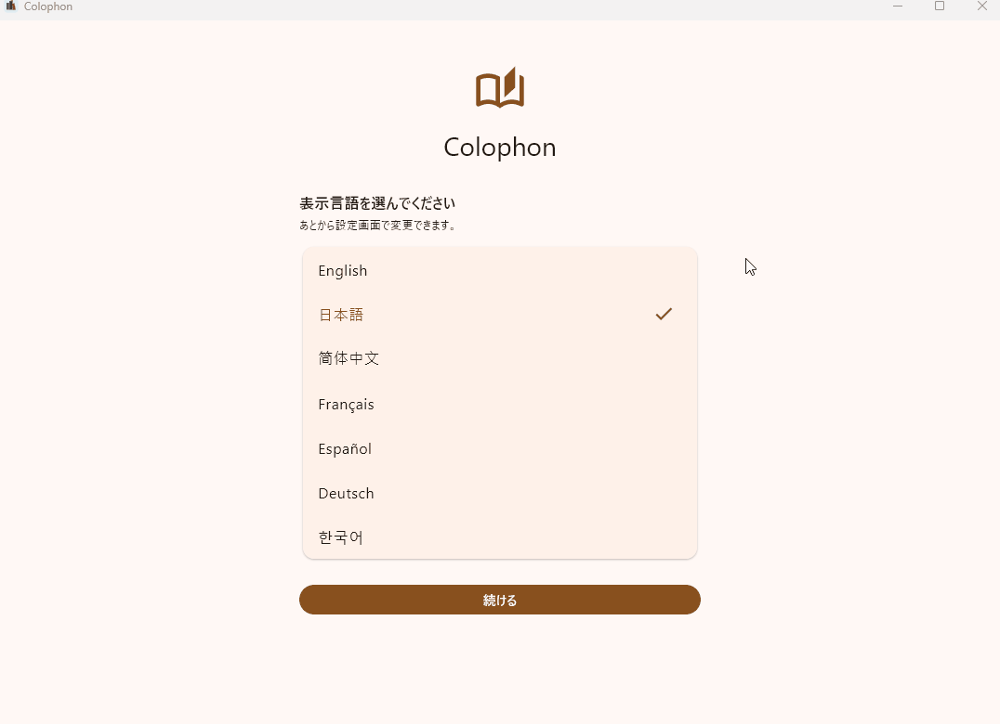
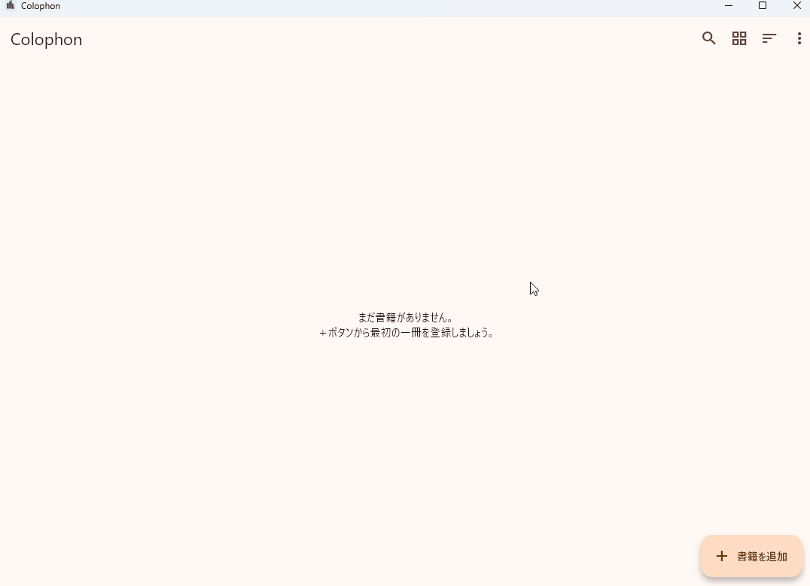
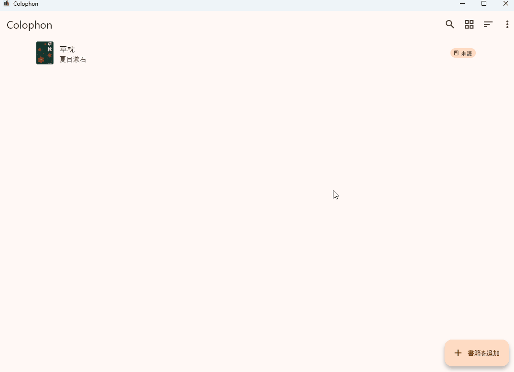
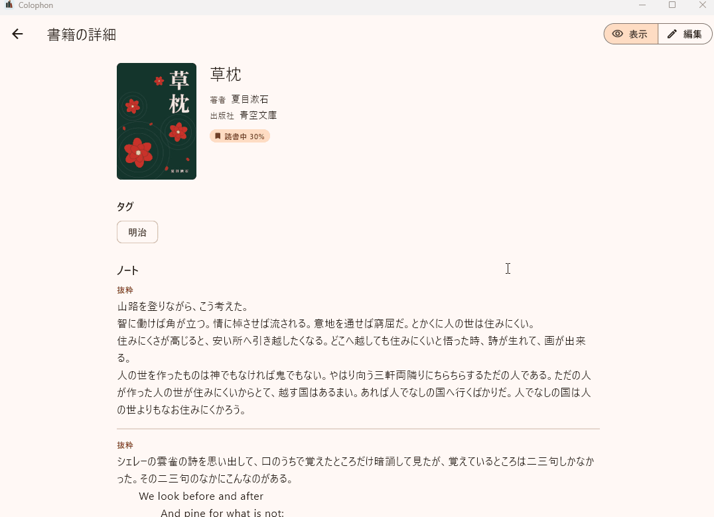
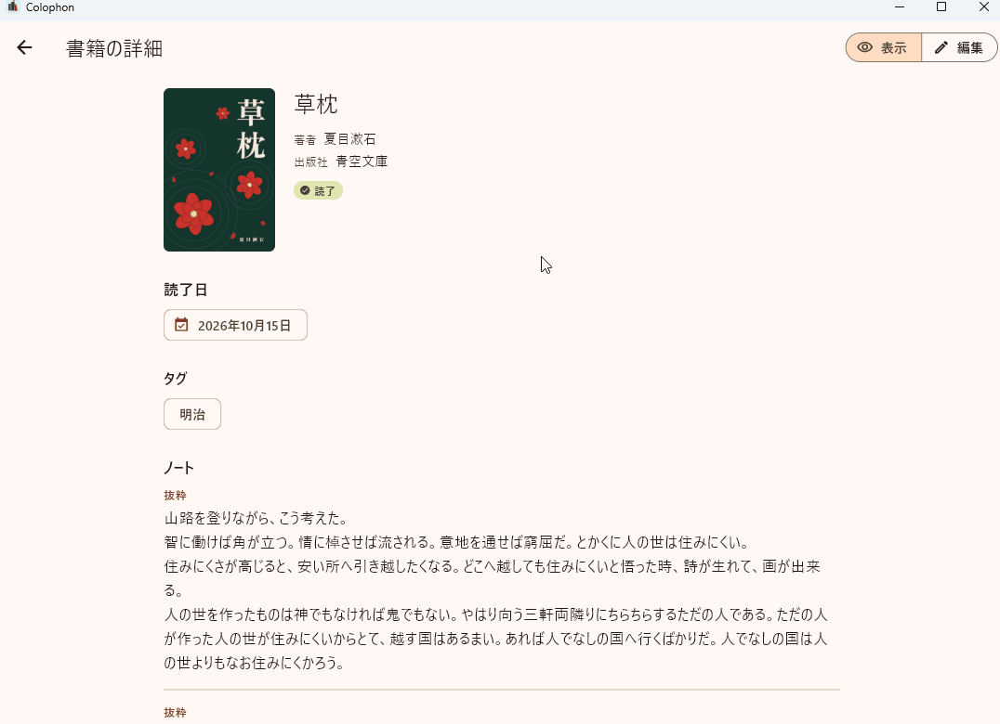
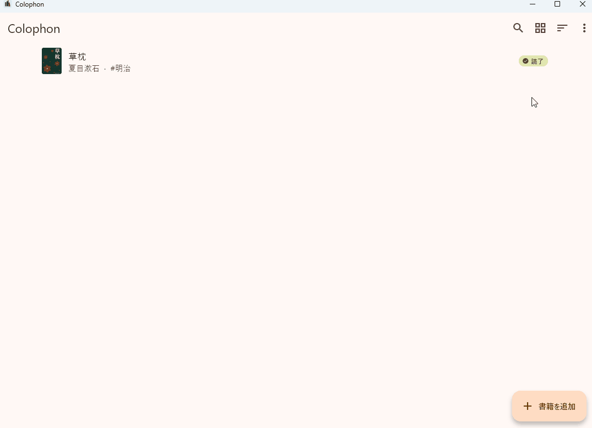

# Colophon の使い方

Colophon（コロフォン）は、本好きのための書籍管理アプリです。持っている本を登録し、読書の状況、読了日、タグ、ノート（感想・学び・メモ・抜粋）を記録できます。

このページでは、Windows 版の画面で基本的な使い方を紹介します。macOS 版・Linux 版も、操作はほぼ同じです。

> 画面の例に使っている本は、青空文庫で公開されている夏目漱石『草枕』です。書影の画像は、説明のために作成したものです。

## 目次

1. [インストールする](#1-インストールする)
2. [表示言語を選ぶ](#2-表示言語を選ぶ)
3. [本を登録する](#3-本を登録する)
4. [読書中の記録を付ける（ステータス・タグ・ノート）](#4-読書中の記録を付けるステータスタグノート)
5. [読み終えたら記録する](#5-読み終えたら記録する)
6. [ノートにお気に入りを付ける](#6-ノートにお気に入りを付ける)
7. [一覧の表示・タグの管理・設定](#7-一覧の表示タグの管理設定)
8. [本とノートを検索する](#8-本とノートを検索する)
9. [そのほかの機能](#9-そのほかの機能)

---

## 1. インストールする

1. [リリースのページ](https://github.com/colophonbooks/colophon/releases/latest)から `Colophon-Setup-<版>.exe` をダウンロードします。
2. ダウンロードしたファイルを開きます。
3. 「**Windows によって PC が保護されました**」と表示されたら、「**詳細情報**」を押してから「**実行**」を押します。
   Colophon のインストーラーには電子署名をしていないため、この画面が表示されます。
4. 使用許諾契約書（MIT ライセンス）を確認して「**同意する**」を選び、「**次へ**」で進めて、インストールを完了します。

インストール先は、ログインしているユーザー専用のフォルダです。管理者の権限は必要ありません。

## 2. 表示言語を選ぶ

初めて起動すると、表示言語を選ぶ画面が表示されます。使う言語を選んで「**続ける**」を押してください。

表示言語は、あとから設定画面で変更できます。

## 3. 本を登録する

1. 一覧画面の右下にある「**書籍を追加**」を押します。
2. 書影を設定する場合は「**画像を選択**」を押し、画像ファイルを選びます。
3. 「**書籍名**」（必須）、「**著者**」、「**出版社**」などを入力します。
4. 「**ステータス**」で、未設定・未読・読書中・読了のいずれかを選びます。
5. 右上の「**保存**」を押します。

> **ヒント：ISBN から書籍情報を取得する**
> 「ISBN」欄に ISBN を入力し、欄の右にある地球と虫めがねの形のボタンを押すと、図書館などのデータから書籍名・著者・出版社などを取得できます。取得した内容は、反映する項目を選んでから入力欄に取り込めます。

## 4. 読書中の記録を付ける（ステータス・タグ・ノート）

登録した本は、一覧から選ぶと「**表示**」（見る専用）の画面で開きます。内容を変えるときは、右上の「**編集**」に切り替えます。

1. 「**ステータス**」を「**読書中**」にすると、「**読んだ割合（%）**」を入力できます（任意）。
2. 「**タグ**」欄にタグ名を入力して Enter キーを押すと、タグが付きます。1冊に複数付けられます。
3. 「**ノートを追加**」を押すと、ノートが1件増えます。
   - 「**分類**」は、感想・学び・メモ・抜粋・その他から選びます（選ばなくても構いません）。
   - 「**ページ**」は任意です。
   - 「**本文**」に、感想や抜き書きなどを書きます。
4. 「**保存**」を押すと、「表示」の画面に戻ります。

ノートは何件でも追加できます。ノートの右上にある矢印のボタンで並べ替え、ごみ箱のボタンで削除できます。

## 5. 読み終えたら記録する

1. 本を開いて「**編集**」に切り替えます。
2. 「**ステータス**」を「**読了**」にします。
3. 「**読了日を記録しますか？**」と聞かれたら「**追加**」を押すと、今日の日付が読了日に記録されます。
4. 「**保存**」を押します。

別の日付を記録したいときは、「**読了日**」の「**日付を追加**」から選べます。同じ本を何度読んでも、そのたびに読了日を追加できます。

## 6. ノートにお気に入りを付ける

1. 本を開いて「**編集**」に切り替えます。
2. ノートの右上にある ☆ ボタンを押すと ★ になり、お気に入りになります。もう一度押すと外れます。
3. 「**保存**」を押します。

「表示」の画面では、お気に入りのノートに ★ が表示されます。検索画面では、お気に入りのノートだけに絞り込めます（[8. 本とノートを検索する](#8-本とノートを検索する)）。

## 7. 一覧の表示・タグの管理・設定

一覧画面の右上のボタンで、次の操作ができます。

| ボタン | できること |
|---|---|
| 四角が並んだボタン | 書籍名の一覧と、書影の一覧を切り替える |
| 横線が並んだボタン（並び替え） | 「登録日の新しい順」か「書籍名順」に並べ替える |
| 「︙」（メニュー）→「**タグの管理**」 | タグの名前を変える・タグを削除する |
| 「︙」（メニュー）→「**設定**」 | 表示言語、配色テーマ、明るさ、書影の自動縮小などを変える |

配色テーマは6種類（レザー・フォレスト・オーシャン・ローズ・モノクロ・ユニバーサル）から選べます。「ユニバーサル」は、色覚の違いにかかわらず見分けやすい配色です。

## 8. 本とノートを検索する

1. 一覧画面の右上にある虫めがねのボタンを押します。
2. 上の欄に言葉を入力すると、書籍名・著者・ノートの本文などから検索します。
3. 「**検索条件**」を開くと、次の条件で絞り込めます。
   - **検索対象**：書籍名、著者、翻訳者、監修、出版社、ISBN、ノート本文
   - **ステータス**
   - **ノートの分類**
   - **お気に入りのノートだけ**
   - **タグ**（選んだタグをすべて持つ書籍）
   - **読了日の期間**
4. 条件を元に戻すときは「**条件をクリア**」を押します。

ノートで絞り込んだときは、条件に合うノートが書籍の下に表示されます。検索結果のノートの ☆ を押して、その場でお気に入りを切り替えることもできます。

## 9. そのほかの機能

| 機能 | 場所 | 内容 |
|---|---|---|
| エクスポート | 「︙」→「**エクスポート**」 | 登録した本をファイルに書き出します。形式は「テキスト」（読む用）、「JSON＋画像（ZIP）」、「SQLite データベース」から選べます |
| インポート | 「︙」→「**インポート**」 | エクスポートした ZIP または SQLite ファイルから、本を戻します。「すべて置き換える」か「追加する」を選べます |
| すべてのデータを削除 | 「設定」→「**データ**」 | 書籍・ノート・設定をすべて削除して、最初の状態に戻します（二段階の確認があります） |

パソコンを買い替えるときや、念のためのバックアップには、「JSON＋画像（ZIP）」でのエクスポートをおすすめします。

### アンインストールする

Windows の「設定」→「アプリ」から Colophon をアンインストールします。最後に「Colophon の書籍データ（書籍・ノート・タグ・設定）も削除しますか？」と聞かれます。

- 「いいえ」（既定）を選ぶと、書籍データは残ります。再インストールすると、続きから使えます。
- 「はい」を選ぶと、書籍データも削除されます。
